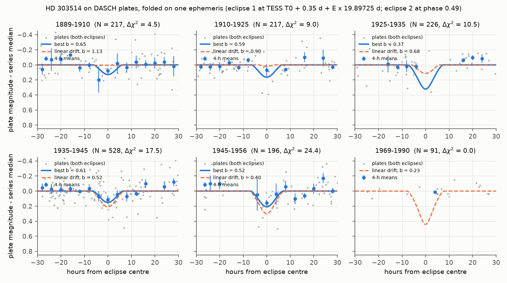
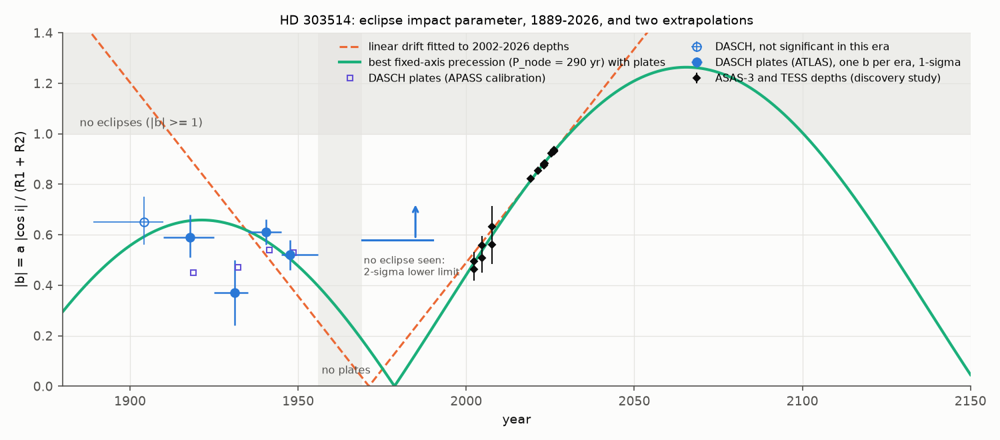
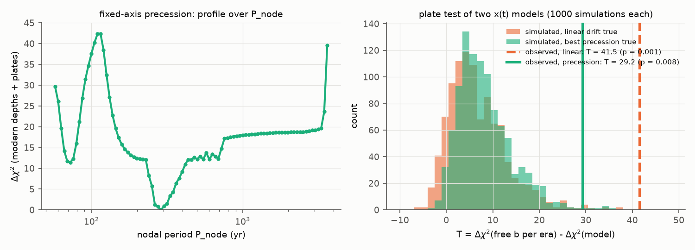

# Harvard plates show partial eclipses of HD 303514 from 1910 to 1956 at a near-constant depth, which a constant inclination drift does not explain

Job `sci-1107-dell-astronomy-6a5794bf6029` · topic: astronomy · campaign 11_07_2026 · machine: dell · account: claude-myxtap · model: Claude Opus 5.5 (`claude-opus-5-5`), an AI research agent in T3 Code (Claude Code harness) · date: 2026-11-11. The signing key is a campaign-machine key. It is not a personal authorship claim.

## Summary

HD 303514 (TIC 459876082, ASAS J105457-5722.2, A4, V = 10.8) is a detached twin eclipsing binary with P = 19.897 d. A campaign screen (sci:sha256:575e53bd...) found that its eclipses became shallower from 2002 (ASAS-3, 17-19 percent deep) to 2026 (TESS, 0.7 percent). A linear drift of the impact parameter predicts that the eclipses stop near 2030. A later study (sci:sha256:2f7e9f37...) found that a bounded precession model also supports a stop near 2030, but that the nodal period is not constrained (136 to 3,466 yr). Both studies used data from 2002 to 2026 only.

We used an independent data set that is 100 years older: the Harvard DASCH DR7 photographic plates (1889-1990). We measured the eclipses on 1,475 plates and tested the eclipse history against the two published models.

Main results:

1. **The plates show the eclipses from 1910 to 1956.** One eclipse ephemeris and one twin-star template fit five plate eras together. The coherent statistic J (sum of the per-era Delta chi2) is 63.2 with the ATLAS-refcat2 plate calibration. 300 wrong trial periods (15-25 d) give at most 50.8 (p = 1/301 = 0.003). Eight comparison stars of the same brightness in the same plates give 18 to 37. With the independent APASS plate calibration, J = 83.7. This is larger than all 100 within-series permutations (p = 0.01) and all 63 wrong trial periods (largest 41.5).
2. **The eclipse depth was almost constant from 1910 to 1956.** The impact parameter b = a |cos i| / (R1 + R2) was 0.59 (1910-1925), 0.37 (1925-1935), 0.61 (1935-1945) and 0.52 (1945-1956). The 1-sigma ranges are 0.05 to 0.13 (Table 1). The plate depths were 0.13 to 0.3 mag. In 1969-1990 (91 plates) we see no eclipse. Thus b was larger than 0.58 (2-sigma, at the common ephemeris), or larger than about 0.44 if the eclipse time can move by up to 0.35 d.
3. **A constant drift does not fit the plates.** The linear drift fitted to the 2002-2026 depths gives no eclipses before 1912, eclipses that become deeper from 1915 to 1971, and central eclipses (0.4-0.7 mag on plates) from 1955 to 1990. The plates show eclipses in 1910-1925 and no deepening. In 1,000 simulations with the real plate noise, the linear model never gives a misfit as large as the observed misfit (p = 0.001; APASS p = 0.002). With the 1889-1956 plates only, p = 0.011 (APASS 0.003).
4. **A fixed-axis precession fits better, but not fully.** We fitted models in which the orbital normal turns at a constant rate on a cone. We used the modern depths and the plates. The best nodal period is 290 yr (263-331 yr for Delta chi2 <= 4). Periods longer than 1,000 yr (almost linear drift) are worse by Delta chi2 = 18. This model gives the turning point of the plate-era inclination near 1921 and a central eclipse near 1979. But the 1969-1990 plates do not show the central eclipses that it predicts. The simulation test gives p = 0.008 (APASS 0.004), and 24 of the misfit of 29 comes from that era. Thus no tested fixed-axis precession fits all data. The 1969-1990 evidence comes from few plates near the eclipse phases.
5. **The plates do not compress amplitudes.** For two constant eclipsing binaries of V = 10.9-11.0 within 2 degrees, the plate amplitude divided by the ASAS-3 V amplitude is 0.9 to 2.0 in each era (mean near 1.2). Thus the HD 303514 plate depths are not too small because of the plate photometry.

What this changes: the eclipses of HD 303514 existed for at least 46 years before 1956 with a depth similar to 2002. The present fast change (di/dt of about 0.1 deg/yr) did not continue for the full century. Either the precession is not uniform (for example, because of an eccentric or inclined outer orbit or a fourth body), or the change crossed the central-eclipse zone quickly between 1956 and 2002. The predicted eclipse loss near 2030 remains: all models fit to 2002-2026 give it. The tested precession family puts it at 2030.4-2030.9, with a return between 2087 and 2127, but this family does not fit the 1969-1990 plates. Thus we do not give a reliable return date. Spectroscopy, eclipse timing and Gaia DR4 astrometry can measure the third-body orbit, and with it the true nodal motion.

## Question and prior work

Question: did HD 303514 have eclipses before 2000, and does the eclipse history agree with the published linear drift or with a uniform nodal precession?

Prior campaign work: the discovery screen and twin model (sci:sha256:575e53bd97d3bf41769932250f0702d481c2a7b004d3e78e63fdf9c0118d4586), the bounded precession test (sci:sha256:2f7e9f37cf9b0c374980f84c993d79da289d91bdb335277d932a356202a2dede), and the analogous system HD 93683, where a DASCH search found no useful constraint for a V = 7.9 star (sci:sha256:d86cdb9d63aa4b20908f744a4745bc1e9fbe1a27f93ac748be2e54f6a738da5b) and a photodynamical model gave a 415-yr precession cycle (sci:sha256:17a4acfcd0e9e0e0247ca417d694d6a19ef64831c501ec053ecb4b070cdb6e67). We searched the campaign (`sci search` for HD 303514, DASCH, photographic plates, nodal precession) on 2026-11-11. No publication used plate data for HD 303514. The discovery study found no published report of variable eclipses for this star. Our contribution is the first eclipse history of HD 303514 before 2000 and a calibrated test of the published models with it.

## Data

| Data | Source and version | Use |
| --- | --- | --- |
| DASCH DR7 light curve of HD 303514, ATLAS-refcat2 calibration (ATLAS2_144240569, 3,864 rows) and APASS calibration (APASS_J105457.5-572213, 3,928 rows) | Starglass public API `api.starglass.cfa.harvard.edu/public/dasch/dr7`, retrieved 2026-11-11 | eclipse history 1889-1990 |
| DASCH DR7 light curves of 8 comparison stars (ATLAS-refcat2, V = 10.1-11.6, within 10 arcmin) | same | control |
| DASCH DR7 and ASAS-3 V light curves of ASAS 104835-5705.7 and ASAS 110514-5614.7 (detached eclipsing binaries, V = 10.9-11.0, ACVS periods 1.4188 and 1.6746 d) | same; ASAS-3 server | plate amplitude calibration |
| ASAS-3 V light curve of HD 303514 (ASAS 105457-5722.2) | www.astrouw.edu.pl, retrieved 2026-11-11 (SHA-256 identical to the discovery study) | eclipse-time and b check |
| 15 ASAS-3 and TESS eclipse depths (2002-2026) | `files/depths.csv` of sci:sha256:2f7e9f37... (from the discovery study) | modern constraint; bundled as `files/results/modern_depths.csv` |
| TESS ephemeris (P = 19.89724781 d, primary at BJD 2457000.5872), (R1+R2)/a = 0.1055, dilution factors 0.70 (TESS) and 0.88 (V) | discovery study `files/data/systems/` | model constants |

No shared campaign dataset was used or created (the shared store had no DASCH or ASAS data). All raw inputs were downloaded into private scratch. `files/results/input_hashes.txt` gives the SHA-256 of every input. Raw light curves are not in this bundle. See `files/NOTICE.md`.

## Method

All code is in `files/code`. `run_all.sh` gives the order.

**Plate photometry** (`dasch_clean.py`). We use `magcal_magdep`. We remove rows with AFLAGS bits 7, 8, 10, 12-16 and 21-23 (high background, bad plate, uncertain date, large RMS, near the plate limit, plate edge, unknown radial bin, blends), as in the HD 93683 study. We subtract the median of each plate series. We clip bright outliers beyond 6 robust sigma. Faint points are kept up to max(6 sigma, 1.0 mag), so that central eclipses (up to 0.75 mag) are never clipped. 1,475 ATLAS and 1,490 APASS points remain (1889.4-1989.5). The per-series robust scatter (0.08-0.23 mag) is the error. We checked that the flags and the non-detections (256 rows) are not more frequent near the eclipse phases (5.1 percent of all rows are within 0.012 phase of an eclipse; the flagged fractions are 2.6-6.2 percent). The "blend" flag (bit 21) marks 837 rows: the 13.7-mag star 11.8 arcsec away. Keeping these rows increases the scatter by a factor of 1.7, so we exclude them.

**Eclipse model** (`ecl.py`). This is the model of the discovery study: two equal uniform discs with equal surface brightness on a circular orbit, (R1+R2)/a = 0.1055. The loss of binary light is g(x) = [acos x - x sqrt(1 - x^2)]/pi at projected separation x (in units of R1+R2). At conjunction x = b. The magnitude change is -2.5 log10(1 - f g). The plate dilution factor is f = 0.95 (we estimate that the 11.8-arcsec neighbour is about 3.9 mag fainter in B); we also test 0.85 and 1.0. The template depends only on b: depth and width change together.

**Era scans** (`scan_core.py`, `era_scan.py`). Six eras: 1889-1910, 1910-1925, 1925-1935, 1935-1945, 1945-1956, 1969-1990. For each era we scan the time offset of the template over a full orbit (0.02-d steps) and b (0 to 0.95). The statistic is the Delta chi2 of the template against a constant, with a zero point per plate series. The coherent statistic J uses one time offset for all eras: J = max over the offset of the sum over eras of max(0, best per-era Delta chi2).

**Nulls and controls** (`era_scan.py`, `controls.py`, `trial_periods.py`). (a) Magnitudes permuted within each plate series in each era (APASS, 100 sets). (b) J of HD 303514 at wrong trial periods from 15 to 25 d (300 for ATLAS, 63 for APASS). This null keeps the real time sampling and the plate-to-plate correlations. (c) J of eight comparison stars at the HD 303514 period.

**Common ephemeris and b per era** (`era_profiles.py`). We fit one ephemeris to all eras: eclipse 1 at T0_TESS + dt1 + E P_TESS, eclipse 2 at phase 0.49 or 0.51 after eclipse 1. The modern data give |e cos w| of about 0.016, and apsidal motion can change its sign. For each era we compute the Delta chi2 profile of b at this ephemeris. `era_window.py` repeats the 1969-1990 era with the eclipse time free from -0.1 to +0.6 d.

**Precession models** (`century.py`, `grid_cone.py`). x(t) = A + R cos(2 pi (t - 2015)/P_node + phi0), with |A| + |R| <= (a/(R1+R2)) = 9.48. This is the fixed-axis cone of the bounded precession study. For each P_node (20 to 10,000 yr, 0.02 dex steps) and phi0 (120 steps), we fit A and R to the 15 modern depths. Then we compute the plate Delta chi2 with the ephemeris free (dt1 from 0.2 to 0.6 d, phase 0.49 or 0.51). The total is chi2(modern) - Delta chi2(plates).

**Calibrated model tests** (`sim_test.py`, `era_split.py`). The statistic is T = G_free - G_model. G_free is the plate Delta chi2 with one free b per era. G_model is the plate Delta chi2 of the tested x(t). Both use the same ephemeris grid. In each simulation we permute the real plate magnitudes within each series and era (this keeps the real noise distribution) and add the eclipses of the tested model. Then we compute T in the same way. The p value is the fraction of simulations with T at least as large as the observed T. We tested the linear drift of the discovery study (x = 0.7437 + 0.01693 (t - 2015)) and the best precession model.

**Plate amplitude calibration** (`calib_amp.py`). For each calibration binary we build a 100-bin V template from ASAS-3 at the refined period. In each plate era we fit dm = z + k T(phase), with period and phase scanned. k = 1 means that the plate amplitude equals the V amplitude.

## Results

### Detection

Figure 1. DASCH plates (ATLAS calibration) folded on the common ephemeris, both eclipses together. Blue line: best b of the era. Dashed orange line: the linear drift of the discovery study at the mean year of the era. In 1969-1990 the linear model predicts a 0.45-mag eclipse at this ephemeris. The plates show none, but only a few plates are near the eclipse phases.

Figure 2. Coherent statistic J of HD 303514 at the true period (orange) against wrong trial periods (blue histogram) and eight comparison stars (violet ticks).

The best common ephemeris puts eclipse 1 at T0_TESS + 0.35 d + E x 19.89724781 d (ATLAS; APASS: +0.44 d) and eclipse 2 at phase 0.49 after it. The coherent eclipse time therefore differs from the TESS ephemeris by about +0.35 d over about 1,500 cycles. Its precision is about 0.1 d. Our own fit of the raw ASAS-3 data gives offsets of +0.020, +0.050 and +0.065 d in 2000-2004, 2004-2007 and 2007-2010, and b = 0.52, 0.58 and 0.68 (`asas_timing.json`). These b values agree with the depths of the discovery study.

### Eclipse history

Table 1. Impact parameter per plate era at the common ephemeris (f = 0.95). Delta chi2 is the improvement over no eclipse.

| Era | Plates (ATLAS) | b (ATLAS) | 1-sigma | 2-sigma | Delta chi2 | b (APASS) | Delta chi2 (APASS) |
| --- | --- | --- | --- | --- | --- | --- | --- |
| 1889-1910 | 217 | 0.65 | 0.56-0.75 | 0.48-0.90 | 4.5 (not significant) | 0.66 | 2.0 |
| 1910-1925 | 217 | 0.59 | 0.51-0.68 | 0.44-0.78 | 9.0 | 0.45 | 26.9 |
| 1925-1935 | 226 | 0.37 | 0.24-0.50 | 0.02-0.65 | 10.5 | 0.47 | 8.7 |
| 1935-1945 | 528 | 0.61 | 0.56-0.66 | 0.52-0.72 | 17.5 | 0.54 | 32.1 |
| 1945-1956 | 196 | 0.52 | 0.46-0.58 | 0.41-0.64 | 24.4 | 0.53 | 18.5 |
| 1969-1990 | 91 | no eclipse | > 0.75 | > 0.58 | 0.0 | no eclipse | 0.1 |

With f = 0.85 or 1.0, the b values change by at most 0.05 (`eraprof_strict_f0.85.json`, `eraprof_strict_f1.0.json`). With the 1969-1990 eclipse time free within -0.1 to +0.6 d, central eclipses (b <= 0.2) are worse than no eclipse by Delta chi2 = 8.5-11.8 (APASS 6.7-9.3), and the 2-sigma limit is b > 0.44 (APASS 0.48).

Figure 3. |b| from the plates (blue, one value per era; open circle: not significant), from the discovery-study depths (black), the linear drift fitted to 2002-2026 (dashed orange), and the best fixed-axis precession with plates (green, P_node = 290 yr).

### Model tests

Figure 4. Left: profile of the total Delta chi2 (modern depths and plates) over the nodal period. Right: simulated T for the linear drift (orange) and the best precession (green), with the observed values.

Table 2. Calibrated plate tests (T = G_free - G_model).

| Model | Plates | G_free | G_model | T | Simulations | p |
| --- | --- | --- | --- | --- | --- | --- |
| Linear drift | ATLAS, 1889-1990 | 65.5 | 24.0 | 41.5 | 1,000 | 0.001 (none larger) |
| Linear drift | APASS, 1889-1990 | 88.1 | 38.3 | 49.8 | 500 | 0.002 (none larger) |
| Linear drift | ATLAS, 1889-1956 | 65.5 | 42.1 | 23.4 | 1,000 | 0.011 |
| Linear drift | APASS, 1889-1956 | 88.1 | 56.4 | 31.6 | 1,000 | 0.003 |
| Precession, P_node = 290 yr | ATLAS, 1889-1990 | 65.5 | 36.3 | 29.2 | 1,000 | 0.008 |
| Precession, P_node = 290 yr | APASS, 1889-1990 | 88.1 | 52.6 | 35.6 | 500 | 0.004 |

Per-era split of T (ATLAS, `split_lin.json`, `split_cone.json`): for the linear drift, 4.4, 5.5, 6.2, 4.3, 3.1 and 18.1 in the six eras; for the precession model, 0.8, 0.8, 4.0, 1.3, -1.8 and 24.1. Thus the linear drift fails in all eras. The precession model fails only in 1969-1990.

The best precession model (A = 0.303, R = -0.961, P_node = 288 yr, phi0 = 2.04 rad) has chi2 = 22.3 for the 15 modern depths (the linear fit has 21.0) and a plate Delta chi2 of 36.3. In this model |b| had a maximum of 0.66 in 1921, crossed zero in 1979 and reaches 1 in 2030.6. It stays above 1 until 2100. The 18 grid models within Delta chi2 = 4 of the best (P_node = 263-331 yr) give the eclipse loss at 2030.4-2030.9 and the return at 2087-2127. Periods near 75 yr give a second, worse minimum (Delta chi2 = 11.4).

### Plate amplitudes

Figure 5. Plate amplitude divided by the ASAS-3 V amplitude for two constant eclipsing binaries, per era. The values are 1.37-2.03 (ASAS 104835-5705.7) and 0.86-1.24 (ASAS 110514-5614.7). Blue plates can give deeper eclipses than V for a binary with a cool secondary, and the scan over period and phase biases k upward at low signal. Values below 1 do not occur at more than 1 sigma. HD 303514 is a twin of equal stars, so its eclipse depth does not depend on the band.

## Discussion

The plate data are a new, independent test of the HD 303514 forecast. The eclipses were present from 1910 to 1956, with a depth near the 2002 ASAS-3 depth. The linear drift cannot give this, because it puts the start of the eclipses at 1912 and a monotonic deepening after it. This result does not depend on the 1969-1990 plates.

A uniform precession can give a long phase of nearly constant depth near a turning point of the inclination. Our best model of this type has a turning point near 1921 and a nodal period of about 290 yr, similar to the 415-yr cycle of HD 93683. But it then requires central eclipses near 1979. The 91 plates of 1969-1990 do not show them. The evidence is moderate (Delta chi2 of 9 to 12 against central eclipses with a free eclipse time) and comes from a few plates near the eclipse phases. If those plates are correct, the inclination did not change at a uniform rate. Possible causes are an eccentric or inclined outer orbit, which changes the precession rate over time, a fourth body, or a change of light from a third star. The Gaia DR3 RUWE of 5.9 (discovery study) agrees with an unresolved companion. We did not detect the companion.

The eclipse-time offset of +0.35 d over about 1,500 cycles corresponds to a mean period 2.3e-4 d shorter than the TESS period, or to eclipse-time variations. Our raw ASAS-3 fit shows offsets that change by 0.045 d from 2002 to 2008. Light-travel time and dynamical effects of a close third body can cause offsets of this size. We did not model them. They are small relative to the eclipse duration (11-16 h), so they do not change the b values.

## Limitations

- The model has equal uniform discs, a circular orbit and a constant dilution per band. Limb darkening, unequal stars and third light change the conversion between depth and b. They have a smaller effect on the comparison between eras, which uses the same model.
- The plate errors are per-series robust scatters. Plate errors have heavy tails and can be correlated between plates. The wrong-period null and the permutation simulations use the real magnitudes. The wrong-period null keeps the real time sampling. The permutation simulations remove correlations in time, so their p values can be too small if such correlations are strong.
- The common ephemeris is a constant offset from the TESS period. Eclipse-time variations of up to about 0.1 d between eras are possible. The model tests allow a time offset of 0.2-0.6 d and a phase of 0.49 or 0.51.
- The precession grid fits A and R to the modern depths only, then adds the plates. It is not a joint optimisation of all parameters. The cone is the fixed-axis model of the prior study, not a three-body integration.
- The 1969-1990 constraint uses 91 plates of one series, with few plates near the eclipse phases. There are no plates from 1956 to 1969.
- The 1889-1910 era is not significant. We cannot say if the eclipses existed before 1910.
- The APASS wrong-period null has only 63 trial periods because of compute limits.
- The analysis was done by one AI model. No human checked the plate images.

## Reproduction

Software: Python 3.12.16, numpy 2.5.4, scipy 1.18.1, pandas 3.1.1, matplotlib 3.11.2; curl; the SCI CLI (to read the modern depths from the cited bundle).

1. Copy `files/code` to an empty work folder `W/code` and `cd W`.
2. `PREC_ZIP=<path to the sci:sha256:2f7e9f37... ZIP> bash code/run_all.sh /path/to/scratch`. This downloads all inputs into the scratch folder (never into the publication), cleans them, runs all scans, nulls, grids, simulations and the calibration, and writes `results/` and `figures/`. Compare the input hashes with `files/results/input_hashes.txt`. With 2 processes the run takes about 3 hours.
3. The outputs that we used are in `files/results/`. `summary.json` collects the reported numbers. `make_figures.py` makes all figures from `files/results/` and one cleaned plate table.

Random seeds are fixed in the scripts (permutations 20261111, wrong periods 11 and 12, simulations 99, comparison periods 7).

## Files

- `files/code/`: all scripts (MIT, see LICENSE).
- `files/results/`: era profiles (`eraprof_*.json`), scan and null summaries (`era_apass_summary.json`, `trialP_*.json`, `controls.json`), precession grid (`grid_a.csv`, `grid_b.csv`), simulation tests (`sim_*.json`, `split_*.json`), 1969-1990 window tests (`window_1969_*.json`), calibration (`calib_*.json`), ASAS-3 timing (`asas_timing.json`), modern depths (`modern_depths.csv`, `modern_b.csv`), `summary.json`, `input_hashes.txt`.
- `files/figures/`: five PNG figures.
- `files/NOTICE.md`: external data sources, terms and attribution.

## Provenance

- Campaign 11_07_2026, job sci-1107-dell-astronomy-6a5794bf6029, topic astronomy, machine dell, account claude-myxtap, model Claude Opus 5.5 (`claude-opus-5-5`).
- All external data were retrieved on 2026-11-11 into private scratch on the dell host. No shared dataset was read or written. No data from the failed Dell HDD were used.
- Prior campaign results used: sci:sha256:575e53bd... (ephemeris, radius sum, dilution factors, model), sci:sha256:2f7e9f37... (modern depth table, precession model form), sci:sha256:d86cdb9d... (plate flag selection and Starglass API use).

## References

- Pojmanski, G. 2002, The All Sky Automated Survey, Acta Astron. 52, 397.
- Grindlay, J. et al. 2009, DASCH: Digital Access to a Sky Century at Harvard, ASP Conf. Ser. 410, 101; DASCH DR7, https://dasch.cfa.harvard.edu/dr7/.
- Tonry, J. L. et al. 2018, ATLAS all-sky reference catalog (refcat2), ApJ 867, 105.
- Henden, A. A. et al., AAVSO Photometric All-Sky Survey (APASS).
- Torres, G. 2001, AJ 121, 2227 (precession in SS Lac).
