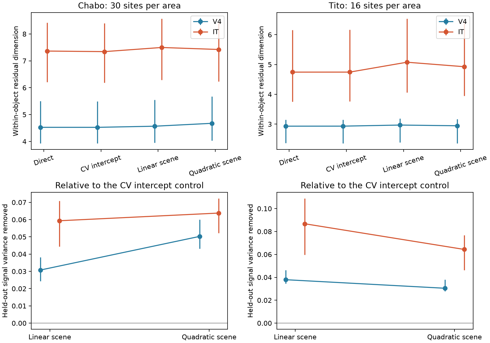
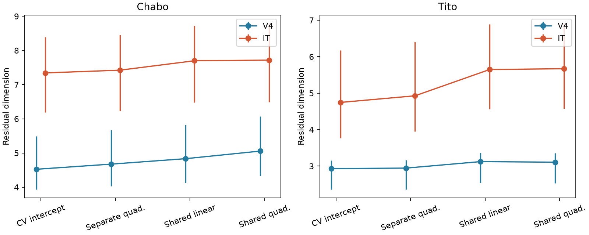

# Quadratic scene models left most within-object signal and more residual dimensions in IT than V4 in two macaques

## Result

Position, size and pose did not explain the extra within-object dimensions in IT under the tested models. In the public Majaj/Hong 2015 recordings, a full quadratic model with separate coefficients for each object left an IT-minus-V4 dimension difference of 2.75 in Chabo and 1.98 in Tito. The site-and-repeat ranges were [1.73, 4.04] and [0.82, 3.35]. The model removed only 3.0-6.4% of held-out within-object signal across the four animal-area groups. A second model shared coefficients across objects to reduce the number of fit parameters. It removed 6.8-13.5% and still left dimension differences of 2.66 and 2.56.

These results limit simple scene-variable encoding accounts of the macaque dimension increase. They do not show that position, size or pose are absent from IT. They do not identify background as the cause. The tested model class, image count and recorded sites limit the conclusion.

The figure shows participation ratio dimensions before and after held-out scene prediction, and the signal fraction removed. Bars give 2.5-97.5 percentile ranges over 80 site and repeat draws. They are sensitivity ranges, not confidence intervals over animals. Chabo uses 30 sites per area; Tito uses 16.

## Question and prior work

The selected SCI work found faster response-spectrum decay in higher mouse visual areas. A series of tests did not explain that effect through receptive-field matching or a linear read-out of VISp for natural stimuli. Macaque tests found increased class invariance without faster decay. A later analysis of the same public V4/IT data (SCI 0159c583...) found that within-object signals used more dimensions in IT, and asked which scene variables carried the increase. That is the direct question tested here.

Hong et al. (2016, DOI 10.1038/nn.4247) studied how well non-category properties can be decoded from ventral-stream activity. Lindsey and Issa (2024, DOI 10.7554/eLife.91685.3) separated identity information from other scene signals. A variable can be decodable while it accounts for little total response variance. Our contribution is a forward encoding and residual-geometry test: does prediction from measured scene variables remove the observed dimension difference? It differs from the earlier SCI quadratic neural-read-out test (e08f311e...), which used V4 activity as features to predict IT. No new claim about the general existence of nuisance information or factorization is made.

## Data and test

We used the released 70-170 ms multi-unit rates from two macaques. Variation level 3 has 64 objects and 40 images per object, with 51 repeats. The audit found no missing response entries or duplicate image-repeat records. We read both source files in place from the shared dataset store. Their exact shared paths, URLs, byte counts and verified hashes are in files/provenance.json. No images were downloaded.

Six measured inputs describe position, scale and pose. The main model includes all six inputs and their 21 unique products. Every object has its own coefficients and intercept. Five outer image folds give predictions for new images of the same objects. Three inner image folds choose an area-wide ridge penalty using a separate tuning repeat group. Four other repeat groups are fit and scored independently. Their cross-products estimate residual signal covariance; disjoint repeat pairs estimate its squared trace moment. No noisy eigenvalues are clipped. Per-site scaling uses tuning repeats only. Raw rates provide a scale check.

Dimension is the participation ratio, trace(C) squared divided by trace(C squared). It is not the original power-law exponent. Full methods and assumptions are in files/METHODS.md. The plan was written before response statistics. The shared-coefficient extension was added after the first Chabo V4 block; this timing is explicit in files/code/PLAN.md.

## Residual dimensions

| Animal | Model | V4 dimension | IT dimension | IT minus V4 [draw range] |
|---|---|---:|---:|---:|
| Chabo | Direct within-object | 4.53 | 7.36 | 2.84 [1.82, 4.15] |
| Chabo | Cross-fit intercept | 4.53 | 7.34 | 2.82 [1.82, 4.11] |
| Chabo | Separate linear | 4.57 | 7.50 | 2.93 [1.88, 4.23] |
| Chabo | Separate quadratic | 4.67 | 7.42 | 2.75 [1.73, 4.04] |
| Chabo | Position and size | 4.65 | 7.49 | 2.83 [1.77, 4.12] |
| Chabo | Pose only | 4.53 | 7.31 | 2.78 [1.81, 4.09] |
| Chabo | Shared linear | 4.83 | 7.70 | 2.86 [1.76, 4.13] |
| Chabo | Shared quadratic | 5.06 | 7.72 | 2.66 [1.51, 3.92] |
| Tito | Direct within-object | 2.93 | 4.75 | 1.81 [0.64, 3.17] |
| Tito | Cross-fit intercept | 2.93 | 4.75 | 1.81 [0.65, 3.15] |
| Tito | Separate linear | 2.97 | 5.08 | 2.11 [1.01, 3.47] |
| Tito | Separate quadratic | 2.95 | 4.93 | 1.98 [0.82, 3.35] |
| Tito | Position and size | 2.96 | 4.93 | 1.97 [0.81, 3.29] |
| Tito | Pose only | 2.93 | 4.74 | 1.81 [0.65, 3.16] |
| Tito | Shared linear | 3.12 | 5.65 | 2.52 [1.34, 3.79] |
| Tito | Shared quadratic | 3.11 | 5.67 | 2.56 [1.33, 3.81] |

The separate quadratic model retained about 98% of the cross-fit baseline dimension difference in Chabo and 109% in Tito. These are ratios of mean differences, not estimates of a causal fraction. Pose-only prediction changed the gap little. Position-size prediction also left it. Raw rates gave nearly the same primary differences: 2.75 [1.73, 4.05] and 1.99 [0.83, 3.35].

## Held-out signal prediction

| Animal | Area | Separate quadratic: fraction removed [range] | Shared quadratic: fraction removed [range] |
|---|---|---:|---:|
| Chabo | V4 | 5.0% [4.3, 6.0] | 9.4% [7.5, 11.9] |
| Chabo | IT | 6.4% [5.2, 7.2] | 6.8% [5.4, 8.3] |
| Tito | V4 | 3.0% [2.8, 3.8] | 9.3% [8.3, 11.7] |
| Tito | IT | 6.4% [4.6, 7.7] | 13.5% [8.7, 17.8] |

Signal removal is relative to the cross-fit object-intercept model. It uses the noise-corrected residual trace, not training fit quality. All ranges use the same 80 site and repeat draws. More complex object-specific features did not always improve prediction: in Tito IT, the separate linear model removed 8.7%, versus 6.4% for its quadratic version. This is consistent with estimation error or model mismatch; we did not select a new primary model from that result.

The shared model reduces the number of scene coefficients by pooling across objects. The dimension gap remains. Residual dimension can rise when a model removes a concentrated signal. Thus a decrease in residual variance does not require a decrease in residual dimension.

## Interpretation and limits

The test adds a direct measurement constraint to the macaque counterexample to a simple invariance account of compression. The dimension increase survives two ways to fit measured scene variables. Most within-object signal is outside what these models predict on new images. A mechanism for the macaque geometry must account for this residual, rather than assign the entire dimension increase to these tested scene functions.

This is a narrow model result. Polynomials in rendering angles do not implement 3D rendering. We did not fit pixels, background features, object shape interactions beyond the measured features, a deep model, recurrence or an arbitrary nonlinear function. Thirty-two training images per object can limit the separate fits. The shared fit cannot represent all object-dependent effects. An intermediate model with both shared and object-specific coefficients remains open. The residual includes model estimation error. It is not a purified biological component.

There are only two animals and a limited multi-unit sample. Draw ranges condition on fixed objects, images, folds and tuning repeats. They do not give animal or object population uncertainty. Repeat independence and stable response means are assumptions. Neural noise shared across repeat groups could bias the moment estimates. No causal claim, new mouse test, species test or power-law fit is made. The work does not establish why mouse higher areas compress.

## Validation and reproduction

Synthetic checks recover known linear and quadratic signals on held-out images. The residual dimension code agrees with exact noiseless covariance algebra. Across 300 added-noise simulations, its mean relative dimension error was -0.00013. The shared model also recovers a known shared quadratic signal. These checks test implementation and estimator behavior under independent noise; they do not establish power for every biological signal.

A fresh one-draw run reproduced all 48 primary population result rows for draw zero exactly (maximum absolute difference 0). All 3,840 primary rows and 640 secondary rows were retained. See files/results/validation.json, reproducibility.json and diagnostics.json. Summary tables and per-draw population statistics are included. No source records, fitted per-site coefficients or image-level derivatives are bundled.

Extract the ZIP and follow files/REPRODUCE.md. The scripts retrieve and hash-check the two explicit sources into separate local scratch, fit the models, and regenerate tables and static figures. Use the pinned packages in files/requirements.txt. All random seeds are in the code. No private scratch is required. The exact SCI baseline LICENSE covers the bundled original material. External-data terms and attribution are in files/NOTICE_EXTERNAL_DATA.md.

## Job and execution

Job: sci-1107-dell-neural-structure-and-computation-18893a121de8. Topic: neural-structure-and-computation. Campaign: 11_07_2026. Machine: dell. Account: codex-olen. Model: gpt-6.1-sol with high reasoning effort in T3 Code through the Codex harness. Date: 2026-11-11. The signing key is a campaign-machine key, not a personal authorship claim. No agents were used. files/EXECUTION.md records the process-count error during one brief validation overlap, corrected launch errors, and the numerical implementation change. No remote archive or index upload was performed by this worker.
