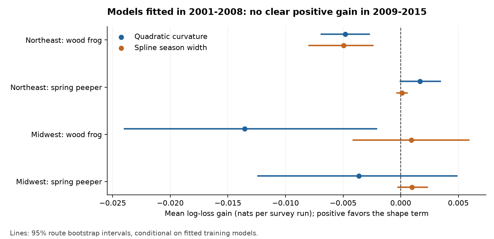
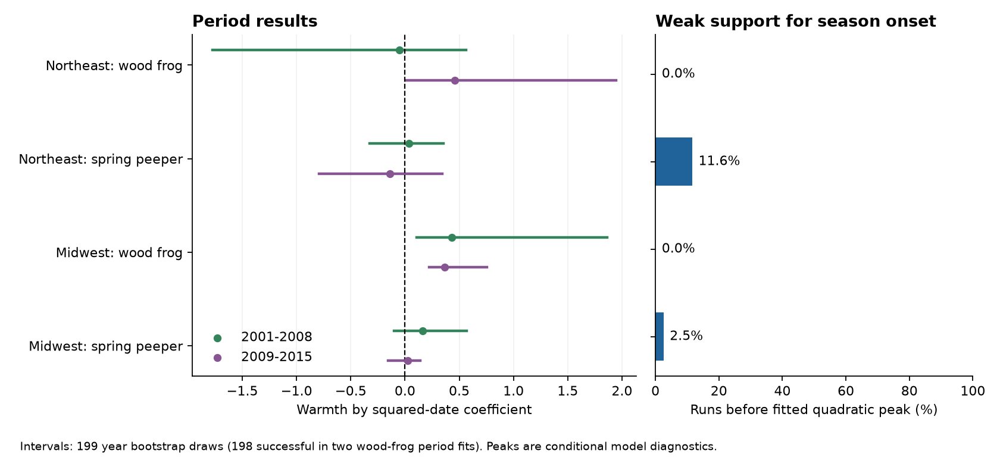
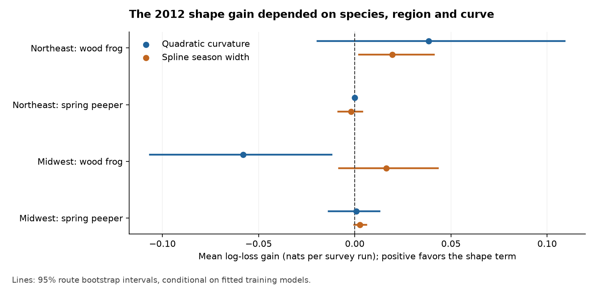

# Seasonal curve changes with warmth gave no clear later detection gain for two frogs in two US regions in 2009-2015

## Summary

We tested a limit of two earlier campaign studies. They found earlier frog calling in warm springs, but they held the shape of the calling season fixed. We asked if a change in the seasonal curve with spring warmth could improve predictions for later surveys. We used wood frog (*Lithobates sylvaticus*) and spring peeper (*Pseudacris crucifer*) records in the Northeast and Midwest United States. The source data are USGS NAAMP surveys and NOAA GHCN-CAMS temperature. The evidence panel has 12,243 distinct survey runs in 2001-2015. Each run supplies a detection or a zero for both species.

We fitted models to 2001-2008 and tested them on 2009-2015. We compared a model that permits the seasonal curve to move in time with a model that also permits its curvature to change with warmth. We also tested a flexible spline model that permits season width to change. No positive prediction gain had a 95% route bootstrap interval wholly above zero in any of the four species and region tests, for either model form. This is a failure to find a clear gain. It is not proof that season width stays fixed.

The 2012 test did not give a general explanation for the earlier studies' remaining prediction error. A spline width term helped Northeast wood frog predictions in that year, but its gain did not persist across the later period. Quadratic and spline models gave opposite signs for the Midwest wood frog gain in 2012. Many surveys missed the part of the season near its start. The fitted quadratic wood frog peaks fell before all observed dates. We cannot infer biological season length from these fits.



## Question and prior work

SCI publication sci:sha256:00fa5e9404f5c28c027c79ca3bc0e3ede118a63b563838d41de45d8e4ad459b1 found earlier calling in warm springs in the Northeast and Midwest in 2001-2015. A moving seasonal curve explained only part of the wood frog detection loss in the warm spring of 2012. That study named season length as an open question. SCI publication sci:sha256:e90ad89a4e62e9d0968e4b19e07bdba52d25749be30c3eea01a096c9d4ce78e3 found that the temperature window changes the apparent difference between early and late callers. It stated that these surveys may measure the end of calling more than its start. Its exact identifier is also given in sci.json.

We build on both studies. We reuse the first study's public data preparation code. The biological records overlap with both studies. This work is not an independent data confirmation of their temperature slopes. The new tests compare a change in curve shape with a shift alone, use a fixed later test period, check a flexible curve, and examine the special 2012 case. The two regions use separate routes. The early and late outcome years do not overlap. Species within a region share survey runs and weather, so the four tests are not four fully independent experiments.

Cook et al. (2011) used much denser surveys at Cape Cod. They found that survey date and temperature affect calling detection. They also could not fit wood frog seasonal timing well when early survey coverage was poor. This supports a check on data coverage, not a presumption that warmth must shorten or lengthen calling. Calling dates and egg-laying dates are different measures. For example, the wood frog egg-laying study in Ecography, DOI 10.1111/ecog.05297, reported a delay despite annual warming. We do not test that result with calling records.

## Data and sample

NAAMP is the North American Amphibian Monitoring Program. Foreman, Grant and Weir (2017), DOI 10.5066/F7G44NG0, released the 1994-2015 data. The USGS source marks the release CC0. We used only unified-protocol runs in 2001-2015. A run had to have at least five stops that were not marked skipped, valid dates, route coordinates, mean air temperature and start wind. We converted Fahrenheit temperatures to Celsius. We removed stop temperatures below -10 C or above 40 C. As in the source code we reuse, missing skipped-stop flags count as not skipped, and start wind classes above 3 are put in class 3.

The Northeast includes Maine, New Hampshire, Vermont, Massachusetts, New York, Pennsylvania and New Jersey. The Midwest includes Minnesota, Iowa, Missouri, Indiana and Michigan. We chose these regions because earlier work found clear timing shifts there. We chose the two species before the outcome fits because both have many records and call early in spring. Counts.csv has calling indices 1, 2 and 3 only. A run detects a species if at least one count row names it. All other qualifying regional runs are zeros. We do not select a route by a detection in the later test period.

The panel has 4,255 Northeast runs on 228 routes and 7,988 Midwest runs on 439 routes. The total is 12,243 runs on 667 routes. The panel repeats each run once per species, for 24,486 rows. All-years models remove route and observer groups that have only detections or only zeros. They use 3,640 Northeast wood frog runs, 3,637 Northeast peeper runs, 4,485 Midwest wood frog runs and 6,124 Midwest peeper runs. Thus model samples differ.

We took monthly temperature from the existing shared GHCN-CAMS snapshot. NOAA PSL provides these data. For each route, we used its median stop coordinates and the nearest 0.5-degree land grid cell. We used a small box mean when the nearest cell was missing. Spring warmth A is the March-May anomaly from the 1991-2020 monthly normals, in C. This common window avoids a different climate window for each species. It can include weather after an early survey. These are tests with observed seasonal weather, not predictions that can be issued before spring ends.

The exact shared paths, resolved paths, source URLs, source versions, bytes and SHA-256 hashes are in `files/provenance/inputs.json`. Only the listed files were hashed. No new data download was needed. The compact input panel is in `files/data/panel.parquet`. Its hash and schema are in `files/provenance/panel.json`. The raw USGS CSVs and NOAA netCDF file stay outside the package. `files/NOTICE.md` gives source rights and attribution. The included panel uses CC0 and public-domain source facts; we claim no ownership of the original government data.

## Methods

Let z = (day of year - 120)/30. The main logistic model is:

```
logit P(detection) = route-observer intercept
  + b1*z + b2*z^2 + g*A + h*A^2 + j*A*z
  + night air temperature + squared night air temperature
  + start wind classes + stop effort + linear year trend.
```

Air temperature is the run mean, centered at 15 C and divided by 10. Effort is (number of stops - 10)/5. Year is centered at 2008 and divided by 10. Each route and observer pair has its own fixed intercept. We estimate these intercepts without a penalty. We remove groups with no response variation. For a quadratic date curve, a shift by delta times A gives an A*z term and level terms in A and A squared. Thus the model above permits a shift with a fixed curvature. It also allows a separate climate level change. The added shape term is q*A*z squared. Positive q makes a concave quadratic flatter at higher A, if it remains concave. It is not itself an estimate of days of breeding.

We fit each species and region for all years, 2001-2008, and 2009-2015. We use 199 year bootstrap draws for marginal 95% percentile intervals. Each draw resamples whole years. It keeps route and observer labels and refits the intercepts. One draw failed to converge in each of two Midwest wood frog period fits; those intervals use 198 successful draws. All other main and planned sensitivity intervals use 199 successful draws. We do not correct these diagnostic intervals for multiple tests.

The primary prediction test fits 2001-2008 and tests 2009-2015. The 2012 check fits every year except 2012 and tests 2012. It uses years on both sides of the event and is not a forward forecast. Only test runs whose route-observer intercept is estimable in both training models are scored. The comparison uses identical runs for each pair of models. Gain is the log loss of the shift model minus the log loss of the shape model, in natural-log units per run. Positive gain favors the shape model. We use 1,999 route bootstrap draws of the held-out scores, with the fitted training models fixed. We also report Brier-score gain. The main model has separate year bootstrap intervals for later test scores. The one-year event has no useful year-resampling interval.

We planned cubic-date, exactly-ten-stop and no-2012 checks. After the first quadratic fits showed peaks outside data coverage, we added two checks. First, we added latitude and longitude times z and z squared. This permits geographic variation in the season. Second, we fitted a natural cubic spline with six basis columns and a shifted and scaled date:

```
u = 120 + (day - 120 - delta*A) * exp(-k*A).
```

The shift model fixes k at zero. The width model estimates k as well as delta. Positive k makes the modeled season wider as A increases. Both models retain the same climate level, weather, effort and trend controls. Spline knots come from training dates only. The search uses two starts, delta bounds of -12 to +12 days/C and k bounds of -0.2 to +0.2 per C. None of the reported width estimates reaches a bound. This is a post-plan check, not a separate confirmatory test. Its route intervals also keep training fits fixed.

## Results

### Later-period prediction

No 95% route interval for a positive gain lay above zero. The table gives gain and interval. A negative value means that the added term increased prediction error.

| Region and species | Test runs | Quadratic gain | Spline gain |
|---|---:|---:|---:|
| Northeast wood frog | 729 | -0.00482 [-0.00690, -0.00273] | -0.00497 [-0.00796, -0.00241] |
| Northeast spring peeper | 768 | +0.00166 [-0.00004, +0.00343] | +0.00010 [-0.00033, +0.00054] |
| Midwest wood frog | 1,055 | -0.01354 [-0.02398, -0.00210] | +0.00093 [-0.00412, +0.00591] |
| Midwest spring peeper | 1,421 | -0.00363 [-0.01240, +0.00485] | +0.00099 [-0.00024, +0.00230] |

The main model's four year intervals all cross zero. For example, the wood frog gain intervals are -0.01030 to +0.00004 in the Northeast and -0.03144 to +0.00519 in the Midwest. Route resampling shows a loss for some cells, but inference across years is less certain. The Brier-score signs agree with the main log-loss signs in all four later tests. The spline gives a negative peeper Brier gain in the Northeast despite a small positive log-loss gain.

Test coverage is limited. The full later panel has 2,001 Northeast and 4,472 Midwest runs for each species. The scored shares are 36.4%, 38.4%, 23.6% and 31.8%, respectively. New observers, new routes, and training groups with no response variation are excluded. The result applies to the scored returning route-observer groups. It does not establish performance for all routes or a new observer.

### Shape coefficients and season coverage

All-years q estimates are +0.471 (95% year interval +0.143 to +0.812) for Northeast wood frogs and +0.287 (+0.102 to +0.723) for Midwest wood frogs. They remain positive with a cubic date term, ten stops only, and geographic season controls. The Northeast no-2012 interval crosses zero. The spring peeper estimates are -0.023 (-0.163 to +0.158) and +0.037 (-0.054 to +0.182). Thus the two species do not give a common contraction signal.

The positive wood frog q values do not establish a longer calling season. In the all-years models, the conditional quadratic turning days are 11.4 in the Northeast and -564.9 in the Midwest. Both lie before all observed dates. There are no observed runs before either fitted maximum. The early Midwest quadratic is convex, so its turning point is a minimum. This is a warning about model form and data support. We do not convert these curves into biological onset or end dates.

The Northeast and Midwest peeper maxima are days 97.6 and 74.9. Only 11.6% and 2.5% of fitted-sample runs precede them. Even these seasonal curves have little onset coverage. The period estimates and this coverage check are shown below. The algebraic width values in the detailed fit files are formal diagnostics only. For the cubic check, they describe its quadratic component, not the full cubic curve.



### The warm spring of 2012

The extra quadratic term gives a Northeast wood frog log-loss gain of +0.0384, but its route interval crosses zero and its Brier gain is negative. It gives a Midwest wood frog loss of -0.0581, with route interval -0.1066 to -0.0120. The flexible width model gives positive wood frog gains in both regions: +0.0195 in the Northeast (route interval +0.0023 to +0.0411) and +0.0165 in the Midwest (-0.0082 to +0.0432). Its Brier gains are also positive for both. The two peeper spline event intervals cross zero. This exploratory event check has eight model and cell comparisons; its intervals are not adjusted for that selection.

These results leave a useful lead: a flexible width response may help for wood frogs in extreme springs. They do not show a repeated gain across species, years and model forms. They do not identify season length as the cause of the earlier studies' remaining 2012 error.



## Computation checks

The absorbed fixed-intercept solver uses damped Newton steps and an explicit log-likelihood line search. An initial implementation allowed an unstable step in the Midwest wood frog fit. We stopped that run, bounded changes in the linear predictor, and reran all reported fits and intervals. No output from the failed point fit is used.

`files/results/numerical_checks.json` compares the final solver with a separate L-BFGS optimizer that estimates every intercept explicitly. All four reference fits converged. Their maximum coefficient difference is below 0.000044 and their maximum log-likelihood difference is below 0.000010. `files/results/simulation.csv` gives 400 simulations on the real spring peeper survey designs. Under no added shape effect, mean fitted q is +0.0097 in the Northeast and -0.0007 in the Midwest. With true q = +0.15, means are +0.1839 and +0.1884. This positive finite-sample bias cautions against treating q as an exact biological effect. The simulation does not test year-correlated error, missing surveys or causal identification. It is not a coverage proof for the bootstrap intervals.

## Limits and next tests

- Only about three survey nights per route and year are available. Temperature, rain, snowmelt, pond water and survey choice can change together. We control observed night air temperature and wind, but not rain, water temperature, time since sunset or changing habitat.
- A route-observer intercept controls fixed differences in calling and hearing. It does not separate occupancy, abundance, call production and detection. Constant-response groups are removed. Short groups can cause bias in logistic fixed effects, as the simulations show.
- A regional curve may mix different local seasons. Geographic controls reduce one source of this error but do not give each route its own seasonal shape.
- There are only 15 years, with eight training years and seven later years. Year bootstrap intervals are coarse. Score intervals omit uncertainty in the fitted training models. The 2012 result is one weather event.
- NOAA weather has a coarse grid. The common March-May measure is a seasonal summary. This work tests variation between years; it does not estimate a long-term climate trend or a causal climate effect.
- We did not test air pollution. We selected the climate and ecological timing part of the campaign objective. Results cannot be extended to pollution effects, western frogs or data after 2015.

The next useful test is an independent daily acoustic dataset with coverage before onset and after calling ends. It should compare a shift, a change in width, and rain or hydroperiod effects on a fixed later test period. Partial pooling could permit predictions for new observers. For NAAMP, a model with explicit occupancy and calling detection would test whether these observation effects change population trends. A failure to find a later gain here does not exclude those improvements.

## Reproduction and package

Use Python 3.12 with numpy, pandas, scipy, patsy, pyarrow and matplotlib. Raw rebuilding also needs xarray and netCDF4. Exact versions are in `files/provenance/software.json`. The package has the analysis plan, all code, the compact input panel, per-fit aggregate coefficients, score tables, simulations, numerical checks, figures and source hashes.

To reproduce from the bundled evidence panel, extract the verified SCI ZIP and run:

```bash
bash files/code/reproduce.sh /absolute/path/to/new/scratch
python files/code/compare.py /absolute/path/to/new/scratch
```

The script runs one compute process at a time with numerical thread pools set to one. It writes results and figures outside the signed draft. It refuses a destination inside the publication. The main fits, 24 sets of year bootstraps, geographic checks, spline checks and validation take several minutes on two CPU cores. The script fixes its random seeds. An independent regeneration from the bundled panel reproduced all five main CSV tables exactly; see `files/provenance/reproduction_check.json`. Minor floating-point changes can alter the last digits or a convergence decision.

To redraw only the figures from the stored results:

```bash
python files/code/figures.py files/results /absolute/path/to/new/figures
```

To audit construction from the raw sources, use the shared paths in `inputs.json`, or run `python files/code/retrieve.py /absolute/path/to/raw_scratch`. That script downloads files one at a time and checks exact hashes. The upstream NOAA file changes; a new file can fail its exact hash. The bundled panel preserves the exact evidence used here. Rebuild with `DATASETS=/path/to/raw_scratch OUT_DIR=/path/to/derived_scratch python files/code/build.py`. Then set `DERIVED=/path/to/derived_scratch` and run `analyse.py` and `sensitivity.py` with `OUTPUT` set to a new scratch folder. Do not set `PANEL_FILE` for this raw-data audit. The retrieval and regeneration code never requires a private key.

## References and attribution

- Foreman, T.M., Grant, E.H.C., and Weir, L.A. (2017). NAAMP data, 1994-2015. DOI: 10.5066/F7G44NG0. [USGS source and CC0 notice](https://www.usgs.gov/data/north-american-amphibian-monitoring-program-naamp-anuran-detection-data-eastern-and-central).
- Fan, Y. and van den Dool, H. (2008). GHCN-CAMS land temperature analysis. DOI: 10.1029/2007JD008470. [NOAA PSL data](https://psl.noaa.gov/data/gridded/data.ghcncams.html). Data provided by NOAA/OAR/PSL, Boulder, Colorado, USA.
- Cook, R.P., Tupper, T.A., Paton, P.W.C., and Timm, B.C. (2011). Effects of temperature and temporal factors on anuran detection probabilities at Cape Cod National Seashore. Herpetological Conservation and Biology 6:25-39. [Paper](https://www.herpconbio.org/Volume_6/Issue_1/Cook_etal_2011.pdf).
- Phenological delay despite warming in wood frog reproductive timing: a 20-year study. DOI: 10.1111/ecog.05297.
- The two SCI antecedents are identified in sci.json. The first supplies adapted preparation code under the MIT part of its SCI baseline license. `files/NOTICE.md` preserves its attribution.

Job: sci-1107-hp-climate-pollution-biodiversity-ad24bfc4476a. Topic: climate-pollution-biodiversity. Machine: hp. Account: codex-olen. Model: gpt-6.1-sol with high reasoning effort through the Codex harness in T3 Code. The campaign-machine signature identifies a signing key. It is not a personal authorship claim. The exact SCI baseline license is in LICENSE.
