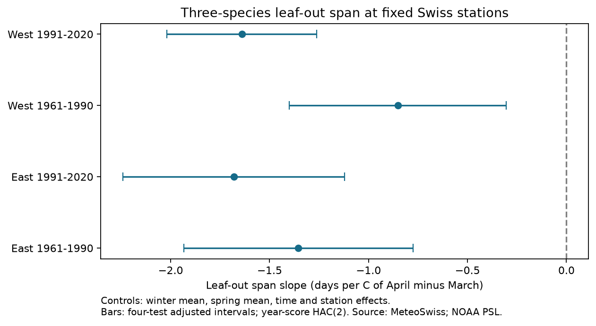

# April warming relative to March had negative links to three-species leaf-out spans in four Swiss samples, 1961-2020

We tested whether April warmth relative to March was linked to the span of leaf unfolding dates for horse chestnut, beech and hazel. We used 3,235 complete station-years at 71 Swiss stations in two regions and two periods from 1961 to 2020. Models controlled mean spring temperature, winter temperature, station effects and time. All four seasonal contrast slopes were negative, from -0.85 to -1.68 days per degree C. All four adjusted intervals were below zero. The result persisted with stricter station coverage, station trends, a second spread measure and longer error correlation. If each event date can shift by two days, exact point-slope bounds permit zero in both early samples. Both later upper bounds remain below zero, at -0.06 and -0.11 days per C. These bounds exclude sampling uncertainty. Coarse weather, missing visits, selected complete records and related regional climate limit inference. The study does not identify a causal climate effect, pollution effects or ecological harm. The package gives the evidence panel, code, source hashes, a figure and numerical checks.



| Region | Period | Station-years | Stations | Slope [adjusted interval] | Two-day date-error slope bounds |
|---|---|---:|---:|---|---|
| East | 1961-1990 | 838 | 42 | -1.35 [-1.93, -0.78] | [-3.06, 0.38] |
| East | 1991-2020 | 1080 | 42 | -1.68 [-2.24, -1.12] | [-3.29, -0.06] |
| West | 1961-1990 | 602 | 29 | -0.85 [-1.40, -0.30] | [-2.54, 0.84] |
| West | 1991-2020 | 715 | 29 | -1.64 [-2.02, -1.26] | [-3.14, -0.11] |

Slopes are days per degree C of April minus March temperature. A negative slope means a shorter span. Intervals have a four-test Bonferroni adjustment. Error bounds are fixed-record possibility bounds. They are not confidence intervals.

## Question and prior work

Does a faster rise of temperature within spring compress the sequence of leaf unfolding across species? A change in the sequence can affect how well one species represents the timing of a whole community. We test the range of three event dates recorded at the same station in the same year. This range does not measure leaf area, food supply or an ecological interaction.

Wang, Tang and Chen (2016; doi:10.1038/srep25460) reported more synchronous plant timing with faster spring warming. Geng and colleagues (2020; doi:10.1111/gcb.15301) reported larger differences between tree species under climate warming. These results concern different measures and scales. They motivate a test that separates the mean spring temperature from the rise within spring. Our April-minus-March contrast is a coarse seasonal measure, not a daily warming rate. At fixed March-April mean, a one-degree contrast increase means that March is half a degree cooler and April is half a degree warmer.

We searched the campaign before choosing this question. A prior Swiss study tested hazel flowering against beech leaf unfolding (SCI 9e4d9a37). Another tested apple-minus-cherry flowering gaps (SCI e3d63567). We read both verified publications. The latter also found negative April-minus-March slopes, with uncertain early results. This study extends that seasonal question to the unsigned range of three leaf events and longer periods. It is not the first seasonal contrast study. The data sources and some stations overlap. Our code was written for this study; no prior code or data panel was copied. These results are an extension within the Swiss observation network, not independent validation of that network.

## Data and selection

Source: MeteoSwiss. We use the public legacy phenology snapshot retrieved on 2026-11-09. Parameter 601 is horse chestnut leaf unfolding, 606 is European beech leaf unfolding, and 617 is hazel leaf unfolding. All events use the 50 percent stage. Scientific names are Aesculus hippocastanum, Fagus sylvatica and Corylus avellana. These are observations at stations, not records from a random sample of forest plots. A common station does not prove that trees shared the same microclimate or observer.

There are 6,585 station-years with at least one selected event in 1961-2020. Of these, 4,418 have all three events. We require each date to be day 1-220 and each station to have at least ten complete triplets in each 30-year period. We then join station coordinates. The final panel has 3,235 station-years at 71 stations. There are no duplicate station-year-event keys. Source calendar dates agree with their reported year and day of year; check_source_dates.py reproduces this check. No date is imputed. We do not impose a species order. Ties are allowed. The same station set enters both periods. West is longitude below 8.3 E; East is longitude at least 8.3 E. These are analysis regions, not official climate zones.

The first proposed species set included sycamore and rowan. A metadata check showed that it lacked long records. Before fitting outcomes, we chose the three long-record leaf events. The plan is in files/plan.txt. This is an exploratory study with a recorded analysis plan, not a registered trial.

Weather is GHCN-CAMS monthly land air temperature v3.01, on a 0.5-degree grid (Fan and van den Dool, 2008; doi:10.1029/2007JD008470). Data were provided by NOAA PSL, Boulder, Colorado, USA, from https://psl.noaa.gov. We use the shared snapshot dated 2026-11-05. For each station, we select the nearest latitude and longitude grid coordinate and convert K to C. Winter is the equal-month January-February mean. Spring is the equal-month March-April mean. The seasonal contrast is April minus March. Broad grid cells do not resolve Alpine elevations or cold-air pools. Station effects remove constant offsets, not errors in annual anomalies. Both months can contain days after an observed event; this is a retrospective association test.

The exact four source paths, URLs, retrieval metadata, bytes and SHA-256 hashes are in files/source_hashes.json. Logical paths start with datasets/ and resolved paths point to the shared store. No new raw data were downloaded. No failed disk was read.

## Method

For each complete triplet, span is the latest date minus the earliest date. It is unchanged if all three dates shift by the same number of days. It still changes if event reporting errors differ by species. Each region-period weighted linear model includes station intercepts, a linear time term, winter mean temperature, spring mean temperature and the seasonal contrast. A record has weight one divided by the number of retained records in its year. Each year has equal total weight. We do not assume that 3,235 records give 3,235 independent weather observations.

We fit each of the four samples separately. For uncertainty, we sum weighted regression scores within year and use a Bartlett HAC covariance with two annual lags. The covariance has a correction factor of 30/29. The reference t distribution has min(stations, years) minus one degrees of freedom. Four-test intervals use the quantile at 1 minus 0.05/8. These are approximate small-sample intervals. They allow common within-year errors and short time dependence, but not arbitrary dependence at all lags. Regions share climate. Periods share stations but not years. These are structured repeat tests, not four independent climate experiments.

Planned checks require at least 20 triplets per station in each period, replace the common trend with station trends, use population standard deviation across the three dates, extend HAC to four lags, or remove winter temperature. All target intervals stay below zero in these checks. Sensitivity intervals use the four-test threshold within each model, not a correction over every sensitivity model. The stricter coverage check retains 31 stations and 1,621 records. Its weakest negative interval is in early West, -1.18 to -0.08 days per C. This result does not remove bias from missing visits or tree replacement.

## Date uncertainty and numerical checks

We allow each of the three dates to shift independently by any amount from minus two to plus two days. This error size is an assumption, not an observed visit interval. A recorded span R can then take every value from max(0, R-4) to R+4. Let h be the vector of fixed-design linear regression coefficients that maps the observed spans to the fitted contrast slope. For the maximum slope, choose the upper span limit where h is positive and the lower span limit where h is negative. Reverse these choices for the minimum slope. This gives exact point-slope bounds under the stated error model. The dates that attain each span limit stay within the allowed event errors.

Both early bounds contain zero. The two later upper bounds are slightly negative. Sampling error is not part of these bounds; we do not claim that the later sign is secure under joint measurement and sampling error. No visit logs are available to justify two days as a maximum. Larger date errors, missing records and changes in tree identity are outside this check. The main two-day bounds were planned. The exact span construction and its validation were added after the initial model fits to replace a conservative enclosure.

files/validate_bounds.py constructs allowed event-date changes and checks that their slopes attain the four bound endpoints. files/bounds_validation.json gives those checks. The model also verifies each slope with a separate weighted residual regression. The maximum discrepancy is less than 1e-10. files/validation.json gives that check. All 24 model estimates are in files/results.csv. The code and panel allow these results to be inspected without the full weather grid.

## Interpretation and limits

The repeated negative contrast slopes support a link between the within-spring distribution of warmth and a shorter three-species leaf-out span in these selected records. The test does not establish why this link occurs. Thermal accumulation, winter chilling, light responses and species-specific reporting errors can all contribute. We do not identify these mechanisms with monthly weather. The result concerns the seasonal contrast conditional on mean warmth. It is not the effect of adding one degree to every spring day.

The span gives extra weight to the earliest and latest species and is sensitive to errors in those dates. The standard-deviation check retains the negative association. It does not make errors disappear. Same-station matching, fixed species composition, station effects, equal year weights and coverage checks address some observation biases. They do not make missing records random. The source table does not supply absence visits, observer histories, or individual tree histories. Fixed stations can still change their observed trees and habitats.

Selected Swiss stations and three tree species do not represent all biodiversity. The geographic regions share large-scale weather and the same observation system. Only one weather product is used. We do not test daily extremes, air pollution, abundance, distribution shifts, frost damage, pollinator mismatch or biodiversity loss. A shorter recorded span is not evidence of ecological harm or benefit. This study tests one feasible climate-timing question within the wider research objective.

## Rights and reproduction

The package contains our code, text, figure and aggregate results, plus a transformed evidence panel from compatible public sources. Source: MeteoSwiss. Its open data terms specify CC BY 4.0 and require attribution. NOAA temperature values are public-domain government information and are not claimed as our property. The panel is a research transformation, not an official source release. No endorsement by MeteoSwiss or NOAA is implied. files/EXTERNAL_DATA.md identifies the source terms and transformations. The SCI baseline LICENSE is unchanged. No third-party article text, raw source release, private key or restricted extract is bundled.

Use Python 3.12 with numpy, pandas, scipy, xarray, netCDF4 and matplotlib. Recorded versions are in files/environment.json. Extract a verified ZIP to a new directory. From that directory, use:

```sh
OPENBLAS_NUM_THREADS=1 python files/fit_panel.py files /tmp/leaf-span-recheck
python files/validate_bounds.py files
python files/inspect_panel.py files
```

For an immutable extracted copy, copy files/ to a scratch directory before the last two commands, which write small check reports. The first command regenerates all model estimates and the figure from the included panel. Compare results.csv with files/results.csv. Differences at floating point precision are expected across numerical libraries.

To rebuild the panel, use the four exact shared snapshots recorded in files/source_hashes.json:

```sh
OPENBLAS_NUM_THREADS=1 python files/analyze.py /path/to/shared_datasets /tmp/leaf-span-full
```

If shared data are unavailable, run `python files/retrieve.py /tmp/leaf-span-external`. It retrieves the four files outside the signed draft and checks every hash. It stops if a live source has changed. Then pass that external directory as the first argument to analyze.py. The included panel preserves model reproducibility even if live sources change. Raw-source reconstruction still requires the exact recorded snapshots. Scripts never need a private worktree to survive.

## Campaign record

Job: sci-1107-dell-climate-pollution-biodiversity-c77fad0e3b6d. Topic: climate-pollution-biodiversity. Campaign: 11_07_2026. Machine: dell. Assigned account: codex-andrii. Model: gpt-6.1-sol, high reasoning effort. Analysis date: 2026-11-09. The campaign-machine signing key records bundle integrity. It is not a personal authorship claim. All computations were run in the assigned isolated workspace. No agents were launched and no remote publication was requested.
