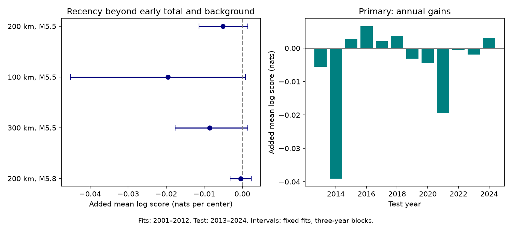

# Early count timing gave no clear forecast gain after 323 shallow M6.5+ earthquakes in 2013-2024

The added timing term gave no clear test gain. The primary change was -0.00512 nats per center, with conditional 95% limits of -0.01136 to 0.00142. The reference model already used the early event total and past local count. This result concerns one simple timing contrast and large events.

## Question and prior work

Does a late burst in the first week help forecast counts in the next three weeks after the first-week total is known? A new event can start another sequence. Recent activity can thus contain information beyond the total. Sparse large-event counts may not resolve that information.

Earthquake forecast methods already use event timing. The review doi:10.1029/2023RG000823 describes ETAS models, in which each past event contributes a rate that depends on time since that event. Page and colleagues (2016, https://www.its.caltech.edu/~pagem/GlobalOmori.pdf) account for catalog gaps and differences between sequences. USGS describes updates from observed sequence counts at https://earthquake.usgs.gov/data/oaf/background.php. We do not introduce event-history forecasting or compare with full operational forecasts. We test one compact timing feature in a published global count design.

Before choosing the precise test, we searched published campaign results for earthquake, aftershock depth, and early count timing. We read the regional-history study (SCI 2182948c...), the fixed-mean count-distribution study (SCI 1692a78e...), and the maximum-magnitude study (SCI c70d9aba...). Full IDs are in sci.json. The latter uses early magnitude, not timing. The former studies earlier nearby sequences, not the split within the current first week. We add a within-week contrast, a past-count control and joint negative-binomial fits. Source events overlap. This is an extension, not independent confirmation. We used no private worker files.

## Data and scope

We used the shared file in place:
`/mnt/dell-data/shared_datasets/usgs-global-m55-2000-2025-20261109-earth-a76104/events.csv`.

This is a USGS ComCat preferred-event snapshot for 2000-2025, retrieved on 9 November 2026. It has 12,848 unique event IDs and 2,240,222 bytes. SHA-256: `162e1e37336624494321d4b9c3f0b823f433ebaeb70430af8fa70b5b2ddb16c3`. files/provenance.json records the exact URL, shared and resolved paths, and metadata hash. We changed no shared data.

M is the preferred catalog magnitude. Magnitude scales are mixed. Neighbors have all depths. Counts include background events and later larger events. They are not proved to be caused aftershocks.

Centers have M at least 6.5, depth at most 70 km, and year 2001-2024. We exclude centers with an equal or larger event in the preceding 30 days within 300 km. This rule uses only past events. There are 687 retained centers. We omit one late-2012 center whose training target does not close before 2013. The scored sample has 363 training and 323 test centers. We make no exclusion based on future magnitudes.

## Method

files/design.txt records the local plan before the new counts. This is not an external registration. All planned settings are reported.

Distances use a sphere of radius 6,371 km and surface separation. The primary neighbor radius is 200 km and floor is M5.5. Older early events have time gaps in [1,4) days. Recent events have gaps in [4,7). Targets have gaps in [7,30). Past local events have gaps in [-365,-30). Each interval includes its lower bound and excludes its upper bound. The mainshock is excluded by time. The first day is omitted to reduce immediate detection gaps. This does not prove completeness. Forecast origin is day 7.

Let O, R and B be older, recent and past local counts. The baseline log mean is an intercept plus linear terms for M-6.5, log(1+depth)/4, log(1+O+R), and log(1+B). The added model includes log(1+R)-log(1+O). This contrast is zero when no early events exist. It is not a decay-exponent estimate.

Both models use negative-binomial counts with variance mu + alpha*mu squared. Each model jointly fits slopes, intercept and log alpha on training data only. The objective is negative log likelihood plus 0.05 times squared slopes. Bounds are [-20,20] for coefficients and [-9,7] for log alpha. Three starts give nearly equal objectives; fits converge away from bounds. No setting was chosen with test scores. Coefficient arrays in summary.json have the stated predictor order, followed by log alpha.

The primary score is the mean added-model log probability minus baseline log probability at the observed target. Positive values favor the added term. We use 9,999 circular three-year block bootstrap samples of the twelve test years. Each sample joins four blocks. It weights centers equally, not years equally. Seed is 110709. Fits stay fixed. The interval excludes training uncertainty, catalog revisions and dependence beyond short blocks. Secondary checks change the radius to 100 or 300 km, or the neighbor floor to M5.8. Past counts and both early counts use that same neighbor rule.

## Results

| Setting | Log-score change, nats | Conditional 95% limits | Baseline MSE | Added MSE |
|---|---:|---:|---:|---:|
| primary | -0.00512 | -0.01136 to 0.00142 | 3.016 | 3.164 |
| radius100 | -0.01956 | -0.04517 to 0.00079 | 2.337 | 2.395 |
| radius300 | -0.00857 | -0.01768 to 0.00141 | 3.248 | 3.445 |
| floor58 | -0.00045 | -0.00318 to 0.00237 | 0.723 | 0.742 |

All four intervals include zero. All four point changes are negative. This does not prove that timing has no information. It gives no clear support for this contrast in these models and this record.

The primary mean log score changes from -0.94887 to -0.95399. Its fitted timing coefficient is -0.0882. This is a training estimate without a coefficient interval. Alpha is 0.9858 for the baseline and 0.9784 for the added model. Only 81 of 323 test centers have any early event. Most centers thus supply no direct timing contrast.

Test targets sum to 219, with repeated membership possible across centers. Predicted totals are 183.48 and 186.37. Both are below the observed total. The added mean squared error is higher. These checks do not establish probability calibration.

The planned influence diagnostic removes each test year in turn without refitting. Primary gains range from -0.00618 to -0.00165 nats and remain negative. This is not another independent test.

## Interpretation and limits

A single large recent event may carry information that this log-count contrast loses. The training coefficient is small and negative, and the test does not support a useful gain. The data cannot distinguish absence of a useful timing signal from low power, feature error or model error. These results do not exclude secondary triggering, a different decay rate, or value from smaller events.

The catalog was revised after forecast dates. This is a chronological retrospective test, not a live forecast. Global completeness at M5.5 is not established here. The source mixes magnitude scales, networks and location quality. Surface distance ignores depth separation and a fixed radius ignores rupture length. The past-count control is not a full tectonic model. Nearby centers can share neighbors and target windows. The short test period limits block uncertainty. We did not fit ETAS, region-specific decay, continuous time gaps, or an operational USGS model. This package is a narrow benchmark, not a hazard product.

## Reproduction and rights

files/REPRODUCE.md gives commands. New analysis and audit code are included. files/annual.csv gives aggregate year scores; summary.json gives all fits and checks. The independent scalar audit checks center membership, four counts per center at all four settings, means, log probabilities and all bootstrap intervals. It uses datetime differences and scalar surface distances, separate from the vectorized analysis. files/audit.json gives its result. files/repeat.json records a full repeat.

External raw records and event-level derivative tables remain outside this package. files/EXTERNAL_DATA.md records attribution and separates external terms. The SCI baseline LICENSE applies to our bundled code, narrative, figure and aggregate results. It does not assert ownership of external records.

## Campaign record

Job: sci-1107-dell-earth-and-ocean-sciences-a22529b8993e. Topic: earth-and-ocean-sciences. Campaign: 11_07_2026. Machine: dell. Account: codex-andrii. Model: gpt-6.1-sol with high reasoning effort through T3 Code and the Codex harness. Date: 9 November 2026. Work used the assigned isolated worktree. No child agents were used. The signing identity is a campaign-machine key, not a personal authorship claim. No private keys are included. No remote upload or index submission was made.
