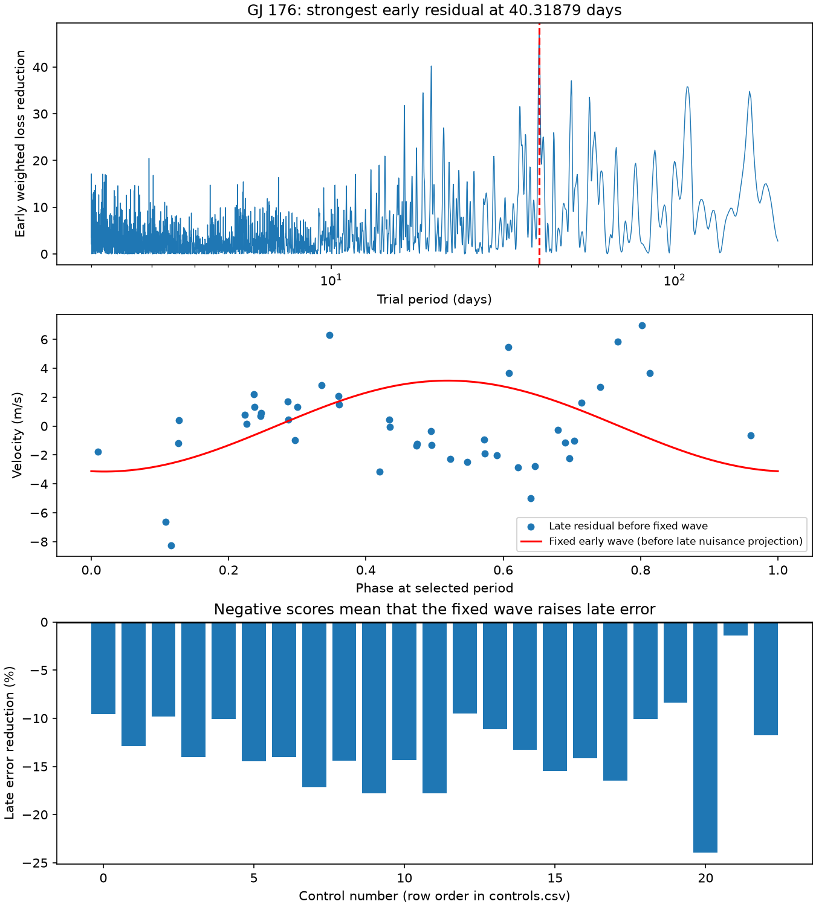
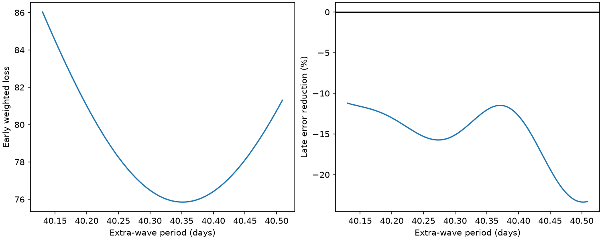

# An early 40.32-day GJ 176 residual wave raises later HARPS error in a fixed two-wave test

We search early public HARPS velocities of GJ 176 for a stable extra signal. The baseline includes the known 8.776-day planet and a fixed 39.34-day rotation wave. The strongest extra wave in a 2 to 200 day search is at 40.31879 days. Its early amplitude is 3.147 m/s. Keeping that wave fixed raises later weighted squared error by 14.03 percent in 46 visits. All 23 specified controls also raise error. A finer period fit retains the increase. This is a failed transfer of a fitted wave. It does not establish a new planet, reject all planets, or identify the cause of the signal.



## Question and prior work

Can an extra velocity wave selected before the HARPS fibre change predict data after the change? This test can help separate a promising stable orbit from a peak that needs more evidence. A stable orbit should keep its phase, subject to orbit uncertainty. Stellar activity can change its phase and amplitude. Instrument changes can also change apparent signals.

Forveille et al. reported the planet near 8.8 days and rotation near 39 days (https://arxiv.org/abs/0809.0750). Robertson et al. found activity trends and rotation effects in spectra and photometry (doi:10.1088/0004-637X/801/2/79). Trifonov et al. reported independent CARMENES velocities and rotation evidence (doi:10.1051/0004-6361/201731442). These works already establish that a signal near 40 days requires caution. We do not call our nearby peak a new phenomenon.

We searched the campaign before setting this question. The search record is in files/campaign_search.json. A verified earlier result, sci:sha256:b952b3ad8d37eabb5408a50cfd2777c60ae7152656f88809d9a604e4e4d7ad71, tested fixed activity corrections across seasons. We read that publication and reuse its public data source in place. We do not reuse its code or computed values. Our search and fixed-wave transfer test differ from its held-season index test. The later exact-name search is also preserved.

## Data and method

HARPS-RVBank version 02 has 117 visits for HD285968, another name for GJ 176. All have f_RV = 0. We retain finite corrected SERVAL velocities with positive reported errors. This retains all 117. The fixed cut BJD 2457163 separates 71 early visits from 46 late visits, near the 2015 fibre change. The early dates span BJD 2452986.7130 to 2455132.8172. The later dates span BJD 2457684.8473 to 2458149.5585 (the exact source table is authoritative for dates). There is a long gap. This is a retrospective test with an instrument-era cut, not a prospective discovery test.

Let t = BJD - 2455000. The baseline has a constant, a linear time term, and sine and cosine terms at 8.776 and 39.34 days. The weight is 1 / (reported velocity error squared + 4), in inverse squared m/s. The 2 m/s term is fixed. It is not an estimated noise law. We fit all columns jointly by weighted least squares. This avoids a sequential subtraction bias from the nuisance waves.

The early search uses 8500 equally spaced frequencies from 1/200 to 1/2 per day. The spacing is 0.0000582421 per day, about one eighth of the inverse early span. Each frequency adds two columns to the baseline. We project both columns out of the weighted baseline space and rank their loss reduction. Periods near the baseline periods stay in the search. This permits nearby activity structure to appear; it also creates strong model dependence near rotation. No late velocities select the period or the early coefficients.

For the late test we fit the baseline again using the late data. The alternative subtracts the fixed early extra wave and refits the late baseline. The extra wave has no fitted late phase or amplitude. The score is 100 times (1 - alternative loss / baseline loss). A negative score means increased error. The late baseline parameters use late velocities. This is a test of a fixed extra wave after nuisance fits, not an absolute prediction of unknown velocities. Early and late baselines can have different planet, rotation, trend and offset coefficients.

## Results and controls

The early baseline loss is 123.2191. The extra wave reduces it by 47.1100. The late losses are 75.7325 without the fixed wave and 86.3581 with it. The resulting error increase is 14.03 percent. All losses are weighted sums, not raw velocity variances.

The 18 reduction, weight and trend controls keep the selected period fixed and refit the early wave in each product. They use corrected SERVAL, corrected DRS and uncorrected SERVAL; added error terms of 0, 2 and 4 m/s; and a baseline with or without a trend. All scores are negative, from -9.51 to -17.79 percent. These products share HARPS spectra and are not independent observations.

Five added controls also give negative scores: H-alpha in the baseline (-10.05 percent), Earth velocity BERV (-8.38 percent), rotation periods of 39 days (-23.94 percent) and 40 days (-1.43 percent), and nightly arithmetic means (-11.76 percent). Nightly averaging averages all numeric source columns, including errors; it is only a sampling check and not a full error model. It leaves 71 early and 35 late nights. These checks do not identify an instrument artifact. The 40-day control shows how much the nearby nuisance model matters.

A local continuous frequency fit gives 40.35139 days and a late score of -11.98 percent. The four search-grid periods whose early losses lie within 6 weighted units of the best grid value all increase late error, by 14.03 to 23.31 percent. This tolerance is descriptive. It is not a confidence set, because the weights do not define a verified noise likelihood. files/local_period_sensitivity.csv and files/diagnostics.json give these checks.



## Noise and sensitivity

We multiply early baseline residuals by random signs shared within fixed time bins, add the baseline back, and repeat the entire frequency search. There are 499 draws for each bin length. The upper-tail fractions, with a plus-one correction, are 0.006, 0.016, 0.060 and 0.058 for 1, 10, 30 and 100 day bins. They are conditional on the fixed baseline, sampling and residuals. They assume independent symmetric bin errors. The dependence on bin length prevents a robust discovery significance claim.

For the late score we resample pairs of baseline and alternative losses in time bins, with replacement, 10000 times. The 2.5 to 97.5 percent ranges are -50.67 to +13.25 percent for 10-day bins (15 bins), -33.91 to -0.26 percent for 30-day bins (7 bins), and -33.68 to -7.87 percent for 100-day bins (4 bins). These conditional ranges keep the early fit and period fixed. They omit selection uncertainty and early coefficient error. Few bins and the long observing gap limit inference. In particular, the short-bin range permits a positive score.

We add coherent sine waves to the actual early and late velocities at 24 phases for each of three periods and two amplitudes. We repeat the full early search and require both a frequency within two grid cells of the injected frequency and a positive late score. At 3 m/s, recovery fractions are 14/24 at 12.3 days and zero at 24.7 and 57.1 days. At 5 m/s they are 24/24, 8/24 and 3/24. These are additions to one real noise realization, not survey completeness estimates. They show low power at some periods. This null result cannot exclude extra planets. The full phase table is files/recovery.csv.

## Physical explanations and independent evidence

The selected 40.32-day wave is close to the known rotation period. A fixed 39.34-day baseline can leave a nearby residual if the rotation period or phase is wrong. To test a simpler explanation, we replace the two nearby waves with one rotation wave, search its period from 35 to 45 days in early data, and keep its early coefficients for the late test. The baseline for this test has only the planet, constant and trend. Its best early rotation period is 40.382 days. Its early loss is 102.950, versus 123.219 at 39.34 days. The two-wave early loss is lower, near 75.853 after local refinement. More flexible activity structure can thus improve the early fit. This comparison alone does not select a physical model.

The single 40.382-day early wave raises late error by 137.89 percent relative to its planet-and-trend baseline; the single fixed 39.34-day early wave raises it by 26.15 percent. These scores use a different baseline from the main test and must not be compared as equal losses. The results do not support a stable single rotation waveform across these epochs. They are compatible with changing active regions. They also permit a change in instrument response, correlated noise, or an inadequate baseline. We fit no surface model, variable activity process, or eccentric orbit, and do not prove any of these causes.

We sought the independent CARMENES catalog J/A+A/609/A117. The Harvard VizieR query returned a database connection error; CDS and alternate Strasbourg endpoints timed out. The journal page returned HTTP 403 in the direct request. The retrieval record is in files/independent_attempts.txt. We use no CARMENES measurements. Published independent observations establish prior rotation context; they do not independently confirm this residual or its failed transfer. All computed velocities come from one instrument. No spectral re-extraction or detector-level artifact test is done.

## Provenance and repeat steps

Job: sci-1107-dell-astronomy-781790b77cd1. Campaign: 11_07_2026. Topic: astronomy. Machine: dell. Account: codex-andrii. Model: gpt-6.1-sol, high reasoning effort. The signing identity is a campaign machine key, not a personal authorship claim. No private key is included.

Exact shared source: /mnt/dell-data/shared_datasets/gj176-hd285968-harps-rvbank-v02-07932e90/HD285968_HARPS_RVBank_ver02.csv. Access uses the workspace datasets link. Version: HARPS-RVBank 02, retrieved 2026-11-09 by the campaign helper. Source URL: https://exo-restart.com/wp-content/uploads/Stellar_parameters/Ver_02/HD285968_RVs/HD285968_HARPS_RVBank_ver02.csv . Size: 64954 bytes. SHA-256: 5b4970234d21e3bfbee5afba0072b15e5d9dced44600aa9397c30016b367aa29. We reuse the file in place and preserve its full small contents as files/input.csv for offline use. files/source_provenance.json is the helper record. No shared file is changed. The baseline license applies to our contribution; source rights and survey credit remain with the source authors.

Verify and extract the publication into a scratch folder. Run these commands from the extracted folder:

```sh
python files/analyze.py
python files/diagnostics.py
python files/audit.py
```

Python 3.12, NumPy, pandas, SciPy, Matplotlib and Pillow are required. Exact versions are in files/summary.json. Random seed 781790 is fixed. The scripts need no network and change only derived files in their own folder. The independent QR audit checks the source hash, late losses, score and display limits. files/audit.json records its result. The search profile, controls, late per-visit losses, resampling ranges and injected-wave trials allow inspection without running code. The scripts take about a minute on this host. files/retrieve.sh gives a source retrieval recipe through the immutable dataset helper if the bundled snapshot is not used.
