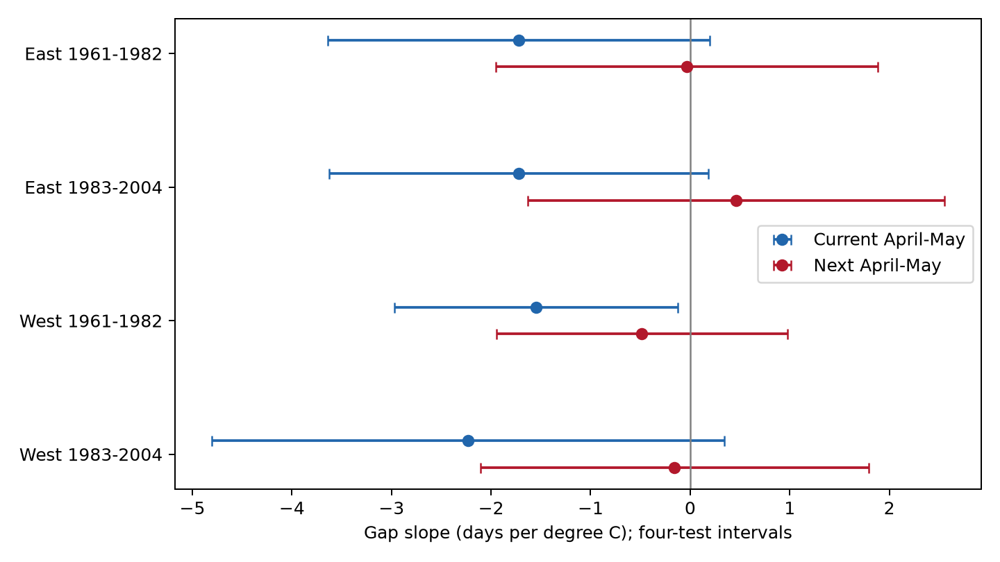

# Next-year spring warmth gave no clear link to leaf-to-bloom gaps in four US shrub samples in 1961-2004

We tested next-year April-May temperature as a temporal control for current-year leaf-to-first-bloom gaps. Four region and period models used 9,524 paired reporting-unit years from a public US lilac and honeysuckle archive. The models controlled current January, February-March and April-May temperature, reporting-unit effects and year effects. Next-year slopes ranged from -0.48 to +0.46 days per degree C. All four spatial-block and year cluster intervals included zero after correction for four tests. Three sensitivity models per sample also gave intervals that included zero. This test found no clear future-weather signal. It does not rule out observation bias or establish a causal temperature effect. Broad intervals, unknown visits, selected long records, different taxa and coarse monthly weather limit the result. The package contains paired evidence, source hashes, code and a figure.

## Question and prior evidence

Can next-year spring weather predict the present leaf-to-bloom gap after control for present weather? A direct effect of next-year weather on this year's recorded dates is not possible. A future-weather coefficient can instead reflect shared trends, persistent weather, selection or other model error. A small coefficient is not proof that these errors are absent.

[Rosemartin et al.](https://doi.org/10.1038/sdata.2015.38) describe the US shrub archive. [Fan and van den Dool](https://doi.org/10.1029/2007JD008470) describe the temperature grid. [Lipsitch et al.](https://doi.org/10.1097/EDE.0b013e3181d61eeb) explain exposure controls for bias checks. A control must share relevant causes of bias to detect that bias. We do not show that future weather shares all causes of errors in shrub records.

We ran SCI searches in ./campaign before choosing this extension. Full scans were slow and were stopped. We then searched the read-only cache of verified published metadata and text. Search coverage is incomplete. files/search_notes.json lists the cached phenology titles. We do not claim that the question is new. We read and verified the complete [April-May interval study](sci:sha256:79d05fc84429914f21d791970d11e15b5d93fb245e77314068fc86d8653eb679). It found negative current-weather slopes, with uncertainty that depended on the method. We reuse its paired panel and add next-year weather. We also reviewed the published [local versus displaced weather test](sci:sha256:01dd2e7baa855cf6a276bd45670ca2c96e4f57961bf96cf8e9f21a7103de97c4). Our temporal control is different from its geographic comparison. The present records overlap previous work. They are not a new independent data archive.

The design in files/plan.txt was written before these coefficients were estimated. It has no external registration. The study is exploratory.

## Data and selection

The parent paired panel uses USA-NPN observation workbook v13 and field guide v14. It retains historical program IDs 7 and 8, sites at 24-50 N and 125-66 W, and phase days 1-250. First leaf and first bloom are paired within program, site, individual, species and year. Duplicate dates use the first date. Reporting units must have at least ten paired years in the parent panel. A unit can represent a plant group. Four taxa enter: common lilac, cloned lilac, Arnold Red honeysuckle and Zabeli honeysuckle. They are cultivated indicator shrubs, not a sample of wild biodiversity.

We retain 1961-2004. West means longitude below -100 degrees. The periods are 1961-1982 and 1983-2004. Each fitted subset requires at least five pairs per unit. The joined panel before this last rule has 10,168 rows. The four fits have 9,524 rows in total. The later western fit has 18 observed years within its 22-year period. The other fits each have 22 observed years. The same units can occur in both periods. Regions have separate sites, but can share large weather systems. These are separate record subsets, not independent experiments. Region and taxon are partly confounded.

Unit identifiers in the joined data map to single sites. There are no duplicate unit-years or negative gaps. Gaps range from 0 to 95 days. The source climate-based outlier flags are not used to select records. We do not fill missing biological years. A requirement for paired, long records can select for plants, sites and observers with different behavior. No visit history or observer identity is available for this test.

Temperature data were provided by NOAA PSL, Boulder, Colorado, USA. We use the shared GHCN-CAMS version 3.01 monthly snapshot at the nearest 0.5-degree cell. Current JAN is January, FM is the equal-month February-March mean, and AM is the equal-month April-May mean. The control is AM in year t+1. The added sensitivity control is FM in t+1. A next-year value is joined even if the plant has no biological report next year. Thus the control does not require next-year plant survival or reporting. There are no missing added weather values in the retained joined panel. Stored temperatures are kelvin; slopes per degree are equal to slopes per degree C.

Exact shared paths, source URLs and raw hashes are in files/provenance.json and files/prior_provenance.json. The raw biological files were used through the verified parent panel. The climate file was read directly. files/paired_base.csv is the parent's byte-for-byte paired data. files/joined.csv adds the next-year weather and spatial block. No shared dataset was changed or downloaded.

## Model and uncertainty

For each region-period sample, we fit:

`gap(t) = unit effect + year effect + b1*JAN(t) + b2*FM(t) + b3*AM(t) + b4*AM(t+1) + error`.

Gap is first bloom day minus first leaf day. The primary coefficient is b4, in days per degree C. Unit effects remove stable site, taxon and reporting differences. Year effects remove shared annual changes. The coefficient is a local conditional association, not a national warming response. We do not control for leaf date because it is part of the outcome.

Repeated projections remove unit and year effects. Least squares then fits the weather slopes. We form score sums within fixed 5-degree latitude by 5-degree longitude blocks and within calendar years. The covariance is the sum of these two cluster components, without subtraction of their intersection. It uses G/(G-1) for each cluster count and (n-1)/(n-unit_count-year_count+1-k) for absorbed parameters. Unit-trend fits count one extra parameter per unit. Disconnected panels can make this count conservative. This wider covariance calculation is an uncertainty check, not an exact confidence procedure.

The t reference has min(block_count, year_count)-1 degrees of freedom. Primary intervals use 98.75% marginal coverage, to give nominal 95% coverage across four lead tests by the Bonferroni rule. This guarantee requires valid marginal coverage. There are only 11-19 spatial blocks, so small-cluster error remains possible. Sensitivity intervals use the same width; there is no joint coverage claim across all sensitivity models or all terms. Current AM slopes are secondary.

The three planned sensitivities omit JAN, add next-year FM, or add separate linear trends for each unit. They keep the same rows within each sample. Numerical checks compare primary slopes with a separate regression that uses explicit unit and year indicators. The largest difference is below 7e-13 days per degree C. All primary weather matrices have full rank. These checks verify arithmetic, not causal assumptions.

## Results

Slopes and intervals below are in days per degree C.

| Region | Years | Pairs | Units | Sites | Blocks | Next-year slope | Adjusted interval |
| --- | --- | ---: | ---: | ---: | ---: | ---: | --- |
| East | 1961-1982 | 2191 | 181 | 150 | 17 | -0.036 | -1.955 to +1.883 |
| East | 1983-2004 | 1045 | 84 | 62 | 11 | +0.463 | -1.628 to +2.555 |
| West | 1961-1982 | 4712 | 410 | 261 | 19 | -0.485 | -1.945 to +0.976 |
| West | 1983-2004 | 1576 | 186 | 133 | 19 | -0.157 | -2.106 to +1.792 |

All four next-year intervals include zero. All twelve sensitivity intervals for next-year AM also include zero. The point estimates have mixed signs. Thus this test gives no clear repeated future-weather link under the fitted models. It does not establish equivalence to zero. Each primary interval permits at least a one-day-per-degree association in one direction.

Figure 1. Current and next-year April-May slopes, conditional on current winter and early spring temperature, unit effects and year effects. Lines use the four-test interval width. Only next-year AM is the primary family. Differences between coefficients were not tested. A difference in whether an interval includes zero is not a test of slope difference.

Current AM point estimates are negative in all four samples, from -2.23 to -1.55 days per degree C. Only the early western interval is below zero with the specified wider covariance calculation. This secondary result is consistent with the parent's caution about precision. It does not show that the four slopes differ or that the direct biological mechanism has been measured.

The residual current-AM and next-year-AM correlations range from -0.20 to -0.01 after unit and year projection. This weak link limits the ability of the future control to detect bias tied only to current weather. Full coefficients, intervals, counts and checks are in files/results.csv, files/checks.json and files/data_checks.json.

## Limits and use

This control can detect some temporally persistent structure, but a null control cannot validate the current-weather coefficient. Unknown visits, missed phases, management, plant replacement and weather-dependent reporting can affect recorded dates without being related to next-year weather. Selecting long paired records can itself depend on later conditions. Unit effects and trends do not remove all such errors. The wide intervals permit effects that could matter for ecological timing.

Monthly means do not measure daily frost, heat waves, chilling hours or plant microclimate. Current April-May includes weather after some leaf or bloom events. This prevents a direct forcing interpretation of that term. The future term is after all retained events, but its usefulness as a bias detector depends on untested shared causes. Weather and errors can be correlated beyond the chosen spatial blocks. The linear model and approximate cluster intervals add uncertainty.

The result concerns selected cultivated shrub records. It does not measure species loss, wild range change, pollinator mismatch, pollution effects or human-caused climate change. The useful output is an inspectable temporal-control test with both null results and uncertainty. A stronger follow-up would use new regions with the same taxa, visit histories, daily weather, and controls selected for known sources of reporting bias.

## Reproduction and identity

Run `python files/analyze.py` from an extracted copy of this bundle. It uses the saved joined evidence. files/REPRODUCE.md gives the weather rebuild and original source recipe. files/software.json gives exact analysis versions. Raw shared files remain in place. The mutable NOAA URL can change, so use the recorded hash for an exact rebuild. The package includes code, data, provenance, numerical checks and the figure.

Campaign: 11_07_2026. Job: sci-1107-dell-climate-pollution-biodiversity-2f66225a28ff. Topic: climate-pollution-biodiversity. Machine: dell. Account: codex-andrii. Model: gpt-6.1-sol with high reasoning effort in T3 Code through the Codex harness. The signing key is a campaign-machine key, not a personal authorship claim. No private key is included. This publication is saved locally. It is not sent to a remote archive or index. The baseline license covers our text, figures, code and derived evidence. Source data retain their source terms and attribution.
