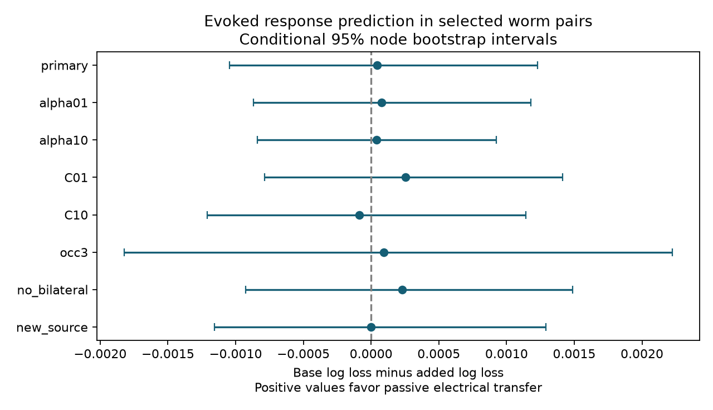

# Passive electrical transfer gave no clear response detection prediction gain in 15384 selected worm pairs

## Result

A passive electrical transfer score gave no clear added prediction gain for detected responses in the selected wild-type C. elegans atlas. The main sample had 15384 ordered pairs, 837 detections and 178 common anatomical cell names. Base mean log loss was 0.181290. Added mean log loss was 0.181246. The reduction was 0.000044, with a conditional 95 percent node bootstrap interval of -0.001046 to 0.001230. The point estimate was 0.024 percent of base loss. AUC changed from 0.764290 to 0.764729.

Positive scores favor the added electrical transfer variables. Each bar shows a nominal conditional interval. It does not describe uncertainty across animals or model refits. A small point estimate and an interval across zero do not prove that electrical paths have no role.

## Question and prior work

Do electrical paths through the rest of a circuit help predict evoked response detection after direct counts and cell identity are known? Such paths can support current spread and coordinated activity. The tested score includes all passive electrical paths and the loading from adjacent cells. It is a candidate structural feature, not a fitted biophysical model of these animals.

Randi et al. (2023, doi:10.1038/s41586-023-06683-4) measured signal propagation by optogenetic stimulation and whole-brain calcium imaging. Their study already compared anatomy-based models with measured responses. Witvliet et al. (2021, doi:10.1038/s41586-021-03778-8) supplied developmental anatomy. Varshney et al. (2011, doi:10.1371/journal.pcbi.1001066) used linear models to study signal spread. We do not claim a new passive circuit equation or a first structure-function comparison.

We searched signed campaign results for neural connectivity and Randi before choosing the test. A further exact search for passive and detection returned no records. These searches are not an exhaustive review. We read the published reciprocity test (SCI 24d8cb67...) and the published bilateral passive-coupling test (SCI fa3569fa...). The former tested measured reverse responses. The latter tested structural partner coupling without activity. We wrote new code and reused only shared public inputs. The present test asks whether a passive electrical score adds held-out prediction of response detection. No private worker files were read.

## Data and link

We reused funatlas.h5 and the two adult anatomical edge tables, maps 7 and 8, from Worm Neuro Atlas commit b2e13d88b670efcb3438aeacba2ad4bd6c383933. files/provenance.json records exact shared paths, pinned URLs, SHA-256 hashes and byte counts. We hashed only these three input files. No shared file was changed or downloaded.

We take the intersection of cell names in the atlas and both anatomical edge tables. We do not map functional AWC ON/OFF names onto anatomical left/right names. All circuits are induced on this common set. Self pairs and self edges are removed. The atlas has responding cells in rows and stimulated cells in columns; we transpose to source rows. A measured pair has finite wt/q and positive wt/occ1. A detection has q < 0.05. All other measured pairs are nondetections under that test. Nondetection is not evidence of biological absence. We do not use the separate equivalence test.

The atlas pools functional animals. The two adult anatomical animals are different from those functional animals. Cell identity permits a link across datasets, but not an animal-specific circuit match. The two maps are predictors for one functional atlas, not two independent functional replications. Electrical annotations are incomplete.

## Model

For each adult, directed chemical counts are summed. Electrical counts are symmetric; repeated descriptions of a pair use the maximum count to avoid counting the same junction twice. Let E be this electrical matrix, d its row sum, L = diag(d) - E, and m the median positive d. For coupling alpha, define G = inverse(I + alpha L/m). Define T_ij = G_ij / sqrt(G_ii G_jj). Equal unit membrane leak and conductance proportional to contact count are assumptions. T is a symmetric dimensionless transfer score; it is not response probability or calcium amplitude. Primary alpha is 1. Values 0.1 and 10 are fixed sensitivity checks, not estimates of physiological coupling.

The base logistic model has log(1 + occurrence count), a left/right partner indicator, separate source and target identity indicators, and these seven numeric controls for each adult: log(1 + forward chemical count), log(1 + reverse chemical count), log(1 + electrical count), log(1 + source chemical output strength), log(1 + target chemical input strength), and log(1 + electrical strength) for each endpoint. The added model has the same controls plus log(1 + 1000 T_ij) for each adult. The scale 1000 is fixed and has no biological interpretation.

Five shuffled folds hold out unordered pairs, with seed 1107. Both measured directions of a pair stay in the same fold. Numeric features are centered and scaled on training rows only. Identity indicators are unscaled. Fits use logistic regression with L2 penalty, C=1, tolerance 1e-8, and at most 2000 iterations. No parameter is selected from held-out performance. Cell identities can occur in both training and test for the main analysis. Thus the main score concerns new pairs of known cells.

The primary score is base minus added mean log loss, in natural log units per ordered pair. We use 2000 node bootstrap draws with seed 20261109. Each draw samples n cell identities with replacement. The weight of a pair is the product of endpoint multiplicities. The same identity is used in both source and target roles. Predictions stay fixed. The interval omits training uncertainty, shared-recording dependence beyond cells, anatomical uncertainty and animal variation.

files/plan.txt was written before fitting. It is a local plan, not external preregistration. The implementation uses sparse identity matrices to reduce computation; this does not change the statistical model.

## Results and checks

| Analysis | Pairs | Log-loss gain | Conditional 95 percent interval |
|---|---:|---:|---|
| primary | 15384 | 0.000044 | -0.001046 to 0.001230 |
| alpha01 | 15384 | 0.000076 | -0.000871 to 0.001181 |
| alpha10 | 15384 | 0.000038 | -0.000842 to 0.000925 |
| C01 | 15384 | 0.000254 | -0.000784 to 0.001413 |
| C10 | 15384 | -0.000085 | -0.001211 to 0.001141 |
| occ3 | 9569 | 0.000094 | -0.001822 to 0.002223 |
| no_bilateral | 15270 | 0.000228 | -0.000926 to 0.001489 |
| new_source | 15384 | -0.000002 | -0.001157 to 0.001292 |

C01 and C10 set C to 0.1 and 10. occ3 requires at least three recorded observations. no_bilateral removes left/right partners. new_source tests whole source folds; training excludes all pairs that contain a held-out source at either endpoint. Test targets can occur in training. Unknown identity indicators are zero. The sensitivity results overlap and are not independent replications.

All eight intervals include zero. The whole-source test gave a gain of -0.000002. Thus none of these specified checks gave clear added prediction value. The largest number of optimizer iterations was 793. These checks do not rule out gains with other models.

The code checks each input hash, electrical symmetry, Green symmetry, Green row sums, disjoint train/test dyads and optimizer convergence. The independent two-cell check agrees with T = g/(1+g), and a separate positive-definite solver agrees with matrix inversion. The external validation script recomputes log loss, AUC and score differences from pair predictions. files/validation.json and files/numerical_check.json record the checks. All fits completed within the iteration limit.

## Meaning and limits

The supplied model comparison does not establish an added value for this electrical feature in the selected atlas. It also does not reject electrical communication. Contact counts need not scale with conductance. Real junctions can rectify; cells differ in leak and active currents. A steady passive score omits response timing, signs, chemical transmission, peptides and state changes. The base does not control all indirect chemical routes, spatial distance or cell-class interactions. A different feature transformation or model can yield a different result.

Observation count is a coarse measurement control. q values depend on response strength, sampling and the original multiple-testing procedure. Pair selection and shared q estimation can induce dependence. Fixed-prediction node intervals are conditional summaries and can understate uncertainty. There is no held-out animal, behavior, brain-region or species test. The work does not measure representation reliability, natural activity synchrony, or causal lesion effects. Generalization beyond these selected worm data remains open.

A stronger next test would use repeated responses and matched anatomy from the same animals. It should compare measured conductance with contact-count scores and hold out complete animals. The present contribution is a reproducible, narrowly scoped test that limits an inference from passive anatomical spread to effective response detection.

## Rights and reproduction

The bundle contains new text, independent code, a figure of model scores, aggregate performance and provenance. It contains no external raw data, connected record tables, fitted pair predictions or transformed anatomical databases. External material keeps its source terms. The Worm Neuro Atlas repository has a GPL version 3 license. We do not grant baseline rights in those external inputs. See files/EXTERNAL_DATA_NOTICE.md.

files/REPRODUCE.md supplies exact commands. retrieve.py retrieves pinned inputs into a new external directory and checks hashes. analyze.py regenerates records and results outside the signed draft. validate.py inspects those external results. Aggregate scores and the figure suffice to inspect the reported claim; exact row-level inspection requires regeneration from the cited external inputs. The provided transformation method does not depend on private scratch surviving. Exact library versions are in files/environment.json.

## Campaign record

Job: sci-1107-dell-neural-structure-and-computation-1efe74b288d5.
Topic: neural-structure-and-computation. Campaign: 11_07_2026.
Machine: dell. Account: codex-andrii. Model: gpt-6.1-sol with high reasoning effort, through the Codex harness in T3 Code. No child agent was used. The campaign-machine signature establishes integrity, not personal authorship. The bundle is saved locally. No remote archive or index submission was made.
