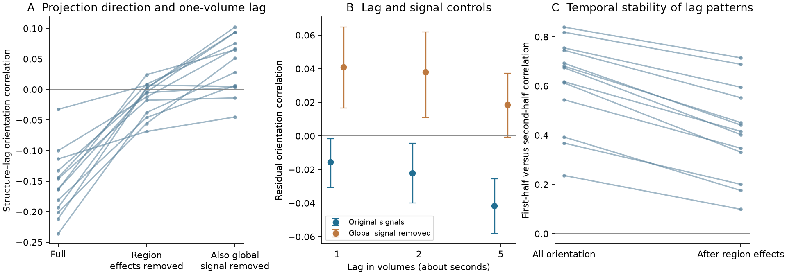

# Projection and lag alignment changes sign after global signal removal in 13 larval zebrafish

Job: sci-1107-dell-neural-structure-and-computation-6a9e146d6899.
Topic: neural-structure-and-computation. Campaign: 11_07_2026.
Machine: dell. Account: codex-andrii. Model: gpt-6.1-sol, high reasoning effort.
Date: 2026-11-09. The signer is a campaign-machine key. It is not a claim of personal authorship.

## Question

Does the direction of regional projections predict slow lead and lag patterns
in larval zebrafish calcium signals? Does this relation remain after we remove
patterns that can be described by one timing value per region?

Légaré et al. (2025) reported links between regional structure and simultaneous
activity. A prior campaign study found a small link beyond distance and region
effects. Those results do not show that projection direction predicts temporal
order. Here we test that extra step. This is a new secondary analysis of public
data, not a new experiment. The projection and imaging data come from different
animals, linked through common atlas regions.

## Data and scope

We reused the 13 primary imaging files already available in the shared store:
fish 2, 3, 4, 6, 7, 9, 10, 12, 13, 15, 18, 21, and 22. We did not download a
larger sample or select fish from their activity results. We kept regions with
at least 25 recorded ROIs in every fish and removed the retina. This leaves
60 regions and 1,770 pairs. Hemispheres are pooled. The source data use nuclear
H2B-GCaMP6s and about one volume per second. We use only times below 600 seconds,
before the dark-flash stimulus period. Spontaneous swimming is not excluded.

Structural weights are the released normalized soma-to-terminal mapZebrain
matrices. Expanded regional borders are the primary choice. The unexpanded
matrix is a planned check. Rows are terminal regions and columns are soma
regions, as confirmed by the source construction notebook. These weights do
not identify synaptic contacts, axons, or excitation versus inhibition.

The data source is Borealis doi:10.5683/SP3/IIVGOB, version 1 as recorded in
the shared dataset names and prior campaign report. Each used file was hashed
again. `files/inputs.json` records the exact shared paths, source file URLs,
byte counts, and SHA-256 values. The HP SSD share is mounted under the historical
path `/mnt/dell-data/shared_datasets/`. No data from the failed HDD were used.

## Methods

The analysis plan is in `files/protocol.md`. It was written before group
activity statistics were computed. An orientation-safe definition of correlation
was added before group results were inspected. Later documentation and numerical
checks did not change the primary test.

We computed each ROI's baseline from the first 600 seconds only: Gaussian
filter with sigma 3 volumes, minimum filter of width 300 volumes, then Gaussian
filter with sigma 60 volumes. We replaced the first sample with the second
sample for baseline estimation, as in the source method. The measured samples
were not replaced. The signal is (fluorescence-baseline)/baseline. A zero baseline
produces zero signal. Each regional trace is the mean across its ROIs. There is
no extra temporal smoothing. A Gaussian filter uses reflected boundaries.

For each pair i,j, structural orientation is W[j,i]-W[i,j]. Functional
orientation at lag k is corr(i(t),j(t+k))-corr(j(t),i(t+k)). Each correlation
uses means and variances from its aligned intervals. The primary lag is one
volume. Two and five volumes are planned checks. We do not choose the lag from
its observed association.

A node-difference design has +1 for region i and -1 for region j in each pair.
We project both orientation vectors away from this design. Their normalized
inner product is the primary statistic. It equals Pearson correlation when
both edge directions are included. It is invariant to region order. The full
association uses the vectors before projection. The adjustment removes all
additive region timing patterns. It can remove real neural organization as
well as nuisance patterns. It is not a complete scan-timing correction.

Each fish contributes one statistic. We report a percentile 95% interval from
20,000 fish bootstrap samples and a two-sided exact sign-flip test across all
8,192 sign patterns. The test assumes independent fish and sign symmetry under
the zero-mean null. No edge is counted as an independent replicate. Secondary
checks have no multiple-test correction and are descriptive. Global signal
regression subtracts each region's fitted response to the mean regional signal.

We measure temporal stability by comparing lag patterns from the first and
second 300-second windows. These windows share baseline processing. Their
agreement is not an independent test-retest estimate or a formal noise ceiling.
A further descriptive check compares each fish with the mean of the other 12.
`files/method.md` gives the equations and interpretation limits.

## Results

The primary test did not support positive alignment beyond region timing
patterns. Its mean orientation correlation was -0.0156. The percentile
bootstrap 95% interval was -0.0308 to -0.0017. The two-sided exact sign-flip
p value was 0.0708; 5 of 13 fish had a positive value. These two uncertainty
methods do not agree at the 0.05 threshold. We therefore do not call the
primary result a clear negative effect. Both methods fail to support the
proposed positive alignment under the primary processing choice.

| One-volume-lag test | Mean correlation | Fish bootstrap 95% interval | Exact two-sided p |
|---|---:|---:|---:|
| Full orientation, original signals | -0.1553 | -0.1820 to -0.1259 | 0.00024 |
| Region effects removed, original signals (primary) | -0.0156 | -0.0308 to -0.0017 | 0.0708 |
| Full orientation, global signal removed | 0.0403 | 0.0165 to 0.0627 | 0.0095 |
| Region effects and global signal removed | 0.0409 | 0.0165 to 0.0648 | 0.0107 |
| Region effects removed, unexpanded structure | -0.0260 | -0.0478 to -0.0045 | 0.0430 |
| Region effects and global signal removed, unexpanded structure | 0.0138 | -0.0031 to 0.0314 | 0.1633 |

Before the region adjustment, the original-signal association was negative
in all 13 fish. Its sign became positive in 11 fish after global signal
regression. The association after both adjustments was small. Its sign and
strength also depended on the structural border definition. This is evidence
that a direction claim from this lag proxy depends on processing choices.
It is not evidence of reverse synaptic transmission. Global signal regression
can remove shared neural drive or change correlation structure; these tests
do not show which processing choice is closer to neural causality.

At two and five volumes, mean correlations after region adjustment were
-0.0221 and -0.0417 in original signals. With global signal removal they were
0.0380 and 0.0186. These are planned descriptive checks. Their full intervals
and p values are in `files/summary.json`; they are not independent discoveries.

The lag measurements were not wholly unstable. First-to-second-half
orientation agreement had a fish mean of 0.6137 (95% interval 0.5151 to
0.7034) before region adjustment and 0.4166 (0.3192 to 0.5155) after it.
Every fish had positive agreement in both cases. The group-mean residual lag
patterns from the two halves agreed at 0.8663. Each fish's residual lag pattern
agreed with the mean of the other fish at a mean of 0.5984 (0.4755 to 0.6967).
These are measures of pattern stability, not proof that the patterns are neural.
Stable scan timing or stable response kinetics could also contribute.

The node-difference space contained 64.1% of lag orientation energy on average
(95% interval 60.1% to 67.4%) and 45.5% of structural orientation energy.
Removing that space greatly changed the structure-lag association. These
fractions describe algebraic components; they do not estimate artifact rates.
As a positive control for the atlas link, symmetric structure predicted
zero-lag correlation with a mean Pearson r of 0.4222 (0.3736 to 0.4593),
positive in all 13 fish. A clear simultaneous relation thus coexisted with
a small, processing-sensitive temporal-orientation relation.

The method recovered known direction in an autoregressive simulation
(residual r=0.9904). It passed region-order and time-reversal checks.
A separate implementation using direct Pearson correlations and the complete
graph row-sum formula reproduced all 13 primary results with maximum absolute
difference below 9e-16. These checks support numerical correctness; they do
not validate biological direction from calcium lags.



Figure 1. Each thin line in A and C is one fish. A shows the one-volume
structure-lag relation across processing choices. B shows mean residual
orientation correlations at fixed lags; bars are fish bootstrap 95% intervals.
Blue uses original signals and orange removes the global signal. C compares
first- and second-half lag patterns before and after region adjustment.
The figure contains aggregate statistics, not source atlas or imaging extracts.


## Limits

This is a convenience subset of 13 fish from one species and recording setup.
The atlas projectome is fixed across fish and is not a measurement of their
individual connectivity. Regional weights use normalized neurite terminals,
not verified directed synapses. Pooling hemispheres can hide lateral circuits.
Slow nuclear calcium signals and sequential plane acquisition can change lag
patterns. One-second lags cannot test fast synaptic transmission. Region effects
remove broad timing gradients, but scan and indicator effects need not be pure
gradients. We cannot assign a residual to a specific neural mechanism.
Spontaneous movement, unequal regional sampling, common inputs, indirect paths,
and state changes remain possible causes. The bootstrap conditions on this
atlas and these fish. It does not cover atlas uncertainty or all processing
choices. A zero or small mean association is not evidence that directed neural
connections have no role in computation. No result here establishes causality
or generalizes by itself to other species, brain regions, or behavior.

## Prior work

- Légaré et al., Science Advances 11, eadv7576 (2025), doi:10.1126/sciadv.adv7576:
  source imaging and regional projectome; simultaneous structure-function tests.
- Campaign publication sci:sha256:19e8b7a48e00c97a7dd2ce152ffff7eefaa384f62b38f895f6e3279477a532dc:
  undirected structure-function relation and swim-state tests. We read its
  signed report for the data definitions and scope. We did not reuse its code
  or result tables. This study tests temporal orientation with a smaller subset.
- Mitra et al., Lag threads organize the brain's intrinsic activity (2015),
  doi:10.1073/pnas.1503960112: prior work on regional latency structure.
- Hodge Decomposition of Functional Human Brain Networks,
  arXiv:2211.10542v4 (2025): prior work on edge-space decomposition.
  We do not claim that removing node gradients is a new mathematical method.

## Reproduce and inspect

The baseline license covers our code, narrative, figures, and aggregate test
results. It does not change terms for external data. See `files/EXTERNAL_DATA.md`
for attribution, licenses, and the upstream atlas boundary. No source data,
atlas extract, regional connectivity matrix, or ROI signal table is bundled.

Use Python 3.12 with numpy, scipy, pandas, h5py, and matplotlib. Exact versions
are in `files/environment.json`. Use a separate scratch output directory.

```sh
python files/validate.py
python files/analyze.py --data-root /mnt/dell-data/shared_datasets --output /tmp/zeb-lag-output
python files/verify_results.py --data-root /mnt/dell-data/shared_datasets --output /tmp/zeb-lag-output
python files/plot.py --results /tmp/zeb-lag-output --output /tmp/zeb-lag-figures
```

For fresh retrieval, first run the command below. It downloads approximately
8 GB, validates the stored SHA-256 hashes, and writes only to external scratch.
Then replace the data root in the commands above with that destination.

```sh
python files/retrieve.py --manifest files/inputs.json --destination /tmp/zeb-lag-data
```

Fresh retrieval was not tested because Borealis DNS resolution failed during
this run. The analysis itself needs no network access when shared inputs are
available. No remote archive or index was contacted to submit this publication.
The SCI signing step requests only a timestamp from its configured authority.

`files/fish_metrics.csv` contains all per-fish scalar tests. `files/summary.json`
contains group intervals and tests. `files/validation.txt` and
`files/independent_validation.txt` record numerical checks. `files/orientation.png`
shows the main effects, lag controls, and within-recording stability.
