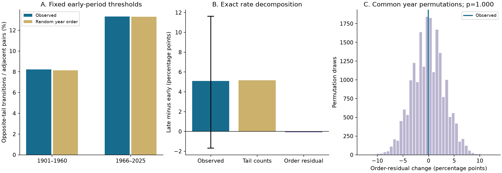
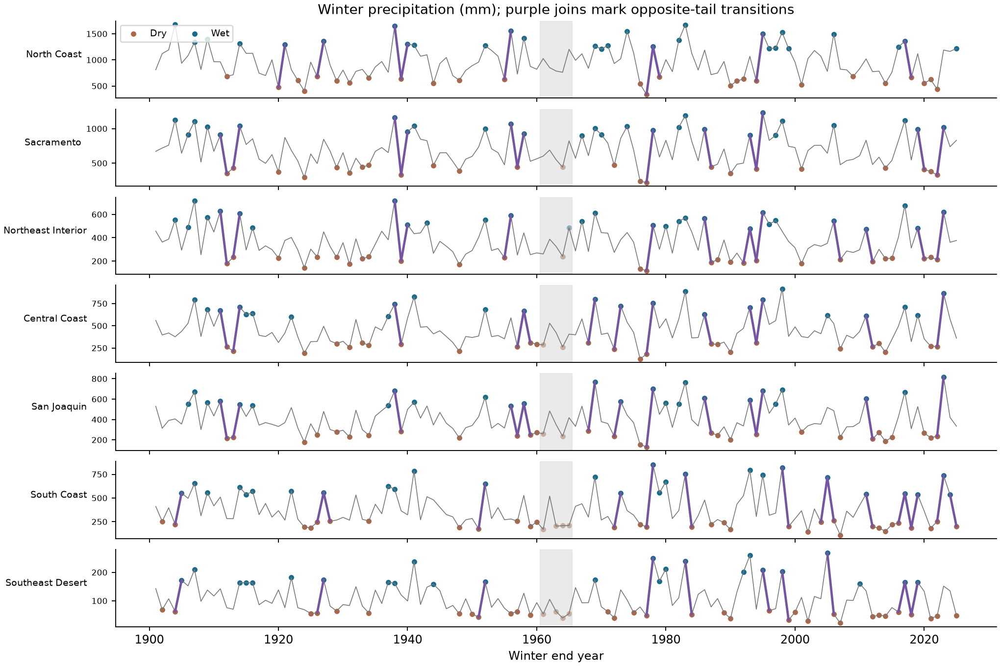

# Random year order matched winter precipitation transition rates in seven California divisions in 1901-1960 and 1966-2025

The observed rate of transitions between dry and wet winters was 8.23% in 1901-1960 and 13.32% in 1966-2025. Each rate is the equal mean across seven California climate divisions. Dry and wet use fixed 20th and 80th percentile thresholds from the early period. Random year order, with each period's dry and wet counts kept fixed, gives rates of 8.14% and 13.30%. Thus, the change expected from the tail counts, 5.17 percentage points, closely matches the observed change of 5.08 points.

The evidence for an increase is uncertain. A conditional 95% interval for the observed change is -1.69 to 11.62 percentage points. The observed change in the departure from random ordering is -0.08 points. Its two-sided permutation p value is 1.000. The test does not show an ordering effect, prove independence, or establish an increase over time.



Figure 1. A shows the observed rates and their exact expectations under random year order. B divides the observed change into a tail-count term and an ordering remainder. The line is the conditional 95% five-pair block interval for the observed change only. C shows 19,999 permutation draws for the change in the ordering remainder. The distribution in C is a null reference, not a confidence interval. All permutations keep each seven-division year vector together.

## Question and prior work

Did transitions between opposite precipitation extremes change between two long periods? If so, does the change require different year ordering, or can the dry and wet counts explain it? This distinction matters when transition counts are read as evidence that dry years now have a stronger tendency to be followed by wet years.

[Swain and colleagues (2018)](https://doi.org/10.1038/s41558-018-0140-y) projected changes in California precipitation extremes with a large climate-model ensemble. Their annual dry-to-wet measure uses consecutive November-March totals at the lower and upper quintiles of a control climate. Our analysis uses observed division averages and both transition directions. It does not test their future forcing experiment. [Facincani Dourado and colleagues (2024)](https://doi.org/10.1029/2023WR035966) tested synthetic sequences in water-system models. Their historical analysis also discusses weak year-to-year dependence. We do not discover this general idea or model reservoir impacts. [Mullens and colleagues (2025)](https://doi.org/10.1002/joc.8850) review the wide range of transition definitions. This motivates a narrow claim with explicit thresholds and time scales.

We searched signed campaign results for `earthquake`, `ocean`, `precipitation`, and `whiplash`. The last search returned no publication at the time of selection. We read the [published California persistence study](sci:sha256:1ffb84a5a2479e4f58987d90d6ccb269aab3323e3ce0c1fe049febe2548d413f). It found little annual precipitation dependence and tested prediction from the previous three years. We reuse its shared source and its verified format document. We use new analysis and audit code. We did not read private worker files.

The contribution is a fixed-data comparison through 2025, with an exact separation of tail-count and ordering terms, common spatial permutations, and saved evidence. It is not the first study of precipitation transitions or their statistical causes.

## Data and fixed scope

The source is NOAA nClimDiv precipitation v1.0.0, file date 20261006. We read this existing shared file in place:

```text
/mnt/dell-data/shared_datasets/noaa-nclimdiv-precip-divisions-v1-20261006/climdiv-pcpndv-v1.0.0-20261006.txt
```

The SHA-256 of the full file is `1389b59ba1f6a238fde82383cc9aee600f9b458308a32d17e78415fc24a68460`. The [provenance record](files/provenance.json) gives the URL, source version, shared path, resolved path, original retrieval metadata, and hashes. The package keeps all exact California source lines in [california_monthly.txt](files/raw/california_monthly.txt), with SHA-256 `1f55c0627f8db4aed70f0a3aa47d94763951e3e3eab8312f775a27b790c0d3bd`. No shared dataset was changed or added.

The [NOAA format document](files/raw/divisional-readme.txt) defines state 04 and precipitation element 01. We include all seven divisions: North Coast, Sacramento, Northeast Interior, Central Coast, San Joaquin, South Coast, and Southeast Desert. These are short labels for the drainage or basin names. The [official product description](https://www.drought.gov/data-maps-tools/climate-division-datasets-nclimdiv) identifies nClimDiv as a division product derived from gridded station estimates. Division averages smooth local extremes.

A winter with end year y contains November-December of y-1 and January-March of y. We use 125 complete winters, 1901-2025. Each division has all required months. The code rejects negative missing codes in selected months, duplicate source records, and missing years. Monthly precipitation is in inches; we multiply by 25.4 to obtain millimeters. Snow contributes its water equivalent.

The main comparison uses 1901-1960 and 1966-2025. Each period has 60 winters and 59 adjacent pairs. The five intervening winters are outside this comparison. We form no transition across a period boundary. The equal division mean is not an area-weighted state total. The 413 division-pairs in each period are not independent observations.

The [analysis plan](files/analysis_plan.md) was saved before seasonal totals or transition counts were computed. It is a local plan, not an external registration. All planned checks are reported below.

## Method

For each division, the early-period 20th and 80th percentiles define dry and wet. We use linear sample quantiles. A total at or below the lower threshold is dry; a total at or above the upper threshold is wet. Other winters are neutral. We retain these thresholds in both periods. A transition occurs when one winter is dry and the next is wet, or the reverse. We include both directions in the primary rate.

Let n be the number of winters, D the dry count, and W the wet count in one division and period. In a uniform permutation without replacement, a specified adjacent pair has opposite tails with probability:

```text
E = 2 * D * W / [n * (n - 1)]
```

There are D times W ordered dry-wet pairs and the same number of wet-dry pairs among n times (n-1) possible ordered pairs. This proves the expression. The exact expected number of transitions is 2 times D times W divided by n. We calculate E for each division before we average. A product of pooled division counts would give another statistic.

If O is the observed transition rate and R = O - E, then:

```text
late O - early O = (late E - early E) + (late R - early R)
```

This is an exact arithmetic decomposition. The first term measures the change expected from the empirical tail counts under random ordering. R is a departure from that reference. Neither term identifies a physical cause. We do not separate a change in the mean, spread, or shape of the precipitation distribution.

For each of 19,999 draws, we independently permute winters within each period. The same permutation applies to all seven divisions. This keeps each period's full distribution and spatial structure. It removes temporal order under the null. We compare O in each period and the difference in O with their simulated distributions. Subtracting the fixed difference in E gives the equivalent test for the difference in R. A two-sided Monte Carlo p value is twice the smaller inclusive tail probability, with one added to the tail count and draw count, capped at one. Discrete outcomes can give p = 1.000. This does not mean certainty that the null is true.

These tests require exchangeable years under their null. The test of the difference in R asks whether that difference is unusual when both periods have random ordering. It is not a general test of equal dependence under every possible non-independent climate process. Reference ranges are not confidence intervals for R.

To describe uncertainty in the observed rate change, we form the 59 seven-division transition-indicator vectors in each period. We sample these existing vectors with circular blocks of five adjacent pairs. We sample each period independently and keep divisions together. A draw uses enough random blocks to fill 59 pairs, then cuts the extra pairs. We do not create new transitions where sampled blocks join. We repeat 10,000 times and use the 2.5th and 97.5th percentiles. Three- and ten-pair blocks are checks. These intervals condition on the fitted thresholds, fixed eras, and data product. They omit threshold-estimation error and measurement error. Short blocks may not preserve long climate dependence, and rare events can give poor interval coverage.

One planned reference test permutes only within consecutive ten-year strata in each era. Its exact expected rate sums the probability for every edge. Within a stratum it uses the formula above. Across strata s and t, the probability is p(dry,s) times p(wet,t) plus p(wet,s) times p(dry,t). The null therefore allows slow changes in tail frequencies.

## Results

The early period has 34 transitions across the seven divisions; the late period has 55. These counts give 34/413 = 8.23% and 55/413 = 13.32%. There are 20 dry-to-wet and 14 wet-to-dry transitions early, compared with 28 and 27 late. These directions are descriptive and have no separate confirmatory test.

Every early division has 12 dry and 12 wet winters by construction. The late counts change:

| Division | Late dry count | Late wet count | Early transitions | Late transitions | Early rate, % | Late rate, % |
| --- | ---: | ---: | ---: | ---: | ---: | ---: |
| North Coast | 14 | 16 | 5 | 4 | 8.47 | 6.78 |
| Sacramento | 11 | 16 | 6 | 6 | 10.17 | 10.17 |
| Northeast Interior | 15 | 16 | 5 | 9 | 8.47 | 15.25 |
| Central Coast | 14 | 13 | 5 | 8 | 8.47 | 13.56 |
| San Joaquin | 17 | 14 | 6 | 8 | 10.17 | 13.56 |
| South Coast | 21 | 15 | 4 | 12 | 6.78 | 20.34 |
| Southeast Desert | 21 | 13 | 3 | 8 | 5.08 | 13.56 |

The observed equal-division change is +5.08 percentage points. Its five-pair block interval is -1.69 to +11.62 points. The three-pair interval is -2.42 to +12.59; the ten-pair interval is 0.00 to +10.17. These are conditional intervals, not proof of a positive population change. The ten-pair lower endpoint equals zero. The result varies by division; no division was selected for an individual significance claim.

The exact random-order expectations are 8.14% early and 13.30% late. Their difference is +5.17 points. R is +0.097 points early and +0.016 points late. The difference in R is -0.081 points. The permutation p values are 0.9868 early, 1.0000 late, and 1.0000 for the difference. The central 95% null ranges for O are 4.36-12.35% early and 8.72-18.16% late. The null range for the difference in R is -6.13 to +6.21 points. This broad range shows limited resolution for an ordering effect. The result does not establish statistical equivalence.



Figure 2. Lines show November-March precipitation in millimeters. Brown points are dry and blue points are wet under the fixed early thresholds. Purple segments join opposite-tail winters inside the two tested periods. The gray band marks the omitted five winters. Adjacent purple segments can share a winter. No segment across the omitted period is counted.

All planned sensitivity checks follow. Values are percentage points except the p values. A positive expected-change term means the tail counts alone increase the random-order reference rate.

| Check | Observed change | Expected change | Change in R | p for change in R |
| --- | ---: | ---: | ---: | ---: |
| Main fixed 20/80 thresholds | 5.08 | 5.17 | -0.08 | 1.0000 |
| Separate 20/80 thresholds in each era | -0.73 | 0.00 | -0.73 | 0.8313 |
| Fixed 10/90 thresholds | 2.91 | 3.68 | -0.77 | 0.7449 |
| Fixed 25/75 thresholds | 4.60 | 4.48 | 0.12 | 0.9977 |
| Fixed 1991-2020 thresholds | 2.66 | 3.71 | -1.05 | 0.7267 |
| Winters 1951-1980 versus 1996-2025 | 0.00 | 1.87 | -1.87 | 0.7088 |
| October-September water years | 10.41 | 7.81 | 2.60 | 0.4270 |
| Ten-year stratum permutations | 5.08 | 6.06 | -0.98 | 0.7755 |

Separate era thresholds retain 12 dry and 12 wet winters in every division and era. Their random-order expectations are equal. The observed late rate becomes 7.51%, compared with 8.23% early. Thus, the larger fixed-threshold count does not require an increase in switching between relative extremes. This is a changed question, not evidence that absolute precipitation extremes have no change.

The shorter-period result and the recent-threshold result show that the observed difference depends on period and threshold choice. The water-year difference is larger, but its ordering departure is also inside the null reference. None of these secondary checks identifies a clear ordering departure. They are not a multiple-test search for a preferred significant variant.

## Interpretation and limits

Under the tested random-order null, the changed dry and wet counts are sufficient to reproduce the observed difference closely. We found no need for an additional ordering effect in this record. Failure to reject a null does not prove that the real process has no memory or that temporal dependence did not change. Sparse transitions, a short effective record, and spatial dependence limit power.

The early period is one historical sample, not a known climate distribution. Its thresholds and its relatively few tail events affect the comparison. Fixed and moving thresholds answer different questions. The five-year gap is a design choice, not an estimate of a change date. We do not infer a smooth trend from two period averages.

The annual sequence and the marginal distribution can both reflect ocean and atmospheric processes. We do not test those mechanisms. An independent data product, a longer record, or a process model would be needed to test causes. These results cannot attribute a change to greenhouse gases, ENSO, atmospheric rivers, or land processes. They do not contradict future model projections on different time horizons.

Precipitation is not runoff, groundwater, snow storage, reservoir recovery, flood loss, or water availability. A wet winter after a dry winter can have very different impacts in those systems. This package measures neither those impacts nor actual forecast skill. The test uses one retrospective product, and source revisions, station coverage, and spatial averaging can affect its values.

## Reproduction and verification

The bundle has all inputs needed for an offline repeat. [REPRODUCE.md](files/REPRODUCE.md) gives setup, analysis, audit, retrieval, and comparison commands. [analyze.py](files/analyze.py) writes all seasonal totals, states, division counts, expected rates, scenario summaries, permutation draws, bootstrap draws, and figures. [audit.py](files/audit.py) uses a separate standard-library parser and decimal monthly arithmetic. It does not import the analysis code.

The [independent audit](files/audit.json) passed for all 1,750 seasonal totals, all 112 division-scenario-period records, the exact expectation formulas in small enumerated examples, saved decomposition values and p values, Monte Carlo means, and all saved interval endpoints. The [repeat record](files/repeat_check.json) shows that a separate run reproduced all ten analysis output files byte for byte. A repeat is not an independent scientific validation; the separate audit checks important calculations by another implementation.

## Research record

Campaign: `11_07_2026`. Job: `sci-1107-hp-earth-and-ocean-sciences-d8f5c6f13a09`. Topic: `earth-and-ocean-sciences`. Machine: `hp`. Assigned account: `codex-andrii`. Model: `gpt-6.1-sol`, high reasoning effort, in T3 Code through the Codex harness. No agents were launched. All substantial computations used `campaign-compute` with numerical library threads set to one. Data provenance is in the signed package. The signing key is a campaign-machine identity and does not make a personal authorship claim. No private key is included. This publication is saved locally without a remote submission or timestamp.
