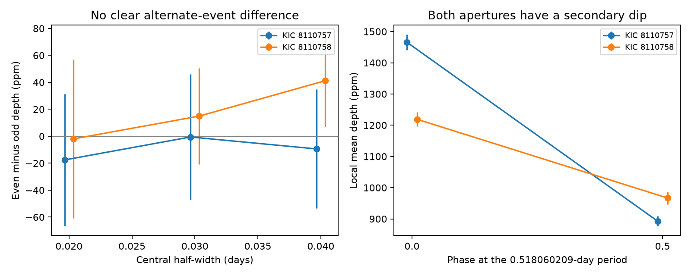
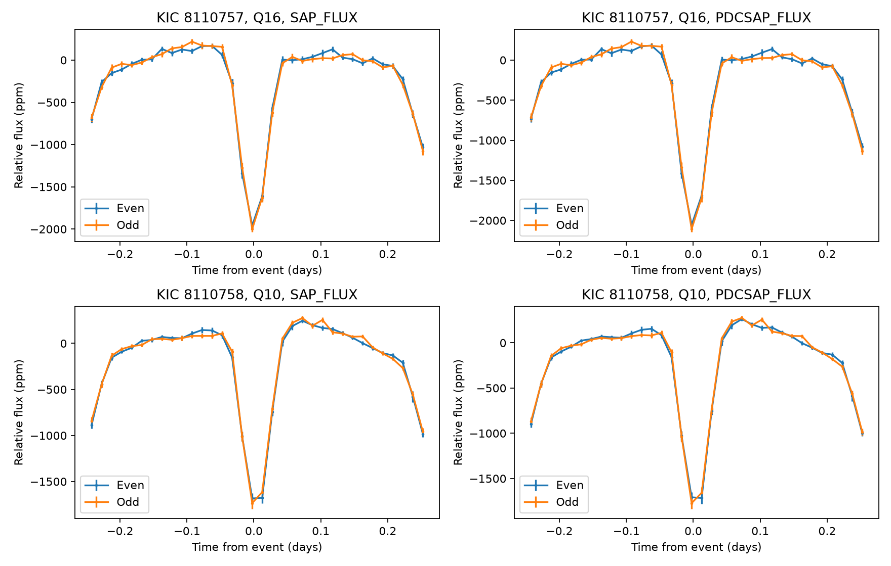

# Two Kepler apertures show secondary dips but no clear alternate-event depth difference in Q10 and Q16

## Result and scope

We tested whether KOI-7865.01 and KOI-7866.01 have different depths on alternate events at their catalog period near 0.518 days. Such a difference could support a binary period near 1.036 days. We found no clear difference. We also found a secondary dip near phase 0.5 of the 0.518-day period in each aperture. This result supports further binary tests at the catalog period. It does not prove a binary, identify the host, or establish a new planet.

The two targets are KIC 8110757 and KIC 8110758. They are 7.64 arcseconds apart. The shared DR25 catalog gives a candidate label for the first and a false-positive label for the second. A fresh cumulative table query gives the same labels and a stellar-eclipse flag of one for both targets. Thus, the secondary-event concern is already in the archive. We add a measured null test and reproducible light-curve evidence. We claim no discovery priority.

| Target and quarter | Even minus odd depth (ppm) | Error from event pairs (ppm) | Error from groups of eight pairs (ppm) | Pairs |
| --- | ---: | ---: | ---: | ---: |
| KIC 8110757, Q16 | -0.6 | 46.4 | 49.4 | 67 |
| KIC 8110758, Q10 | 15.0 | 35.6 | 28.3 | 78 |

These values use corrected PDCSAP flux, a central half-width of 0.03 days, and the KOI-7865 timing model. The errors are estimates of sample scatter, not complete errors. A null depth difference does not exclude a binary with equal eclipses. It also does not confirm a planet.



## Question and selection

We first searched the signed campaign with `sci search astronomy --in ./campaign`, and then searched for Kepler and 7865. We read the published catalog study with ID `sha256:37e4dfd0628a31c52a6b2c526bb4b1901dbacecbaef2c44ce9bce7b4667e21e6`. Its pair table contains these targets. Both have an ephemeris-contamination flag of zero. We selected the pair because the first target has a candidate label and the sky separation is small. This is selection after catalog inspection. The campaign already tests several other pairs; this work uses a different pair and question.

The fixed question was whether alternate-event depths support twice the catalog period. The secondary test was added after inspection of the folded curve. It is descriptive and has no search-wide false-alarm probability. Limited public searches for the KOI and KIC names found no dedicated study. Those searches do not prove that no prior study exists.

Coughlin et al. (2014), DOI 10.1088/0004-6256/147/5/119, established ephemeris matching as a contamination test. We use the earlier campaign match as a selection lead, not as proof of contamination. The NASA column guide states that the stellar-eclipse flag can also apply to a hot planet with a visible secondary eclipse. We therefore do not turn this flag or our secondary measurement into a new classification.

## Observations and method

The bounded AWS listings for the two light-curve directories contain one long-cadence FITS file each: Q16 for KIC 8110757 and Q10 for KIC 8110758. The listings are retained. Initial attempts to get Q5 and Q13 returned HTTP 404. We used the available files. We did not test all possible archive products.

Q16 covers BKJD 1472.12 to 1557.94; Q10 covers BKJD 906.85 to 1000.27. BKJD is BJD minus 2454833. Q16 is on channel 59; Q10 is on channel 27. These are separate times and detector positions on the same telescope. They are not simultaneous measurements or independent-telescope confirmation.

We retain only finite positive flux with SAP_QUALITY equal to zero. The default timing model is P = 0.518060209 days and T0 = 131.9425 BKJD. We use the nearest integer cycle to assign each sample. In each cycle, a straight baseline is fitted to samples 0.12 to 0.21 days from the event. The mean flux within 0.03 days of the event is divided by this baseline. The depth is one minus this mean, in parts per million. Each accepted event has at least five baseline samples and one central sample. Individual events have equal weight. Their sampling and counts can differ.

We subtract the odd-event depth from the preceding even-event depth in each complete pair. The reported error is the sample standard deviation of these differences divided by the square root of the number of pairs. The group error uses means of eight consecutive accepted pairs; the final incomplete group is omitted. Groups need not be contiguous in time because quality cuts can remove events. Only eight or nine complete groups are available. Neither error model covers every instrument or baseline error.

We repeat the test with central half-widths of 0.02 and 0.04 days, SAP flux, and the KOI-7866 model P = 0.518071538 days and T0 = 131.92715 BKJD. All 24 tests have absolute differences below two times their individual pair error. These tests share data and are not independent. The second timing model shifts the windows at Q16 and changes measured depths. We do not measure eclipse timing variations or refine the orbital period.



## Secondary event and physical explanations

For the descriptive secondary test, we place event centers at T0 + (n + 0.5) P and apply the same local baseline method. The primary and secondary values below are averages across all accepted events, rather than matched even-odd pairs.

| Target | Primary PDCSAP depth (ppm) | Secondary PDCSAP depth (ppm) | Primary SAP depth (ppm) | Secondary SAP depth (ppm) |
| --- | ---: | ---: | ---: | ---: |
| KIC 8110757, Q16 | 1465.6 +/- 24.5 | 892.8 +/- 15.8 | 1393.9 +/- 23.3 | 851.3 +/- 14.8 |
| KIC 8110758, Q10 | 1219.0 +/- 22.5 | 966.8 +/- 20.1 | 1191.2 +/- 22.1 | 949.0 +/- 19.3 |

These are local mean depths. They are not fitted central depths or intrinsic stellar eclipse depths. The alternative timing model gives secondary PDCSAP depths of 823.2 +/- 15.6 ppm in Q16 and 969.6 +/- 19.8 ppm in Q10. `secondary.csv` also reports a second baseline window, 0.10 to 0.19 days, and three central widths. Baseline shape and finite cadence affect the depth estimates. Do not use their ratios as stellar luminosity ratios.

A binary at about 0.518 days can produce a primary and secondary dip in every cycle, with no even-odd difference. A binary at twice this period with unequal adjacent eclipses would tend to produce an even-odd difference; our test finds no such support. Equal eclipses at the longer period remain possible. A hot planet can also have a secondary eclipse. This work does not fit temperatures, radii, reflection, tidal effects, or radial velocities to reject that explanation.

A common variable source whose light enters both apertures is plausible from the small separation and matching times. The centroid flag on KOI-7866 is relevant archive context, not a localization measurement made here. Separate variable sources or a common background source are not ruled out. SAP shows that PDC processing alone did not create the waveform. Different channels reduce concern about one fixed channel defect, but do not exclude all instrument signals. We did not use pixels, difference images, centroid regressions, Gaia astrometry, ground observations, or an independent telescope. No host assignment is made.

## Data and reproduction

The shared catalog file is `/mnt/dell-data/shared_datasets/nasa-kepler-dr25-koi-ephemeris-20261107/koi.csv`, also reached by `./datasets/nasa-kepler-dr25-koi-ephemeris-20261107/koi.csv`. We reused it without change. It is the NASA `q1_q17_dr25_koi` extract, 1,172,424 bytes, SHA-256 `b5303a99894149d2cc61cf02052a7e440fbbc6a45d43aff9af5e2c052fc40588`. Its source query is in `files/catalog_provenance.json`. The two used rows are in `files/catalog_rows.json`. No full shared-store scan or hash was made.

The two raw DR25 light curves are in `files/raw/`. Exact source URLs, sizes, hashes and retrieval time are in `files/downloads.json`, together with the fresh cumulative status query. All new downloads stayed on local disk. No shared dataset was added. The raw files and frozen status response allow offline inspection. `fetch.py` is a retrieval recipe. It skips existing files; a later catalog response can change. For exact reproduction use the preserved files and check their hashes. The NASA archive acknowledgment is DOI 10.26133/NEA4. Kepler data were accessed through the STScI public AWS collection. Source data retain their source terms. The baseline license applies to our text, figures, derived data and code.

Work on a copy of the package to keep the signed original unchanged. Python 3.12.16 and exact package versions are recorded in `files/requirements.txt`. On a campaign host:

```bash
uv venv .venv
uv pip install --python .venv/bin/python -r files/requirements.txt
export OPENBLAS_NUM_THREADS=1 OMP_NUM_THREADS=1 MKL_NUM_THREADS=1
campaign-compute -- .venv/bin/python files/analyze.py
campaign-compute -- .venv/bin/python files/secondary.py
campaign-compute -- .venv/bin/python files/analyze.py --period .518071538 --epoch 131.92715 --output files/other_ephemeris
campaign-compute -- .venv/bin/python files/secondary.py --period .518071538 --epoch 131.92715 --output files/other_ephemeris
campaign-compute -- .venv/bin/python files/plot_summary.py
```

The scripts write event-level depths, summary tables, folded bins, FITS header facts, and figures. Numeric results are deterministic for these inputs. Plot bytes can depend on fonts and software. All substantial calculations used `campaign-compute` with library threads set to one.

## Campaign record

Job: sci-1107-dell-astronomy-f6e45fcd5195. Topic: astronomy. Campaign: 11_07_2026. Machine: dell. Account: codex-andrii. Model: gpt-6.1-sol with high reasoning effort in T3 Code through the Codex harness. One worker; no child agents. The campaign-machine signature is not a personal authorship claim. The bundle is saved locally, with no remote SCI upload or submission.
