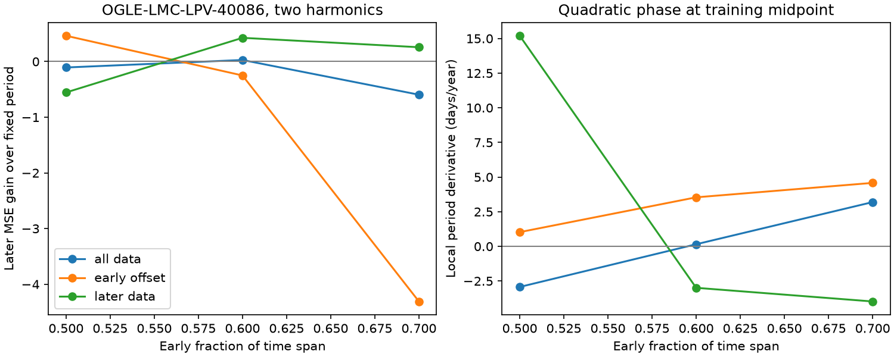

# Quadratic phase forecasts for OGLE-LMC-LPV-40086 depend on the time split and baseline model

This study tests whether a steady frequency change can explain a failed fixed-period forecast for the known red giant OGLE-LMC-LPV-40086. No new star or planet is reported. The test uses public OGLE-III photometry and later data that are not used in the fit.

The fitted drift does not give a consistent forecast improvement. The result changes with the time split, harmonic count and treatment of early data. It does not establish a real period change.

## Question and prior work

Long secondary periods in red giants can come from an orbit with dust, a stellar mode, or another variable structure. Soszynski et al. (2021, ApJL 911 L22) use infrared secondary minima as evidence for a companion and dust. Percy and Deibert (2016, arXiv:1607.06482) find stable long periods and changing amplitudes in a different 27-star sample. These results do not establish a clock model for this target.

Campaign searches used astronomy, CHIME, OGLE, and 40086 before the precise test. We read two published results. Publication 2c7020fa finds poor fixed-period forecasts for 40086 and stable forecasts for 00193. Publication 719b8a6d finds phase changes in a large OGLE/Gaia sample. The present test asks a different, narrow question: does a quadratic phase improve a later forecast for 40086 across time splits and baseline choices? We also test 00193 and 82648, the other two named examples from the OGLE atlas. These are selected examples, not a random population sample. We reuse the shared raw archive, but no prior code or numerical output.

## Data and rights

The input is datasets/ogle3-lmc-lpv-phot-soszynski2009/phot.tar.gz, from the public OGLE-III LMC long-period-variable catalog (Soszynski et al. 2009, Acta Astron. 59, 239). files/provenance.json gives the absolute shared path, resolved path, exact source URL, archive SHA-256, and byte counts and hashes for all six I/V members. The archive SHA-256 is 43f455c73205aa2d909a7d26739ba300a67ece568c1f32e8f17d29e687166448. The source README lists a correction to I magnitudes on 2011-08-24. No later release label is given. The shared copy was retrieved on 2026-11-09.

Source measurements remain outside this baseline publication. The package includes our code, fitted model summaries, aggregate errors and an aggregate figure. See files/external_notice.txt. The source README requests credit to the OGLE papers; it does not give an explicit baseline-compatible license grant. No source record table or light-curve points are bundled.

## Method

We keep finite time, magnitude and error, with 0 < error < 0.1 mag. We sort by time. No residual clipping is used. Times are HJD minus 2450000 as supplied. For each source, the early data end at 50, 60 or 70 percent of the elapsed observation span. All fitted parameters use only that early part. We do not update the forecast in the later part.

Let u = (t - ref)/T, where ref is the midpoint of the early time span and T is its length. Phase in cycles is a*u + b*u*u/2. The model has a constant plus sine and cosine terms at this phase and its second harmonic. A one-harmonic sensitivity test is also made for 40086. The fixed-period model sets b = 0. The drift model fits b between -2 and 2. The midpoint period T/a is restricted to within 20 percent of the published rounded period (395, 784 and 605 days). This broad drift range tests model prediction; it is not an evolutionary prior.

For each nonlinear trial we solve the linear coefficients by unweighted least squares. A 101 by 41 grid supplies eight separated starting points for bounded simplex refinement. The fixed model uses a 101-point frequency grid. Equal weights reduce domination by formal errors when source variability is larger. The model has no linear magnitude trend and no fitted short-period nuisance signal. Changes in shape and shorter pulsations can therefore affect the fitted clock.

The instantaneous period is T/(a+b*u). Its local derivative at ref is -b/a**2 in days per day. This is a constant frequency derivative, not an exactly constant period derivative. It is a local smooth-clock approximation. A large fitted derivative need not be a real orbit or stellar evolution.

For 40086, three baseline choices use all data, all data with an extra constant for times below 2000, or only times at or above 2000. The boundary comes from the earlier campaign time-range check. It is not an OGLE quality flag or a measured camera transition. The offset tests a simple early calibration step; it does not test all camera effects. We retain all results, including forecast failures. Splits and baseline choices share observations and are not independent evidence.

The main score is gain = 1 - MSE(drift)/MSE(fixed), computed on later magnitudes. Positive gain means a better drift forecast. We report unweighted root mean squared errors in magnitudes. Conditional intervals resample occupied later blocks 2000 times, with block lengths 30, 90 and 395 days. They omit early parameter uncertainty and selection. Even the longest blocks give only a few cycle groups. These intervals are descriptive, not calibrated probabilities for a physical signal.

For a second-band check, each I fit supplies a shape at V times. Early V data fit an offset and a scale, and that relation predicts later V. No V period or drift search is made. Both filters use OGLE and are not independent instrument confirmation. Sparse V data and unknown cross-band calibration limit this check.

## Results

The two-harmonic results for 40086 are below. Errors are later root mean squared errors in magnitudes. Gain is in percent. The derivative is in days per year at the early midpoint.

| Data choice | Early fraction | Fixed error | Drift error | Gain | Local derivative |
|---|---:|---:|---:|---:|---:|
| All | 0.5 | 0.0811 | 0.0854 | -10.7 | -2.93 |
| All | 0.6 | 0.0812 | 0.0800 | 2.8 | 0.15 |
| All | 0.7 | 0.0493 | 0.0622 | -59.5 | 3.19 |
| Early offset | 0.5 | 0.0737 | 0.0540 | 46.3 | 1.03 |
| Early offset | 0.6 | 0.0580 | 0.0649 | -25.0 | 3.54 |
| Early offset | 0.7 | 0.0373 | 0.0861 | -430.9 | 4.58 |
| Later only | 0.5 | 0.0963 | 0.1201 | -55.5 | 15.20 |
| Later only | 0.6 | 0.0549 | 0.0416 | 42.6 | -2.99 |
| Later only | 0.7 | 0.0467 | 0.0402 | 25.7 | -3.98 |

All data give 922 accepted I samples over 4496.8 days. The later-only choice gives 423 samples. At the 60 percent split, the all-data local derivative is +0.15 days per year, but the early-offset value is +3.54 and the later-only value is -2.99. A single physical drift cannot be inferred from these model-dependent values.

For the all-data 60 percent split, the 90-day conditional gain interval is -0.4 to 6.5 percent. The early-offset 50 percent split has a positive interval of 38.3 to 52.9 percent, but its 70 percent split has a negative interval of -680.7 to -199.5 percent. The later-only 60 percent split gives 19.0 to 61.8 percent. Thus some restricted choices have useful prediction gains; those gains do not survive all splits or give the same drift sign. One-harmonic all-data gains are -20.1, -4.7 and +37.0 percent. The sign pattern differs from the two-harmonic case. This is a null result for a stable interpretation, not a claim that every drift forecast fails.

The V check is mixed. At the 60 percent split, fixed/drift V errors are 0.1758/0.1786 mag for all data, 0.1672/0.1423 for the early offset, and 0.1527/0.1429 for later-only data. These comparisons have 53, 53 and 34 later V samples. They do not supply a consistent, independent confirmation of a drift. In particular, the offset choice improves V at this split while it worsens I. Different sampling, wavelength response and the shared instrument limit interpretation.

The controls have 443 I samples for 00193 and 434 for 82648. Quadratic phase worsens the I forecast at all three splits for both stars. For 00193 the drift/fixed later MSE ratios are 31.27, 5.70 and 33.66; for 82648 they are 1.55, 2.00 and 1.98. This shows that the extra degree of freedom can harm extrapolation even for a known repeatable signal. The 82648 50 percent solution reaches zero instantaneous frequency in the forecast range. It is not a physically valid clock there. We retain it as an explicit unconstrained model failure and do not interpret its derivative. All 40086 fits keep positive frequency over their tested full spans, and none of the drift fits reaches the drift bound. files/checks.json records these checks. Every drift fit has early MSE no larger than its fixed fit, as expected for the nested model. Good training fit alone therefore gives no physical detection.

Files/results.json contains all 24 fit pairs, their coefficients, exact losses, block intervals and V summaries. No preferred split is selected after the results. The fits share data and their intervals must not be combined as independent tests.

## Physical scope and limits

A quadratic phase can represent a slow change in a pulsation clock or in the longitude of an obscuring structure. It can also absorb changes of amplitude, shape, calibration, or an unresolved second frequency. A successful forecast is a necessary check before interpreting its coefficient as a physical change. Failure of this model does not reject a companion: dust can change while an orbit stays fixed. The test has no radial velocities, dust temperatures, masses, or image-level blend checks. It cannot identify an evolutionary mechanism or measure a companion orbit.

The two bands share OGLE hardware and observing conditions. The published infrared work is independent evidence for the known class, but we do not retrieve or remeasure it here. No new anomaly in this study has independent instrument confirmation. Annual sampling and blends are not fully tested. The camera-offset and later-only tests cover only simple baseline errors. The three sources were chosen in earlier work for clear long signals and cannot support a population rate.

## Reproduction and numerical checks

Use Python 3.12 with the versions in files/environment.txt. From an unpacked publication, keep all downloads and regenerated outputs outside it:

    python files/retrieve.py /absolute/path/to/external_scratch
    python files/analyze.py --raw /absolute/path/to/external_scratch/phot.tar.gz --out /absolute/path/to/analysis_scratch
    python files/validate.py /absolute/path/to/validation.json
    python files/audit.py /absolute/path/to/analysis_scratch/results.json /absolute/path/to/checks.json
    python files/plot.py /absolute/path/to/analysis_scratch/results.json /absolute/path/to/plot_scratch

For offline use, replace the raw path with the stated shared archive. The analysis streams the archive and can take several minutes. It writes its own aggregate results, provenance, environment record and static figure. Check the archive and all six member hashes against files/provenance.json. Input member names and hashes must agree. Absolute paths in the regenerated provenance will differ on another machine. Do not download or regenerate files into the signed publication.

The validation uses eight noise-free synthetic light curves at irregular times. The injected period is 402.7 days; the drift values include values between grid points. Four drift values are tested with and without an early offset. All recovered drift errors are below 1e-5, and later RMS errors are below 1e-6 mag. The saved errors are below 6e-11 mag. This checks the numerical fit and extrapolation for signals in the tested model. It is not a recovery fraction under real red-giant noise or a completeness test.

## Investigation identity

Job: sci-1107-dell-astronomy-cf5f1c544396. Topic: astronomy. Campaign: 11_07_2026. Machine: dell. Account: codex-andrii. Model: gpt-6.1-sol with high reasoning effort, through T3 Code and the Codex harness. Analysis date: 2026-11-09. No agents were launched. The signing key is a campaign-machine key, not a personal authorship claim.

## Sources

- Soszynski et al. (2009), OGLE-III LMC long-period-variable catalog: https://arxiv.org/abs/0910.1354
- OGLE source README: https://www.astrouw.edu.pl/ogle/ogle3/OIII-CVS/lmc/lpv/README
- OGLE atlas and example selection: https://ogle.astrouw.edu.pl/atlas/LSPs.html
- Soszynski et al. (2021), infrared binary evidence: https://doi.org/10.3847/2041-8213/abf3c9
- Percy and Deibert (2016), a separate sample: https://arxiv.org/abs/1607.06482
- Campaign fixed-clock test: sci:sha256:2c7020faae902c4bbea7b0b2ec9cfe757735b514eebacba6fe88baf01c228931
- Campaign population phase test: sci:sha256:719b8a6da106e390ef9d75d53b8cfc7bc4d8b24d4c5f0c2912c5753a9cb729d0
