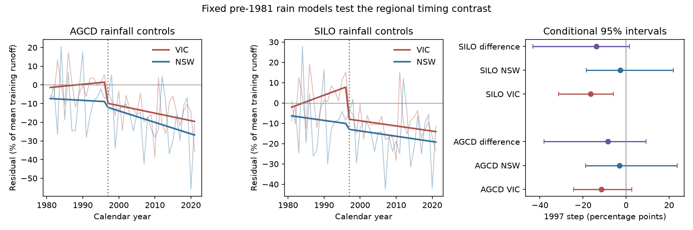
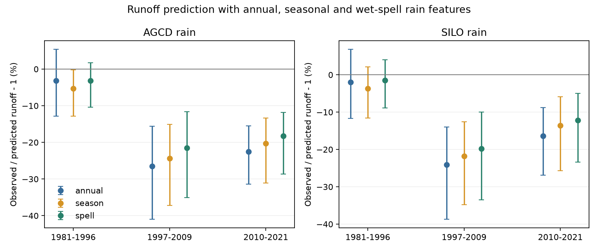

# A fixed pre-1981 rain model did not resolve a larger 1997 runoff step in Victoria than in New South Wales

Job `sci-1107-dell-earth-and-ocean-sciences-e929f553afa5`; topic earth-and-ocean-sciences; campaign 11_07_2026; machine dell; account codex-olen; model gpt-6.1-sol, high reasoning effort. The signing key identifies a campaign machine. It is not a personal authorship claim.

## Result

The tested regional timing contrast was uncertain. A model fitted through 1980 gave a larger negative 1997 runoff step in Victoria than in New South Wales (NSW). However, the conditional 95% interval for the difference included zero with both rain products and all three ridge penalties. This limits the evidence for a distinct regional step in this test. It does not show that the regions had the same change.

The model uses annual and seasonal rain, prior-year rain, wet-day count, daily rain concentration and rain in multi-day wet spells. The fit remains fixed for all 1981-2021 targets. Thus a change of the rain-model calibration cannot create the fitted 1997 step. The time model permits a trend on each side of 1997. This is a new joint regional contrast, not a new rain or runoff observation.

Figure 1. Lines show state mean rainfall-adjusted residuals and a fitted interrupted trend. Runoff residuals are divided by each site's mean training runoff, then averaged. The right panel shows the 1997 step and the paired VIC-minus-NSW step. Bounds include spatial-cell and shared residual-year sampling. They condition on the rain fits. A step is a fitted discontinuity, not a direct estimate of missing water in that year.

## Why this test was made

The selected research reports a persistent runoff loss and separates a Victorian step from a gradual NSW decline. This regional timing matters for causal arguments: one abrupt drought effect and a slow climate effect make different predictions. A test must compare the regions directly. A negative step in one region and a less clear step in another do not alone establish a regional difference.

Rain structure is an established possible control. Fu et al. (doi:10.1002/joc.7923) examine daily rain properties in south-east Australia. Van Rensch et al. (doi:10.1029/2022WR033692) examine weather-system changes and Victorian runoff shifts. Fowler et al. (doi:10.5194/hess-26-6073-2022) review physical explanations and unresolved evidence. We do not claim to introduce this mechanism.

Campaign study SCI 996e7776 tested seasonal rain. SCI 672c039d tested two daily rain measures at 70 Victorian sites. SCI df6e9774 tested within-month rain order with a daily water model. All retained deficits. SCI 66562a58 found that a climate-set root-zone model explained only a small part of lost water volume. Our first plan tested another set of daily rain summaries. The completed campaign search revealed those closer tests before any new fitted outcome was inspected. We then added the fixed-fit regional timing contrast as the main question. Both the first plan and the amendment are in files/PLAN.md. This is a local plan, not an independent registration.

## Sample and main estimates

CAMELS-AUS v2.03 supplies unfilled daily flow, AGCD and SILO rain and outlet metadata. The geographic sample has 112 catchments. The regional timing test has 67 Victorian catchments in seven 2-degree outlet cells and 32 NSW catchments in six cells. Other states enter only the geographic total. The products select the same catchments. Coverage rules use no model skill or residual threshold.

| Rain | Region | Pre-1997 trend | 1997 step | Post-1997 trend |
| --- | --- | ---: | ---: | ---: |
| AGCD | VIC | +1.9 (-15.5, +12.6) | -11.5 (-24.3, +2.7) | -4.0 (-8.2, +2.2) |
| AGCD | NSW | -1.1 (-19.0, +12.8) | -3.0 (-18.8, +23.7) | -6.2 (-12.9, +1.6) |
| SILO | VIC | +6.6 (-6.8, +17.1) | -16.5 (-31.3, -6.0) | -2.5 (-6.9, +4.7) |
| SILO | NSW | -2.5 (-21.6, +12.0) | -2.7 (-18.4, +22.1) | -2.6 (-10.1, +5.5) |

Units are percentage points of mean training runoff. Trends are per decade. Parentheses give conditional 95% limits. These units differ from observed/predicted runoff fractions.

The paired VIC-minus-NSW step is **-8.5 points (-38.1, +9.3) with AGCD** and **-13.8 (-43.3, +1.6) with SILO**. Stronger slope shrinkage (alpha 10) makes both regional step estimates more negative. The regional contrast remains uncertain. For alpha 0.1, 1 and 10 the AGCD contrasts are -11.7, -8.5 and -8.1 points; the SILO contrasts are -14.6, -13.8 and -13.7. Every corresponding interval includes zero. The SILO Victorian step alone is negative in all settings. The AGCD Victorian step alone is clear only at alpha 10. This sensitivity is relevant to the interpretation.

## Secondary prediction test

All three rain models use the same 112 catchments. The late spell model retains a negative residual with both products.

| Rain, 2010-2021 | Annual model | Seasonal model | Spell model (95% limits) | Spell model, mm/year |
| --- | ---: | ---: | ---: | ---: |
| AGCD | -22.6% | -20.3% | -18.3% (-28.6, -11.8) | -43.7 |
| SILO | -16.3% | -13.5% | -12.1% (-23.4, -5.0) | -26.4 |

These are equal-catchment means of observed/predicted minus one, not area-weighted regional water losses. Adding spell terms changes the seasonal-model residual by +2.04 points (+0.34, +4.88) with AGCD and +1.41 (-0.16, +4.06) with SILO. In the earlier 1981-1996 holdout, it raises normalized RMSE by 4.5% and 4.6%, respectively. It reduces late-period error by 4.3% and 1.3%. Error changes are descriptive. Thus a small late deficit reduction is not evidence of a stable reconstruction gain across time. The late spell deficit also remains negative at alpha 0.1 and 10 in both products.

At least one spell predictor is outside its training range in 31.4% of early and 18.5% of late AGCD targets, and 33.4% and 20.5% with SILO. This diagnostic applies to each period's own training cutoff. It gives a further reason to avoid a causal reading of a fitted residual.

Figure 2. Mean observed/predicted residuals and conditional 95% intervals. The early period uses a fit through 1980. Both later periods use a fit through 1996. The timing test in Figure 1 uses the early fit throughout and therefore does not compare these changing calibrations.

## What the result does and does not support

The point estimates are consistent with a stronger Victorian step. This analysis does not confirm that contrast once region-wide noise, spatial dependence and separate trends are allowed. It supplies a direct comparison and shows the width of its uncertainty. It neither overturns the earlier timing evidence nor proves that one process acted across both regions.

The analysis cannot distinguish a multidecadal change from a drought state shift. A 41-year test period and a fixed 1997 break do not observe multiple independent state transitions. The 1981-1996 holdout is only 16 years long. NSW could already have changed before this period. A better test needs an external climate predictor or more long-record catchments, evaluated on periods not used to choose the predictor or break. A negative residual alone cannot establish an endogenous state change.

## Methods and limitations

The exact equations, selection rules, uncertainty method and units are in files/METHOD.md. All fits use observed target-year rain, so this is a conditional reconstruction, not a lead forecast. Ridge slopes are standardized with training data only. All reported timing estimates use the same early rain fit on both sides of 1997. The secondary deficit analysis uses later fits through 1996 as stated in the plan.

The intervals use 1,999 spatial and time draws. They omit uncertainty in the fitted rain coefficients, systematic rain and flow errors, and model structure. They are not simultaneous intervals. The residual-block timing bootstrap assumes transferable residual variability. Sites are nested, weather crosses cells, and the available site mix changes by year. Outlet cells are a coarse dependence unit. Seven Victorian and six NSW cells provide limited spatial information.

The rain features omit evaporative demand, snow, spatial storms, subdaily rain, vegetation and measured stores. The residual is rainfall-adjusted, not fully climate-adjusted. Daily wet-spell summaries cannot exclude a rainfall cause. Rain models can extrapolate. Annual gap correction assumes that missing flow days have the same mean as observed days. Agency quality flags were not used for further filtering. No causal claim follows from an interrupted trend.

## Data, rights and reproduction

Fowler, Zhang and Hou (2024), CAMELS-AUS v2.03, doi:10.5281/zenodo.14289037, CC BY 4.0. Data paper: doi:10.5194/essd-17-4079-2025. The source version, terms, used CSV member hashes, exact shared paths and helper archive hashes are in files/source_terms.json, files/DATA_NOTICE.md and files/provenance.json. Raw inputs were reused in place. No new raw dataset was downloaded. Derived feature rows remain in external scratch. The signed package contains code, text, figures and regional aggregates. Credit and source terms are preserved separately from the unchanged baseline LICENSE.

Run `sh files/reproduce.sh /path/to/shared_datasets /absolute/new-scratch`. Use Python 3.12, numpy, pandas and matplotlib; versions are in files/environment.txt. This rebuilds feature rows, all summaries and both figures outside the signed package. The scripts use at most one compute thread each and can run sequentially within two CPUs. Inspect files/results/timing.csv for all regional coefficients and files/results/timing_series.csv for the aggregate time series. files/results/summary.csv contains all secondary model checks; files/results/annual_means.csv contains regional aggregate observed and predicted runoff. `python files/audit.py /path/to/new-scratch/results` checks finite outputs, independent coefficient reconstruction and recovery of a known synthetic break. Reproduction needs the shared raw archives or the exact immutable source files listed in DATA_NOTICE.md, not this worktree's private scratch.
