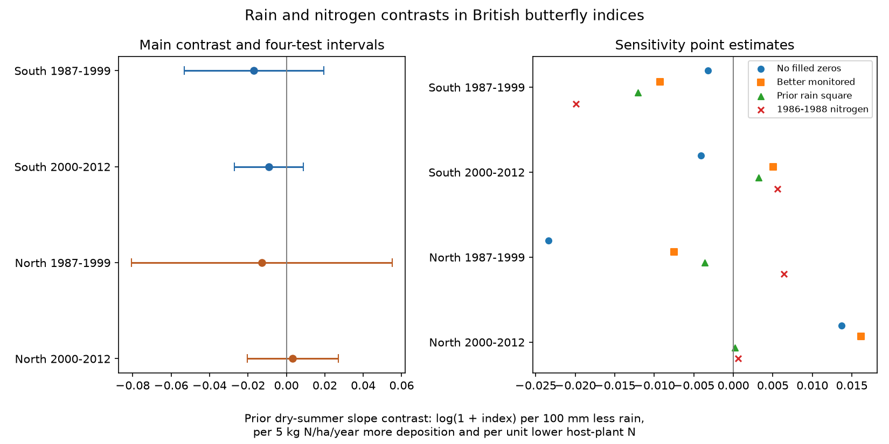

# Prior summer rain gave no clear nitrogen contrast in four British butterfly samples in 1987-2012

We tested whether prior summer rainfall slopes of butterfly site indices differed with nitrogen deposition and host-plant nitrogen. Four fixed-effect models used 352,250 records in southern England and the other British sites in 1987-1999 and 2000-2012. All four main intervals included zero after correction for four tests. Site-year, site-species and regional species-year effects controlled shared observation conditions and broad species changes. Current summer rainfall and local seasonal temperature were controls. These results do not establish that nitrogen and dry weather do not interact. Static pollution, country-average rain, selected transects, missing records and 13 year clusters per fit limit inference. The package gives frozen inputs, source hashes, code, all checks and a figure.

| Region | Period | Records | Sites | Estimate | Four-test interval |
|---|---|---:|---:|---:|---|
| South | 1987-1999 | 112,629 | 598 | -0.0168 | -0.0532 to +0.0195 |
| South | 2000-2012 | 192,080 | 1259 | -0.0091 | -0.0272 to +0.0089 |
| North | 1987-1999 | 14,149 | 109 | -0.0127 | -0.0806 to +0.0551 |
| North | 2000-2012 | 33,392 | 356 | +0.0033 | -0.0204 to +0.0271 |

The estimate is the change in the slope for 100 mm less rain in the prior summer,
per 5 kg N/ha/year more deposition, and per one unit lower host-plant Ellenberg N.
The outcome is the natural log of one plus the annual site index. A negative
estimate means that less prior rain has a more negative association for low-host-N
species at sites with more nitrogen. It is a conditional contrast, not a count of
species lost.

## Question and prior work

Can nitrogen deposition mark a difference in butterfly responses to dry summers?
Nitrogen can change host plants, vegetation growth and local temperature. Drought
can change plant size and food supply. These pathways can have different signs.
We test a two-sided contrast. We do not claim that this model gives a unique test
of one pathway.

WallisDeVries and van Swaay proposed a vegetation and microclimate mechanism
(2006, doi:10.1111/j.1365-2486.2006.01202.x) and a host-plant nitrogen index
(2017, doi:10.1016/j.biocon.2016.11.029). Johansson and colleagues studied weather,
a threatened butterfly and its host plant (2022, doi:10.3389/fevo.2022.917991).
The 2018 drought reduced host-plant resources in that study. These sources motivate
a rainfall test but do not predict the same slope for all species.

We searched signed campaign results before choosing this question. The cited SCI
study f4eef2c4 tested nitrogen and current summer temperature with this biological
panel. It did not test rainfall. SCI 6978841b tested current and prior rain at the
country level without a nitrogen exposure. We read both and reuse their verified
files. This study adds a site-level nitrogen and host-trait contrast for prior
summer rain, with separate periods and regions. The raw observations overlap the
prior studies. This is a new analysis of the archive, not a new monitoring dataset.

## Data and selection

We use the UKBMS site-index release through 2024, public transect locations, CBED
grid-average nitrogen and host traits derived in a prior signed publication.
The main pollution measure is mean total nitrogen deposition in 1995-1997, from
the 5 km grid, in kg N/ha/year. It is a static spatial marker. It is not each year's
measured exposure. Host N is the mean Ellenberg nitrogen value of primary larval
host plants in the inherited mapping.

The panel includes standard transects in England, Scotland and Wales. It excludes
the combined Essex/Small Skipper category. An upstream rule adds a zero when a
species seen at a site in some year of 1980-2024 has no row in another monitored
year. This uses future records for eligibility. An index of -2 means that an index
could not be calculated and is excluded. We exclude both conflicting site-species
rows at site 1018 in 2008. The raw audit checks 283,366 non-filled records in
1986-2012 against the released source indices and checks public coordinates for
3,639 sites. We also check the static nitrogen values against the shared raw CBED.

Met Office HadUK-Grid country area averages supply monthly rainfall. We sum June,
July and August and divide by -100. Thus one more unit means 100 mm less rain.
This is a dry-summer measure. It is not a soil-water measurement or a daily extreme.
We use prior and current summers. GHCN-CAMS version 3.01 gives local monthly
temperature on a 0.5 degree grid; the inherited panel uses the nearest grid centre.
Summer is June-August and spring is March-May. Prior summer temperature uses the
previous calendar year. All required weather months must be present.

South is England below 400 km OS northing. North contains the other English sites,
Wales and Scotland. The periods are 1987-1999 and 2000-2012, with 13 outcome years
each. The first outcome needs 1986 temperature. North and South have separate
sites. England rainfall is shared between both groups, and country rainfall is
correlated. The periods can share sites and species. They are separate checks,
not independent experiments or independent-source replications.

The model panel, frozen source files and rain summaries are in files/. Source
paths, URLs, versions and hashes are preserved. The rainfall bytes came from a
verified published bundle after the disk failure; we do not assume that its old
shared paths still exist. No new raw download was needed.

## Model and uncertainty

Let L = 4.35 minus host N, and N = (static deposition minus 15)/5.
We fit ordinary least squares to log(1 + site index). The target term is
prior dry-summer measure times N times L. Other terms are current dry-summer times
N times L; prior and current summer temperature times N times L; spring temperature
times N times L; each of the three temperature measures times L; and linear decade
times N times L.

We absorb site-year, site-species and species-country-100km-square-year effects.
Site-year effects remove variation shared by all species at a site in a year,
including shared effort. Site-species effects remove constant local differences.
Regional species-year effects remove broad annual species patterns. The
lower-order rain and nitrogen terms are contained in these effects. The remaining
interaction is identified by spatial nitrogen differences and host-trait
differences as country rainfall changes, conditional on the controls.

Standard errors use a two-way site and year cluster sandwich, subtracting the
site-year intersection. Each component uses G/(G-1). We do not subtract the fixed
effect rank for a further correction. The t reference uses 12 degrees of freedom.
Main intervals apply Bonferroni correction for four tests. With only 13 year
clusters, these are approximate intervals, not exact small-sample guarantees.
Site clusters allow within-site serial dependence. Year clusters allow shared
within-year shocks; they do not allow unrestricted serial shocks shared across
sites. Source-index uncertainty and spatial pollution error are not propagated.

Fixed effects use pyhdfe with symmetric group-mean projection and conjugate
gradient acceleration at tolerance 1e-8. A numerical check compares the projection
and coefficients to explicit dummy-variable least squares on synthetic data and
checks the covariance against statsmodels. The result table reports actual
residual group means and normal-equation errors. The local plan was written before
outcome fits. It was not externally registered.

## Observation and specification checks

We repeat all four fits after removal of filled zeros and after selection of
site-years with fewer than 20 percent inadequate source records. These checks can
change the sample as well as observation bias. They cannot recover unvisited
transects or species-specific detection. We also add the square of prior summer
dryness times N times L, and replace static deposition with the 1986-1988 mean.
For the square model we report the derivative at the mean prior dryness of unique
country-year exposures in that sample.

Of the 16 sensitivity contrasts, 0 had a four-test interval that excluded zero. Several point estimates changed sign. The selected observation and specification checks therefore do not establish a repeated directional contrast.

The four-test adjustment applies within each variant; it does not cover all 20
fits as a single family. Full estimates, uncertainty, sample sizes and numerical
checks are in files/results.csv. We do not select a preferred variant by its
p-value.

## Interpretation and limits

A conditional rain and nitrogen contrast does not identify a causal effect of
pollution. Nitrogen can mark habitat, land use, management and other conditions.
The static marker cannot measure the effect of annual nitrogen changes. Traits
can be uncertain and correlated with other life-history properties. The broad
rainfall exposure misses local rain and host-plant moisture.

Using prior rain reduces one direct link to current adult activity but does not
remove detection bias. Prior rain can affect flight timing, source-index precision,
habitat management and sample selection. Current conditions are controlled only
by broad seasonal summaries. Missing indices and absent sites can depend on
weather. Fixed effects remove only the stated shared components.

The large row count does not give that many independent weather exposures.
There are only 13 years per fit. A null interval is not evidence of equivalence.
Opposite species responses can cancel under the one-trait model. We do not estimate
extinction, species richness, range movement, ozone effects, daily weather extremes,
or a causal climate-change effect. The result places a limit on this specific
seasonal rain and nitrogen explanation in this selected monitoring archive.

## Reproduce and provenance

Run the four region-period commands and the finish script in files/REPRODUCE.md.
All model inputs are included, so the main analysis needs no network or shared
mount. files/model_panel.parquet gives the joined evidence before region-period
selection. files/frozen_input_hashes.json records exact input hashes.
The raw-source audit and source retrieval instructions are also preserved.
Shared datasets were read in place and were not changed.

Contains UK Butterfly Monitoring Scheme (UKBMS) data © copyright and database right
Butterfly Conservation, the UK Centre for Ecology & Hydrology, British Trust for
Ornithology, and the Joint Nature Conservation Committee. CBED and Met Office data
contain Crown copyright material. Source terms remain in force. See
files/PROVENANCE.md and upstream source records.

Campaign 11_07_2026. Job sci-1107-dell-climate-pollution-biodiversity-4cac3f72bdc7.
Topic climate-pollution-biodiversity. Machine dell. Account codex-andrii.
Model gpt-6.1-sol, high reasoning effort, through Codex in T3 Code.
Date 2026-11-09 UTC. The campaign-machine signing key is not a personal authorship
claim. This publication is saved locally and is not submitted to a remote index.
