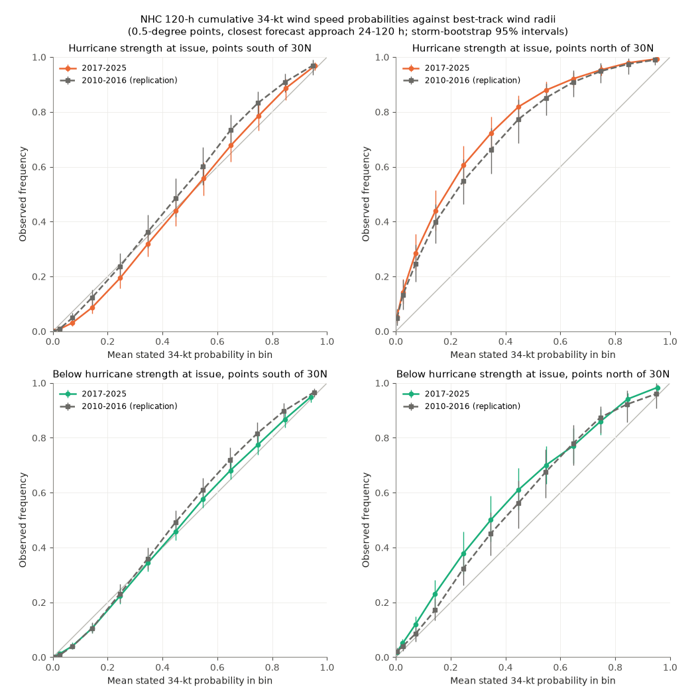
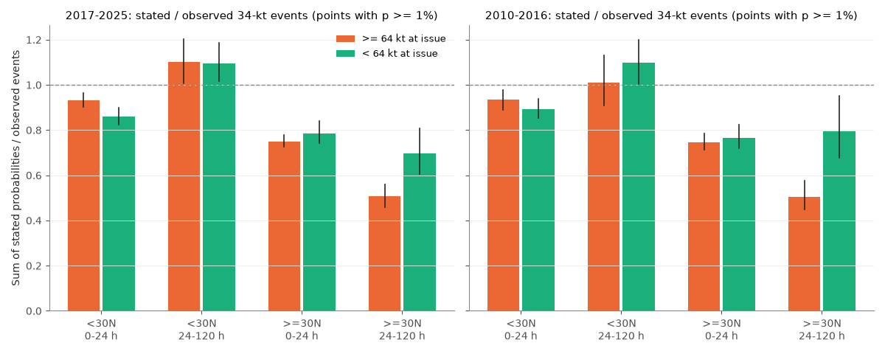
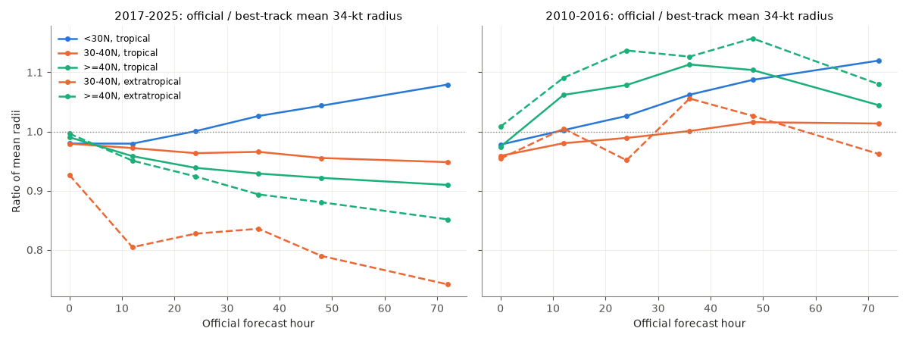

# NHC wind speed probabilities for hurricanes gave about half the best-track 34-kt wind frequency north of 30N after day 1, and were too flat south of 30N (2010-2025)

Job sci-1107-dell-earth-and-ocean-sciences-02efb5053cad. Topic: earth and ocean sciences. Machine: dell. Model: claude-opus-5-5 (Claude Code). The signing key is a campaign-machine key. It is not a personal authorship claim.

## Main result

The National Hurricane Center (NHC) and Central Pacific Hurricane Center publish Monte Carlo wind speed probabilities (WSP). Emergency managers use them to make decisions about preparation and evacuation. We verified the archived 0.5-degree WSP grids for 7,396 synoptic times against best-track wind radii (HURDAT2). The sample has 353 storms in 2017-2025 (primary period) and 251 storms in 2010-2016 (replication period). The independent published verification that we found covers 2006-2011.

1. **Pooled, the 34-kt probabilities were too low.** In 2017-2025, at points with a stated 120-hour probability of 1% or more, the sum of the stated probabilities was 0.77 times the number of observed events (storm-bootstrap 95% interval 0.72-0.83). The result was 0.81 (0.74-0.89) in 2010-2016. This level depends on how the outcome uses best-track radii (see Limitations). With all best-track radii multiplied by 0.80, the pooled ratio was 0.98.
2. **The pre-registered hypothesis failed.** Earlier campaign work found that rebuilt NHC track-error circles covered too many positions of hurricanes and too few positions of weaker storms. From this, we predicted that WSP for hurricanes would be too flat (higher recalibration slope) relative to WSP for weaker systems. The sign was opposite. In 2017-2025 the slope difference (hurricane minus weaker) was -0.075 (-0.149 to -0.005). In 2010-2016 it was -0.121 (-0.209 to -0.024).
3. **Latitude, not track spread, controls most of the error.** After the first forecast day (closest forecast approach 24-120 h), the stated/observed ratio for storms at hurricane strength at issue was:
   - north of 30N: 0.51 (0.46-0.56) in 2017-2025 and 0.51 (0.45-0.58) in 2010-2016. That is, the observed frequency of 34-kt winds was about twice the stated probability.
   - south of 30N: 1.10 (1.01-1.20) and 1.01 (0.91-1.13). That is, the totals were approximately correct.
   For weaker systems, the ratio was 0.70 (0.61-0.81) and 0.79 (0.68-0.95) north of 30N, and 1.10 (1.02-1.19) and 1.10 (1.00-1.20) south of 30N.
4. **South of 30N, the probabilities were too flat after day 1.** The recalibration slope was 1.28 (1.18-1.40) for hurricane starts and 1.21 (1.12-1.31) for weaker systems in 2017-2025, and 1.28 and 1.35 in 2010-2016. Thus the probabilities were too low near the forecast track and too high far from it. This agrees with track-error distributions that are too wide for these cases. In the pooled sample, the high-latitude deficit hides this pattern.
5. **Source tests.** The high-latitude deficit increases with lead time for hurricane starts (0.75 at 0-24 h, 0.61, 0.51 and 0.45 at 24-48, 48-72 and 72-120 h, 2017-2025). It is concentrated in large recurving Atlantic hurricanes. Ten storms (Erin 2025, Lorenzo 2019, Oscar 2018, Kirk 2024, Lee 2023, Sam 2021, Fiona 2022, Nigel 2023, Epsilon 2020, Michael 2018) give 61% of the excess events in the hurricane group in 2017-2025. Official forecasts that end before 120 h while the best track keeps gale winds give only 9-29% of the high-latitude excess. In 2017-2025, official 34-kt radius forecasts north of 30N were 5-26% smaller than best-track radii at 72 h, most for extratropical stages. But in 2010-2016 they were not smaller (ratio 0.95-1.16), while the WSP deficit was the same. Thus errors in the official radius forecast do not explain the deficit. The data agree with a wind-size treatment inside the WSP model that does not follow the expansion of the 34-kt wind field at high latitude, or with best-track radii that overstate the area. These data cannot separate the two.

## Question and prior work

The objective of the campaign is the pre-registered verification of public hazard products, and the identification of the physical or algorithmic sources of the errors. Earlier campaign publications tested NHC track-error circles (SCI d0ccb210, 6f21c3dc and related work). They found that rebuilt 5-year, two-thirds error circles covered 82% of 48-hour positions for hurricane starts and 63% for weaker systems. The WSP model (DeMaria et al. 2009, 2013) samples official track and intensity errors from the previous 5 years, with a situation-dependent track spread (GPCE) since 2010, and gets wind extents from a wind-radii model. Thus it can inherit a strength-dependent track error. The WSP product had no test in this campaign. Our web search found published verification for 2006-2011 only (DeMaria et al. 2009, 2013; NHC Joint Hurricane Testbed reports). Those reports found small bias and good reliability. Our search does not prove that no later verification exists.

Our question: Are the WSP calibrated in 2017-2025, and does the strength dependence of track-error coverage go into the probability product?

## Data

- NHC GIS archive WSP grids, `YYYYMMDDHH_wsp_120hrhalfDeg.zip`, 0.5-degree points, 120-hour cumulative probability (percent) of sustained winds of at least 34, 50 and 64 kt. One grid holds the combined probability from all active storms. We downloaded 8,683 files. 7,396 synoptic times had an NHC/CPHC official (OFCL) forecast and were used: 3,261 in 2010-2016 and 4,135 in 2017-2025. Files from 2009-2016 have an extra POINTID column; we read the PWIND120 column by name. A file can omit the 50- or 64-kt layer when no point reaches it; we read such a layer as zero.
- NHC ATCF a-decks, OFCL lines only: the storms with an official forecast at each synoptic time, their forecast tracks, the as-issued initial intensity (tau 0) and the official 34-kt radius forecasts.
- HURDAT2 Atlantic (23 Sep 2026 revision) and Northeast/North Central Pacific (29 Sep 2026 revision) from the shared campaign store. SHA-256 values are in files/sources.json.

Exact URLs, file sizes and SHA-256 values for every grid file and a-deck are in files/provenance. The raw files are not in this bundle. files/code/retrieve.py downloads them into a separate scratch folder.

## Method

The analysis plan is in files/plan.md. We wrote it before we computed any outcome. We then ran a pipeline check on 2017 data only. After that check we added three items before we computed 2018-2025: radius-scaled outcomes, slopes by lead, and a fix for omitted layers. The plan addendum records this. The latitude split, the storm contributions, the official radius check, the truncation check and the radius-definition check were added after we saw the primary results. They are exploratory. The 2010-2016 period is a replication of these exploratory results because no 2010-2016 outcome was computed before they were defined, but the same person designed both, and the replication period uses the same method.

**Sample.** For each synoptic time t0, we take all 0.5-degree points in the western hemisphere north of the equator within 1,000 km of an OFCL forecast track point (0-120 h, interpolated to 3 h). Points absent from the grid get p = 0. Each point goes to the storm with the nearest forecast track. A point is ambiguous if a second storm track is within 1.5 times that distance. Ambiguous points stay in pooled tests and leave strength and latitude tests. Five storms that have no HURDAT2 entry (for example potential tropical cyclones that did not form) are removed. The stated probability mass outside the domain was 0.02-2.4% of the mass inside, by year.

**Outcome.** A point has an event if the best-track 34-kt (or 50-kt, 64-kt) radius of a storm active at t0 covers the point at any time in [t0, t0+120 h]. We interpolate best-track positions and quadrant radii linearly to 30-minute steps. The quadrant follows the bearing from the centre to the point. All best-track stages with radii count, including extratropical stages. Storms that form after t0 do not count.

**Statistics.** Reliability bins; the ratio of the sum of stated probabilities to observed events at p >= 1% (ratio below 1 means the probabilities are too low); and a logistic recalibration slope b of the event on logit(p), with p clipped to 0.5-99.5% and p > 0 (b > 1: too flat; b < 1: too sharp). Intervals are 2.5-97.5 percentiles of 1,000 storm-cluster bootstrap samples (500 for lead bins, 200 for single years). The slope difference uses one joint resample of storms for both groups. The strength groups use the OFCL tau-0 intensity, which was available when the product was issued.

## Results

Primary tests, 34 kt, 2017-2025 (16.6 million point-times; 1.93 million events):

| Group | Ratio stated/observed (p >= 1%) | Recalibration slope | Storms |
|---|---|---|---|
| All points | 0.77 (0.72-0.83) | 0.96 (0.91-1.00) | 353 |
| Hurricane at issue (>= 64 kt) | 0.70 (0.64-0.77) | 0.91 (0.85-0.98) | 152 |
| Below hurricane (< 64 kt) | 0.88 (0.82-0.95) | 0.98 (0.94-1.03) | 353 |
| Atlantic | 0.68 (0.64-0.74) | 0.93 (0.88-0.99) | 173 |
| Eastern and central Pacific | 1.17 (1.06-1.28) | 1.14 (1.06-1.23) | 180 |

The 50-kt ratio was 0.72 (0.66-0.80) and the 64-kt ratio was 0.79 (0.72-0.89); both slopes include 1. Events at points with stated p = 0 were 3% of all events. Results did not change much when we removed points of storms before genesis (0.78), used an event window from t0+3 h (0.79) or kept only times with one active storm (0.76). In 2010-2016 the pooled values were 0.81 (0.74-0.89) and slope 1.03 (0.95-1.12).

Latitude and lead (34 kt, non-ambiguous points, ratio with 95% interval):

| Strength at issue | Latitude | 0-24 h, 2017-2025 | 24-120 h, 2017-2025 | 24-120 h, 2010-2016 |
|---|---|---|---|---|
| >= 64 kt | south of 30N | 0.93 (0.90-0.97) | 1.10 (1.01-1.20) | 1.01 (0.91-1.13) |
| >= 64 kt | north of 30N | 0.75 (0.73-0.78) | 0.51 (0.46-0.56) | 0.51 (0.45-0.58) |
| < 64 kt | south of 30N | 0.86 (0.82-0.90) | 1.10 (1.02-1.19) | 1.10 (1.00-1.20) |
| < 64 kt | north of 30N | 0.79 (0.74-0.84) | 0.70 (0.61-0.81) | 0.79 (0.68-0.95) |

Single years: the pooled 34-kt ratio was below 1 in 15 of 16 years (0.70-0.92); 2013 gave 1.25. In 2017 alone, the hurricane-start slope was 1.27 (1.11-1.55), the sign that we predicted. Other years did not repeat it. A single season can give a wrong conclusion.

Radius definition (34 kt, 24-120 h, 2017-2025): when we multiply the best-track radii by 1.0, 0.9 and 0.8, the hurricane-start ratio north of 30N is 0.51, 0.56 and 0.63, and south of 30N is 1.10, 1.23 and 1.38. A uniform change of the outcome radius cannot make both regions calibrated. 2010-2016 gave 0.51, 0.56, 0.63 and 1.01, 1.13, 1.28.

Official radius forecasts against best track (mean of four quadrants, cases with a positive radius): at 72 h in 2017-2025 the ratio was 1.08 south of 30N, 0.95 (tropical) and 0.74 (extratropical) at 30-40N, and 0.91 and 0.85 north of 40N. In 2010-2016 the values were 1.12, 1.01, 0.96, 1.04 and 1.08.

## Interpretation

The WSP product has two different errors. In the tropics, the totals are approximately correct, but the probabilities are too flat after day 1. This agrees with the track-error circle results. North of 30N, the product states about half the observed frequency of tropical-storm-force winds for hurricane starts, and the deficit grows with lead. This deficit dominates the pooled verification. It also explains why the pooled strength comparison has the opposite sign to the circle-based prediction: hurricane-start points are more often at high latitude. The deficit was the same in two independent periods, before and after changes in the official radius forecasts, so it is a stable property of the product or of the verification reference. It is not an effect of official radius errors.

Users at high latitudes (for example Bermuda, Atlantic Canada, New England and the Azores) get the largest under-statement. We did not fit or test a recalibration. Because the latitude and lead pattern was the same in both periods, a latitude- and lead-dependent correction is a candidate for a forward test.

## Limitations

- The reference is best-track wind radii, not wind observations. HURDAT2 radii are the maximum extent in each quadrant, so a full-quadrant outcome overstates the wind area. This affects the pooled level (ratio 0.77 to 0.98 for radii times 1.0 to 0.8). The latitude contrast stays for uniform scaling. A large asymmetric extratropical wind field could make the overstatement larger at high latitude. A test against scatterometer or station winds is necessary to separate this from a product error.
- Best-track radii are estimates with large uncertainty, especially before aircraft data and for extratropical stages.
- We cannot see the WSP model's internal radii. The wind-size explanation is an inference.
- Points in a storm and time are strongly dependent. We resample complete storms; intervals are pointwise, without correction for multiple comparisons.
- The strength groups use as-issued OFCL intensity; the latitude groups use the point latitude. Hurricane starts and high-latitude points overlap; the groups are not a causal design.
- We tested the 0.5-degree GIS grid. We did not test the text product at named places or the 0.1-degree and 5-km grids. Grids that also contain western Pacific storms were limited to the western hemisphere, and points nearer to non-NHC storms could not be identified.
- 2010-2016 is a later replication run by the same worker after seeing the 2017-2025 results, not a blind test.

## Reproduction

1. `bash files/code/run_all.sh SCRATCH_DIR` downloads the external data into SCRATCH_DIR and runs all steps. It needs Python 3.12 with numpy, pandas, pyarrow, pyogrio and matplotlib, plus curl.
2. build.py reads HURDAT2 from the shared campaign paths given in files/sources.json. On another computer, download the two HURDAT2 URLs and edit `build.HURDAT`.
3. The NHC GIS directory listing is slow (12 MB). A saved copy can be given with the WSP_INDEX_HTML environment variable; its SHA-256 is in files/sources.json.
4. Outputs: files/results (aggregate CSV and JSON), files/figures (PNG). files/provenance has the per-year build logs and the download manifests.

Run time on the campaign machine: downloads about 2 hours; tables about 10 minutes per year in parallel; analyses about 30 minutes.

## Files

- files/plan.md: analysis plan and addendum.
- files/code: retrieve.py, build.py, analyze.py, lat_boot.py, explore.py, radii_check.py, truncation_check.py, radius_def_check.py, figures.py, run_all.sh.
- files/results: summary_main.csv and summary_early.csv (all primary and sensitivity statistics), reliability_*.csv, lead_slopes_*.csv, lat_boot_*.csv, mech_*.csv (distance and time profiles), explore_*.csv, info_*.json.
- files/provenance: download manifests and build logs.
- files/sources.json and files/NOTICE.md: source data, hashes and terms.

## References

- DeMaria, M., et al. (2009). A new method for estimating tropical cyclone wind speed probabilities. Weather and Forecasting 24. https://www.nhc.noaa.gov/pdf/2009waf_wsp.pdf
- DeMaria, M., et al. (2013). Improvements to the operational tropical cyclone wind speed probability model. Weather and Forecasting 28.
- NHC GIS archive: https://www.nhc.noaa.gov/gis/forecast/archive/ ; ATCF archive: https://ftp.nhc.noaa.gov/atcf/archive/ ; HURDAT2: https://www.nhc.noaa.gov/data/hurdat/
- Campaign work on NHC track-error circles: SCI d0ccb210 and 6f21c3dc; on public hazard verification: SCI 156946e5 and others listed in sci.json.
