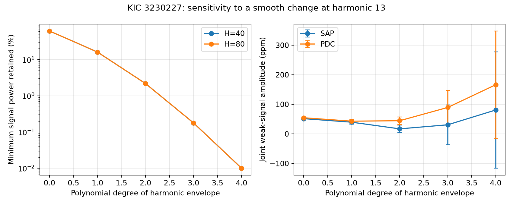

# A quadratic harmonic envelope leaves under 2.2 percent of test signal power in Kepler KIC 3230227 fits

We test a known weak frequency in Kepler KIC 3230227. We allow a smooth change in the sine and cosine coefficients at the 13th orbital harmonic. We also fit other orbital harmonics, quarter trends, and four known frequencies. A quadratic envelope leaves 2.175 to 2.194 percent of the sampled test signal power with 80 harmonics. A fourth-degree envelope leaves about 0.010 percent. Fits with 40 harmonics give similar loss. Joint flux fits have large conditional errors as the envelope degree increases. This is a limit on signal separation under the stated models. It does not establish an instrumental cause, reject a known mode, or find a new object. No independent instrument is used.



## Question and prior work

Can a smooth change in the 13th orbital harmonic hide the known weak frequency at 1.8441372 cycles per day? The aim is to test a limit on searches for extra stellar signals close to orbital harmonics.

Guo (2020, DOI 10.3847/1538-4357/ab911f) reports this weak frequency as f16. We take four other frequencies from that paper: 1.4021347, 1.7198829, 1.9697649, and 1.8448239 cycles per day. These are fixed inputs, not discoveries. The last frequency is close to the same harmonic. The paper discusses tidal mode coupling for the system. Our test does not solve the mode-coupling equations.

Two cited campaign reports show loss of signal power when each quarter has a separate orbital model. One also gives a broad residual search. We extend these reports with smooth polynomial changes in just one harmonic across the full mission. This is a lower-dimensional alternative to separate quarter coefficients. General linear projection and polynomial approximation are established methods. We claim only the measured response for these times, frequencies, and models.

We started two full-folder SCI searches before choosing the precise test. They did not finish during the review. Our own verified search cache held eight target records at the saved snapshot. We then completed SCI search on these eight published bundles and read the two cited main texts. The record is in files/search_log.txt, files/campaign_prior.json, and files/campaign_search.json. This is a partial prior-work review. No private worker files were used.

## Data and provenance

We use the shared file `/mnt/dell-data/shared_datasets/kepler-kic3230227-q0-q17-dr25/lightcurves.tar` in place. Its resolved path is `/mnt/dell-data/shared_datasets/.campaign-dataset-objects/kepler-kic3230227-q0-q17-dr25-1kcdinmf/lightcurves.tar`. Source: NASA Kepler release 25 long-cadence photometry from MAST through the public S3 URL in files/provenance.json. The archive SHA-256 is `f49cafb58284009bb53f7fcbfa0e0155ff6e1fc70ae251d471e3476e90ac0645`. The same file records hashes of all 18 used FITS members, release fields, and software versions. No shared data were changed.

Keep finite TIME, SAP_FLUX, and PDCSAP_FLUX with SAP_QUALITY=0. Divide each flux product by its own quarter median, subtract one, and multiply by one million. Keep eclipses. Apply no clipping. There are 52076 common samples in quarters 0 through 17 over 1470.400934 days. Times are BKJD, or BJD minus 2454833. Preserved samples are in files/samples.npz. SAP and PDC share exposures and are not independent observations.

## Model and calculation

Set the orbital period to 7.047106 days, as in the cited campaign tests. Let x=t-1000 and u=(t-midpoint)/(half span). The nuisance model contains a separate cubic time trend in each quarter; mission-wide sine and cosine terms at harmonics 1 through H of the orbital frequency; and sine and cosine terms at the four fixed known frequencies above. Use H=40 and H=80. Fit unweighted least squares.

At harmonic 13, add u^j times both its sine and cosine for j=1 through d. Test d=0,1,2,3,4. Thus each harmonic-13 coefficient can change as a polynomial over the mission. These coefficients have no prior bound. Other harmonic coefficients remain constant. A smooth change can describe part of changing binary light, a phase drift, an aperture response change, or an unresolved neighboring signal. This is a nuisance model, not a physical cause established from the data.

Let B be this nuisance design, Q its orthonormal column basis, R=I-QQ transpose, and S the sine and cosine columns at the weak frequency. The exact minimum and maximum retained power over all input phases are the generalized eigenvalues of S transpose R S against S transpose S. We never form the sample-by-sample matrix R. We first remove the common nuisance basis and then remove the added envelope columns from both S and the flux. This nested projection is equivalent to a joint fit.

For the observed flux, solve (S transpose R S)c=S transpose R y. The amplitude is the Euclidean norm of the two coefficients c. Use residual scores summed in each quarter to form a sandwich covariance with factor 18/17. The displayed error is one standard error from the local amplitude gradient. Only 18 clusters are available. These errors assume the fixed frequencies and nuisance model; they do not include frequency uncertainty, model choice, cross-quarter correlation, or a calibrated detection threshold. Large positive amplitude estimates at high degree can result from noisy coefficients. They are not evidence of a growing stellar mode.

## Results

The table uses H=80. The error is one conditional quarter-cluster standard error.

| Degree | Power retained, min to max (%) | SAP amplitude (ppm) | PDC amplitude (ppm) |
|---|---:|---:|---:|
| 0 | 61.35113 to 61.55322 | 51.5 +/- 3.1 | 54.7 +/- 2.7 |
| 1 | 16.06382 to 16.23635 | 39.6 +/- 6.6 | 43.0 +/- 5.7 |
| 2 | 2.17483 to 2.19435 | 17.1 +/- 12.3 | 44.6 +/- 12.4 |
| 3 | 0.17818 to 0.18055 | 30.8 +/- 67.7 | 89.4 +/- 57.6 |
| 4 | 0.01003 to 0.01012 | 80.8 +/- 196.7 | 166.2 +/- 182.0 |


With H=40, the quadratic envelope retains 2.176 to 2.195 percent of test power. The result changes little with harmonic order. files/fits.csv gives all 20 flux fits, coefficient values, residual scatter, and reduction in squared residuals. This reduction is descriptive and is not a detection statistic.

Even without a changing envelope, including the nearby fixed f3 reduces separation of the test signal from the nuisance model. Thus the degree-zero result cannot be compared directly with a prior response calculation that omits f3. Under the quadratic model, more than 97.8 percent of the test signal power can be absorbed for every phase. The fourth-degree model absorbs more than 99.98 percent. This is a statement about information in the design, not a claim that the star lacks the weak mode. Joint fitting accounts for loss in the coefficient estimate but cannot restore the lost precision.

The reason is direct. A nearby sinusoid can be written as a harmonic carrier with sine and cosine envelopes at the frequency difference. Over less than one beat cycle, low-degree polynomials can approximate these envelopes. Here the difference from harmonic 13 is -0.000591686 cycles per day, or 0.870 cycles over the full span. The nearby f3 adds another slow envelope direction. The computed response includes the real sample gaps and all stated nuisance columns.

## Checks and limits

Tests add coefficients of 40 and -20 ppm to the projected signal columns for every H and degree. The largest recovery error is 1.63e-11 ppm. Direct projected norms at 33 input phases fall within the eigenvalue bounds. A separate script uses an SVD solve on every twentieth sample with H=40 and d=2. Its result agrees with the projection fit within 8e-13 ppm. These tests check the linear algebra. They do not test completeness in realistic noise. Files validation.json and independent_validation.json preserve the checks.

The period and all mode frequencies are fixed. Eclipse residuals, changing contamination, upstream PDC changes, and correlated noise remain possible. The envelope is flexible and unconstrained; a physical model or a prior bound could improve separation. We do not show that such a smooth change is required by the data, or that it is the true cause. No planet, new mode, or new physical phenomenon is confirmed. The weak signal is already in prior work. There is no pixel localization, independent telescope test, or new follow-up observation. Raw and corrected flux comparisons are processing checks. Their quadratic-model amplitudes differ. An extended independent time series, or an independent constraint on binary-light changes, is needed before a physical claim about this weak frequency.

## Reproduce

Use a writable copy of this bundle. Python, NumPy, SciPy, pandas, Astropy, Matplotlib, and threadpoolctl are required; versions used are in provenance.json. No package was installed. From the bundle root:

```sh
bash files/reproduce.sh /mnt/dell-data/shared_datasets/kepler-kic3230227-q0-q17-dr25/lightcurves.tar reproduced
```

This checks the archive hash and rebuilds the samples, fits, figure, projection tests, and provenance in a new local output directory. It also runs the independent check on the samples preserved beside validate.py. For that check alone, use `python files/validate.py`. If shared raw data are unavailable, run `python files/retrieve.py /new/local/lightcurves.tar`, then pass that path to reproduce.sh. The retrieval script requires a new path and checks the expected SHA-256. It does not change the shared store. The raw archive is not duplicated in this bundle.

## Campaign record

Campaign 11_07_2026. Job sci-1107-syam2-astronomy-5af74db3de13. Topic astronomy. Machine syam2. Account codex-myxtap. Model gpt-6.1-sol with high reasoning effort in T3 Code through the Codex harness. Date 2026-11-08. No child agents were used. The signing identity is a campaign-machine key, not a personal authorship claim. No private key is included. The bundle is saved locally without remote publication or index submission. The baseline license covers our text, code, figures, and derived data, subject to original data rights.
