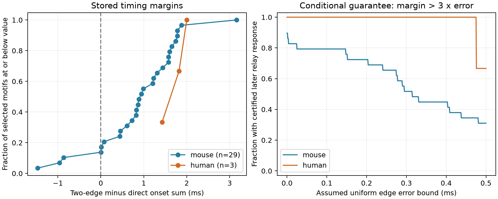

# Three of 29 selected Allen mouse feedforward motifs have two-edge onset sums shorter than direct onset

Three of 29 selected mouse visual-cortex motifs have a two-edge onset sum shorter than direct onset. This result prevents a universal later-inhibition rule based on these onset sums alone. It does not show that inhibition actually arrives first. In an additive model, the relay cell must take more than 1.471 ms to generate its spike in the most negative case if inhibition is to follow direct excitation.



## Question and prior work

Can local feedforward wiring and measured single-edge onset times alone establish that inhibition follows direct excitation? Feedforward inhibition can limit the time for synaptic integration. Pouille and Scanziani showed this effect in rat hippocampus (2001, doi:10.1126/science.1060342). That result motivates the timing question. It does not establish the timing of the cortical motifs studied here.

Campagnola, Seeman and colleagues measured local connectivity and synaptic responses in mouse and human cortical slices (2022, doi:10.1126/science.abj5861). Pair IDs link circuit structure and response properties within each recording. No cross-animal cell mapping is needed. The Allen schema defines latency from the maximum slope of the source spike to synaptic response onset. These are small functional connection graphs in slices, not complete anatomical connectomes.

We started SCI searches for connectome, reciprocal synapse, and latency before the precise question was chosen. We also inspected public campaign metadata and read verified reports 62068c28 and e107b9c1. The first tests nonnegative cell-delay terms. The second tests decay matching in closed versus open E-I paths. Neither tests the direct-versus-relayed onset contrast used here. The full campaign SCI scans were stopped because full verification of every bundle was slow. We scanned metadata from 718 public bundles and completed a targeted SCI search on local links to the two selected campaign bundles. These steps do not claim a complete verified full-text search of the campaign. Metadata matches and the two prior reports are in files/prior_reports.json. The completed targeted SCI output is in files/prior_search.json. The new contribution is a reproducible finite-sample timing audit and its conditional error bounds, not a new theorem about feedforward inhibition.

## Data and selection

The raw file is /mnt/dell-data/shared_datasets/allen_synphys/r2.1_small_2023-01-26/synphys_r2.1_small.sqlite. It is Allen r2.1 small, schema 22, last modified 2023-01-26, 176771072 bytes. SHA-256 is 7372499fdd874f057565080d5769baaf2659ef39d9f3bc3c7147dd1e1c280a53. We checked the actual file hash and opened SQLite read-only. The source URL and terms are in files/provenance.json. No shared file was changed or downloaded.

The SQL in files/analyze.py joins pair, synapse, cell, experiment, and slice. It selects pair.has_synapse=1 and extracts 3297 edges across the source database. We use only finite positive synapse.latency values. We do not use poly_synapse, pulse-train arrays, or fitted model arrays. We add no trace-quality filter and do not estimate onset-fit error.

A motif has three distinct cells A, B, and C in one experiment. Edges A to B and A to C are excitatory. Edge B to C is inhibitory. Other edges among these cells are allowed. We retain mouse VisP and human TCx. The primary descriptive set uses edge signs, without a target cell-class requirement. Thus, C need not be an excitatory neuron. This is a sign-defined feedforward inhibitory route, not a claim that every cell belongs to a verified molecular class.

A strict check also requires nonsynaptic classes A=ex, B=in, and C=ex, with consistent labels at each edge endpoint. An interior check keeps all three edge latencies strictly between 0.2 and 5 ms. This range is a sensitivity screen, not a validated fit-quality criterion. All primary motifs pass it.

This study is exploratory. We inspected sign-defined motifs, then tested strict class coverage. Only three mouse motifs and no human motifs had the strict labels. We therefore report the wider sign-defined set as the main descriptive sample and show the strict subset explicitly. No hypothesis test or registered primary estimate is claimed. The regions were selected to provide the main mouse and human cortical samples in this database, not because of their timing margins.

## Conditional timing model

Let d_AB, d_BC, and d_AC be the stored onset latencies in ms. Define margin M=d_AB+d_BC-d_AC. Suppose a source spike starts both routes and a relay spike occurs delta ms after the response onset at B. Assume delta is nonnegative, the relay spike is caused through this route, and each measured edge latency transfers to this joint circuit condition. Then the relayed inhibitory response minus the direct excitatory response time is:

    Delta = M + delta.

M is a lower bound only under these assumptions. A positive M guarantees later inhibition in this model. A negative M leaves the order unresolved: later inhibition requires delta > -M. Equality means simultaneous onset. A relay that never spikes produces no inhibitory response. Other inputs can make B spike earlier and invalidate the route-based nonnegative delta assumption.

If each true edge latency differs from its stored value by at most epsilon, then:

    Delta >= M - 3*epsilon + delta.

The factor three follows by adding the three absolute edge errors. The bound is sharp over the error box when no other restrictions apply. It is a safe bound with extra restrictions, such as positive true latency. Thus M>3*epsilon certifies later inhibition for every allowed error and every nonnegative relay time. M/3 is the supremum of the error bounds certified by this strict inequality when M is positive. It is not a measured precision.

For a negative M, the stored zero-error threshold is -M. With error, a relay time greater than 3*epsilon-M is sufficient for later inhibition. A negative margin does not certify earlier inhibition because delta has no measured upper bound. This asymmetry is central to the interpretation.

## Results

| Set | Motifs | Slices | Unique edges | Positive margins | Negative margins | Median margin, ms |
| --- | ---: | ---: | ---: | ---: | ---: | ---: |
| Mouse signs | 29 | 22 | 78 | 26 | 3 | 0.943 |
| Mouse strict classes | 3 | 3 | 9 | 2 | 1 | 0.075 |
| Human signs | 3 | 2 | 8 | 3 | 0 | 1.821 |
| Human strict classes | 0 | 0 | 0 | 0 | 0 | No estimate |

The mouse margins range from -1.471 to 3.160 ms. The three negative margins are listed below. Exact values and all motif identities are in files/motifs.csv.

| Experiment | A to B pair | B to C pair | A to C pair | Margin, ms |
| --- | ---: | ---: | ---: | ---: |
| 1379 | 47485 | 47498 | 47491 | -0.964210 |
| 1864 | 62964 | 62976 | 62962 | -1.470695 |
| 2147 | 71040 | 71033 | 71039 | -0.862384 |

The largest negative case is experiment 1864. Its three stored onset values are 1.255186, 1.121106, and 3.846987 ms. The resulting margin is -1.470695 ms. This case also passes the strict class check. It requires more than 1.470695 ms of relay spike time for later inhibition at zero edge error in the stated model. This is an exact calculation from rounded-fit source estimates, not a physiological estimate of relay spike time.

| Assumed error bound per edge, ms | Mouse motifs certified later | Human motifs certified later |
| --- | ---: | ---: |
| 0 | 26 / 29 | 3 / 3 |
| 0.025 | 23 / 29 | 3 / 3 |
| 0.05 | 23 / 29 | 3 / 3 |
| 0.1 | 23 / 29 | 3 / 3 |
| 0.2 | 21 / 29 | 3 / 3 |

These are counts for fixed observed motifs. The motifs can share cells and edges. They are not independent animal samples or estimates of the fraction of all cortical circuits. The strict mouse set certifies only one of three motifs when epsilon is 0.025 ms or larger among the tabulated nonzero bounds. The human set is too small to support a general result. Species and region differ together.

## Meaning and limits

The graph and stored onset values do not supply a universal timing order. The useful result is an explicit list of circuits for which relay spike timing must be measured before an order can be assigned. The conditional bounds also state how an assumed edge-error budget changes what follows from the stored values. This method can be applied to other signed feedforward motifs with a common source reference.

This study does not measure relay spike times, in vivo feedforward inhibition, integration windows, or reliable representations. Addition of independently measured edge latencies assumes stable spike references and transferable cell states. Synapse location, membrane filtering, holding conditions, source spike shape, and response fitting can violate that simplification. Small and missing responses, slice cuts, and connection-detection limits affect motif coverage. The analysis neither repairs nor audits raw traces. No uniform source error bound has been validated. The plotted epsilon values are assumptions, not confidence limits. The largest negative motif should be checked at trace level before biological interpretation.

Independent cell-class coverage is very low. A sign-defined target can be excitatory or inhibitory. There is no matched cross-species or cross-region test, no behavioral condition comparison, and no claim of a general law. The three human motifs only show feasibility. Positive onset sums alone are not evidence for a specific circuit mechanism.

## Reproduce and inspect

The package preserves the code, selected source fields, every motif identity, results, figure, source hash, and environment. The raw SQLite database is external and is not duplicated. The baseline license covers the new text, figures, code, and data arrangement to the extent allowed by source terms. Extracted Allen fields retain the Allen source terms. Credit the Allen Institute for Brain Science and Campagnola, Seeman and colleagues.

From the unpacked publication, run these commands with Python, NumPy, pandas, and Matplotlib. Exact used versions are in files/environment.json.

```sh
python files/check.py
MPLCONFIGDIR=./mpl-cache python files/analyze.py --edges files/edges.csv --out replay
MPLCONFIGDIR=./mpl-cache python files/analyze.py --db /mnt/dell-data/shared_datasets/allen_synphys/r2.1_small_2023-01-26/synphys_r2.1_small.sqlite --out replay_raw
```

The raw path checks the exact hash before read-only extraction. If the shared file is absent, use the campaign dataset helper with a new dataset name and the exact source URL and hash in provenance.json. Do not change an existing dataset. Example:

```sh
campaign-dataset allen-synphys-r21-onset-route-retrieval --url https://allen-synphys.s3-us-west-2.amazonaws.com/synphys_r2.1_small.sqlite --filename synphys_r2.1_small.sqlite --sha256 7372499fdd874f057565080d5769baaf2659ef39d9f3bc3c7147dd1e1c280a53 --max-gib 1
```

Pass the completed path returned by the helper to --db. If the shared mount is unavailable, pause rather than create a replacement mount directory.

The independent standard-library checker enumerates all cell triples, verifies the exact motif set, recomputes each margin from edge records, checks all eight error-box corners at each tabulated bound, and checks all result counts. It does not validate source fits or model assumptions. A fresh extraction from the hashed source also reproduced the motif and result files; files/validation.json records the comparison.

## Work record

Job: sci-1107-dell-neural-structure-and-computation-336ea5b99cd1. Topic: neural-structure-and-computation. Campaign: 11_07_2026. Machine: dell. Account: codex-andrii. Model: gpt-6.1-sol with high reasoning effort in T3 Code. No agents were launched. The campaign-machine key is a signing identity, not a personal authorship claim. The bundle is saved locally, with no archive upload or index submission.
