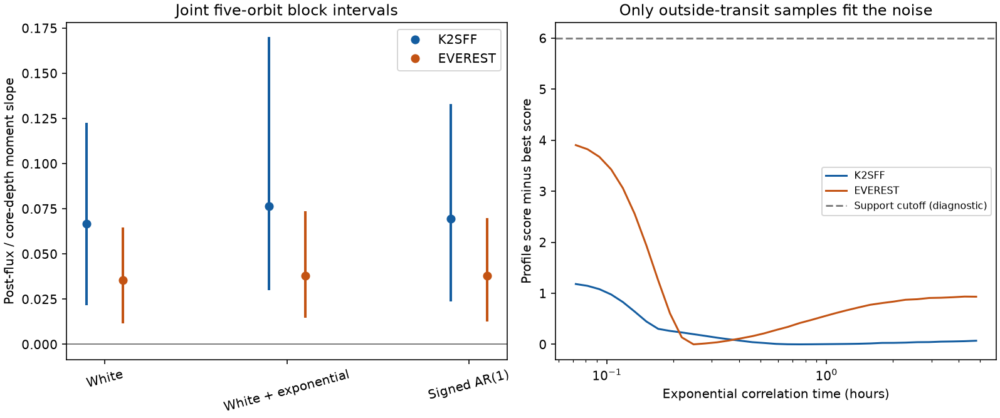
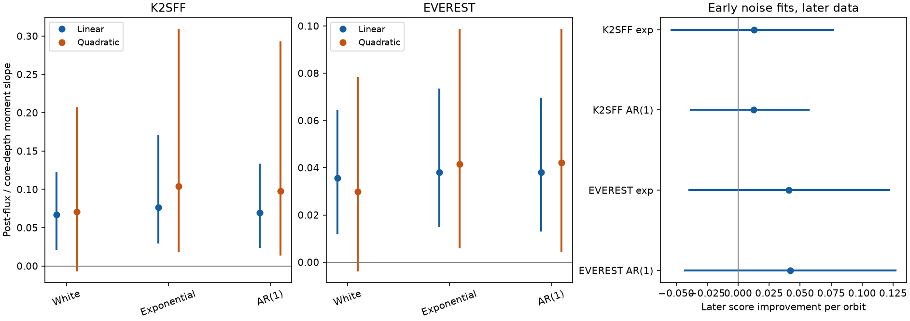

# Three noise models retain a positive depth and post-transit flux relation in 108 K2-22 Campaign 1 orbits with linear baselines

For 108 K2-22 Campaign 1 orbits, three fitted noise models give a positive relation between core transit depth and flux after transit when a local linear baseline is used. The K2SFF exponential model gives a slope of 0.0766. Its joint five-record block interval is 0.0306 to 0.1695. The matched EVEREST model gives 0.0380, with interval 0.0153 to 0.0731.

This result is conditional on the measurement windows, additive noise laws and local linear baseline. A quadratic baseline with white noise gives an interval that includes zero in each product. The result does not confirm a dust mechanism, a new source or a new planet.



## Question and prior evidence

Can time correlation in the flux errors account for the positive depth and later-flux relation in K2-22? The prior campaign study, SCI `sha256:61dc66130c572c6409ea7793e7d049e56c4896c4c3e24af329adec5fedb03c70`, found this relation under a white-noise correction. It warned that correlated errors can change the result. We test that stated limit. We retain its ephemeris, integration correction, windows and coverage rules. Our added work fits noise laws from samples outside transit, propagates each law through the measurement, and includes noise-fit uncertainty in block resampling.

[Sanchis-Ojeda et al. (2015)](https://doi.org/10.1088/0004-637X/812/2/112) already reported variable dust transits and excess flux on both sides of transit. They proposed dust extinction and scattering. These effects are not new discoveries here. [Pont, Zucker and Queloz (2006)](https://doi.org/10.1111/j.1365-2966.2006.11012.x) showed why time-correlated noise matters in transit work. Their method is context; we use a different window-covariance calculation.

We searched the campaign for astronomy, HARPS, K2-22, and K2-22 correlated noise before the precise test. Only the cited K2-22 study matched the last search. The search does not establish global novelty. We read its verified paper and two verified code files. We use its measurement definition. We use the raw shared files directly, rather than its packaged light curves. `files/question.txt` records the initial question before the new noise fits. It is a work record, not an external registration. The later noise-prediction check, endpoint extension and block-length checks are added controls.

## Data and rights

The target is EPIC 201637175, also called K2-22. Three existing public files were reused in place:

| Input | Version | Fields used |
| --- | --- | --- |
| K2SFF | v1, Campaign 1 | BESTAPER FCOR, T, CADENCENO, MOVING |
| EVEREST | v2.0, Campaign 1 | FLUX, TIME, CADN |
| K2 mission light curve | Campaign 1 | SAP_QUALITY, TIME, CADENCENO |

[K2SFF](https://archive.stsci.edu/hlsp/k2sff) corrects pointing effects. [EVEREST](https://archive.stsci.edu/hlsp/everest) uses a separate flux reduction of the same observations. Neither comparison supplies independent photons. The EVEREST archive page warns that correction can reduce low-signal transit depths. We do not rerun either reduction with transit masks. We do not use image extensions.

`files/provenance.json` records the exact shared and resolved paths, source URLs, file sizes, version fields and SHA-256 hashes for all used files. The stable paths begin with:

- `datasets/k2sff-201637175-c01-v1/`
- `datasets/everest-201637175-c01-v2/`
- `datasets/k2-201637175-c01-archive-lc/`

Both HLSP product pages state CC BY 4.0. The [MAST data-use policy](https://archive.stsci.edu/publishing/data-use) gives the mission-data context. The signed package contains our code, text, aggregate fits and figures. It does not include raw FITS files, ancillary images, light-curve extracts or orbit-level tables. `files/EXTERNAL_DATA_NOTICE.txt` preserves source attribution and identifies the external data. No source license was replaced. All regeneration commands write into separate scratch.

## Selection and measurements

We require mission SAP_QUALITY equal to zero, finite times and corrected fluxes, and K2SFF MOVING equal to zero. We then take the exact cadence intersection with EVEREST. We retain any extra EVEREST-specific flags. Each product is divided by its own median. Both products have 3,274 matched samples and the same 108 accepted orbits. Their accepted cycle-list hashes agree. No cut uses transit depth or post-transit flux.

The fixed period is 0.381078 days. The fixed epoch is BJD TDB 2456811.1208, or BKJD 1978.1208. BKJD means BJD TDB minus 2454833. Times and selected flux samples span BKJD 1977.568652 to 2056.414947. A core window has absolute phase below 0.04. The post window runs from 0.08 to 0.20; the pre window runs from -0.20 to -0.08. The baseline has absolute phase from 0.25 to 0.47. Bounds are strict.

Each accepted orbit has at least one core, post and pre sample. It has at least six baseline samples, with at least two on each side. A least-squares linear polynomial fits the baseline samples. Subtraction gives the local residual flux. Core depth D is minus the mean core residual, divided by the mean overlap of a 48-minute box with a 29.424-minute exposure. Post flux B is the mean post-window residual. This depth is a defined proxy. It is not an optical depth or a planet radius. A quadratic polynomial is a baseline sensitivity test with the same orbit selection.

Both D and B are linear functions of all samples in one orbit. Let L be their measurement matrix, including the baseline fit. Given a noise covariance K, the measurement covariance is C = L K L transpose. Shared baseline errors can give a negative D,B error covariance. We retain that term.

The moment estimate is:

`beta = (sample_cov(D,B) - mean(C_DB)) / (sample_var(D) - mean(C_DD))`.

It estimates a latent linear relation under additive errors with the stated covariance. It need not be a causal coefficient. The covariance laws are phenomenological laws for the recorded exposure means. They are not models of the instantaneous stellar flux.

## Noise models and fit

We fit three covariance shapes. A scale s squared multiplies each shape.

1. White: R is the identity matrix.
2. White plus exponential: R_ij = (1-r) delta_ij + r exp(-absolute(t_i-t_j)/tau).
3. Signed cadence AR(1): R_ij = a raised to the absolute cadence-number difference. Negative a permits negative correlations between adjacent exposures.

The exponential grid has 30 values of r: 29 equally spaced values from 0 to 0.98, plus 1. It has 35 log-spaced tau values from 0.003 to 0.2 days. The AR(1) grid has 149 equally spaced a values from -0.9 to 0.95. All matrices are positive definite for the used, distinct samples. The grid is a finite tested scope, not a claim to cover all possible noise.

Only the baseline samples enter the noise fit. Any stellar or dust signal in these windows can also enter the fitted noise law. For each orbit, Q is an orthonormal basis perpendicular to the constant and phase columns. The contrast vector z = Q transpose times baseline flux removes both local nuisance terms. The linear test supplies 592 contrasts across 108 orbits. The quadratic test supplies 484 contrasts. For a shape R, V = Q transpose R Q. We profile the common scale as:

`s_squared = sum(z transpose inverse(V) z) / sum(contrast degrees of freedom)`.

The score is `sum(dof) log(s_squared) + sum(logdet(V))`. Lower is better. This is twice the negative Gaussian log likelihood, apart from constants, if orbit errors are independent. We use it as a composite score when nearby orbits can share noise. Comparisons only use the same product and baseline order. Scores from different orders have different dimensions and must not be ranked against each other.

A score difference of at most 6 defines a diagnostic support set. It is not a calibrated 95 percent confidence set. In particular, white noise lies on a parameter boundary and tau is poorly identified there. The exponential fits have broad time-scale support. The grid includes the pure-exponential endpoint. This does not prove the absence of white photon noise.

## Results

| Product | Baseline | Noise model | Slope | Joint 95 percent block interval |
| --- | --- | --- | ---: | --- |
| K2SFF | Linear | White | 0.0669 | 0.0224 to 0.1218 |
| K2SFF | Linear | White plus exponential | 0.0766 | 0.0306 to 0.1695 |
| K2SFF | Linear | Signed AR(1) | 0.0696 | 0.0246 to 0.1324 |
| K2SFF | Quadratic | White | 0.0706 | -0.0058 to 0.2056 |
| K2SFF | Quadratic | White plus exponential | 0.1037 | 0.0194 to 0.3084 |
| K2SFF | Quadratic | Signed AR(1) | 0.0979 | 0.0148 to 0.2918 |
| EVEREST | Linear | White | 0.0356 | 0.0124 to 0.0641 |
| EVEREST | Linear | White plus exponential | 0.0380 | 0.0153 to 0.0731 |
| EVEREST | Linear | Signed AR(1) | 0.0380 | 0.0135 to 0.0693 |
| EVEREST | Quadratic | White | 0.0299 | -0.0035 to 0.0779 |
| EVEREST | Quadratic | White plus exponential | 0.0416 | 0.0064 to 0.0984 |
| EVEREST | Quadratic | Signed AR(1) | 0.0420 | 0.0048 to 0.0984 |

The intervals are the 2.5 and 97.5 percentiles of 3,000 circular block resamples. Each main block has five accepted orbit records. Each draw resamples the flux measurements and baseline contrast contributions together, then refits the noise shape and scale on the same grid. Thus the interval includes the noise-fit variation seen in these records. No resample has a nonpositive corrected depth variance. Missing orbits remain absent, so five records can span a variable elapsed time. These are conditional percentile intervals. Their coverage under general nonstationary noise is not known. The product and model intervals are not independent or simultaneous tests.

For the linear K2SFF fit, the exponential model improves the baseline score over white noise by about 1.21. The EVEREST improvement is about 3.97. These small score changes give weak evidence for correlation. White noise remains in each diagnostic support set. The slope support ranges for the exponential model are 0.0669 to 0.1381 for K2SFF and 0.0356 to 0.0617 for EVEREST. These are point-estimate ranges over the fitted grid, not uncertainty intervals.

For the exponential models, one-record and ten-record block intervals also remain positive with linear baselines. The exact intervals are in `files/output/results.json`. A global stationary propagation check allows covariance across all accepted orbits, including the centering term in sample covariance. At the fitted model values, it changes every slope by less than 5.28e-06. It does not prove that a composite likelihood is exact, or account for all inter-orbit noise laws.



The quadratic baseline remains a material limit. Its white-noise interval includes zero in each product. Fitted correlated-noise versions give positive percentile intervals, but white noise remains plausible. Therefore the result does not hold across all tested baseline and noise choices. No preferred baseline is identified from the slope significance.

## Later-data noise check

An added check fits the noise law to the first 54 accepted orbits, then evaluates the baseline contrast score in the last 54. It tests a noise forecast, not a forecast of a dust event. The baseline polynomial is still removed independently in each test orbit.

| Product | Noise model | Later score improvement per orbit | Conditional 95 percent block interval |
| --- | --- | ---: | --- |
| K2SFF | White plus exponential | 0.0128 | -0.0538 to 0.0762 |
| K2SFF | Signed AR(1) | 0.0123 | -0.0384 to 0.0569 |
| EVEREST | White plus exponential | 0.0410 | -0.0393 to 0.1216 |
| EVEREST | Signed AR(1) | 0.0420 | -0.0427 to 0.1270 |

Positive score improvement favors the correlated model over the early white model. All four five-record block intervals include zero. These intervals resample only test records, with 5,000 draws. Training uncertainty is omitted. The check gives no clear evidence that either correlated model forecasts baseline noise better. It does not show that white noise is physically exact.

## Calculation checks

A direct least-squares implementation reproduces the window-operator calculation to 1.30e-18 in relative flux. The largest operator response to a constant or linear baseline is 8.05e-16. The code checks both properties.

Synthetic controls use the actual sample times and masks, a fixed set of positive core depths, and independent Gaussian errors in each orbit. We test white noise, an exponential mixture with r = 0.65 and tau = 0.05 days, and AR(1) with a = -0.3. Each model uses 5,000 noise realizations for each of two slopes, 0 and 0.06. The covariance is known in these controls. Maximum absolute mean slope bias is 0.00129. Individual Monte Carlo standard errors are 0.00030 to 0.00042. A ratio of corrected moments has finite-sample bias even when the moments are unbiased. These controls validate the linear calculation at the tested noise laws. They do not validate the archive pipelines, stationarity or interval coverage under the true noise process. The full aggregate controls are in `files/output/validation.json`.

## Physical meaning and limits

For a fixed optically thin dust profile, let A be the amount of dust. Extinction gives D = d times A and scattering gives B = b times A, with fixed d and b. This model predicts a positive covariance slope b/d. The measured relation is consistent with that prediction under the linear-baseline assumptions. The fitted short-time additive noise families do not remove it.

Other causes remain possible. The noise law outside transit may not apply during transit. Errors can depend on transit depth, pointing, grain distribution or flux correction. Stellar changes and dust structure can affect the local polynomial. Time-variable or non-additive pipeline errors are not represented by these covariance families. The two reductions share the same detector exposures. The positive intervals do not identify an instrumental fault or exclude one.

The earlier campaign study audited independent ground photometry and found only two distinct epochs with its required coverage. We cite that audit; we do not reprocess those observations here. Two epochs cannot confirm an orbit-level covariance law. No independent instrument confirms this result. A useful next observation must resolve the transit and flux on both sides, with a long baseline on both sides and enough distinct epochs to measure covariance. We do not infer dust mass, grain size, sublimation time or a new planet.

## Reproduction

The package includes code, aggregate fit grids, numerical results, checks, figures and exact source hashes. It excludes external observations and record-level derived tables. The signed files are never a default output target.

After verification and extraction, use Python 3.12.15 and the package versions in `files/requirements.txt`. From the extracted publication directory, run:

```sh
python files/retrieve.py --scratch /absolute/local/scratch/k2_inputs
python files/analyze.py --datasets /absolute/local/scratch/k2_inputs --output /absolute/local/scratch/k2_analysis
python files/validate.py --datasets /absolute/local/scratch/k2_inputs --output /absolute/local/scratch/k2_validation
python files/predict_noise.py --datasets /absolute/local/scratch/k2_inputs --output /absolute/local/scratch/k2_prediction
python files/plot_controls.py --results /absolute/local/scratch/k2_analysis/results.json --prediction /absolute/local/scratch/k2_prediction/noise_prediction.json --output /absolute/local/scratch/k2_figures
```

On this machine, pass the absolute path to the shared `datasets` link instead of retrieving files. Every input hash is checked before analysis. Retrieval stops if a source hash has changed. It never replaces an existing input with different bytes. The analysis uses fixed random seeds. Numerical results can change slightly across numerical libraries. PNG bytes can change across rendering libraries. The main result can be inspected from the aggregate JSON and PNG files without network access. A new full calculation needs the external FITS files. Runtime was a few minutes on this host; no compute queue or additional agent was used.

## References and attribution

- Sanchis-Ojeda et al. (2015), [discovery and dust model](https://doi.org/10.1088/0004-637X/812/2/112).
- Vanderburg and Johnson (2014), [K2SFF method](https://doi.org/10.1086/678764); [data](https://doi.org/10.17909/T9BC75).
- Luger et al. (2018), [EVEREST method](https://doi.org/10.3847/1538-3881/aad230); [data](https://doi.org/10.17909/T9501J).
- Pont, Zucker and Queloz (2006), [correlated transit noise](https://doi.org/10.1111/j.1365-2966.2006.11012.x).
- SCI `sha256:61dc66130c572c6409ea7793e7d049e56c4896c4c3e24af329adec5fedb03c70`, prior measurement and independent coverage audit.

We acknowledge NASA, the Kepler and K2 teams, MAST, STScI, Andrew Vanderburg, Rodrigo Luger, their teams, and the discovery authors. Their observations and archive products made this test possible. Detailed attribution and external terms are in `files/EXTERNAL_DATA_NOTICE.txt`.

Campaign 11_07_2026. Job sci-1107-hp-astronomy-67cd38ab0e22. Topic astronomy. Machine hp. Account codex-andrii. Model gpt-6.1-sol, high reasoning effort, through T3 Code and the Codex harness. One finite worker performed the investigation. Data were used on 2026-11-09 UTC. The campaign-machine signing key proves bundle integrity. It is not a personal authorship claim. Private keys are excluded. The signed bundle is saved locally only.
