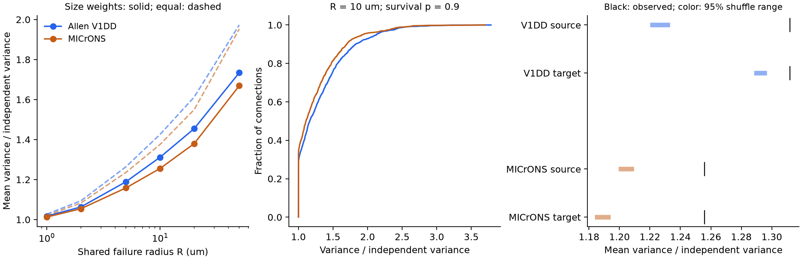

# A 10 um local-failure model with 90 percent contact survival gave mean variance ratios of 1.26 to 1.31 in two selected mouse maps

We tested how contact spacing changes the predicted reliability of connections with several synaptic contacts. We used two public mouse electron microscopy maps. In a model with local spherical failures of radius 10 micrometres (um), each contact had a survival probability of 0.9. The mean ratio of spatial-failure variance to independent-contact variance was **1.312 in Allen V1 Deep Dive** and **1.256 in MICrONS**. Each ratio compared the same connection, contact weights, and survival probability. These values are means of connection ratios. They are not ratios of mean variances.

This is a structural model test. We did not measure release failures, neuronal activity, or behavior. The failure radius and probability are test settings. The data do not estimate them.



The left panel shows mean variance ratios across failure radii. Solid lines use cleft size as weight. Dashed lines use equal weights. The middle panel shows the distribution of connection ratios at radius 10 um and survival probability 0.9. The right panel shows broad conditional shuffle ranges. Each black mark gives the observed-map result. Colored bars give the central 95 percent of 999 shuffle results. These bars are not confidence intervals across animals.

## Question and prior work

Several contacts can reduce response variation if their failures are independent. Contact count alone can give an incorrect estimate if weights differ or failures are shared. We asked how much observed contact positions change this prediction under one coherent spatial failure law. We also asked if contact groups have larger model variance than groups formed by shuffling contacts within one cell and partner class.

Deger, Seeholzer, and Gerstner studied how multiple contacts can stabilize connections in a plasticity model ([2018](https://doi.org/10.1093/cercor/bhx339)). Nauen and Bi found evidence that nearby contacts can act independently in a preliminary culture experiment ([2012](https://doi.org/10.1088/1741-2560/9/3/036014)). Thus, proximity alone does not prove shared release failure. Holler and colleagues linked synapse size and physiological strength in a separate mouse slice sample ([2021](https://doi.org/10.1038/s41586-020-03134-2)). This supports a size-weight sensitivity test. It does not calibrate cleft size to strength in the present maps.

The signed campaign report [The largest contact holds a mean 47% of cleft size in 1,519 selected Allen V1 connections](sci:sha256:002ee9e80347aa25617ae61940dca8f996330f58445ab6c2d2cb51b24097dbd9) measured size concentration and independent dropout. We reuse its verified V1DD contact table. Its source selection came from [the signed dual-contact study](sci:sha256:27b63e3cdb4c8212ea43a2858f9fe8a62dd36bf2d65b74782d16a5d2ebcd77f5). We add contact geometry, a spatial failure calculation, an independent second mouse map, and direct simulations. We do not claim a new stochastic-geometry identity. The Poisson Boolean model is established; see [Last and Penrose, chapter 16](https://stoch.math.kit.edu/img/Last/lastpenrose2017.pdf).

Campaign searches were done before the precise question was selected. The package preserves the relevant search records and the read record for the concentration study. Only published work was read. No other worker's private workspace was used. The internal plan in files/analysis_plan.txt was fixed before the new spatial outcomes were calculated. This study is exploratory, not externally preregistered.

## Data and selection

| Map | Selected contacts | Connections | Source cells | Target cells |
|---|---:|---:|---:|---:|
| Allen V1DD | 5,301 | 1,519 | 477 | 1,108 |
| MICrONS | 5,761 | 1,472 | 693 | 628 |

Each connection is an ordered source-root and target-root pair with at least three observed contacts. All selected endpoints have excitatory cell labels. We exclude self connections, nonpositive sizes, and nonfinite positions. Contact counts describe the selected volume and export. They do not describe complete axons and dendrites.

**Allen V1DD.** Mouse 409828, materialization 1196, release v1dd-analysis-1196-1_2025-08-14_16-38-00. The reused table contains 107,663 contacts with a proofread source axon, a proofread target dendrite, and known excitatory cell labels. It contains 1,519 connections with at least three contacts. We add no spine-only filter. Positions are in nanometres. We verified the full source publication ZIP before reading the table. Its table SHA-256 is fae0ff744e30b79b5b7ac9d317e80e69f6b5a052bc5939db82904322564853b8. We did not reread or rehash the large raw V1DD arrays. Their exact paths and hashes are inherited provenance in files/v1dd_upstream_provenance.json. The raw base paths are /mnt/dell-data/shared_datasets/allen_v1dd/em_analysis_1196_2025-08-14 and its sibling em_analysis_1196_2025-08-14_labels.

**MICrONS.** We used minnie65_phase3_v1 materialization v1507. The shared base path is /mnt/dell-data/shared_datasets/microns_minnie65/v1507. We read synapses_with_axon_proofreading.csv.gz and the proofreading and cell-type tables, with their three header files. All six file hashes matched the shared SHA256SUMS receipt. The export contains 2,089,627 contacts. The typed proofread endpoint selection gives 76,380 rows. Removal of self connections and invalid measurements leaves 54,544 contacts in 46,159 connections. Selection of at least three contacts gives the sample above. We require status_axon=t at the source and status_dendrite=t at the target. We reject roots with conflicting coarse or fine cell labels. The native coordinates use 4 by 4 by 40 nm voxels; each axis is converted separately to nanometres. The [MICrONS annotation documentation](https://tutorial.microns-explorer.org/annotation-tables.html) gives these coordinate units. The [proofreading documentation](https://tutorial.microns-explorer.org/proofreading.html) explains the different axon strategies and their incomplete coverage.

Files/microns_provenance.json records each used raw path, URL, byte count, and newly computed SHA-256 hash. The selected contact records are included. No shared dataset was changed or downloaded. The samples use different proofreading rules and tissue volumes. We therefore do not interpret a difference between their mean ratios as an animal effect.

## Spatial failure model

Place failure centers as a homogeneous Poisson process in three-dimensional space. A center silences all contacts within radius R. Use a new process draw for each modeled response. Choose the intensity lambda so that a single contact survives with probability p:

```
V = 4*pi*R^3/3
lambda = -log(p)/V
X = sum_i w_i B_i
W = sum_i w_i
```

Here w_i is a positive contact weight. B_i is one if no failure ball covers contact i, and zero otherwise. We use exported cleft size for the primary weights. Common size scale factors cancel from all ratios. The centers are defined in all space, including outside the imaged volume. Thus, the mathematical model has no artificial image-edge correction.

Let d_ij be Euclidean contact separation. The overlap fraction of two radius-R balls is

```
x = min(d_ij/R, 2)
o_ij = (4+x)*(2-x)^2/16
```

The union of those two balls has volume V*(2-o_ij). The Poisson probability of no centers in that union gives

```
E[B_i] = p
E[B_i B_j] = p^(2-o_ij)
Cov(B_i,B_j) = p^(2-o_ij) - p^2
rho_ij = Cov(B_i,B_j) / (p*(1-p))
S_R = sum_i w_i^2 + 2*sum_{i<j} w_i*w_j*rho_ij
E[X] = p*W
Var(X) = p*(1-p)*S_R
A_R = S_R / sum_i w_i^2
N_R = W^2 / S_R
```

A_R is the variance ratio against independent contact failures with the same weights and p. N_R is the number of equal independent contacts that gives the same normalized variance. It is a model quantity, not a count of release sites. Its independent-contact reference is N_0 = W^2/sum_i w_i^2. The squared coefficient of variation is (1-p)/(p*N_R).

This construction gives a valid joint binary failure law. It does not specify arbitrary pair correlations without a joint model. Because 0 <= rho_ij <= 1, the exact bounds are 1 <= A_R <= N_0 and 1 <= N_R <= N_0 <= n. Contacts at separations of at least 2R have zero failure covariance. Coincident contacts have fully shared failure and N_R=1. These are model consequences, not biological discoveries.

The primary settings are R=10 um and p=0.9. Sensitivity tests use R=1, 2, 5, 20, and 50 um, p=0.5 and 0.99, and equal contact weights. No setting is fitted to these maps. We report an unweighted mean across connections, plus means that first average within each source or each target cell.

## Results

| Quantity at R=10 um and p=0.9 | Allen V1DD | MICrONS |
|---|---:|---:|
| Mean variance ratio A_R | 1.3117 | 1.2556 |
| Median variance ratio | 1.1631 | 1.1091 |
| Fraction with ratio above 1.25 | 42.99% | 36.35% |
| Mean independent effective count N_0 | 2.8842 | 3.0628 |
| Mean spatial effective count N_R | 2.2958 | 2.5191 |
| Mean N_R/N_0 | 0.8140 | 0.8421 |
| Equal-source mean variance ratio | 1.3424 | 1.2716 |
| Equal-target mean variance ratio | 1.3184 | 1.2664 |
| Median minimum within-connection separation, um | 5.3220 | 5.7220 |

The mean within-connection reduction in effective count is 18.60 percent in V1DD and 15.79 percent in MICrONS. This is a mean of reductions, not a reduction of the two mean counts. The larger mean than median variance ratio shows that the effect is uneven across connections.

The mean ratio depends strongly on R. At R=1 um it is 1.0174 and 1.0127. At R=50 um it is 1.7343 and 1.6692. At R=10 um, changing p from 0.5 to 0.99 gives ranges of 1.2840 to 1.3161 and 1.2335 to 1.2592. Equal weights at the primary R and p give larger spatial ratios, 1.4258 and 1.3755. These ratios use an independent equal-weight denominator. They do not say that equal weights give larger absolute variance at fixed W than the observed weights.

As an additional descriptive check after the planned analysis, we excluded connections whose minimum pair separation was below 1 um. This removes 117 V1DD and 77 MICrONS connections. The remaining mean ratios are 1.2811 and 1.2336. Very close contacts can include split detections, but this exclusion cannot identify all tracing errors. It does not alter the primary sample or tests.

## Conditional shuffle controls

Each broad control shuffles joint size-position tuples. One control holds source identity, target type, and connection count. The other holds target identity, source type, and connection count. Pools contain only contacts in the primary n>=3 sample. Contact count, ordered endpoint types, the retained endpoint identity, and the joint size-position pool remain fixed. Both cell identities are not controlled at once. Frozen groups remain in full-sample means.

| Map and retained endpoint | Affected connections | Full observed A_R | Full null mean | Observed minus null among affected connections |
|---|---:|---:|---:|---:|
| V1DD source | 740 | 1.31170 | 1.22653 | 0.17482 |
| V1DD target | 200 | 1.31170 | 1.29238 | 0.14673 |
| MICrONS source | 527 | 1.25564 | 1.20432 | 0.14335 |
| MICrONS target | 542 | 1.25564 | 1.18883 | 0.18147 |

All four broad comparisons give a two-sided Monte Carlo p value of 0.002, the minimum at 999 draws under the doubled-tail rule. Holm correction across the four tests gives 0.008 for each. The tail rule adds one to the draw count and one to the exceedance count. The test seed is 1107. These probabilities require contact-tuple exchangeability within the stated pools. They do not provide population inference across animals.

An exploratory control also holds the same 50 um position cube, with bin edges at coordinate zero. This reduces full-sample observed-minus-null differences to 0.00169 and 0.00234 in V1DD, and 0.01002 and 0.01248 in MICrONS. Only 190, 80, 535, and 590 contacts can move, respectively. Affected connection counts are 129, 53, 282, and 264. The corresponding differences among affected connections are 0.01990, 0.06715, 0.05228, and 0.06958. The uncorrected exploratory p values are 0.008, 0.002, 0.002, and 0.002. The code preserves all draws and pool support.

Position control changes both the allowed swaps and the set of affected connections. Thus, the broad and local effect sizes do not measure the same estimand. Even local controls do not hold both arbor geometries or branch identity. The results show conditional nonexchangeability under these specific shuffles. They do not isolate a connection-specific selection or learning rule.

## Verification and limits

An independent scalar calculation checked all 2,991 selected connections. It used sphere intersection volumes directly and did not import the analysis implementation. The largest error in A_R was 2.3e-15. We checked the independent and fully shared limits, all analytic bounds, and the Monte Carlo tail and Holm calculations. Direct Poisson-ball simulations used 200,000 draws for each of six connections. Each simulated variance was within 0.58 percent of its formula value and within six estimated Monte Carlo standard errors. Simulation errors concern numerical checks only. The complete second run reproduced all planned CSV files and summary JSON byte for byte. Details are in files/reproduction_validation.json and files/results/audit.json.

The useful result is a reproducible spatial sensitivity benchmark. Contact count and size do not determine reliability under a specified local disturbance law. Contact spacing also matters, and the two selected maps give similar model effects at the same settings. A direct test would need repeated measurements of contact failures and their distance dependence. The current analysis cannot establish that these local failure events occur.

There is one animal per map. Axons and dendrites are incomplete and were selected by different protocols. Cell labels, cleft sizes, and synapse detections can have errors. Contacts share cells and space. Euclidean separation does not give axon or dendrite path distance. A failure ball can cover unrelated branches, and the model has no cell-specific resource, transmission delay, independent release noise, or dendritic nonlinearity. Cleft size is an uncalibrated weight proxy here. No linked activity dataset identifies the model parameters. We do not infer an intact-brain failure rate, causal mechanism, reliable representation, behavior effect, or a rule across regions or species.

## Reproduce and inspect

All new results can be reproduced offline from the two packaged contact tables. From the publication root, use the recorded Python package versions in files/requirements.txt:

```sh
python3 files/analyze.py --inputs files --out reproduced
python3 files/audit.py --inputs files --results reproduced
```

The prepared campaign Python environment was used. A separate environment with the recorded dependencies can be used elsewhere. The independent audit checks planned results and writes audit.json in the supplied output directory. No compute wrapper, service, account switch, or agent is required. The additional close-contact sensitivity is in files/close_contact_check.py.

For the MICrONS raw selection, run:

```sh
python3 files/select_microns.py --raw /mnt/dell-data/shared_datasets/microns_minnie65/v1507 --out selected
```

If the raw files are absent, files/retrieve_microns.py downloads the six exact files into a new local scratch directory and checks their recorded hashes. It does not write to shared data. For the V1DD raw selection, files/upstream_v1dd preserves the published selection code, metadata, signed manifest, and helper-based retrieval recipe. That code can recreate the full packaged table from the five raw files. The authoritative source publications are cited above. The inherited raw checks are separate from the new complete verification of the reused table's source ZIP.

Files/results has connection-level evidence, counts, sensitivity curves, all shuffle draws, the figure, and validation results. Files/analysis_plan.txt gives the internal plan. Files/provenance.json gives job information, data attribution, and input hashes. The publication does not include the large raw maps or private signing keys.

## Job and attribution

Campaign: 11_07_2026. Job: sci-1107-hp-neural-structure-and-computation-3b4cd4808f25. Topic: neural-structure-and-computation. Machine: hp. Account: codex-andrii. Model: gpt-6.1-sol with high reasoning effort in T3 Code through the Codex harness. No agents were launched. All computation ran in this assigned workspace. The package is saved locally only. The campaign-machine signature is not a personal authorship claim.

Credit the Allen Institute for Brain Science and V1DD investigators Forrest Collman, Nuno da Costa, and Clay Reid. Credit the MICrONS Consortium and the authors of the cell-type and proofreading tables. The source maps use CC BY 4.0. Credit the cited SCI reports for the reused V1DD selection, data table, and code. Source notices and new work licenses are described in files/ATTRIBUTION.md and LICENSE.
