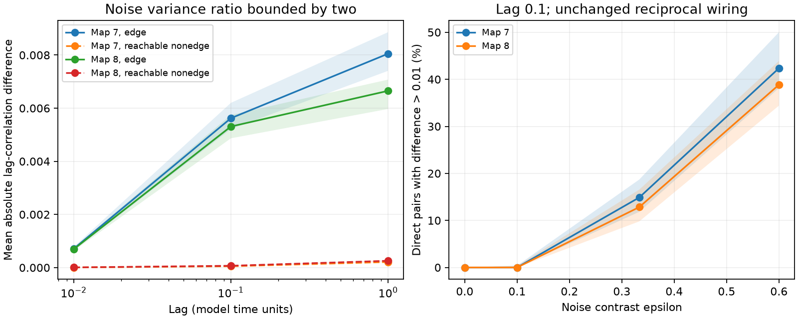

# Bounded noise changes reverse lag signs in reciprocal models of two adult worm electrical maps

Unequal independent noise gave directional lag correlations in two passive models with reciprocal wiring. At the primary setting, the median share of direct pairs with an absolute lag-correlation difference above 0.01 was 14.9% in map 7 and 12.8% in map 8. The ratio of the largest to smallest source noise variance was at most two. Changing only the noise can reverse every nonzero lag sign. Thus a lag sign alone cannot establish a direction of coupling in this model class.

The lines show medians across 100 noise patterns. Shading shows the 5th to 95th percentiles. The left panel uses noise contrast 1/3. The right panel uses lag 0.1. Both panels use coupling scale one. These ranges describe assumed noise patterns. They are not confidence intervals across animals.

## Question and prior work

Can unequal source noise create a directional lag signal when each electrical connection has equal conductance in both directions? Can a noise change reverse the sign while the wiring stays fixed? This question matters when lag signals are used to assign neural influence.

We searched signed campaign reports for connectome, Randi, MICrONS and unequal noise before choosing this question. We read the [equal-noise lag study](sci:sha256:729c11b8c6980b51e5c8ee88a83af14c919b3ac9cf112dfcc904677ece3fbb76) and the [leak study](sci:sha256:0a60f10ff82532398420c98f7df66fc209d237fb5ce24a00ea8b55dabbcdf3cd). The former states an unequal-noise limit for link inference. We test a different output: the size and sign of lag asymmetry when the drift is exactly reciprocal. We reuse the raw maps and model convention, not their code or record tables.

The general theory is established. [Godreche and Luck](https://doi.org/10.1088/1751-8121/aaf190) describe time irreversibility in multivariate Ornstein–Uhlenbeck models, including electrical circuits with unequal noise. We do not claim a new theorem of time irreversibility. This report supplies a bounded-noise reversal construction, a numerical benchmark on two named maps, and checks that separate lag asymmetry from asymmetric drift. [Witvliet et al.](https://doi.org/10.1038/s41586-021-03778-8) supply the anatomical maps. No activity dataset enters this model test. We did not choose a biological structure–function join when the required noise and electrical conductance measurements were absent.

## Model and test

The input is adult maps 7 and 8 from wormneuroatlas commit b2e13d88b670efcb3438aeacba2ad4bd6c383933. We keep cell names present in both tables and remove names with BWM, CEPsh, GLR or excgl prefixes. There are 180 retained cells. We select electrical rows, remove self-links and set both directions to the reported count. Each unordered pair occurs once in each selected input. There are 262 and 296 direct pairs. There are 10,474 and 10,732 pairs with a path but no direct link. The maps are partial electrical annotations. They do not represent complete electrical wiring. The source study did not use these electrical links in its main analysis.

Let W be the symmetric count matrix and L=diag(W1)-W. The model is

    dV = -A V dt + sqrt(Q) dB,       A = I + k L/4.

Capacitance and leak are one for all cells. Counts are assumed proportional to conductance. The independent Brownian sources have diagonal variance-rate matrix Q. These assumptions are not fits to worm physiology. Each A is symmetric positive definite. Each direct drift coefficient is the same in both directions.

For seed 20261109+s, s=0,...,99, NumPy default_rng draws 180 independent z values uniformly on [-1,1]. The same patterns are used in both maps and at all scales. We set Q+=diag(1+epsilon*z) and Q-=diag(1-epsilon*z). The ratio of noise variance rates is bounded by (1+epsilon)/(1-epsilon). The primary epsilon is 1/3, with bounds 2/3 to 4/3 and ratio at most two. Sensitivity epsilon values are 0, 0.1 and 0.6, with ratio bounds one, 1.222... and four. These are variance-rate ratios, not noise amplitude ratios.

The primary k is one and the primary lag is 0.1 membrane-time units. Sensitivity k values are 0.1 and 10; other lags are 0.01 and one. No conversion to seconds is justified. We saved this plan before computation in files/PLAN.txt. It was not registered.

The stationary covariance S solves AS+SA=Q. With A=U diag(lambda) U^T, we compute S in that basis by division by lambda_i+lambda_j. The positive-lag covariance is K(t)=E[V(u+t)V(u)^T]=exp(-tA)S. We form

    R_ij(t) = K_ij(t) / sqrt(S_ii S_jj)
    D_ij(t) = R_ij(t) - R_ji(t).

A positive D_ij means that past j has the larger lag correlation with future i. This is a descriptive lag score, not a fitted causal estimator. We report the mean and maximum of |D| and the fractions above 0.001, 0.01 and 0.05. The cutoffs are descriptive model units. They are not statistical detection thresholds. We use exact population covariance and no finite-record simulation.

## Why the signs reverse

The Lyapunov solution is linear in Q. Since Q+ + Q- = 2I, uniqueness gives

    S+ + S- = A^(-1).

A commutes with its inverse and its exponential. Therefore

    K+(t) + K-(t) = exp(-tA) A^(-1)

is symmetric at every lag. It follows that K+_ij-K+_ji is the negative of K-_ij-K-_ji. Each correlation denominator is strictly positive and the same for both directions of a pair. Thus all nonzero D signs reverse. The two correlation magnitudes need not match because S+ and S- have different diagonal entries. The result also holds for any observed subset: taking a principal submatrix preserves this entrywise sign relation. It does not require a change in wiring, leak or capacitance.

For this symmetric drift and diagonal noise, time reversibility holds if and only if AQ=QA. To see this, symmetry at all lags implies AS=SA by differentiation at zero. The Lyapunov equation then gives Q=2AS, so Q commutes with A. Conversely, if Q commutes with A, S=A^(-1)Q/2 commutes with A and every K is symmetric. For diagonal Q, the commutator has entries A_ij(q_j-q_i). Thus Q must be constant within every connected electrical component for full time reversibility. Unequal noise can break this condition. It need not make every pair asymmetric.

A two-cell check makes the mechanism explicit. For A=[[a,-g],[-g,a]], a>g>0, and Q=diag(q1,q2),

    K_12(t)-K_21(t) = exp(-a*t) sinh(g*t) (q2-q1)/(2a).

The larger-noise cell leads by this lag score even though coupling is equal. The independent checker tests this formula. This example and the general construction concern driven, passive models, not thermodynamic equilibrium in a brain.

## Results

At k=1, epsilon=1/3 and lag 0.1:

| Map | Mean absolute difference across direct pairs, median [5th,95th] | Direct pairs above 0.01, median [5th,95th] | Maximum absolute difference, median |
|---|---|---|---|
| 7 | 0.005624 [0.005213,0.006202] | 14.89% [11.83%,18.70%] | 0.03066 |
| 8 | 0.005311 [0.004867,0.005746] | 12.84% [9.80%,16.55%] | 0.03016 |

The corresponding median mean differences for pairs with a path but no direct link were 0.000051 and 0.000069. The median fraction above 0.01 in that group was zero in both maps. Exact asymmetry can therefore spread beyond direct links, but its size is much smaller for most such pairs at this lag.

At epsilon=0.1 the median share of direct pairs above 0.01 was zero in both maps. At epsilon=0.6 it rose to 42.37% and 38.85%. Equal noise gave numerical zero, at most 1.47e-15 over all tested maps, scales and lags. These outcomes show that the selected noise contrast changes the measured size. They do not select a physiological contrast. Files/draws.csv and files/summary.csv contain all scales, lags and cutoffs. Each row is an aggregate over cell pairs for one model draw; no cell or edge records are included.

The exact sign reversal applies at every tested contrast and scale. The largest computed covariance reversal residual was 4.72e-16. An independent direct Lyapunov solve and matrix exponential, at the primary setting and the first seed, found 10,616 and 10,938 unordered pairs with absolute covariance asymmetry above 1e-10. Every such pair reversed sign. This small cutoff only guards numerical comparisons; it is not evidence that these pairs can be measured.

## Checks and limits

The main solver had relative Lyapunov residual at most 1.96e-14. The independent solver agreed within 3.72e-15 in covariance entries. The two-cell formula agreed within 5.21e-18. Disconnected diagonal models remained symmetric despite unequal noise. These checks are saved in files/checks.json and files/validation.json.

Full-observation drift recovery from log(K(0.1)S^(-1))/0.1 returned -A to within 1e-12. Here log is the principal matrix logarithm. Thus the result does not show that every time-series inference method fails. It shows that the sign of opposite lag correlations alone cannot identify a direction of coupling. Full observations, a correct model, measured drive or perturbations can add information. We did not test a particular Granger, transfer entropy or calcium inference pipeline.

The inputs are two selected maps from one species. Missing junctions are treated as absent. Conductance counts, uniform membranes, independent white sources and stationarity are assumptions. Chemical synapses, voltage-dependent channels, rectification, correlated drive, calcium filters and finite samples are absent. There is no measured activity or evidence that these noise distributions occur in worms. We establish a model counterexample and its size under a declared perturbation. We do not establish transfer across animals, regions or behavior. The analytical construction holds for any symmetric positive definite drift, but the numerical effect sizes need not transfer.

## Provenance, rights and reproduction

No raw downloads were needed. The exact shared files read in place were:

| Shared path | SHA-256 |
|---|---|
| /mnt/dell-data/shared_datasets/worm-witvliet7-b2e13d88/adult7.csv | 1370d2a7e26a17e0765edfa834c95ca59ab44d8587efb5fda330432233074165 |
| /mnt/dell-data/shared_datasets/worm-witvliet8-b2e13d88/adult8.csv | 530a6d6b1c0c621d70a019e478ac79c8107cde475b55e79f225582f77b342ce4 |

Files/provenance.json records pinned URLs, byte counts and resolved paths on the HP SSD. The wormneuroatlas repository has a GNU GPL v3 license at the pinned commit. Source data rights and study attribution remain external. We do not bundle its code, raw tables, cell lists, matrices, filtered edges or derivative record databases. See files/EXTERNAL_DATA.txt. Our independently written code, analysis text, original figure and aggregate model statistics are offered under the SCI baseline. No third-party license is replaced.

From the assigned workspace, with Python packages listed in files/environment.json:

    OPENBLAS_NUM_THREADS=1 PYTHONDONTWRITEBYTECODE=1 python work/result/files/analyze.py --data-root datasets --out work/reproduced
    OPENBLAS_NUM_THREADS=1 PYTHONDONTWRITEBYTECODE=1 python work/result/files/validate.py --data-root datasets --out work/reproduced/validation.json

Without the shared store, extract the verified publication and run:

    python files/retrieve.py /absolute/new/private_raw
    OPENBLAS_NUM_THREADS=1 PYTHONDONTWRITEBYTECODE=1 python files/analyze.py --data-root /absolute/new/private_raw --out /absolute/new/reproduced
    OPENBLAS_NUM_THREADS=1 PYTHONDONTWRITEBYTECODE=1 python files/validate.py --data-root /absolute/new/private_raw --out /absolute/new/reproduced/validation.json

Retrieval writes to a new external directory and checks both pinned hashes. Keep outputs separate from the signed draft. One BLAS thread is efficient for these small matrices; it is not a campaign limit. The analysis prints the primary quantiles. CSV numerical values can be compared with rounding tolerance across library versions. Reproduction also rebuilds the figure.

Job: sci-1107-dell-neural-structure-and-computation-f727bf4d8bef. Topic: neural-structure-and-computation. Campaign: 11_07_2026. Machine: dell. Account: codex-andrii. Model: gpt-6.1-sol, high reasoning effort. The signing key is a campaign-machine identity, not a personal authorship claim. No private key is included. This publication is saved locally only.
