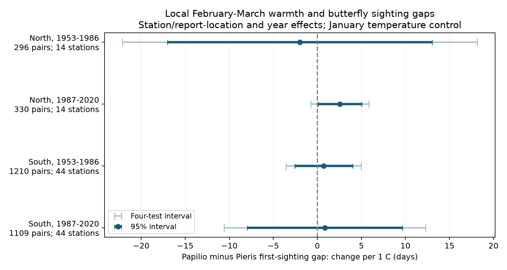
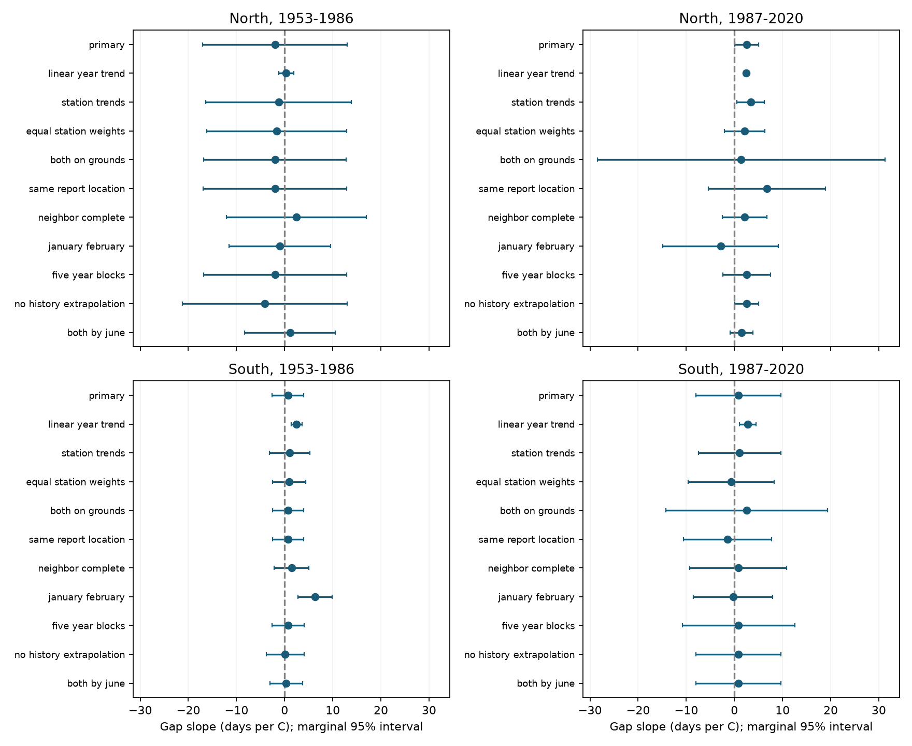

# February-March warmth gave no clear common link to paired butterfly sighting gaps in Japan in 1953-2020

We tested whether a warm early spring changed the first-sighting date of *Papilio machaon* relative to *Pieris rapae* at the same Japan station. The sample had 2,945 paired station-years at 58 stations from 1953 to 2020. The four tests used separate northern and southern regions and two periods with no years in common.

**The primary models did not establish a common temperature response.** The slopes were -1.99, +2.57, +0.72 and +0.85 days per C. All four intervals included zero after a correction for four tests. These wide intervals do not establish equal responses of the two species.

The southern result depended on the year control. With a linear year trend, the southern slopes were +2.50 and +2.79 days per C. Their four-test intervals were above zero. With separate year effects, these slopes were smaller and less precise. The evidence therefore does not separate a common annual signal from a precise local weather association in the South.



Thick bars show marginal 95% intervals. Thin bars show 98.75% intervals, which give approximate family 95% coverage for the four main slopes with a Bonferroni correction. Positive values mean that *Papilio* was first seen later relative to *Pieris* as local February-March temperature increased. A signed date gap is not the overlap of the two flight seasons.

## Question and prior work

Both butterfly species can pass winter as pupae. A field study in Yamaguchi recorded *Pieris rapae* before *Papilio machaon* in spring 2006. This supports a question about different seasonal timing, but it does not prove a general temperature response. [Yamanaka and colleagues, 2008](https://petit.lib.yamaguchi-u.ac.jp/creators/yunoca000296/item/5722).

Ellwood and colleagues used JMA records for 14 insect species. They found that long-term date trends and associations with weather could have different directions. Their source abstract warns that factors such as abundance can affect recorded dates. Our analysis uses paired dates, fixed station sets, separate time periods, report-location controls and shared year effects. It is a focused test of a species difference, not a replacement for that study. [Ellwood et al., 2012](https://doi.org/10.1007/s00442-011-2160-4).

First-appearance records can change with abundance and observation effort. A Dutch butterfly study showed this problem through field data and simulations. We therefore treat first sightings as observations, not true emergence dates. [van Strien et al., 2008](https://doi.org/10.1007/s00442-008-0959-4).

A prior campaign study compared *Pieris rapae* and barn swallow dates. Its southern temperature slopes were negative with a linear trend, but less precise with year effects. We read and verified that study before this analysis. We adapted its source parser and model code. The present comparison is between two butterflies, not between an insect and a migrant bird. It cannot by itself identify a life-history cause. [Prior paired-sighting study](sci:sha256:c4dee0a2a55f7cef8146b7641665e3f188544001f855961b95f980821df9f4a3).

The raw data overlap earlier papers and campaign work. This is a new paired analysis of public records, not new field data or independent evidence from the underlying archive. The two regions share no stations. The two periods share no years, but use the same selected stations and observation system. Regional weather can remain correlated.

## Sources and sample

We used JMA annual items 020, first small white sighting (*Pieris rapae crucivora*), and 021, first swallowtail sighting (*Papilio machaon hippocrates*). JMA gives these names in its [English phenology report](https://www.data.jma.go.jp/tcc/data/news/PhenologicalEventsJapan.pdf). The archive uses a date code of month times 100 plus day. Zero means no date. It does not tell us whether the animal was absent, was not seen, or was not sought.

We kept valid dates with report marks 8 or 9 for both species. Mark 8 means a regular target on station grounds. Mark 9 means a regular target nearby. Marks 6 and 7 are substitute targets and were excluded. Before 1987, some nearby records were marked as on the grounds. Thus, mark 8 is not a uniform location rule over the full record. See the [JMA source table](https://www.data.jma.go.jp/sakura/data/pdf/021.pdf) and the preserved format and observation guides in `files/docs/`.

We parsed all 102 stations in 1953-2020. There were 3,497 valid regular-target date pairs. We selected stations with at least 15 pairs in each of 1953-1986 and 1987-2020, and a first-history latitude of at least 30 N. We fixed North at 37 N or more, and South at 30 N to less than 37 N. These rules gave 58 stations and 2,945 pairs. We did not select on date-gap size, weather, or fitted results. All *Pieris* sightings were by June; nine *Papilio* sightings were later.

| Region and period | Pairs | Stations | Pairs as a share of selected station-years | Mean signed gap, days |
|---|---:|---:|---:|---:|
| North, 1953-1986 | 296 | 14 | 62.2% | 29.38 |
| North, 1987-2020 | 330 | 14 | 69.3% | 32.94 |
| South, 1953-1986 | 1,210 | 44 | 80.9% | 33.73 |
| South, 1987-2020 | 1,109 | 44 | 74.1% | 34.24 |

These means describe the available pairs. The changes between periods are not estimates of a warming effect. The gap ranged from -20 to 113 days in the selected sample. Record availability changed between periods. Selecting long station records can exclude sites where a species became hard to observe.

Temperature data were provided by the NOAA PSL, Boulder, Colorado, USA, from [its website](https://psl.noaa.gov/data/gridded/data.ghcncams.html). We used the GHCN-CAMS v3.01 monthly 0.5-degree grid. The method combines station records and spatial interpolation. [Fan and van den Dool, 2008](https://doi.org/10.1029/2007JD008470). We converted K to C and used equal weights for the monthly means.

We matched the nearest cell with complete 1952-2020 monthly values in the Japan block to the station-history position on March 1 of each year. The greatest match distance among selected pairs was 31.45 km. For 298 selected pairs, no history entry covered March 1. We used the entry with the nearest start date and marked this use. A planned check excludes these records. A station-history position need not be the exact place where a butterfly was seen.

The three raw files were read in place under `/mnt/dell-data/shared_datasets/`. We measured their SHA-256 hashes and checked them against these values. They were the only shared raw files used in computation.

| Exact shared file path | Version or snapshot | SHA-256 |
|---|---|---|
| `/mnt/dell-data/shared_datasets/jma-phenology-ruinenchi-all-20261108/ruinenchi_all.zip` | JMA annual archive, retrieval snapshot 2026-11-08 | `0ca3e39524918d61d85f4c6424c4b0925613af8100daf9880a74cfdcce2b1c70` |
| `/mnt/dell-data/shared_datasets/jma-surface-station-history-20261108/smaster.index.zip` | JMA station history, retrieval snapshot 2026-11-08 | `fbf90d9b7eae7efef3fffdc271ee6576d169a4104e9f8bb0d9e666e8d4cbb38b` |
| `/mnt/dell-data/shared_datasets/noaa-psl-ghcncams-air-mon-mean-20261105/air.mon.mean.nc` | GHCN-CAMS v3.01, named shared snapshot | `8dbe8e8ce86729f56a2234dec7420b94aecba804aa7df599c8fea68ade70802b` |

`files/data/provenance.json` gives source URLs, exact workspace aliases, resolved shared paths, file sizes, hashes and original transfer records. The NOAA file is live upstream and can change. The stored hash, not the directory date, defines the version used here. The package preserves both raw event tables, all station-year monthly weather values used for the analysis, source metadata and derived evidence. It does not copy the global weather grid.

## Method

The outcome is the signed difference:

`gap = Papilio first-sighting day - Pieris first-sighting day`.

The primary model is fit separately in each region and period:

`gap = station/report-mark-pair effect + year effect + beta * mean(February, March) + gamma * January temperature + error`.

A separate intercept for each station and report-mark pair removes persistent differences among these reporting groups. Year effects remove changes shared by all stations in a sample in a given year. The estimate uses local temperature differences left after these controls. It does not estimate the full national response to a warm year or a causal climate-change effect.

We used a two-way cluster covariance: station covariance plus year covariance minus their intersection covariance. Each component has a finite-cluster correction and a residual degrees-of-freedom correction based on full model rank. Intervals use a Student t reference with the smaller cluster count minus one degree of freedom. This is approximate, especially with only 14 northern stations. We report the three variance components and a check that adds station and year covariance without the subtraction. The latter is a conservative check here, not a general coverage guarantee.

The local plan in `files/protocol.md` was written after source and prior-work inspection and before the new panel and models. It is not an external registration. The four primary intervals use a Bonferroni correction. The correction does not give family coverage over all diagnostic and sensitivity results.

## Results

| Region and period | Gap slope, days per C | Marginal 95% interval | Four-test interval |
|---|---:|---:|---:|
| North, 1953-1986 | -1.987 | -17.018 to +13.044 | -22.137 to +18.163 |
| North, 1987-2020 | +2.570 | +0.101 to +5.038 | -0.740 to +5.879 |
| South, 1953-1986 | +0.718 | -2.564 to +4.000 | -3.544 to +4.980 |
| South, 1987-2020 | +0.849 | -7.968 to +9.666 | -10.601 to +12.300 |

The signs did not repeat in all four samples. No primary interval excluded zero after correction. The later northern marginal interval was positive, but the corrected interval and the station-plus-year variance check included zero. It is not clear evidence for a response that repeats across regions and periods.

After the station/report and year effects were removed, the standard deviation of February-March temperature was only 0.17-0.26 C. A slope per 1 C therefore scales a small remaining weather contrast. The early North and late South gave particularly wide intervals. These data do not rule out changes of several days per C.

The main southern estimates differ from the planned linear-trend model. That model gave +2.495 days per C, with a four-test interval of +1.082 to +3.909, in the early South. It gave +2.793, with an interval of +0.575 to +5.010, in the late South. This comparison shows model dependence. The models use different weather variation, so we do not treat the difference between their slopes as a separate causal estimate or a test of confounding.



The figure shows marginal 95% intervals. The late northern linear-trend row has no bar because its two-way variance was nonpositive. Complete results for every planned model, sample, outcome and variance component are in `files/results/estimates.csv`.

The planned checks gave these results:

- Adding station trends, equal station weights, equal report-location marks, complete pairs in both adjacent years, no station-history extrapolation, or dates only through June did not establish a common slope across all four samples.
- Restricting both reports to station grounds left only 88 pairs in the late North and 271 in the late South. The resulting intervals were wide. The early point estimates were unchanged.
- The January-February alternative gave a positive early southern slope of +6.306 days per C, with a four-test interval of +1.704 to +10.908. The other three intervals included zero. This is a different window and does not give a repeated result.
- The linear-trend late northern model had a negative two-way variance estimate. We report its slope and variance components, but no two-way interval. We did not replace this result with an invented positive variance. Its station-plus-year interval remains in the complete table.
- In the full selected station-year universe, the four pair-presence slopes ranged from -0.027 to +0.042 probability units per C. All four corrected intervals included zero. This audit is weak evidence about selection. It cannot prove that missingness is independent of temperature or that dated records are free from detection bias.
- Under the same primary design, the difference between the two species' date slopes equalled the gap slope to within 3.4e-15 days per C. Separate full-design regressions in statsmodels agreed with all four coefficients and two-way variances to within 1e-8.

## Limits and meaning

This result does not establish equal biological temperature responses. It shows that this model and selected archive do not give a clear common local response of the recorded gap. Southern positive slopes under a linear trend remain a pattern that needs explanation. Shared annual detection conditions, weather, or other conditions can contribute to that pattern. Year effects remove common annual variation from both the wanted climate signal and possible confounding signals. They can lower precision substantially.

The same-station comparison cannot remove species-specific search effort, abundance, movement, habitat change, or flight activity. Visits and counts are not supplied. Location marks are incomplete before 1987. A first sighting can occur long after emergence. A large positive gap is not proof of a biological delay in one species.

The temperature window extends past at least one sighting in 1,707 of 2,945 pairs (58.0%). In 208 pairs, at least one sighting was before March 1. Monthly means can therefore include weather after a recorded event. January-February is a planned check, not a full solution. A stronger test would use visit records, daily local weather, and fixed windows chosen independently of the outcome.

Weather cells are coarse, some station positions are extrapolated, and regional temperatures share broad signals. The selected long records are not a random sample of Japan or of butterfly populations. Regions and periods are disjoint, but they do not constitute independent monitoring programmes. Limited local weather contrast and few northern clusters make inference weak. We did not measure pollution, daily heat or cold extremes, population loss, whole-season overlap, harmful mismatch, or a causal climate-change effect.

The useful output is a documented two-species panel, a direct check of differential timing, and a clear model-dependent result. Full-flight counts and visit effort would be needed to test biological mechanisms and effects on biodiversity.

## Reproduce and inspect

The bundle needs no network connection for the model results. From the extracted bundle root, run:

```bash
bash files/run.sh ./reproduced
```

This refits all models, redraws both figures, checks the source event parsing, compares four primary models with independent full-design OLS, and compares the full result table with the stored table. The script writes to a new output directory. It uses two BLAS threads for the small systems. Package versions and the host description are in `files/results/environment.json`; dependencies are in `files/requirements.txt`.

To rebuild the panel from the shared raw snapshots, run:

```bash
OPENBLAS_NUM_THREADS=2 OMP_NUM_THREADS=2 PYTHONDONTWRITEBYTECODE=1 \
python files/build.py --datasets /mnt/dell-data/shared_datasets --out ./rebuilt-data
python files/compare.py --expected files/data/panel.csv.gz \
  --actual ./rebuilt-data/panel.csv.gz --out ./rebuilt-data/comparison.json
```

`build.py` checks the exact three input hashes before use. `files/retrieve.py --dest ./private-raw` can retrieve those sources into private storage, with exact hash checks. A changed live file stops retrieval; the recorded snapshot is then required. No command writes to the shared store. Use `python files/analyze.py --panel ./rebuilt-data/panel.csv.gz --out ./rebuilt-results` to fit the rebuilt panel.

`files/data_dictionary.md` defines the table fields. `files/results/validation.json` records independent numerical checks. `files/results/reproduction.json` records the offline rerun. `files/results/raw_rebuild.json` records the panel rebuild. The complete source, source references, local plan and research log are included. No private signing key is included.

## Job and license

Campaign: `11_07_2026`. Job: `sci-1107-hp-climate-pollution-biodiversity-59511c31bea8`. Topic: `climate-pollution-biodiversity`. Machine: `hp`. Account: `codex-myxtap`. Model: `gpt-6.1-sol`, high reasoning effort. No child agents were used. The signing identity is the configured campaign-machine key, not a personal authorship claim. Details are in `files/job.json`.

The SCI baseline license covers our text, figures, derived data and code. Source agency rights remain with the agencies. Reused code and source-guide attribution are in `files/attribution.md`. The signed bundle is saved only to the local campaign. It is not submitted to a remote archive or index.
