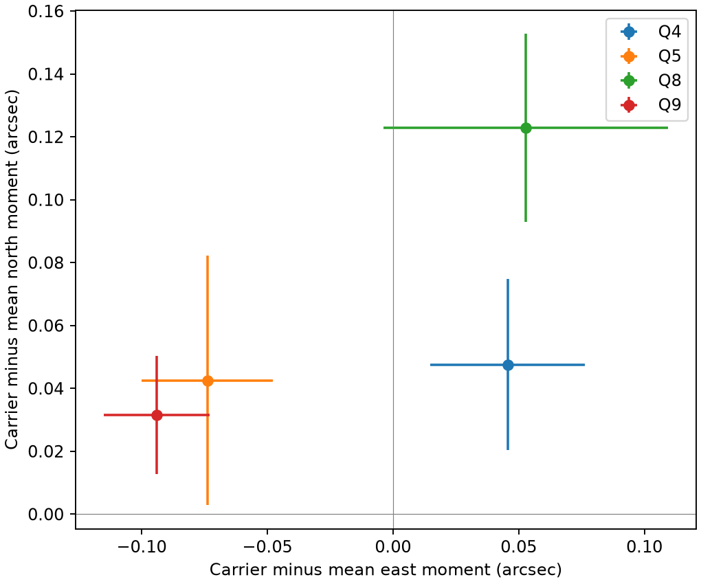
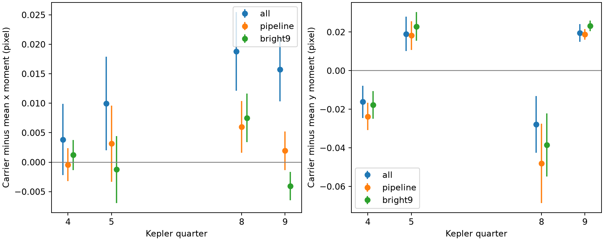
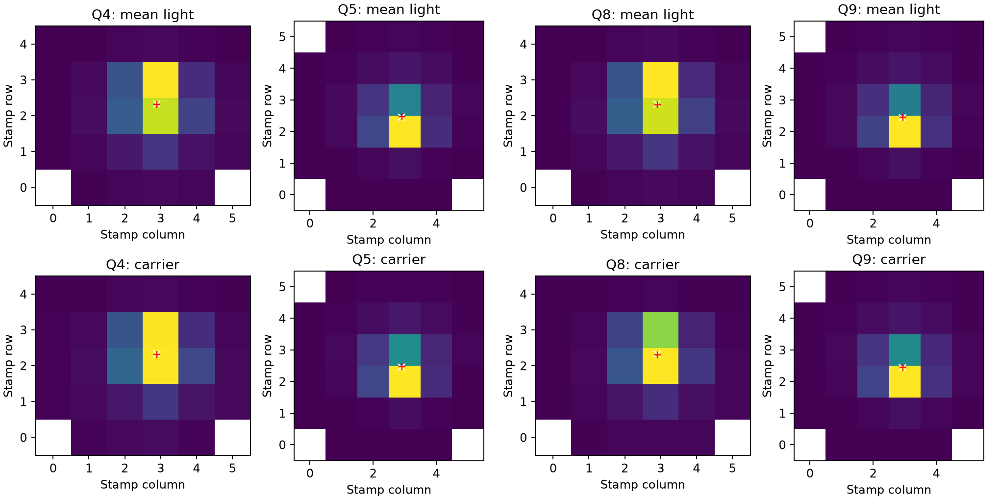

# A fixed sky-offset fit leaves residual image shifts for the KIC 8164262 carrier in four Kepler quarters

The known strong oscillation of KIC 8164262 does not have exactly the same measured image moment as the median light image. In four Kepler release 25 quarters, a fit with one fixed sky offset leaves residual shifts. This result applies to image moments on the supplied stamps. It does not locate a second star or prove an instrument cause. No new planet or stellar mode is reported.



Error bars are one conditional standard error from two-day residual blocks. They do not include calibration error or uncertainty in the median image. The plotted axes use each stamp's sky transform. Quarters 4 and 8 use channel 44. Quarters 5 and 9 use channel 41.

## Question and prior evidence

Can one fixed offset on the sky explain the difference between the oscillation image and the mean-light image on two detector orientations?

Hambleton et al. (2018, DOI 10.1093/mnras/stx2673) reported the strong mode at 2.6184922 cycles per day, near 229 times the orbital frequency. This is a known tidal oscillation. The campaign pixel study SCI 9eaae8163f49d0f8a71f333b6b95181646d01a03b703403ff6654baf855b3afe found an aperture effect on its measured amplitude. It showed spatial maps but did not fit image positions. We use its frequency list and orbital mask. Our contribution is a moment calculation, its noise propagation, and a test after rotation to sky axes.

We ran `sci search` for astronomy and for 8164262 before selection. Full verification was slow. We stopped those two searches after several minutes. We read the partial verified cache and scanned metadata in published campaign ZIP files. This scan found 19 target matches at that time. We read the pixel study with `sci read`. The search record and verified read are included. Search coverage is incomplete. No private worker files were read. We make no first-discovery claim.

Kepler uses difference images and pixel response fits to test signal positions (Kepler False Positive Table, KSCI-19093-001). Our coherent-image moment is a simpler diagnostic. It is not the mission pixel response fit and has no equivalent calibrated source-exclusion radius.

## Data and selection

We reuse these shared files in place. Each is `pixels.fits.gz` in the stated directory below `/mnt/dell-data/shared_datasets/`.

| Directory | SHA-256 |
|---|---|
| kepler-kic8164262-q4-pixels-dr25 | 9c2c7ea16373ecd5fc4fd91d44b0f7607e8ef2585ff50c8ff36e9717121f6dca |
| kepler-kic8164262-q5-pixels-dr25 | 9468a1db957ab5cc705c6a380d2bb89e054e2e181404bd4d2e2de360e701287e |
| kepler-kic8164262-q8-pixels-dr25 | 2e1449633a5ad99459e9b0292128ad66eca72bcf8eb5a2b37d51c4764b817215 |
| kepler-kic8164262-q9-pixels-dr25 | acc9e2669f268372500ce416f09764a0f4211dce7a50fd24e6e9d535a61e9a78 |

`files/provenance.json` records exact shared and resolved paths, source URLs, measured hashes, release and channel. All four hashes were checked. These quarters were chosen because the pixel files were available. They are not a random sample. No new raw data download was needed.

Keep zero QUALITY, finite TIME, finite FLUX in all observed pixels, and finite POS_CORR1/2. Exclude times within five days of periastron. Use period 87.4549 days and epoch BKJD 835.7898. This leaves 2500, 3451, 2440, and 3636 exposures. FLUX is already background-subtracted calibrated pixel flux. We do not subtract FLUX_BKG a second time. The stored samples preserve the selected times, flux, position corrections, and aperture map.

An initial format inspection also read the first three members of the shared full light-curve archive. That archive is not an input to the measured results. `files/exploration.json` identifies it and records its checked hash. No shared dataset was changed.

## Method

Fit all observed pixels together. Each pixel has its own coefficients. The common design contains sine and cosine terms for 19 published frequencies and a cubic spline baseline. The main spline has five-day knot spacing. Frequencies, phase origin, and orbital mask are fixed. The code gives the full list. Exclude the published close unresolved carrier peaks: these short intervals cannot separate them. Fit unweighted flux without clipping.

Let b_p be the two carrier coefficients in pixel p. For a chosen aperture, let B be their vector sum. The coherent image weight is `w_p = B dot b_p / norm(B)`. Its moment is `sum(w_p * position_p) / sum(w_p)`. This keeps the common phase and permits negative pixel weights. It does not replace weights with their absolute values. The light reference is the moment of the per-pixel median flux. The reported offset is the carrier moment minus this reference. Pixel coordinates start at zero on each stamp.

The three apertures are all observed pixels (bit 1 in the aperture map), pipeline pixels (bit 2), and the nine pixels with highest median flux. Apertures stay fixed within a quarter. All stamps are small and can lose source light. Some all-pixel carrier weights are negative (one or two pixels per quarter). No negative weights occur in the main pipeline or nine-pixel fits.

Propagate coefficient errors through the derivative of the moment ratio, including the fitted phase direction. Project the residuals through the design pseudoinverse. Sum the coefficient influence within consecutive time blocks and form the outer-product covariance sum. The main block length is two days. The full two-axis covariance is saved. This conditions on the median image, frequencies, aperture, baseline, and orbit. It assumes that different blocks and quarters are uncorrelated. There is no small-sample correction.

Transform each offset and covariance with the aperture image's TAN sky matrix. In this small field, its two axes approximate east and north. The stored matrix has units of degrees per pixel. Multiply by 3600 for arcseconds. A constant-offset model fits one east and one north parameter by generalized least squares to the four quarters. Its residual statistic has six nominal degrees of freedom. The chi-square probabilities are conditional diagnostics, not calibrated discovery probabilities.

Repeat with three-, five-, and ten-day spline knots, with and without linear POS_CORR1/2 terms, and with one-, two-, five-, and ten-day noise blocks. These choices reuse the same photons. They are not independent confirmations.

## Results

The main all-pixel moments are:

| Quarter | East offset (arcsec) | North offset (arcsec) |
|---|---:|---:|
| 4 | 0.0456 +/- 0.0308 | 0.0475 +/- 0.0272 |
| 5 | -0.0738 +/- 0.0261 | 0.0426 +/- 0.0397 |
| 8 | 0.0528 +/- 0.0565 | 0.1228 +/- 0.0299 |
| 9 | -0.0940 +/- 0.0211 | 0.0315 +/- 0.0188 |

The fitted common offset is east -0.0519 arcsec and north 0.0475 arcsec. The residual statistic is 22.62 for six nominal degrees of freedom, with conditional p = 0.00094. Pipeline and nine-pixel apertures give statistics 41.06 and 43.10 in the same fit. These are diagnostics of the stated model, not probabilities of contamination or an instrument cause.

Across all baseline, position, and block choices, the all-pixel statistic ranges from 14.20 to 65.47. Pipeline values range from 22.69 to 154.31; nine-pixel values range from 24.51 to 142.42. The different errors change the apparent strength. No variant establishes a physical source position.



For all three apertures and all six baseline/position fits, the detector row offset is negative in Q4/Q8 and positive in Q5/Q9. The main all-pixel row offsets are -0.0161, +0.0191, -0.0279, and +0.0195 pixel. They are small. A mean-flux reference instead of a median reference changes the all-pixel row reference by -0.00112, -0.00446, -0.00161, and -0.00034 pixel. These reference changes are smaller than the main row offsets but are not included in the stated errors.



Each image is normalized to its own sum. The white cross is the median-light moment. The red cross is the carrier moment. These maps do not use a fitted point-spread function.

## Physical interpretation and limits

For a stationary single source with pixel flux `c_p * S(t)`, every pixel has the same fractional signal. The mean and carrier moments then agree. A constant extra light source can move the mean moment relative to the variable source. With a stable, complete image response and fixed dilution, that difference would give one offset on the sky. The measured moments do not follow this simple model within the conditional errors.

This result does not reject general blended-light models. Stamp loss, different pixel response functions, changing aperture shapes, background errors, and pointing can change moments even for a fixed sky scene. In particular, the all-pixel stamps have different boundaries after a spacecraft roll. A blend can therefore have different measured moments on each orientation. Position regression is not a full detector model. Calibration errors and correlations beyond ten days can increase the errors. The Q4 fit has condition number about 2903 and is less well conditioned than the other quarters. Nearby unresolved modes can enter the short-interval carrier estimate.

Thus, the useful result is an orientation-dependent image diagnostic that a source model must reproduce. It is not a new oscillation, an identified contaminant, a measured binary separation, or a proof of instrumental origin. The repeated quarters are separate observing intervals with the same telescope and processing. No independent observatory confirmation was obtained. A physical follow-up would need a pixel response fit for the complete catalogued scene, explicit stamp truncation, and independent imaging or photometry. We leave those tests open.

## Validation and reproduction

On each actual design matrix, synthetic proportional images recover equal moments to within 9e-16 pixel. Synthetic asymmetric carrier images recover the known moment to within 1.4e-15 pixel. These noiseless tests check algebra and do not calibrate the sky test. A finite-difference test checks the analytic moment derivative. A separate run from saved samples checks the numerical fit tables. See `validation.json` and `reproduction_check.json`.

Use Python 3.12 with NumPy, SciPy, pandas, Astropy, and Matplotlib. Exact tested versions are in `versions.json`. From the unpacked publication root, run offline:

```sh
OPENBLAS_NUM_THREADS=2 python files/analyze.py --samples files --out reproduced
python files/sky_test.py --files files --out reproduced_sky
python files/check.py files reproduced
```

To regenerate sky statistics from the new fit table, copy `files/wcs.json` to `reproduced/wcs.json`, then run `python files/sky_test.py --files reproduced --out reproduced_sky_new`. Outputs must stay outside the signed bundle.

For full raw reproduction, run `python files/analyze.py --data /mnt/dell-data/shared_datasets --out reproduced_raw`. Outside the campaign, `python files/retrieve.py NEW_DIRECTORY` downloads exact sources and checks their hashes. Give that new root to `--data`. Retrieval creates a new private directory. It does not change the shared store. The four raw files total about 10 MB. The sky matrices are preserved from the raw aperture headers.

## Job and rights

Campaign 11_07_2026. Job sci-1107-syam2-astronomy-8a99953d6d05. Topic astronomy. Machine syam2. Account codex-myxtap. Model gpt-6.1-sol with high reasoning effort in T3 Code. Analysis date 2026-11-08. No child agents were used. The campaign-machine signing key records integrity. It is not a personal authorship claim. No private key is included. This publication is saved locally only.

Credit NASA, Kepler, MAST, Hambleton et al., and the cited campaign study. The baseline license covers new text, code, figures, and derived evidence to the extent source rights permit. Source data retain their original terms.
