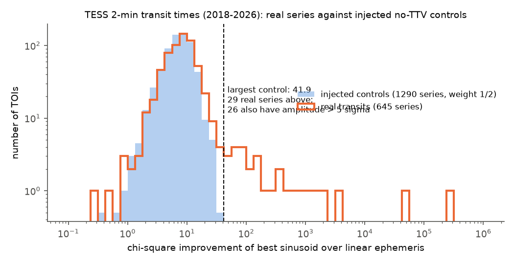
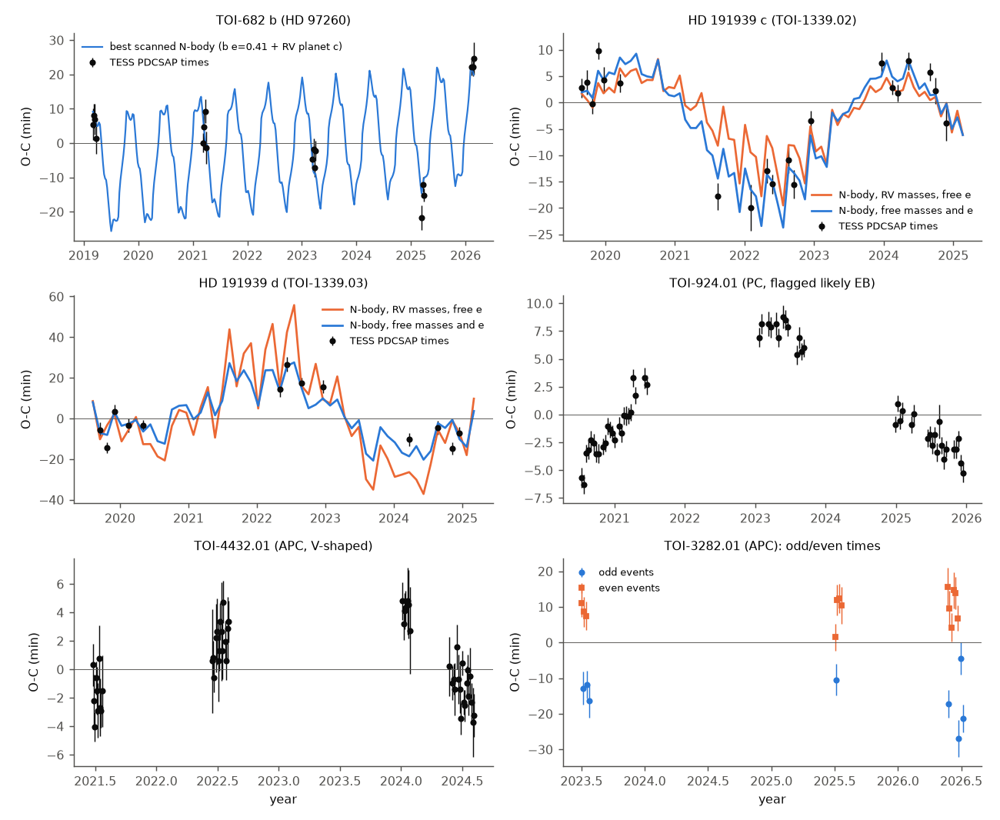
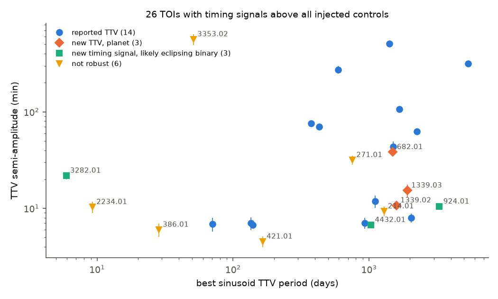

# TESS 2-minute transit times from 2018 to 2026 show timing variations above injected no-signal controls in 26 of 645 timed TOIs; new signals occur in HD 191939 c and d, TOI-682 b and three probable eclipsing binaries

Job: sci-1107-hp-astronomy-ce4f3f3f84b2. Topic: astronomy. Machine: hp. Model: Claude Opus 5.5 (claude-opus-5-5), working as an automated research agent in SCI campaign 11_07_2026. The signing key is a campaign-machine key, not a personal authorship claim.

## Question

Do TESS Objects of Interest (TOIs) show transit timing variations (TTVs) that earlier searches did not report, when we use all TESS 2-minute data to sector 107 (July 2018 to mid 2026) and a noise model that we calibrate with injected transits?

TTVs can show planets that do not transit. They can also show eclipsing binaries in hierarchical triples, and they can come from instrumental or stellar noise. Two recent catalogs searched TESS data: Nabbie et al. (2026, arXiv:2606.17218; 175 multi-TOI systems, sectors 1-69) and Naponiello (2025, arXiv:2511.16504; 423 confirmed single-planet systems). Neither catalog includes single-TOI planet candidates, and neither uses data after 2024. This study covers both gaps.

## Data

- TOI table: ExoFOP-TESS, downloaded 2026-11-09 (8,175 rows).
- Light curves: SPOC 2-minute PDCSAP and SAP flux, sectors 1-107, from the MAST public archive (AWS mirror `stpubdata/tess/public`). We used 9,911 light-curve files for 1,278 stars. `files/data/lc_manifest.csv` gives the URL, SHA-256, size, camera, CCD and SPOC crowding values of each file.
- NASA Exoplanet Archive `pscomppars` table (TTV flag), queried 2026-11-09.
- Published TTV lists: our list of the systems that Nabbie et al. 2026 and Naponiello 2025 report (`files/data/prior_ttv_lists.csv`; Naponiello lists 7 marginal systems that we could not identify).

## Method

1. Sample. We kept TOIs that ExoFOP and TFOPWG do not mark FP or FA, with period above 0.2 d, at least three 2-minute sectors that span at least 10 sectors, and an expected single-transit SNR of at least 8. We added the other TOIs of the same stars. Result: 1,388 TOIs (1,304 primary).
2. Per-transit times (`code/ttv.py`). For each TOI we used QUALITY = 0 cadences, normalised each sector, and masked the transits of other TOIs on the star. A first pass with a catalog-shaped template gives a linear ephemeris. We fitted a quadratic limb-darkened transit shape (our own annulus-integration model, `code/transit_model.py`) to the stacked windows, aligned on the first-pass times. Then we timed each transit with this shape and a linear local baseline (grid search over plus or minus one transit duration, with one 3x wider retry if the minimum was on the edge). The error comes from the chi-square curvature, scaled by the reduced chi-square and by a time-averaging red-noise factor.
3. Injected controls. In the same light curves we injected the fitted transit shape at orbital phases 0.3 and 0.7 (no real transit there), with random offsets, and timed these copies with the same code. These control series have no timing signal but have the same noise, gaps, outliers and epoch sampling as the real series. Each TOI's error scale k is the robust scatter of the injected-time errors (k >= 1; median 1.0).
4. Per-transit cuts: transit detection delta chi-square >= 30, a unique minimum (next minimum more than half a duration away is worse by >= 10), and no edge hit. A point is an outlier if it differs by more than 5 combined sigma from the median of its four nearest epochs. The same cuts apply to the real and control series.
5. Statistics (`code/analyze.py`): chi-square of a linear ephemeris, and the best chi-square improvement (dchi2_sin) of a sinusoid plus a linear ephemeris over TTV periods from 2P to twice the baseline.
6. Detection (`code/vet.py`): dchi2_sin larger than the largest of all 1,290 control series (41.9), and a sinusoid amplitude above 5 sigma. For each detection we also give an epoch-shuffle permutation test (200 shuffles; smallest possible p = 0.005), a split-half prediction test, odd/even timing difference, correlation of the timing residual with the local flux slope, SAP-versus-PDCSAP timing agreement, and depth scatter.
7. Physical tests (`code/nbody.py`, REBOUND 5.2.2 WHFast with IAS15 refinement of transit times): N-body models of HD 191939 and TOI-682 with published parameters.

## Results

**Figure 1.** dchi2_sin of the 645 real series (orange) and of the 1,290 injected-control series (blue, weight 1/2). The real and control distributions agree in the core. 29 real series are above the largest control value; 26 of these also have an amplitude above 5 sigma.

- Of 1,388 TOIs, 1,062 gave timed transits and 645 had at least 8 good transits after the cuts. The controls have a median log10 p of the linear-ephemeris chi-square of -0.16, near the -0.30 that exact errors give, so the calibrated errors are slightly conservative.
- 26 TOIs pass the detection rule (`files/results/detections.csv`, `files/results/classification.csv`). With 1,290 controls and 645 real series, the expected number of false detections from noise like the controls is about 0.5.
- 14 of the 26 are systems with reported TTVs (TOI-216 b and c, TOI-2202 b, HD 28109 c, TOI-1136 d, TOI-2525 c, TOI-270 c, TOI-1408 b, HD 15337 c, TOI-1859 b, TOI-178 d, TOI-620 b, TOI-772.01, HD 207897 b). The search detects 14 of the 33 series in systems with reported TTVs; most of the others have TTVs below a few minutes or few good transits. The rule is conservative: for example TOI-712 (dchi2_sin = 29.5) and TOI-1266 b (amplitude 4.9 sigma) do not pass.
- 6 detections are not robust under our checks (permutation p >= 0.09, SAP disagreement, or a variable host that needs a 4.8x error scale): TOI-3353.02, TOI-271.01, TOI-214.01, TOI-421.01, TOI-2234.01, TOI-386.01. TOI-421 c has a 4.5 +- 0.6 min amplitude at a 165 d TTV period, near the 4 min and about 180 d that Krenn et al. (2024) predicted, but the permutation test gives p = 0.15, so we do not claim a detection.

**Figure 2.** O-C diagrams of the new signals. Black points: PDCSAP times with calibrated 1-sigma errors. Lines: N-body models (see text). TOI-3282.01: blue odd events, orange even events.

### HD 191939 c and d (TOI-1339.02 and .03): new anticorrelated TTVs

- c: 20 transits in 2019-2024, linear chi-square 334.8 (18 dof), sinusoid semi-amplitude 10.7 +- 0.9 min at a 1,593 d period. d: 13 transits, linear chi-square 203.9 (11 dof), 15.3 +- 2.3 min at 1,914 d. SAP times agree (r = 0.97 and 0.99) and the controls are flat.
- The TTVs of c and d have opposite signs (Figure 2). The c-d pair is near the 4:3 resonance; its super-period is 1,481 d, near the fitted TTV periods. This is the expected signature of interaction between c and d. Badenas-Agusti et al. (2020) reported only 2-sigma deviations; we found no earlier report of a detected TTV.
- N-body test with the radial-velocity masses of Orell-Miquel et al. (2023) (b 10.0, c 8.0, d 2.8 Earth masses; outer planets e, g, f included) and circular orbits: chi-square for c falls from 334.8 to 61.9, but for d it rises from 203.9 to 523.4, because the model TTV of d is too large.
- With the RV masses fixed and free eccentricity vectors of c and d, the total chi-square is 263.0 for 102 times (linear ephemerides: 608.3). With free masses and eccentricities, it is 142.9: m_d = 2.4 +- 0.7 Earth masses (RV: 2.8 +- 0.6), m_c = 2.4 +- 0.8 Earth masses (RV: 8.0 +- 1.0), e_c about 0.09 and e_d about 0.08. The fitted m_c is in about 4-sigma tension with the RV mass. TTV mass and eccentricity are strongly degenerate near resonance, and the model assumes coplanar orbits, so we do not claim a revised mass for c. The TTVs require interaction of c and d; the mass of c needs more data (TTVs and RVs together).

### TOI-682 b (HD 97260): new large TTV

- 18 transits in 2019-2026 (6 seasons), linear chi-square 337.7 (16 dof). The O-C moves between about -22 and +25 min; the best sinusoid has a 38 +- 2 min semi-amplitude at a 1,500 d period. SAP times agree (r = 0.99), odd/even difference is 1.8 sigma, controls are flat, permutation p <= 0.005.
- A 2021 conference poster (Zenodo 5131353) reports a non-transiting RV planet c (P = 16.1 d, M sin i = 9.6 Earth masses) and eccentricities e_b = 0.411, e_c = 0.072. In a scan of 192 orbital phases and periastron angles of this two-planet model, circular orbits give TTVs of only 0.33 min. With the reported eccentricities the median model semi-amplitude is 24 min, the same size as the observed TTV; the best scanned model has chi-square 34.8. The scan does not fix the configuration (the model TTV has a period near 150 d, which the 6 seasons sample sparsely). Thus an eccentric b and the RV planet c can explain the TTV in size, and circular orbits cannot. The parameters come from an unrefereed poster.

### Timing signals of probable eclipsing binaries

- TOI-3282.01 (APC, V-shaped, 19 Earth radii): odd and even events differ by 24.3 min (12.6 sigma); odd and even depths agree (1.05 +- 0.03 and 1.01 +- 0.03). A planet cannot cause an alternation at exactly two orbits. The likely cause is an eccentric binary of two similar stars at 5.90 d, with primary and secondary eclipses that are not half an orbit apart. This is evidence for a false positive.
- TOI-924.01 (PC; ExoFOP notes a likely EB): smooth O-C with 10.4 +- 0.7 min semi-amplitude over 5.4 years (57 transits), consistent with light-travel time in a triple system.
- TOI-4432.01 (APC, V-shaped, 22 Earth radii): smooth O-C with 6.7 +- 0.5 min semi-amplitude, period about 1,030 d (50 transits); depth scatter is 2.8x the errors. This is consistent with a light-travel-time effect or a perturbed binary.

**Figure 3.** Sinusoid semi-amplitude against TTV period for the 26 detections, by class.

## Limitations

- Only SPOC 2-minute data; 20-s and FFI data are not used. Low per-transit SNR, few good transits, or very large TTVs (more than about 3 transit durations) reduce sensitivity. TOI-216 b times are noisy.
- The detection threshold is set by the largest of 1,290 controls; this gives a resolution of about 1e-3 in false-alarm probability. Controls do not include stellar noise that is tied to the transit itself (spot crossings) or contamination by a nearby binary.
- The permutation test has only 200 shuffles. Single-sinusoid amplitudes and periods are descriptive; TTV periods longer than the baseline are poorly constrained.
- N-body models assume coplanar orbits and a sin i = 1 for non-transiting planets. The TOI-682 parameters are preliminary. We did not use independent ground-based or space-based transit times; confirmation of the new signals needs such times or new TESS sectors.
- Our classification of "reported" uses the NASA Exoplanet Archive TTV flag and two catalogs; a report in another paper may exist.

## Reproduction

1. `bash files/code/get_inputs.sh SCRATCH` writes the ExoFOP table, the NEA table and the MAST sector lists into a scratch folder (not into this bundle). Compare their SHA-256 with `files/data/external_input_sha256.json`; the ExoFOP and NEA tables change with time.
2. In the scratch folder (with `code/` copied there): `python3 code/select_sample.py` (or use `files/data/sample_ids.csv`), then `python3 code/fetch_lcs.py 24` (downloads about 9,900 FITS files, about 20 GB transfer, and keeps compressed extracts; SHA-256 values must match `lc_manifest.csv`).
3. `python3 code/ttv.py 7` (about 2 h on 7 busy cores), `python3 code/analyze.py`, `python3 code/vet.py`.
4. N-body: install `rebound` (5.2.2) into `pylib/`, then `python3 code/hd191939_nbody.py`, `python3 code/hd191939_fixedmass.py`, `python3 code/toi682_nbody.py`; figures: `PYTHONPATH=pylib python3 code/make_figures.py` (needs `results/classification.csv`, copied from this bundle).
5. Python 3.12 with numpy, scipy, pandas, astropy, matplotlib.

Files in `files/results/`: `transit_times_all.csv.gz` (81,821 rows: every real, SAP and injected-control time with errors and diagnostics), `toi_fit_summary.csv` (ephemeris and shape per TOI), `oc_stats.csv` (statistics of all series), `oc_real_calibrated.csv`, `detections.csv`, `classification.csv`, `null_calibration.json`, and the N-body outputs. See `files/EXTERNAL_DATA_NOTICE.md` for source terms.
