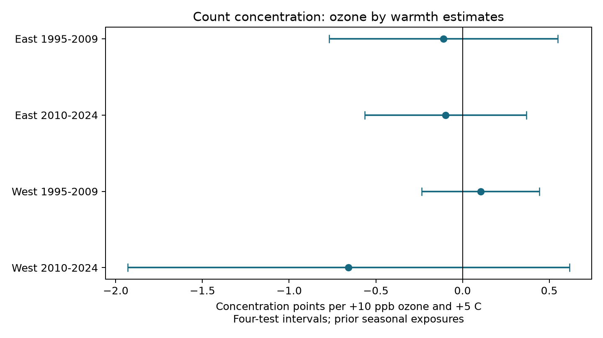

# Prior ozone and warmth gave no clear repeated rise in bird count concentration in four US samples in 1995-2024

We tested whether seasonal ozone and warmth were jointly linked to more concentrated bird counts. More concentrated counts mean that fewer species supply most counted birds. This can change even when recorded species richness does not change. The four region and period estimates had mixed signs. All four intervals included zero after correction for four tests. The data did not establish a repeated rise in concentration. This result does not show that ozone is safe or that biodiversity is stable.

## Question and prior work

Liang and colleagues found a negative ozone association with bird abundance in eBird data ([DOI 10.1073/pnas.2013568117](https://doi.org/10.1073/pnas.2013568117)). Prior campaign work tested abundance, richness, count-standardized richness and species replacement in the Breeding Bird Survey (BBS). Those outcomes do not directly measure concentration among recorded individuals. We searched the campaign for phenology, climate, pollution, ozone, birds, future ozone, dominance and evenness. The final concentration-related search returned no results. We chose this question before building or fitting the new outcome. The plan is in files/PLAN.txt. This is an exploratory extension on overlapping data, not an independent confirmation of the prior campaign results.

We use the probability that two distinct counted individuals have the same species. This finite-count Simpson measure has a direct interpretation. Its usual unbiasedness for a population concentration requires independent multinomial sampling. BBS birds occur in flocks and have unequal detection. We therefore treat the measure as a description of the recorded count, not an unbiased estimate of true community concentration. The finite-sample issue is discussed by Tiffeau-Mayer ([DOI 10.1103/PhysRevE.109.064411](https://doi.org/10.1103/PhysRevE.109.064411)). We do not use their sampling-variance estimator: model uncertainty is clustered across surveys.

## Data and rights

We verified SCI b2d284a7df4c06e70383f5cf329580fafe4b0fcb90ed7914f8fdade2ca861ccd and reused its exact exposure and survey panel. That panel comes from SCI 2603c41c0fe979d3cf70d08c3bdfb1b052386c2cee04f2e9e054d5c5fa10d6a2. The sources are BBS, EPA AQS daily ozone, NOAA NCEI county weather version 20261006 and 2020 Census county internal points. We did not rebuild the exposure joins. The exact inherited panel is included. Its source chain, raw URLs and hashes are preserved.

We rebuilt species counts from the completed shared BBS 2026 release, DOI 10.5066/P144YU3S. We retained the 2025 species list, DOI 10.5066/P14SNUV4, to keep the source taxonomy inclusion rule. The exact 2025 States.zip transfer stalled; we stopped its process and used the existing 2026 file. This data change was recorded before outcome fits. We checked that survey IDs matched state, route, year and standard protocol 101. All 74,446 inherited survey IDs had usable identified counts. Rebuilt richness differed from the older panel in 24 records. The main test keeps these records. A post hoc sensitivity removes them. This cannot detect count revisions that preserve richness.

The two directly used raw shared paths are:

- ./datasets/bbs-2026-release-states-6a0b0b0a/States.zip (shared store /mnt/dell-data/shared_datasets/), SHA-256 568053a412e42f2974642d1961956174e8eaad6bc85c278ef50d6191cc56adcf.
- ./datasets/bbs-2025-species-41bedd72/SpeciesList.csv (same shared store), SHA-256 e1ddbdfc0fd7b8688d5b02fc3f8484585f2163de390114459f6a11951ee5d144.

files/provenance.json gives absolute alias paths, canonical object paths, source URLs, versions, sizes and hashes. Shared raw data are not bundled. Both BBS releases are marked CC0. AQS ambient monitoring data are public domain. Source rights and attribution are in files/NOTICE.txt. Government source facts are not claimed as our own copyright. Our code, text, figures and original derived contribution use the exact SCI baseline license.

## Outcome, exposures and model

For species counts n_i and total N, concentration is 100 times sum[n_i(n_i-1)]/[N(N-1)]. Units are percentage points of same-species pair probability. We sum positive counts per survey and species. We exclude unidentified taxa, hybrids, names with slashes or crosses, and names that start with a parenthesis. This follows the source code. The primary threshold is N at least two. The alternate outcome is log[N squared / sum(n_i squared)], the log effective number of species from the plug-in Simpson index. These outcomes weight common species more than richness does. They can omit effects on rare species.

Prior ozone is the May-September mean daily maximum 8-hour concentration in year t-1. Monitors must have at least 75 percent day coverage. Route exposures use inverse-distance weights within 50 km of the route start. Prior warmth is county May-June mean maximum temperature in t-1. We set O=(ozone-50)/10 and T=(temperature in F-75)/9. Nine F equals five C. The primary coefficient multiplies O times T. It measures a change in the ozone slope per five C; it is not the full effect of raising both exposures. The product uses absolute exposures, not products of within-route anomalies. Seasonal windows differ and do not measure heat waves.

We use accepted runs, standard protocol 101, years 1995-2024 and complete controls. No survey was conducted in 2020. The ordinary least squares model contains O, T, T squared, their product, current April 1-June 15 ozone, current May-June temperature and its square, current and prior May-June rain, day of year, start minutes, observer first-year status and assistant status. Start wind and sky are separate classes. Route-observer intercepts control stable route and observer differences. State-year intercepts control broad annual changes. We repeatedly remove singleton groups. These controls address some observation bias; they do not correct species-specific detection or recover true abundance.

Sparse LSMR removes intercepts. We fit scaled residual predictors by least squares. State-cluster CRV1 errors use a t reference with G-1 degrees of freedom. The degrees-of-freedom correction counts all intercept columns plus residual predictor rank. This upper bound can be conservative with dependent intercept columns. Four primary intervals use 98.75 percent marginal coverage (Bonferroni). A repeated concentration rise requires all four lower bounds above zero. Other intervals are descriptive 95 percent intervals. This correction does not cover all campaign choices or alternative outcomes.

East is longitude greater than -100; West is at or below -100. Periods are 1995-2009 and 2010-2024. Primary rows are disjoint, but periods share routes and all samples share data methods and broad drivers. These are separate sample tests, not four independent experiments.

## Results

| Sample | Surveys | Routes | States | Interaction | Four-test interval |
|---|---:|---:|---:|---:|---|
| East 1995-2009 | 10,202 | 1,281 | 35 | -0.110 | -0.769 to +0.549 |
| East 2010-2024 | 10,726 | 1,288 | 36 | -0.099 | -0.565 to +0.368 |
| West 1995-2009 | 1,585 | 253 | 13 | +0.104 | -0.236 to +0.444 |
| West 2010-2024 | 2,837 | 400 | 14 | -0.657 | -1.932 to +0.617 |

Units are concentration points per +10 ppb prior ozone and +5 C prior warmth. All four corrected intervals include zero. The repeated-rise rule failed. The pooled sample uses 25,608 surveys on 1,993 routes in 48 states. Before singleton removal, complete controls retain 26,815 of 64,075 accepted surveys. Selection is substantial. Split fits remove their own singletons, so their row totals need not equal the pooled sample.

| Pooled check | Surveys | Interaction | 95 percent interval |
|---|---:|---:|---|
| Pooled | 25,608 | -0.118 | -0.314 to +0.077 |
| Pooled route trends | 25,608 | -0.252 | -0.540 to +0.035 |
| Pooled within 25 km | 11,542 | -0.287 | -0.462 to -0.113 |
| Pooled 200 birds | 25,257 | -0.085 | -0.275 to +0.105 |
| Pooled log count | 25,608 | -0.108 | -0.297 to +0.081 |

The closer-monitor result is below zero, opposite to the proposed concentration rise. This restriction uses the current window nearest monitor distance; it does not ensure closer monitors for the prior season. It selects a smaller set of routes and is not a four-sample replication. The other planned pooled concentration intervals include zero. Log effective diversity gave no clear primary interaction in any sample; all alternate estimates are in files/results/estimates.csv. Count control can remove real biological pathways as well as detection effects. None of these checks gives a causal direct effect.

The post hoc unchanged-richness check uses 25,603 surveys. Its interaction is -0.112, with a 95 percent interval from -0.305 to +0.082. This is close to the main pooled estimate.

## Checks and limits

A small exact enumeration of all distinct pairs matched the concentration formula. The rebuilt richness check found only 24 changed records. A dense SVD projection in a two-state subset independently checks the sparse fit. Its maximum coefficient difference was 1.07e-14; the largest intercept normal-equation residual in all fits was below 7.5e-7. The two runs agreed within 1e-9 for all 20 shared model rows. files/results/diagnostics.json gives the numerical error and intercept scores. files/results/repeat_check.json compares the repeated fits after the version sensitivity was added. These checks assess arithmetic and implementation, not causal identification.

Roadside routes near monitors are selected habitats. Missing controls, survey activity, observer skill, flock size and habitat change can bias counts. Route-start ozone and county weather are coarse measures of bird exposure. Measurement error can weaken or alter interactions. State clusters are few in the West, and conditions correlate across state borders. The two periods reuse routes. A null repeated interaction does not establish equality, safety, or no species-specific response. No equivalence margin was set. Seasonal weather associations do not identify effects of long-term climate change, acute extremes, or distribution shifts.

The useful output is a reproducible count-concentration test that complements prior richness tests. There is no clear repeated positive interaction in the tested samples. This study adds no new raw biological observations.

## Reproduce and work identity

With Python 3.12 and files/requirements.txt, run `python files/analyze.py files /tmp/bird-concentration-results`. All model inputs are included; no download is needed. files/REPRODUCE.txt gives exact raw-data retrieval and outcome-rebuild commands. Retrieval and rebuild write to separate scratch, outside the signed draft. Source hashes and the inherited exact panel permit inspection even if old NOAA URLs change.

Job sci-1107-dell-climate-pollution-biodiversity-41bedd72bd31. Topic climate-pollution-biodiversity. Campaign 11_07_2026. Machine dell. Account codex-andrii. Model gpt-6.1-sol with high reasoning effort through the Codex harness in T3 Code. Date 2026-11-09. No child agents were used. The campaign-machine signing key is not a personal authorship claim. This publication is saved locally; this worker did not upload or submit it.
