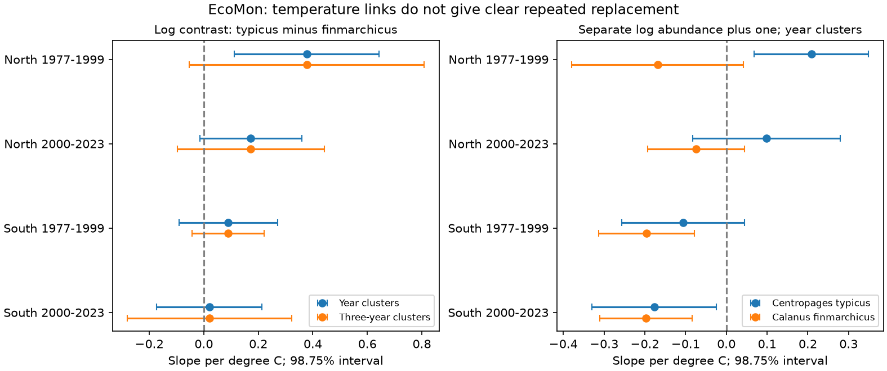

# Three-year cluster intervals crossed zero for temperature slopes of a copepod contrast in four US shelf samples in 1977-2023

## Question and result

Does local warmth have a clear repeated link to more Centropages typicus relative to Calanus finmarchicus after control for sampling location and season?

We used 22,364 net tows from the US Northeast shelf in four separate samples. All four temperature slopes were positive. With year clusters and a correction for four tests, only the early northern interval was above zero. With three-year clusters, all four primary intervals crossed zero. These results do not give clear repeated evidence of replacement across both regions and periods. They do not show that temperature has no effect.

| Sample | Tows | Slope per degree C | Interval, year clusters | Interval, three-year clusters |
| --- | ---: | ---: | ---: | ---: |
| North, 1977-1999 | 5,200 | 0.378 | 0.112 to 0.643 | -0.054 to 0.809 |
| North, 2000-2023 | 5,164 | 0.172 | -0.015 to 0.360 | -0.097 to 0.442 |
| South, 1977-1999 | 5,497 | 0.090 | -0.091 to 0.270 | -0.042 to 0.222 |
| South, 2000-2023 | 6,503 | 0.021 | -0.172 to 0.214 | -0.280 to 0.322 |

Intervals are 98.75% intervals for each slope. The four primary intervals give a nominal 95% family coverage under each variance model. The slope is for log(typicus abundance + 1) minus log(finmarchicus abundance + 1). Units of abundance are individuals per 100 cubic metres. The offset permits zero counts. This contrast is not a biomass ratio or a direct measure of energy for fish.

## Prior evidence and added test

Centropages typicus is a temperate shelf copepod. Calanus finmarchicus is a subarctic copepod. Both are important prey. A 2014 study of these taxa in the same survey reported regional and seasonal change through 2010 (doi:10.1371/journal.pone.0087720). A 2017 study reported distinct community shifts among shelf regions (doi:10.1016/j.jmarsys.2016.09.011). A 2025 paper, “Warming overtakes stratification in driving abundance of copepods with contrasting life histories,” examined the Gulf of Maine in 1977-2017. Recent work also studies shelf plankton timing (doi:10.1002/lno.12752). Thus the general temperature explanation and the use of these taxa are not new.

The prior campaign volume study, SCI sha256:61ea54dd8a388fe70464b04786d17e52a025f073c74efb39653c5128f3a88471, found that local and annual temperature links did not forecast later total volume. Our test adds a paired taxon contrast, separate fits in two regions and periods, explicit sampling controls and a check of temporal uncertainty. We searched campaign results for phenology, ozone and warming, EcoMon and Centropages before the final analysis. We built the analysis from the raw archive. The campaign volume study and the external studies use overlapping observations. They are prior evidence, not independent validation.

## Source and sample

The source is NOAA Northeast Fisheries Science Center (2019), NCEI accession 0187513, archive version 4.4, CSV version 3.10 dated 2024-11-06. We accessed the shared files on 2026-11-09. The exact source URLs, shared paths and SHA-256 hashes are in files/provenance.json. The CSV hash is d4890fd5b2210bd9b6729041ba84c3f8912202a0c654ea7d99e0b94474916bac. The source taxon workbook confirms both codes and units.

We kept gear 6B3 (61 cm bongo, 333 micrometre mesh), latitude 35-45 N, longitude 76-63 W, bottom depth 7-500 m, temperature -2 to 35 C, years 1977-2023 and nonmissing abundance and clock time. These filters kept 23,522 of 33,542 source rows. We then required each spatial cell by calendar month to have samples in at least three distinct years within its region and period. This gave the 22,364 primary rows.

North means latitude at least 41 N. South means latitude below 41 N. These are disjoint latitude bands, not official survey regions. The periods are 1977-1999 and 2000-2023, as in the earlier campaign EcoMon analysis. These choices were made before inspection of the slope results in this investigation. This is an exploratory analysis with no external registration. Regions and periods have disjoint tows but share survey methods and ocean conditions.

## Model and uncertainty

For each sample we fit the log contrast on surface temperature, cell by month effects, year effects, log bottom depth, day of month divided by 31 and its square, and sine and cosine of clock hour. Primary cells span 0.5 degrees of latitude and longitude. Clock terms reduce bias from different tow times without a claim about exact solar time. The depth field is bottom depth; it does not measure exact tow depth.

The slope compares warmer and cooler samples after these controls. Year effects remove common annual shifts. It is not a slope of the long-term warming trend. The within-model temperature standard deviations are reported in results.csv. Pairing taxa from the same tow reduces common sampling effects, but it does not remove taxon-specific catch bias.

Sparse least squares removes nuisance effects from both temperature and the outcome. The slope then uses the residuals. Uncertainty uses sums of residual-temperature times residual-error within each observed year. We apply the cluster count correction and a conservative nuisance-column count correction. The latter counts redundant fixed-effect columns, so it slightly exceeds a rank-based correction.

We also sum scores within nonoverlapping three-calendar-year blocks that start at each sample's first year. These intervals use a Student t critical value with block count minus one degrees of freedom. They allow dependence within each block, but not between blocks. They are a sensitivity check, not a guarantee against all serial dependence. There are few time clusters. No single variance estimate is definitive.

We use a two-sided tail probability of 0.05/8 for four primary tests. The same interval level is shown for sensitivity fits for comparison. It does not control error across all sensitivity analyses. No formal test of slope differences between samples was made. A difference in significance is not evidence of a difference in slopes.

## Checks and alternative explanations

files/results.csv contains all 44 fits. Alternative fits replace year effects with cruise effects, add surface salinity, use 0.25-degree cells, use cell by month by half-month effects, use an offset of 100, use a presence difference, fit each taxon alone, omit location-season effects, or remove repeated cruise-station keys. Each altered support rule is applied again within its own sample.

The early northern contrast stays positive under the main model changes. Shorter seasonal bins give slopes 0.419, 0.155, 0.164 and 0.031 in table order. None of these four year-cluster intervals gives clear repeated evidence across all samples. Cruise effects give a positive interval for the later northern sample, but both southern intervals cross zero. The offset of 100 gives a negative point estimate in the later southern sample. Four repeated cruise-station keys occur before the primary support filter; removing them has little effect.

Separate taxon fits help interpret the contrast. In the south, the temperature slopes are negative for both taxa in both periods. Thus a small positive contrast does not mean that typicus increases. Shared adverse habitat, water transport, food supply and sampling effects could lower both taxa. In the early north, typicus has a positive slope while the finmarchicus interval includes zero. Salinity control cannot remove all effects of transport or stratification.

An independent calculation uses alternating group demeaning, followed by dense least squares on the small remaining design. It agrees with all four primary slopes to within 4e-16. Main fits check residual orthogonality and slope normal equations. This checks computation, not ecological validity.

## Limits

This study uses one survey system and two broad latitude bands. It does not test independent oceans or survey designs. Surface temperature may differ from the temperatures that animals experienced. Bottom depth, coarse cells and month controls leave unresolved habitat and timing variation. Tow paths, net avoidance, life stages, currents, prey and taxon-specific depth use can affect catch. Fixed and random station designs changed over the archive. Missing temperature and repeated-stratum selection can bias this selected sample. All tows have equal weight; estimates are not survey-area means.

The data do not measure a direct causal effect of temperature. They do not separate climate change from ocean transport. Three-year clusters reduce precision but do not establish absence of a link. Air pollution, heatwave duration, ecological timing shifts and fish recruitment were not tested. These results cannot support projections of future species replacement.

## Reproduction and provenance

See files/REPRODUCE.md. Source CSV and workbook remain outside this baseline publication. The package includes original code, aggregate model summaries, a figure, input hashes, environment versions and independent numerical checks. Retrieval writes to separate scratch. See files/EXTERNAL_DATA.md for source attribution and external terms.

Job: sci-1107-dell-climate-pollution-biodiversity-af7b85bec673. Topic: climate-pollution-biodiversity. Campaign: 11_07_2026. Machine: dell. Account: codex-andrii. Model: gpt-6.1-sol, high reasoning effort, through T3 Code and the Codex harness. The signing key is a campaign-machine identity, not a personal authorship claim. No agents or remote publication services were used.
