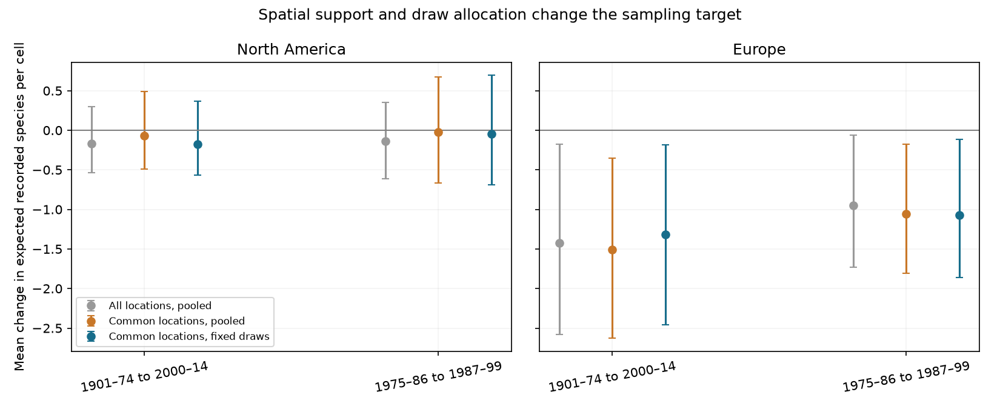
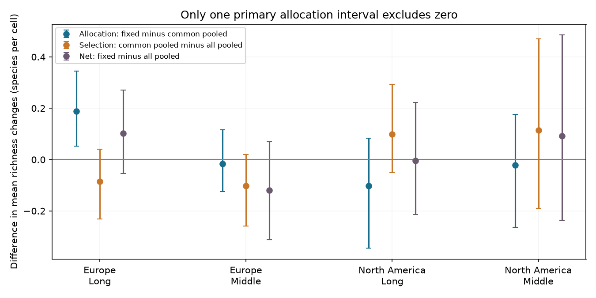

# Fixed draws within shared subcells reduced one bumblebee richness loss estimate in four tests of 1901-2014 records

We tested whether fixed record counts make bumblebee richness changes stable to shifts in sampling locations. We used public records for Europe and North America in two disjoint time comparisons within 1901-2014. We kept quarter-degree subcells with at least five records in each period. We compared exact richness expectations from fixed draws in each shared subcell with pooled draws from the same records. Both designs kept all four mean change signs. In 168 European cells, the long-period allocation contrast was +0.188 expected species per cell, with a four-test adjusted interval of +0.052 to +0.345. The other three contrasts were uncertain. The European shift stayed positive at two other bootstrap block sizes, but its interval crossed zero with larger subcells or more draws. Removing unmatched locations gave an opposite shift. All four net-contrast intervals included zero. These selected records do not identify true richness change or a climate effect. The test extends a climate-impact analysis; it fits no environmental exposure. Source records and cell tables stay outside the package. Code, aggregate results, checks and a figure support reproduction.



## Question and prior work

Does equal-record rarefaction give stable richness changes when observers shift locations within a grid cell? This matters for tests of climate-linked biodiversity loss. Equal record counts do not imply equal geographic coverage.

Soroye, Newbold and Kerr (2020; Science, DOI 10.1126/science.aax8591) linked bumblebee distribution changes to climate exposure. A prior campaign re-test (SCI 782802ff) showed sensitivity to record effort. Another campaign study (SCI e11b5d6b) compared fixed source draws with pooled draws. We reuse its preparation code, species rules, time bins and exact expectation functions. We add fixed geographic subcell draws and separate the change from location selection from the change from draw allocation. The raw biological records fully overlap those studies. This is a method extension, not independent biological confirmation.

Boakes et al. (2010; DOI 10.1371/journal.pbio.1000385) documented changing spatial and temporal biases in occurrence records. Osazuwa-Peters et al. (2018; DOI 10.1371/journal.pone.0204484) compared individual and spatial rarefaction for museum records. The review *Spatial standardization of taxon occurrence data—a call to action* explains why record-count control does not replace geographic control. We do not claim that spatial standardization or rarefaction is new. The added evidence is this direct, paired spatial sensitivity test and decomposition in a public climate-impact archive.

We searched the campaign before choosing this question. Search terms were `phenology temperature pollution`, `ozone warming wildflower`, and `bumblebee`. The last search found the two cited bumblebee studies. The design is exploratory. It has no preregistration. We chose the primary quarter-degree, five-draw setting before seeing its computed results.

## Data and selection

We reused Figshare version 3, file 22019016. The shared path is `datasets/soroye2020-bumblebee-repo-figshare9956471/Bumblebee_repo.zip`, relative to this campaign worktree. The persistent shared alias is `/mnt/dell-data/shared_datasets/soroye2020-bumblebee-repo-figshare9956471/Bumblebee_repo.zip`. This compatibility path points to HP SSD. `files/provenance.json` records its resolved path, the archive hash and the hashes of all three members used. The archive hash is `f6b51f83bb058d4b2653c591d07f1837c9e9ffcaf3dff7540c794d2cf9234ac3`. We downloaded no new raw data and read no climate grids.

The archive has 955,268 original rows. Source species rules, synonym merges and geographic exclusions retain 747,572 records. Removal of exact repeated species, coordinate, year, location-year ID and source-label combinations leaves 386,271 records. This does not remove all duplicates across sources or prove independent visits. The code assigns continent by the prior study's longitude rule. All eligible cells fall within plausible study-region bounds: Europe has parent-cell longitudes -11 to 29 and latitudes 40 to 67; North America has longitudes -150 to -64 and latitudes 33 to 64. These are lower cell edges, not precise site locations.

Parent cells are integer-anchored one-degree cells. Subcells are quarter-degree squares in the primary test. Each parent cell needs at least two subcells with at least five records in each period. Only these common subcells enter the two main sampling designs. Eligible cells are not a random sample of either continent. They favor well-recorded sites and can exclude genuine range losses where records are absent. The mean fraction of records retained in eligible parent cells ranges from 0.65 to 0.78 across the four primary samples.

The long comparison is 1901-1974 to 2000-2014. The middle comparison is 1975-1986 to 1987-1999. These comparisons have disjoint years, but share sites, providers and species. They are not independent archives. The long comparison also has unequal period durations. Rarefaction does not remove this difference.

## Method

For each period and parent cell, calculate exact expected recorded richness under three designs: pooled draws from all locations, pooled draws from common subcells, and five draws in each common subcell. All three use the same total number of draws in that cell. The last two use identical records. Species can occur in multiple subcells; the exact absence-product formula accounts for this. See `files/METHOD.md` for the formula and assumptions.

Each design gives a later-minus-earlier change. The fixed-minus-common-pooled change is the allocation contrast. The common-pooled-minus-all-pooled change is the selection contrast. The fixed-minus-all-pooled change is the net contrast. The code verifies their sum relation. These changes compare sampling targets. They are not causal estimates of observer bias. Real spatial community change and nonrandom visits can both produce them.

Means give equal weight to eligible parent cells. Intervals resample five-degree geographic blocks 6,000 times. The quantiles give an approximate Bonferroni adjustment for four region-period tests for each statistic. They do not jointly cover all statistics and settings. The intervals condition on the selected source records and eligibility rules. Sensitivity tests use half-degree subcells, ten draws, and bootstrap blocks of 2.5 and 10 degrees.

## Results

| Region | Comparison | Cells / blocks | All locations pooled | Shared locations pooled | Fixed subcell draws | Allocation contrast [adjusted interval] |
| --- | --- | ---: | ---: | ---: | ---: | --- |
| Europe | long | 168 / 24 | -1.423 | -1.509 | -1.321 | +0.188 [+0.052, +0.345] |
| North America | long | 74 / 27 | -0.170 | -0.071 | -0.174 | -0.103 [-0.345, +0.084] |
| Europe | middle | 113 / 21 | -0.951 | -1.054 | -1.070 | -0.016 [-0.125, +0.117] |
| North America | middle | 21 / 14 | -0.135 | -0.021 | -0.042 | -0.022 [-0.264, +0.176] |


The primary allocation contrast was above zero only in the long European sample. Fixed spatial draws reduced the estimated loss from 1.509 to 1.321 expected species per cell on the same retained records. All four pooled and fixed mean changes were negative. No primary mean sign changed. A negative mean is a decline in expected recorded richness under the design, not a measured decline in the full community.

In long-period Europe, selection gave -0.086 expected species per cell, with interval -0.231 to +0.041. The net shift was +0.102, with interval -0.054 to +0.270. Thus location selection partly opposed the allocation shift. All four primary net-contrast intervals included zero. All three other primary allocation intervals included zero. They do not prove equivalence or an absence of spatial sampling effects.

The long European allocation interval stayed above zero with 2.5-degree blocks (+0.035 to +0.339) and 10-degree blocks (+0.013 to +0.328). However, the ten-degree test has only 12 blocks. Half-degree subcells gave +0.021, with interval -0.065 to +0.114. Ten draws in quarter-degree subcells gave +0.200, with interval -0.030 to +0.474. Both changes alter cell eligibility and the draw target. All 16 setting-specific pooled and fixed mean changes kept the same sign within each setting. The long North American means changed sign between settings, so agreement within a setting does not show a stable continent-wide trend. Full aggregate results are in `files/summary.csv`; block-size checks are in `files/block_sensitivity.csv`.



## Interpretation and limits

The evidence shows a small allocation sensitivity in one selected European sample. It does not show a common spatial correction across regions and periods. It also shows why the support-selection step should be reported: it can oppose the allocation step and make the net change uncertain.

This analysis extends a climate-impact method. It does not fit temperature, weather extremes, pollution, phenology or any causal environmental effect. It cannot tell whether the original thermal mechanism is correct. It cannot distinguish true community change from changes in taxonomic practice, collection purpose, season, source coverage or habitat within subcells. Quarter-degree subcells can still contain large spatial shifts. Degree grids vary in area with latitude. Exact repeat removal leaves possible source overlap. Presence-only records have no confirmed absences or common survey protocol. Expected recorded richness is not abundance, occupancy or confirmed extinction. Intervals omit these systematic errors.

A stronger test needs documented repeated surveys at common locations with the same detection model and local exposure data. For these historical records, the useful method result is to report both spatial support selection and draw allocation before attributing richness changes to climate.

## Reproduction and checks

Use Python 3.12 with numpy, pandas, scipy and matplotlib. Versions are in `files/environment.json`. From an extracted bundle, run:

```sh
python files/retrieve.py --external ../external-source
python files/analyze.py --archive ../external-source/Bumblebee_repo.zip --out ../reproduced --scratch ../external-derived
python files/audit.py --cells ../external-derived/cell_results.csv --summary ../reproduced/summary.csv --out ../reproduced
```

On this machine, use the shared archive path above instead of retrieval. The retrieval script checks its hash. The analysis records exact member hashes. Raw records and the derived cell table remain outside the signed bundle. Regenerate that table for cell-level inspection. All analysis outputs can be made in separate scratch. Do not add external records or derived cell databases to the publication.

Checks include exact enumeration of a small draw problem, 200 independent integer-combination checks, finite outputs, the contrast decomposition and independent aggregation of every summary mean. The maximum formula error was 1.42e-14 species. `files/checks.json` and `files/audit_checks.json` preserve the results. A complete repeat run and its comparison are recorded in `files/repeat_check.json`. Figures can vary with software versions.

## Rights and job provenance

The exact SCI baseline license applies to the bundled code, text, figure and continent-level research statistics. No source database or cell-level extract is bundled. External data terms and source-code attribution are in `files/EXTERNAL_DATA_NOTICE.txt`. The source metadata label the repository CC BY 4.0 and permit extension of its analysis. They ask for original-provider permission for novel applications. This work extends its sampling assessment and makes no separate biological application. It does not relicense the source records.

Campaign: 11_07_2026. Job: sci-1107-dell-climate-pollution-biodiversity-ae3129199987. Topic: climate-pollution-biodiversity. Machine: dell. Account: codex-myxtap. Model: gpt-6.1-sol, high reasoning effort. The signing key identifies the campaign machine. It is not a personal authorship claim. The signed bundle is saved locally; this worker does not submit it to a remote archive or index.
