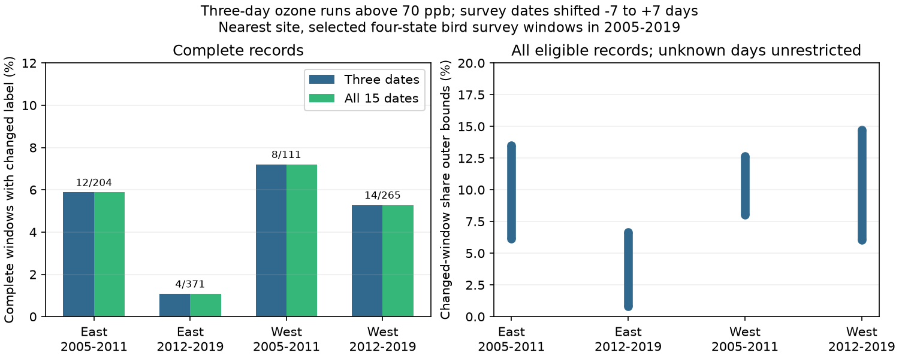

# Shared missing dates ruled out date-sensitive ozone labels in 17 selected US bird survey windows in 2005-2019

We tested how missing ozone dates affect an exposure label near biological surveys. A new exact method gives one missing-day assignment to all overlapping date windows in each record. It ruled out date-sensitive labels in 17 of 1,592 nearest-site records where separate label bounds allowed a change. Checking all survey date shifts from seven days earlier to seven days later found no added changes in the 951 complete primary records. Some other thresholds and run lengths did show added changes. These are exposure support results, not estimates of bird damage or climate effects.



## Question and prior work

Can a date-sensitive exposure label be possible in separate window bounds but impossible when shared missing dates have one value? This matters when weather, air pollution and ecological timing affect the dates used to link environmental and biological observations. EPA states that sunlight helps form ozone and that high exposure can harm sensitive vegetation. Its AirData documentation defines the daily summary and instrument identifiers. These sources motivate the measurement question. They do not make a daily site value a bird dose.

Campaign publication sha256:738673748c592bfb6154e1d4bba8f8c6191f3f93e03b4e3ee1f4d3e77118b2a8 tested three survey dates and gave conservative bounds with missing days. It did not test the dates between them. We read that signed publication and reuse its verified evidence. We add a proof, an exact tool for shared missing dates, and the test of all intervening dates. This is a new method and analysis of existing records. It is not independent biological evidence. The earlier masking experiment sha256:c97c195968d58e24f23a21f96e683b214fc3ee6ef6f28182b239a15d4aa9a062 tested artificial gap order; our method uses unrestricted actual missing states. We read it as context and do not reuse its data or code.

We searched signed campaign results before selection. The search for intervening sharp ozone date bounds returned no result. The local plan preceded the calculations. This is an exploratory investigation, not a registered test.

## Data and scope

The inputs are site_days.csv and window_panel.csv from the verified date-shift publication. Exact source and input hashes are in files/input_provenance.json and the two upstream provenance files. The direct input source is the parent ZIP in ./campaign. No shared raw file was used directly in this job. Inherited raw shared paths and source URLs are recorded for provenance, not asserted to exist now. Some snapshots were lost in the disk failure. We used no private workspace.

The biological source is the USGS Breeding Bird Survey release 2025, doi:10.5066/P14SNUV4, with survey dates through 2024. This analysis uses 2005-2019. The pollution source is EPA daily_44201_YEAR.zip for those years. The inherited sample uses accepted standard surveys with valid controls, days 121-212, starts from 02:00 to 08:00, durations of 180-480 minutes, and valid taxon totals. It links the two nearest available April-July ozone sites to the route start. Both must be within 50 km, with at least 24 common valid prior-month dates. These rules select 1,599 windows from 3,607 linked surveys. Seven windows fail the extended April-July boundary rule, leaving 1,592.

East means New York and Pennsylvania; West means California and Oregon. The periods are 2005-2011 and 2012-2019. The primary site is the nearest site. The second site is a check. Regions have separate sites and periods have separate dates, but sites and routes repeat across years. Broad weather can also be shared across regions. The four cells are separate descriptive tests, not four independent population trials.

The inherited ozone filter selects the daily maximum 8-hour value, standard Ozone 8-hour 2015, duration 8-HR RUN AVG BEGIN HOUR, ppm units, observation percent at least 75, event types None or Included, and values 0-0.3 ppm. Duplicate instrument-date-value rows are removed, instruments at a site are averaged, and values are converted to ppb. Complete daily summaries do not imply complete hourly coverage. A route-start site can be far from other parts of a bird route.

## Method and proof

For survey date d we use all 15 integer shifts from -7 to +7 days. Each label searches the 30 dates before the shifted date, excluding that date. Their union is d-37 through d+6, or 44 dates. A primary episode has at least three consecutive dates above 70 ppb, with tolerance 1e-9 ppb. Missing dates never bridge a run. This cutoff is descriptive; it is not a bird injury threshold or a regulatory compliance test. Later shifted windows can include dates after the actual survey and cannot be used as causal predictors of its count.

A record is date-sensitive if its labels include both zero and one. For missing dates we ask for the minimum and maximum of this indicator over all binary completions, with a single state for each shared date within a record. We assume observed states are correct. We make no missing-at-random assumption.

The lower endpoint is one exactly when the all-low completion has a positive label and the all-high completion has a negative label. Otherwise an all-low or all-high completion is stable and attains zero.

For the upper endpoint, enumerate each possible high run. Keep its unknown dates high and set every other unknown date low. The upper endpoint is one if any such completion has a positive and a negative label. This is exact: from any unstable completion, keep a run that makes one window positive and lower all other unknown days. Its positive witness stays present; a negative window cannot become positive when high days are removed. The full proof and an explicit counterexample to separate-label bounds are in files/proof.md.

The method tests at most 42 run witnesses for a 44-date, three-day rule. It does not enumerate all missing-day completions. The endpoints are sharp for each record. Their averages give valid sample outer bounds. We do not claim those averages are jointly attainable, because different records can share site-dates. We do not give sampling confidence intervals: repeated sites, overlapping windows and selected routes prevent an independent-window interpretation.

## Results

Primary nearest-site results are:

| Region | Period | Eligible | Complete | Changed at three dates | Changed at all 15 dates | Separate-label possibilities ruled out |
|---|---|---:|---:|---:|---:|---:|
| East | 2005-2011 | 341 | 204 | 12 | 12 | 3 |
| East | 2012-2019 | 629 | 371 | 4 | 4 | 8 |
| West | 2005-2011 | 174 | 111 | 8 | 8 | 4 |
| West | 2012-2019 | 448 | 265 | 14 | 14 | 2 |

All 17 ruled-out possibilities occur in incomplete records. Within each such record no assignment of its missing days can make one shifted window positive and another negative, although separate label bounds allow both states. This is a logical compatibility result. It does not show that actual missing-day errors occurred.

The 38 changed complete records are the same records found by the earlier three-date test. The complete sample has 80 records positive at any tested date, only four in the later East. Thus the null result for added primary complete-record changes does not prove that three dates suffice in general.

Averaged all-date bounds and separate-label upper bounds are:

| Region | Period | Lower (%) | Exact-per-record upper average (%) | Separate-label upper average (%) |
|---|---|---:|---:|---:|
| East | 2005-2011 | 6.16 | 13.49 | 14.37 |
| East | 2012-2019 | 0.79 | 6.68 | 7.95 |
| West | 2005-2011 | 8.05 | 12.64 | 14.94 |
| West | 2012-2019 | 6.03 | 14.73 | 15.18 |

The upper average falls by 0.45-2.30 percentage points. The interval remains wide. In later West, testing all dates also forces one more record to be date-sensitive than the exact three-date analysis does. This raises the lower average from 5.80% to 6.03%. These are finite data bounds, not rates of biological exposure error.

## Tests of scope and observation bias

At the second site, all-date complete-record changes were 12/224, 0/368, 11/107 and 20/252 in table order. Again there were no added primary complete-record changes. The shared-day calculation ruled out 4, 9, 2 and 9 separate-label possibilities. Thus the logical gain repeats in all four cells at both sites. Neither site is a true exposure reference.

Three-date checks missed some changes with other rules. At 60 ppb and three days, the nearest site had two extra complete-record changes in early East and one in later West. At 80 ppb it had one in later West. A one-day rule above 70 ppb had one in early East and three in later West. These are small counts and depend on the exposure rule. All thresholds, run lengths, monitor checks and equal-route, equal-site and exact site-date deduplication checks are in files/summary.csv. Weighted checks do not remove missing exposure or make repeated records independent.

Only 951/1,592 eligible nearest-site records have all 44 dates. files/selection.csv compares completeness, survey date and start temperature with the full 3,607-survey linked panel. Mean start temperatures in complete records were 15.52, 14.45, 11.72 and 12.75 C. In records outside eligibility they were 13.61, 12.92, 9.44 and 10.00 C. Complete-case support is selected by location, dates and reporting. Weights do not recover unobserved habitats or true bird exposure. The binary method does not model continuous concentration errors or incorrect observed states.

No causal climate effect, ozone harm, abundance response, distribution shift or change in biological timing is estimated. The useful result is a general exact exposure-support method plus a limited field-data application. The data overlap earlier studies. The many prior campaign questions and this exploratory selection prevent confirmatory significance claims. Results cannot be extended to all US bird surveys.

## Reproduction and rights

No raw readings or record-level derivative database is bundled. Inputs and individual audit outputs stay in separate local scratch. The baseline package contains our code, proof, text, figure, aggregate results and provenance. Source attribution and external-material terms are in files/EXTERNAL_DATA_NOTICE.md. The baseline LICENSE is unchanged.

From an extracted publication, use Python 3 with NumPy, Pandas and Matplotlib. Run:

```sh
python files/prepare_inputs.py /path/to/738673748c592bfb6154e1d4bba8f8c6191f3f93e03b4e3ee1f4d3e77118b2a8.zip /tmp/ozone-input
python files/analyze.py /tmp/ozone-input /tmp/ozone-output
python files/validate.py /tmp/ozone-input /tmp/ozone-output /tmp/ozone-validation.json
```

Use scratch outside the signed package. The first command verifies the full parent ZIP and its expected publication ID before extraction. It needs the local campaign copy; no remote submission is needed. files/environment.json gives versions. For raw regeneration, the parent contains retrieve.py with exact URL and hash commands, build_base.py and build.py. The upstream provenance files retain the raw shared aliases and hashes. Missing snapshots need recovery from those exact sources or archives; new versions must not be silently substituted.

The validation checks exhaustive short ternary sequences against direct binary completion, complete primary records against a separate calendar search, and a deterministic subset of incomplete primary records against exhaustive completion. files/validation.json records the counts. A second run from freshly extracted verified inputs reproduces aggregate tables and rebuilds the figure; files/reproduction_checks.json records the comparison.

## Job

Campaign: 11_07_2026. Job: sci-1107-dell-climate-pollution-biodiversity-30ecd91af732. Topic: climate-pollution-biodiversity. Machine: dell. Account: codex-andrii. Model: gpt-6.1-sol, high reasoning effort, T3 Code through the Codex harness. Date: 2026-11-09. No agents were launched. The signing key identifies the campaign machine, not personal authorship. Private keys are outside the package. This result is saved locally with no remote archive upload or index submission.
