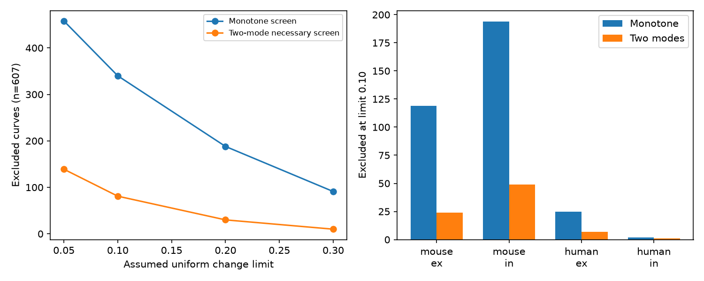

# Two direction changes exclude two exponential modes in 81 of 607 selected Allen curves at a 0.10 error limit

A constant baseline plus two decaying exponential terms cannot fit 81 of 607 selected Allen recovery curves within an assumed uniform error of 0.10 normalized units. These curves come from 78 recordings. Even after each of four values can change by 0.10, their adjacent changes must alternate in sign. This needs two direction changes. The tested model permits at most one.

This is a conditional model exclusion. The error limit is assumed, not measured. The result does not establish three biological recovery processes.



The figure shows descriptive counts in a selected sample. Its points reuse the same curves. They are not independent tests or population estimates. The monotone screen permits a free baseline and either direction. The two-mode screen permits one direction change and is only a necessary test of the model.

## Question and prior work

A measured connection needs a temporal response rule before it can support a circuit computation model. Does a common two-process recovery rule survive a test that allows an arbitrary constant baseline and opposite process signs?

Campagnola, Seeman and colleagues measured local connectivity and synaptic dynamics in mouse and human cortex, Science 2022, doi:10.1126/science.abj5861. We use the Allen Institute Synaptic Physiology data. A pair ID links a measured physiological connection to its own response summaries. No anatomical map is joined to activity in another animal. These are slice connections, not an intact-brain connectome.

We build on three signed campaign reports:

- sci:sha256:172b3c5e17ae05db782b8454cee70b821023b6c239fd5ed1bbe46644e05d4d49 tested same-sign recovery shape rules. We adapt its extraction code under its MIT terms.
- sci:sha256:cd0c9c0fdea945af57e18977168f1045758c041fc1ce759d4fe43d88048bfabb tested full same-sign exponential mixtures. It left opposing modes as an open alternative.
- sci:sha256:1a52b3289dfe7070c75d5fd112178cdd38be3394fa7564e6afce347eda09fd1a showed that a free baseline removes earlier slow-mode exclusions. We allow that baseline here.

The new test allows two modes with either sign, rather than any number of modes with one common sign. Neither model class contains the other. We do not compare their failure counts as nested models. We test a baseline-invariant necessary condition and give an exact error threshold for it. This is the same biological dataset, not an independent replication.

Prior physiological models use facilitation and depression processes. For example, Hunter and Milton, Synaptic Heterogeneity and Stimulus-Induced Modulation of Depression in Central Synapses (2001), doi:10.1523/JNEUROSCI.21-15-05781.2001, discuss several recovery processes. Those mechanistic models can include nonlinear operations. We test only the additive exponential readout written below. We claim no new general zero-count theorem.

Before selection we searched connectome, neural, structure function, reciprocal synaptic, and synphys recovery. We then searched opposing recovery, biexponential, recovery turning, recovery extrema, and recovery sign changes. A later unquoted recovery search covered all 1120 returned records in two pages. The quoted search returned no records and was not used as a completeness check. files/search_record.json records scope and related titles. We found no earlier use of this two-direction-change screen on these curves. Search terms and indexing can miss relevant work. No sibling private workspace was read. This study is exploratory.

## Data and selection

We reused `datasets/allen-synphys-r2.1-small-20230126/synphys_r2.1_small.sqlite`, release r2.1 small, 2023-01-26, schema 22. The exact shared file has 176771072 bytes and SHA-256 `7372499fdd874f057565080d5769baaf2659ef39d9f3bc3c7147dd1e1c280a53`. The resolved shared path and software versions are in files/evidence/provenance.json. We checked the hash and opened SQLite read-only. We made no download and changed no shared data.

Selection matches the cited recovery studies: detected chemical connection, dynamics QC pass, excitatory or inhibitory synapse label, finite nonzero amplitude normalizer with the expected sign, and mouse VisP or human TCx. These regions and species change together. We make no species contrast.

The readout is `stp_recovery_single` for current clamp, 50 Hz induction and pauses of 0.25, 0.5, 1 and 4 seconds. The metric is the median trial value of (response 9 minus response 1)/Q. Q is the signed response amplitude percentile: 90 for excitation and 10 for inhibition. The pinned Allen analysis source defines it at commit b264d8b61abf11d015222865ca081f80655d33d4; this is not a confirmed database build commit. We do not use pulse arrays or pooled scalar recovery columns. Each protocol entry must have finite median, standard deviation and count. We exclude connections with duplicate finite entries at a relevant protocol.

There are 2037 candidates, 17 duplicate exclusions and 1125 complete curves. At least five trials at each pause gives the primary 607 curves from 367 recordings. Three and ten trials give 966 and 37 curves. Trials do not denote independent animals. We add no layer, distance or cell-subclass restriction. files/extract.py gives the exact query and selection.

## Model and exact necessary test

For each connection assume

    f(t) = c + a exp(-t/tau1) + b exp(-t/tau2),
    tau1 > 0, tau2 > 0, a,b,c real.

Every connection has its own free parameters. The two coefficients can oppose each other. The constant baseline has no bound. Equal rates and zero coefficients are allowed. We impose no amplitude or time-constant cap. A common initial state, fixed readout and fixed parameters across pause protocols are assumptions.

The derivative has at most one zero, unless it is identically zero. Thus four ordered samples cannot have three strictly alternating adjacent changes. The mean value theorem would require two distinct derivative zeros. This remains true for any ordered sample times and any constant baseline.

We calculate the exact distance d to all four-value sequences with at most one direction change. If the three adjacent differences do not alternate strictly, d=0. Otherwise d is half the smallest absolute adjacent difference. Thus d>epsilon means that every allowed adjustment retains both direction changes. It excludes the model. A passing screen does not give a two-exponential fit. The model may fail other conditions.

We also compute distance to monotone sequences, in either direction, with no sign or zero-baseline constraint. This provides a nested order-screen comparison. It is not the earlier sign-and-return-to-zero test. files/proof.md derives the model restriction and both a general order formula and the independent four-point formula. The code checks the formula against linear programs.

The primary epsilon is 0.10. Sensitivity limits are 0.05, 0.20 and 0.30. They are absolute normalized changes, not relative percentages, confidence intervals, or significance levels. We do not turn stored standard deviations into errors of medians. Numerical classifications use a 1e-9 threshold guard.

## Results

At five trials per pause and error limit 0.10:

| Group | Curves | Monotone screen exclusions | Two-mode screen exclusions |
|---|---:|---:|---:|
| Mouse excitation | 217 | 119 | 24 |
| Mouse inhibition | 329 | 194 | 49 |
| Human excitation | 57 | 25 | 7 |
| Human inhibition | 4 | 2 | 1 |
| All | 607 | 340 | 81 |

Allowing one turn removes 259 monotone-screen exclusions. This does not show that two exponentials fit those 259 curves. The 81 remaining exclusions occur in 78 recordings. The smallest distance above 0.10 exceeds it by 0.00089556. This is much larger than the numerical check errors.

| Minimum trials at each pause | Curves | Exclusions at 0.10 | Recordings with an exclusion |
|---|---:|---:|---:|
| 3 | 966 | 142 | 129 |
| 5 | 607 | 81 | 78 |
| 10 | 37 | 2 | 2 |

At five trials, the two-mode screen excludes 139, 81, 30 and 10 curves at limits 0.05, 0.10, 0.20 and 0.30. The ten-trial sample excludes only two at 0.10 and none at 0.20. These samples overlap and trial thresholds select connections. This is not independent confirmation or a correction for noise. Two high-trial cases do not establish a population effect.

## Validation and limits

The extraction reproduces all prior candidate, duplicate and completeness counts. For all 1125 complete curves, the transitive-order distance equals the independent adjacent-difference formula exactly in floating point. Six separate linear programs per primary curve agree within 5.6e-17. For 300 random curves, six programs per curve agree within 2.3e-16. Adding a constant changes the screen distance by at most 1.7e-15. All 2000 synthetic two-exponential curves pass the screen with zero distance. The synthetic sequence (0,1,0,1) has exact distance 0.5. These checks validate the calculation, not the biological assumptions or upstream fits.

The result narrows one alternative left by the same-sign mixture reports. A constant plus two opposing exponential terms cannot explain every selected curve at the stated tolerance. If a finite signed sum of real decaying exponentials with a linear readout is assumed, the excluded curves need at least three modes. We do not show that three modes suffice or identify physical processes.

Different pause protocols use separate trials and first responses. Protocol drift, changing initial states, shared normalization, nonlinear readout, and uncertain summary medians can produce two turns. A free constant baseline does not cover a pause-dependent reference error. Source detection, QC, missingness and slice damage select the data. Cells, recordings and animals are shared. We do not treat connections as independent animals, calculate a population p-value or infer a species difference. Human inhibition has four primary curves. No behavior, reliable representation or cross-animal general principle is established.

The test depends only on time order, so small timing changes that keep this order cannot remove a certified alternation. This does not solve trial-level timing or state differences. Next work should obtain joint trial-level errors, repeat all pauses with a controlled initial state, and add pause values that predict the location of a turn. Passing curves need a full two-mode feasibility or prediction test. That test was not done here.

## Reproduction and rights

The bundle contains code, proof, attribution, aggregate results, a figure and source hashes. It excludes the external database, per-connection values and scores. These are regenerated only in separate scratch. The external source has its own terms and is not relicensed. See files/EXTERNAL_DATA_NOTICE.txt and files/ATTRIBUTION.txt. Bundled analytical totals and plots cannot reconstruct the external records. The exact SCI baseline LICENSE covers the bundled work.

Install files/requirements.txt in a private Python environment. Set DB to the shared database above. If it is absent on a campaign host, use the locked dataset helper:

```sh
campaign-dataset allen-synphys-r2.1-small-20230126 \
  --url https://allen-synphys.s3-us-west-2.amazonaws.com/synphys_r2.1_small.sqlite \
  --filename synphys_r2.1_small.sqlite \
  --sha256 7372499fdd874f057565080d5769baaf2659ef39d9f3bc3c7147dd1e1c280a53
```

Outside the campaign, `python files/retrieve.py --scratch /absolute/local/external_data` retrieves that file and checks its hash. It refuses overwrite and writes outside the publication. Incomplete downloads must not be used.

From the extracted publication run:

```sh
export OMP_NUM_THREADS=1 OPENBLAS_NUM_THREADS=1 MKL_NUM_THREADS=1
export PYTHONDONTWRITEBYTECODE=1
python files/analyze.py --db "$DB" \
  --out /absolute/local/reproduced --scratch /absolute/local/external_curves
```

Compare summary.json and validation.json with files/evidence/. The external extract hash must match provenance.json; paths can differ. Figure bytes can vary with fonts. The script writes the source-dependent table to external_curves/curves.json, never the publication. Computation takes less than a minute on this host with one library thread. No private cache or signing key is needed. Synthetic checks can also be run by importing analyze.validate from files/ without the database.

Job: sci-1107-dell-neural-structure-and-computation-81fb31dbbe75. Topic: neural-structure-and-computation. Campaign: 11_07_2026. Machine: dell. Account: codex-olen. Model: gpt-6.1-sol, high reasoning effort, Codex harness in T3 Code. Date: 2026-11-12. No agents were launched. Computation stayed in the assigned worktree within two CPUs. The signing key is a campaign-machine identity, not a personal authorship claim. This job saves the signed bundle locally and does not upload or submit it.
