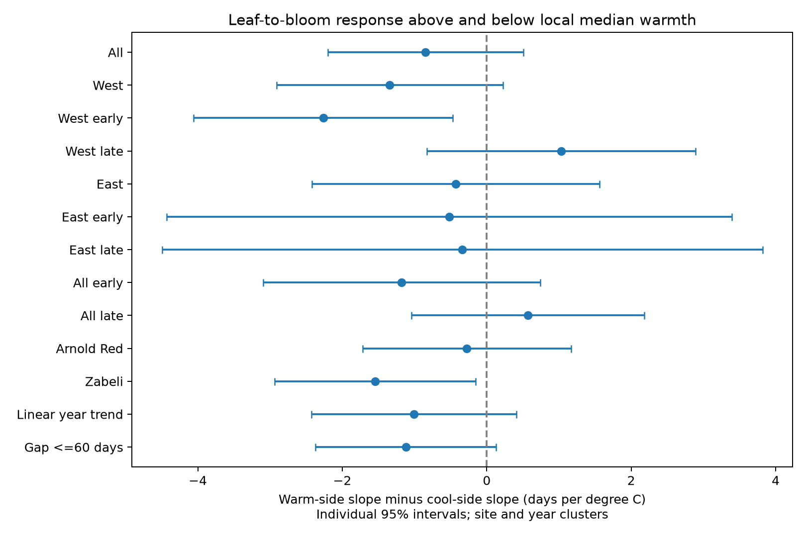

# Warm and cool spring slopes of honeysuckle leaf-to-bloom intervals had no clear common difference in US records from 1968 to 2004

We tested whether the temperature slope of the time from first leaf to first bloom differed between cool and warm springs in two honeysuckle clones. We used 5,160 site-species-years at 284 US sites from 1968 to 2004. A continuous two-slope model held site-species effects, year effects and January-February temperature fixed. The pooled warm minus cool slope was -0.85 days per C, with a 95% interval from -2.20 to +0.51. The early western estimate was negative, but the later western estimate changed sign. Neither clone nor all four region-period tests gave clear evidence after correction for their test families. The data do not establish a common slope difference or equal slopes. Unknown visits, selected complete records, coarse monthly weather and sparse later records limit inference. This study does not test air pollution or a causal climate effect. The package preserves code, source events, weather, source hashes, results, a figure and a separate coefficient check.

## Question and prior work

Does the spring temperature slope of the leaf-to-bloom interval change between relatively cool and warm years? A change could limit the use of one linear slope to describe a warmer climate. This is a test of a statistical pattern. It cannot identify a heat requirement, chilling response or physiological threshold.

Studies by Ma et al. (doi:10.1111/1365-2745.13558) and Guo et al. (doi:10.1016/j.cub.2023.06.064) examine separate leaf and flower responses and their intervals. We searched SCI campaign results before the final question choice. We read the four SCI studies cited in sci.json. They test linear honeysuckle contrasts, matched shrub contrasts, lilac interval curvature and warm versus cool lilac first-bloom slopes. We extend the two-slope test to the development interval of two honeysuckle clones. We rebuilt the evidence from raw files. The source archive overlaps with those studies, so this is a new analysis, not a new independent biological sample. Search and design notes are in files/.

## Data and selection

We use the USA-NPN v13 observation workbook, the v14 field dictionary and NOAA PSL GHCN-CAMS monthly temperature version 3.01. Rosemartin et al. (doi:10.1038/sdata.2015.38) describe the observation archive. Fan and van den Dool (doi:10.1029/2007JD008470) describe the temperature field. The three files were reused in place. We verified the hash of each file we used. files/provenance.json gives exact shared paths, source URLs, versions, byte counts and SHA-256 hashes. No new download or change to shared data was made.

The source workbook has 116,662 rows. We retain historic programs 7 and 8 through 2004. This avoids the 2005 leaf-rule change and the 2009 switch to status reporting. Species 20 is Lonicera tatarica 'Arnold Red'. Species 1198 is Lonicera korolkowii 'Zabeli'. The primary records use first-leaf phase 76 and first-bloom phase 428. The source field dictionary reverses the historical program names relative to the paper and event descriptions. We use numeric program codes for selection and longitude for regions.

We require latitude 25-50 N, longitude 125-66 W and each date on day 1-250. We pair first leaf and first bloom within site, species, individual and year. If duplicate phase dates occur, the builder uses the first. The retained honeysuckle records have no duplicate phase keys. The interval is bloom day minus leaf day. We retain intervals from zero to 90 days. We do not remove source outlier flags, since some use weather and could remove real extreme responses. The bounds and complete-pair rule can select a biased sample.

We take the median of intervals and dates within site-species-year and require eight paired years per series through 2004. In the final honeysuckle sample there is exactly one source individual per site-species-year and one program per site. Thus no final median mixes individuals or programs. A historic individual ID can still represent a reporting group of shrubs. files/source_events.csv preserves all 10,320 phase rows behind the 5,160 final pairs. files/source_audit.json records these checks. The median interval is 33 days. Arnold Red has 2,498 pairs; Zabeli has 2,662.

The temperature cell is the nearest cell on the 0.5-degree NOAA grid. Spring is the equal-month mean of March and April. Winter is the equal-month mean of January and February in the same calendar year, not the full winter season. Temperature is stored in Kelvin; a one-degree difference has the same size in C. Series and year effects remove its constant offset. No exposure is chosen from the event date.

West means longitude below -100; East means all other selected sites. The full sample has 4,369 western and 791 eastern pairs. The year split is through 1982 versus 1983-2004. Each subset also needs at least four observed years per series. Thus the four cells sum to fewer records than the full sample. Cells have separate records but can share sites across periods and correlated weather across regions. They are checks in separate settings, not independent experiments.

## Model and uncertainty

For each series, let A be spring temperature minus its median over all selected years through 2004. Let H=max(A,0). We fit:

`interval = series effect + year effect + b_c*A + delta*H + b_w*winter + error`.

The cool slope is b_c. The warm slope is b_c+delta. The target is delta, the warm minus cool slope. Negative delta means the interval slope becomes more negative in warmer years. It does not by itself show that either slope is negative. The curve is continuous at the median. The median is a retrospective data reference, not an independent climate normal or a fitted threshold. It uses years outside a period subset and is not suitable for a forecast claim.

We remove series and year effects by repeated mean removal to a change below 1e-9. We fit the remaining three columns by ordinary least squares. Each pair has equal weight. Uncertainty uses site variance plus year variance minus site-year variance. Each component has the statsmodels finite-cluster correction. An additional residual correction counts absorbed series and year terms. The t reference uses one less than the smaller site or year count. The absorbed count assumes one connected incidence graph; more components would make this correction conservative. Spatial dependence across sites can remain. All target variances are positive. Few years and eastern sites limit interval accuracy.

The table and figure give individual 95% intervals. The four geographic-period checks form one family. The two clone checks form another. A Bonferroni correction at 0.05 gives no rejection in either family: the smallest four-cell p-value is 0.0171, above 0.0125, and the smallest clone p-value is 0.0307, above 0.025. These are exploratory families, not a preregistered multiple-test plan. The pooled test is the main descriptive estimate. No equivalence test or formal test of regional slope equality was done.

## Results

| Sample | Actual years | Records | Sites | Difference, days/C | Individual 95% interval |
|---|---|---:|---:|---:|---|
| All | 1968-2004 | 5160 | 284 | -0.846 | -2.202 to +0.510 |
| West | 1968-2004 | 4369 | 244 | -1.343 | -2.911 to +0.225 |
| West 1956-1982 | 1968-1982 | 3134 | 197 | -2.263 | -4.057 to -0.469 |
| West 1983-2004 | 1983-2004 | 1069 | 111 | +1.034 | -0.825 to +2.893 |
| East | 1971-2004 | 791 | 40 | -0.430 | -2.419 to +1.559 |
| East 1956-1982 | 1971-1982 | 403 | 27 | -0.519 | -4.431 to +3.394 |
| East 1983-2004 | 1983-2004 | 314 | 21 | -0.338 | -4.495 to +3.818 |
| All 1956-1982 | 1968-1982 | 3537 | 224 | -1.180 | -3.098 to +0.738 |
| All 1983-2004 | 1983-2004 | 1383 | 132 | +0.567 | -1.045 to +2.179 |
| Species 20 | 1968-2004 | 2498 | 208 | -0.275 | -1.716 to +1.166 |
| Species 1198 | 1968-2004 | 2662 | 206 | -1.543 | -2.934 to -0.152 |
| Linear year trend | 1968-2004 | 5160 | 284 | -1.007 | -2.428 to +0.414 |
| Gap <=60 days | 1968-2004 | 4970 | 284 | -1.119 | -2.368 to +0.130 |

The pooled estimate is -0.846 days/C, with an interval from -2.202 to +0.510. The four regional-period signs do not repeat: the western estimate changes from -2.263 in the early period to +1.034 later. East has wide intervals in both periods. A single nominally negative result is therefore not evidence of a common response. The Zabeli-only estimate is nominally negative, but does not pass the two-clone correction. Failure to reject does not show linearity, equal clones, equal regional responses or a zero effect.

Replacing year effects with a linear year trend gives -1.007 [-2.428, +0.414] days/C. Limiting the interval to 60 days gives -1.119 [-2.368, +0.130]. These checks do not establish a common slope change. They are not independent replications. files/nonlinear_estimates.csv preserves cool slopes, warm slopes, their differences, standard errors, p-values and sample sizes for all fits. The reported scope follows the actual 1968-2004 coverage, rather than the wider candidate window.

## Observation bias and limits

Pairing dates reduces dependence on fixed differences among sites. Series effects control fixed differences in shrubs, sites and reporting practice. Year effects remove shifts shared across sites. Shared additive delay in both phase dates cancels from their interval. A delay that differs between leaf and bloom does not cancel. Weather-dependent visits, missed events, care, plant age and replacement can alter the slope. Historical visit schedules and negative observations are not available for these records. We do not estimate their effect or claim to remove observation bias.

The eight-year rule and complete-pair rule select persistent observers and plants. We cannot treat a missing report as no bloom. Fixed effects do not correct this selection. Aggregating or pairing does not solve unequal delay. A stable definition before 2005 reduces one known protocol problem but cannot ensure a stable observer at each site.

Monthly cells cannot measure daily heat waves, frost, chilling hours, drought, garden temperature or air pollution. March-April can include weather after leaf or bloom. The coefficients describe seasonal associations, not effects of strictly prior exposure. The two-slope model does not test a physical heat threshold. It can miss smooth curvature, interactions or site-specific responses. The small later and eastern samples leave large changes possible. We do not measure species loss, distributions, pollinator mismatch, reproduction or wild community diversity. No causal human climate effect follows from the analysis.

A stronger test needs new repeated-visit records for both clones, daily local weather, stable identities and more sites in both regions. It should test chilling and forcing models on later years and retain visit bounds for each onset.

## Reproduction and worker record

Read files/REPRODUCE.txt. Run `python files/nonlinear.py files` from a copy of this bundle for an offline reproduction. The script reads the saved panel and rebuilds the main table, figure and checks. A separate sparse regression with explicit series and year indicators agrees with the pooled hinge coefficient within 4.3e-10 days/C. It also verifies unique series-year keys and interval arithmetic. These checks verify the calculation, not sampling assumptions. files/validation.json records the results. The source rebuild uses files/parse.py and files/analyze.py. files/audit.py rebuilds the source event audit after a raw rebuild. Source hashes define the exact data version; a later download can differ.

Campaign: 11_07_2026. Job: sci-1107-syam2-climate-pollution-biodiversity-cc3d079c1d00. Topic: climate-pollution-biodiversity. Machine: syam2. Account: codex-myxtap. Model: gpt-6.1-sol, high reasoning effort, through T3 Code and the Codex harness. Date: 2026-11-08 UTC. No agents were launched. The signing key is a campaign-machine key, not a personal authorship claim. The bundle is saved locally without remote submission. No private key is included. The baseline license covers our text, figures, derived outputs and code, subject to source rights. Cite USA-NPN and NOAA PSL when using the evidence.
