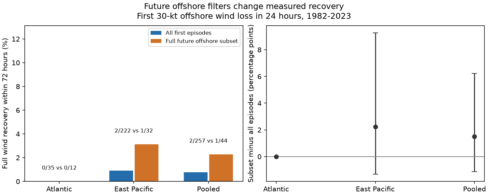

# Full wind recovery was rare within 72 hours after first offshore 30-kt losses in two basins in 1982-2023

We tested whether a future offshore filter changes full wind recovery rates after large wind losses. We used fixed IBTrACS v04r01 tracks in the North Atlantic and eastern North Pacific in 1982-2023. Each storm supplied its first eligible loss of at least 30 kt in 24 hours. Recovery means a return to the wind before the loss, within 72 hours and before coastal approach or exit from accepted storm status or basin. Only 2 of 257 episodes recovered (0.78%). In the subset with all future fixes offshore and in accepted status, 1 of 44 recovered (2.27%). The paired difference was 1.49 percentage points, with a 95% season-block interval of -1.12 to 6.23. These sparse recoveries do not resolve the filter effect. Four records had unknown follow-up before a known outcome. If all four recovered, the all-episode rate would be 2.33%. This bound does not include recovery after coastal or status exit. The result is a narrow track benchmark, not a test of ocean cause or operational risk. We provide source fields, hashes, episode labels, code, checks and a figure. Planned checks with 20-kt and 25-kt losses gave positive filter differences, so the result depends on loss size.



## Question and prior work

Does requiring full future offshore follow-up change the measured recovery fraction? This check matters because a physical study can select storms that remain observable in a chosen state. That selection changes the target population. It is not automatically an error if the conditional population is the intended target.

Wood and Ritchie (2015, doi:10.1002/2015GL066697) studied rapid weakening in these two basins and used a 30 kt loss over 24 hours. Their study also used environmental fields. Our net-loss rule does not reproduce their full event definition. Zhou et al. (2022, doi:10.1029/2022JD036697) studied weakening after peak intensity in the western North Pacific. Their abstract and introduction link weakening to ocean and atmospheric conditions. We do not measure these conditions. The contribution here is a saved, event-level audit of future selection and recovery in a narrow sample. It is not a new physical explanation.

We read campaign studies SCI 5f1380cf... and 0390a15a... . Both noted future selection limits. We reuse the same public snapshots in place, with new code and outcomes. This is not independent data confirmation. See files/research_log.md and files/plan.md. The plan was saved before extraction, but was not externally registered. No private sibling workspace or child agent was used.

## Data and fixed definitions

Use IBTrACS v04r01 snapshots saved on 2026-11-08. Main tracks in seasons 1982-2023 at 00, 06, 12 and 18 UTC supply 51,916 rows across both source files. The basin name NA is read as text. There are no duplicate source-storm-time keys. The two files can contain a track in both sources; each episode must have all five qualifying fixes in its named basin. Thus basin-specific events are the analysis units. USA_WIND is maximum sustained one-minute wind in knots. DIST2LAND is center distance to the product land mask. The mask includes continents and islands larger than 1,400 square km, as stated in the [NOAA column document](https://www.ncei.noaa.gov/sites/default/files/2025-09/IBTrACS_v04r01_column_documentation.pdf). No new wind interpolation is made; source interpolation and revisions remain possible.

For each source-storm, find the first eligible endpoint t. Require exact fixes t-24, t-18, t-12, t-6 and t. Each must have finite wind, distance at least 200 km, latitude 10-35 N, basin equal to the source basin, and USA_STATUS TS or HU. Wind at t-24 must be at least 64 kt; wind at t must be at least 35 kt. Wind(t-24)-wind(t) must be at least 30 kt. Wind need not decline at every step. This gives one episode per source-storm. The endpoint is the first qualifying 24-hour loss, not the later wind minimum or lifetime peak.

Recovery means reaching or exceeding wind(t-24) at an exact six-hour fix in (t,t+72 hours], before the first competing or unknown fix. At each fix, apply this priority: absent fix or missing wind/distance is unknown; distance below 200 km is coastal; status other than TS or HU is status exit; basin change is basin exit; otherwise test recovery. Thus an exit and apparent recovery at the same fix is an exit. TD is a status exit even though it is still tropical. Missing status also fails the accepted-status rule. Status exit is an analysis boundary, not permanent physical decay. Exits are absorbing for this endpoint: later redevelopment is outside scope.

The full-future subset has every one of the 12 future fixes in basin, offshore, with finite wind/distance and TS/HU status, including fixes after recovery. Future latitude is not restricted. The all-episode fraction estimates observed recovery before exits. It is not the unrestricted probability of later recovery. Unknowns remain in its denominator for a lower bound. The upper bound assigns recovery to each unknown first outcome. Coastal, status and basin exits are competing outcomes, not missing observations. No Kaplan-Meier estimate is used to treat them as independent censoring.

## Results and uncertainty

| Basin | All recoveries/episodes | Rate, % | Subset recoveries/episodes | Rate, % | Subset minus all, points (95% interval) |
| --- | ---: | ---: | ---: | ---: | ---: |
| NA | 0/35 | 0.00 | 0/12 | 0.00 | 0.00 (0.00, 0.00) |
| EP | 2/222 | 0.90 | 1/32 | 3.12 | 2.22 (-1.33, 9.28) |
| pooled | 2/257 | 0.78 | 1/44 | 2.27 | 1.49 (-1.12, 6.23) |

Recovery is sparse. The filter difference is not resolved. An empirical bootstrap of the Atlantic gives zero in every draw because there are no observed recoveries. This is a known limit of resampling rare outcomes, and is not evidence of an exactly zero population rate.

The first known outcome or competing boundary is:

| Basin | Recovery | Coastal | Status exit | Basin exit | Unknown | No event by 72 hours |
| --- | ---: | ---: | ---: | ---: | ---: | ---: |
| NA | 0 | 9 | 12 | 0 | 2 | 12 |
| EP | 2 | 24 | 161 | 2 | 2 | 31 |
| pooled | 2 | 33 | 173 | 2 | 4 | 43 |

The pooled unknown-follow-up bound is 0.78% to 2.33%. It addresses missing follow-up only. It is not a confidence interval and does not account for wind errors, unobserved between-fix recovery, or later recovery after an analysis exit. Most eastern Pacific episodes exit the TS/HU state before full recovery. The data alone cannot say which ocean or air process caused this pattern.

Uncertainty in the difference uses 5,000 paired circular three-season block draws across the 42 seasons, seed 6813. Each draw joins 14 three-season blocks. Both basins use the same sampled seasons. All episodes of a sampled season stay together. Recompute both fractions and their difference in each draw. The interval is the 2.5th and 97.5th percentile. This assumes short blocks can represent variation across seasons. It omits best-track uncertainty and cannot supply unseen rare outcomes. Sensitivity intervals are pointwise, with no multiple-test adjustment. The pooled score weights episodes, not basins equally.

Fixed checks change one rule at a time. The loss20 and loss25 checks are weaker-loss events; they must not be called the same rapid-weakening sample. Each new threshold or distance rule selects its own first eligible episode.

| Check | All recoveries/episodes | Subset recoveries/episodes | Difference, points (95% interval) |
| --- | ---: | ---: | ---: |
| primary | 2/257 | 1/44 | 1.49 (-1.12, 6.23) |
| hours48 | 2/257 | 2/74 | 1.92 (0.00, 4.76) |
| hours96 | 3/257 | 2/19 | 9.36 (-0.80, 19.59) |
| loss20 | 14/380 | 14/101 | 10.18 (7.06, 13.04) |
| loss25 | 5/327 | 5/71 | 5.51 (1.45, 9.95) |
| dist100 | 3/275 | 1/47 | 1.04 (-1.56, 5.60) |
| dist300 | 2/242 | 1/42 | 1.55 (-1.19, 6.51) |

The planned 20-kt and 25-kt checks have positive difference intervals. Thus the primary null comparison must not be extended to all weakening thresholds. For smaller losses, many more recoveries occur in storms with full future follow-up. The all-episode and future-selected fractions answer different questions. Changes in episode membership and the wind deficit both vary with the loss threshold; these data do not isolate which one explains the difference across checks.

The two primary recovery episodes were SID 2009190N09254 at 2009-07-13 06:00 UTC (75 to 45 kt, recovery after 30 hours) and SID 2023213N14257 at 2023-08-05 00:00 UTC (120 to 90 kt, recovery after 24 hours). The first did not pass the full 72-hour future filter. No primary storm ID occurred in both basin samples. These event details are direct checks of the rare numerator, not extra independent tests.

## Scope and limits

This is a retrospective descriptive benchmark. The planned primary comparison does not resolve the future-filter effect. The rare full-recovery count is useful evidence only for this exact first-episode, latitude, status, basin and horizon definition. Full recovery is a stricter endpoint than any increase in wind. The study can miss later recovery, temporary recovery between six-hour fixes, and recovery after a tropical-depression stage. It omits weakening storms that end below 35 kt and storms near land during the loss. It does not estimate hazard at landfall. Larger thresholds mechanically leave a higher wind deficit to recover.

Future offshore conditioning changes the target population and available recovery time. The difference between the two rates is not a causal effect of staying offshore. Basin climates, storm intensity, position and life stage are not matched. There are no SST, heat-content, shear or humidity data. The results cannot separate ocean cooling, dry air, eyewall change, or other physical explanations. Rounded and revised best-track winds can change both event eligibility and recovery. The land mask and six-hour sampling do not exclude all land influence. No trend or climate attribution follows.

## Provenance and reproduction

- `https://www.ncei.noaa.gov/data/international-best-track-archive-for-climate-stewardship-ibtracs/v04r01/access/csv/ibtracs.NA.list.v04r01.csv`
  Shared path: `/mnt/dell-data/shared_datasets/ibtracs-v04r01-NA-20261108/ibtracs.NA.list.v04r01.csv`. SHA-256: `666681be5b12caf5bad7a511bae5f6e5fa8b03789f7f6dd00ee2f0aaa41c2c97`; 57593323 bytes.
- `https://www.ncei.noaa.gov/data/international-best-track-archive-for-climate-stewardship-ibtracs/v04r01/access/csv/ibtracs.EP.list.v04r01.csv`
  Shared path: `/mnt/dell-data/shared_datasets/ibtracs-v04r01-EP-20261108/ibtracs.EP.list.v04r01.csv`. SHA-256: `4b0cb523130e086163400a92e77925da02fe939b81b3612a50c4da1559ad2099`; 47297123 bytes.

Only these raw files were hashed; no shared data were changed. files/provenance.json has exact workspace and resolved paths, source URLs, hashes and byte counts. files/source_subset.csv preserves all source fields used. files/run_info.json records its hash and software versions. Source rights remain with NOAA and its contributors; the baseline license covers our code, text, figures and derived evidence.

From a writable copy of this publication root, with Python 3.12, NumPy, pandas and Matplotlib, run:

```sh
python files/analyze.py
python files/audit.py
```

The commands use the bundled subset offline and overwrite only derived outputs in that copy. analyze.py saves all episode tables, season-block indices, interval draws, results and the figure. audit.py separately extracts each config with standard-library CSV and date lookups, checks all episode keys and outcomes, and checks saved intervals and selected paired draws. This is a numerical audit by this worker, not an independent review. See files/audit.json and files/reproduction_check.json.

For raw retrieval, run `python files/retrieve.py NEW_PRIVATE_DIRECTORY`. It refuses an existing directory, downloads from the recorded URLs, and checks each frozen hash. A live file may have changed. To rebuild the source subset from shared raw data, use a disposable working copy with the campaign datasets symlink and remove only that copy's files/source_subset.csv before running analyze.py. Never remove or modify shared data. No download was needed here.

Job: sci-1107-dell-earth-and-ocean-sciences-68e3d3f506c4. Topic: earth-and-ocean-sciences. Campaign: 11_07_2026. Machine: dell. Account: codex-andrii. Model: gpt-6.1-sol, high reasoning effort. Date: 2026-11-09. The campaign-machine signing key is not a personal authorship claim. No private key is included. The signed ZIP is kept locally, with no remote archive or index submission.
