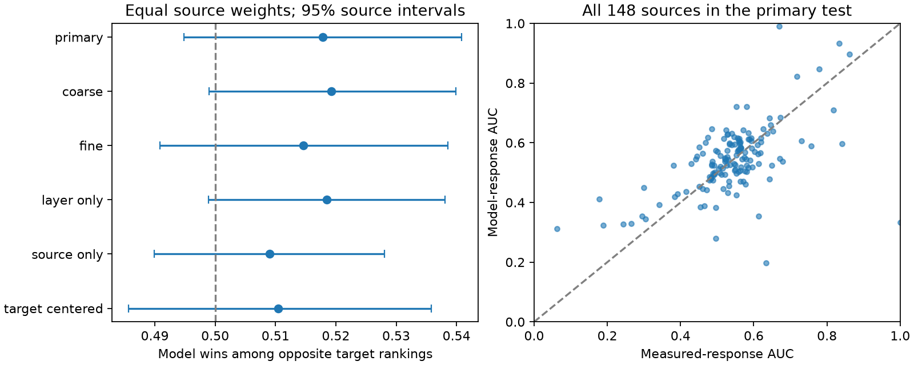

# Matched target rankings leave a model response advantage uncertain in one MICrONS mouse

## Question and result

Can model response similarity rank connected targets better than measured response similarity when the two measures give opposite target orders? The test left this advantage uncertain. The model won 51.79% of opposite rankings. The nominal 95% interval was 49.48 to 54.08%. This is a null result for an advantage test. It does not show that the measures are equal.



## Reason for the test

Ding et al. (2025; doi:10.1038/s41586-025-08840-3) linked response similarity to wiring. A prior campaign study, sci:sha256:c59a7cc9c394931da48264dbdd64f4dd2ef21ea50f820313c35558be9be14d07, found positive adjusted slopes for both measured and model similarity. A larger separate slope need not give better target orders. We test this distinction. We do not test a new wiring mechanism.

The original study also tested model response estimates against broader measured responses in other mice. Our outcome is anatomical connection status, not that response benchmark. Our result therefore does not contradict its response validation.

## Data and scope

We used the v1 public Ding edge table. We kept the Connected and ADP groups. ADP means axon and dendrite proximity. We excluded the Same region controls because they do not have the same contact opportunity. The table had 295,371 unique directed cell pairs, 8,128 connections, 148 source cells, and 11,035 target cells. The Pearson correlation between the two pair scores was 0.46943.

The primary strata need a target area and layer. Missing layer labels removed 13,829 rows, including 311 connections. The known-layer candidate panel thus had 281,542 rows and 7,817 connections. Strata without both outcomes contribute no comparisons. All 148 sources contributed to the primary statistic. The labels combine V1 and higher visual areas, not individual higher areas. The mouse, brain volume, visual stimuli, selected neurons, and reconstruction procedures are those of the source release. No new animals were used.

Measured signal correlation uses the published in_vivo_sig_corr field. Model signal correlation uses in_silico_sig_corr_cvt. We do not recompute responses or treat the model as measured ground truth. The source study defines the first measure from repeated movie responses and the second from model responses to a larger movie set. Those stimulus sets and measurement errors differ.

## Method

We saved the analysis plan before we read the ranking results. For each source and target area-layer group, we ranked each of the two proximity lengths, axon_len and dend_len. We made five equal-rank bins for each length. A connected target and an unconnected target were compared only when they had the same source, target area-layer label, and both length bins. Ranking length is equivalent to ranking its logarithm. At ties, we used average ranks. The code maps ranks to bins with floor((rank - 1) * 5 / group size), capped at 4. This is a coarse control, not exact geometry matching.

For a target comparison, subtract the unconnected target score from the connected target score for each measure. Opposite strict signs define disagreement. A positive model difference in a disagreement is a model win. A tie in either score excludes the comparison from all strict-comparison counts. Each source contributes its fraction of model wins among disagreements. The primary estimate is the arithmetic mean of these fractions. A source with more comparisons has no extra weight. Primary sources had 3 to 56,284 strict comparisons and 2 to 19,982 disagreements. Sources with very few comparisons have noisy fractions; equal weights retain this variation.

We drew 10,000 source bootstrap samples, with replacement, using seed 1107. Percentiles 2.5 and 97.5 give nominal intervals. Targets and their measured scores remain fixed. These intervals are conditional on this target panel. They do not estimate uncertainty over mice, stimuli, reconstructions, or a new target population. Shared targets can cause dependence across sources that this bootstrap does not resolve. No multiplicity claim is made for sensitivity intervals.

For each source, AUC here means the fraction of matched strict connected-control comparisons in which a score ranks the connected target higher. It is a matched descriptive rank statistic, not held-out model performance. For counts M of model wins and D of disagreements among N strict comparisons, model AUC minus measured AUC equals (2M - D)/N. The code checks this identity for each source.

## Results

The primary test had 840,419 comparisons and 293,676 disagreements (34.94%). The model won 50.76% of pooled disagreements. Equal source weights gave 51.79%. Of the sources, 56.76% had a model win share above one half. Removing any one source gave equal-source shares from 51.46 to 52.14%.

The average measured AUC was 0.53998. The average model AUC was 0.54203. Their difference was 0.00206 (95% source interval -0.01550 to 0.01883). Neither the rank-win interval nor the AUC-difference interval resolved an advantage.

| Analysis | Sources | Strict comparisons | Model win share | 95% source interval |
|---|---:|---:|---:|---:|
| primary | 148 | 840,419 | 51.79% | 49.48 to 54.08% |
| coarse | 148 | 1,638,314 | 51.93% | 49.90 to 53.99% |
| fine | 146 | 313,505 | 51.46% | 49.09 to 53.86% |
| layer_only | 148 | 5,993,678 | 51.85% | 49.89 to 53.81% |
| source_only | 148 | 23,944,607 | 50.91% | 48.99 to 52.80% |
| target_centered | 148 | 840,419 | 51.04% | 48.57 to 53.58% |
| quality | 142 | 559,517 | 51.24% | 48.88 to 53.56% |

Coarse and fine use three and ten length bins. Layer only omits length bins. Source only also omits target area-layer control and retains unknown layers. Target centered subtracts each target's mean score over the eligible source panel, separately for each measure, before comparison. This is a sensitivity check for target effects; it does not remove all target-related confounding.

The quality check uses both cells with cc_max_cvt > 0.4 and cc_abs_cvt > 0.2, as in the source study. It was added after we read the source methods and before we read the primary result. It retained 234,393 candidate rows and 6,608 connections before the known-layer and matched-stratum rules. Its estimate was 51.24% (48.88 to 53.56%). The main figure shows the six planned control choices; this quality result is in the table and files/quality/results.csv. We did not carry out the optional projection subgroup reports named in the plan.

## Interpretation and limits

The data do not resolve a model ranking advantage in the tested scope. The interval permits a small advantage or disadvantage. Positive similarity slopes can coexist with almost equal target ranking. Similarity alone gave AUC values close to one half in these matched comparisons.

Only one mouse was tested. We make no claim of transfer across animals, regions, behavioral conditions, or species. Sources were selected for reconstruction, and the primary panel has a broader response-quality range than the source paper's filtered analysis. Proximity bins can leave residual anatomical differences. Matched comparisons reuse targets and connections many times; 840,419 is not a count of independent observations. No trial-level uncertainty is available in this test. Pair-specific reconstruction error and response error remain. The analysis controls source identity and broad geometry but does not identify a causal preference. Target centering is not a full two-way fixed-effect model.

## Checks and reproduction

All cell pairs were unique and all four numerical input fields were finite. The count identity above passed. A separate merge-based audit reproduced counts for three sources. The audit explicitly drops missing stratum labels because pandas joins can match missing values, while the primary group operation excludes them. A toy check verified opposite score orders. An offline primary rerun from the preserved pair CSV checks the derived input route.

Run all commands from a workspace root with work/result containing this draft. The scripts use Python 3.12, numpy, pandas, scipy, and matplotlib; recorded versions are in files/environment.json. No extra packages were installed.

```
python work/result/files/analyze.py
python work/result/files/quality_check.py
python work/result/files/audit.py
```

The first command uses shared raw edge data. The second also uses shared raw node data. Exact paths, source URLs, and SHA-256 hashes are in files/provenance.json and files/quality/node_provenance.json. These are immutable v1 source files, not downloads from this worker. Verify the listed hashes before loading these trusted-source pickle files. Do not load unknown pickle files.

For an offline primary run with no raw data:

```
python work/result/files/analyze.py --data work/result/files/pairs.csv.gz --derived --primary-only --out work/offline_check
```

Run python work/result/files/plot.py to draw the publication figure from the saved result tables. Omit --primary-only to repeat all six analyses from the derived pairs. Compare the primary source counts with files/primary_sources.csv. Bootstraps for later analyses consume one continuous seeded random stream, so standalone analyses need not give identical resample percentiles. The primary standalone run uses the same stream start.

If shared data are absent, use the campaign dataset helper with each URL, filename, and hash in the provenance files. Use a new dataset name and pass --sha256. Do not overwrite existing datasets. Point --data to the completed edge file. For the quality script, restore the documented node dataset path or edit its node_path variable. No raw responses are needed to inspect the ranking result. Derived pairs, scalar quality fields, source counts, result tables, code, and this figure are preserved here. The original sources retain their terms; the baseline license covers this worker's original text, code, figure, and derived results.

## Worker record

Campaign: 11_07_2026. Job: sci-1107-dell-neural-structure-and-computation-f7b2d6304a6a. Topic: neural-structure-and-computation. Machine: dell. Account: codex-andrii. Model: gpt-6.1-sol, high reasoning effort, Codex harness in T3 Code. No subagents were used. The campaign-machine signing key is not a personal authorship claim. No private keys are included. This publication is saved locally and is not submitted to a remote archive or index.
