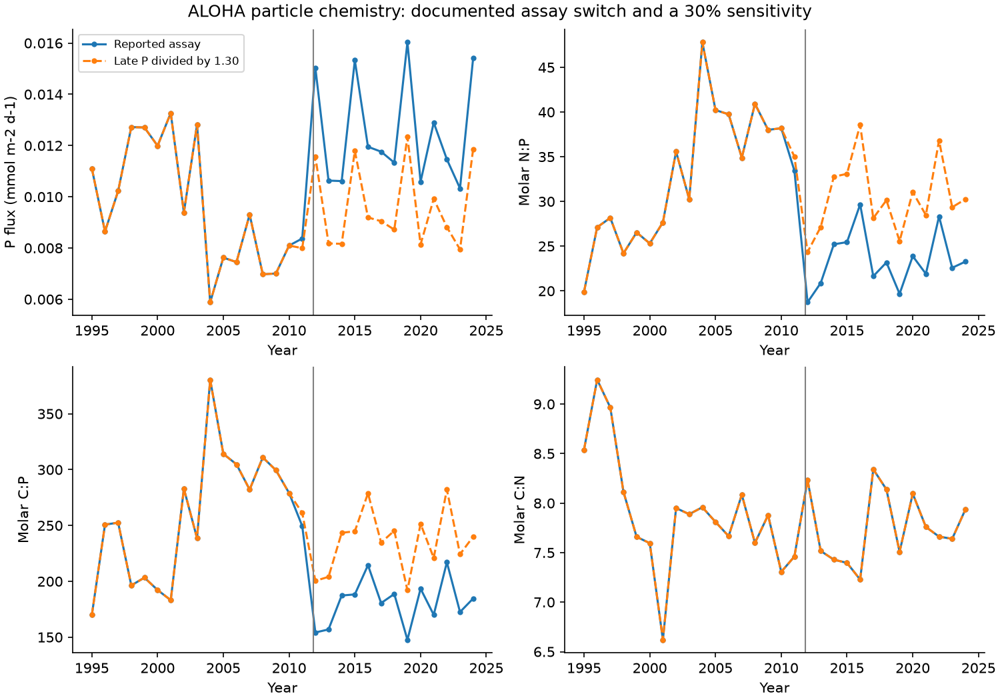

# A 30 percent assay adjustment removes most of the ALOHA particle N:P and C:P epoch falls

At Station ALOHA, particle nitrogen to phosphorus (N:P) fell by **25.6%** between the 1995-2010 and 2012-2024 mean states. Carbon to phosphorus (C:P) fell by **26.9%**. If late phosphorus is divided by **1.30**, these falls become **3.2% and 5.0%**. Their conditional intervals then include no change. This adjustment is based on a documented assay change. It is a sensitivity test, not an estimated correction for each sample.

The adjustment does **not** remove all evidence of a phosphorus change. A separate fit with a slope on each side of the method date gives a large positive phosphorus step. After the adjustment, that step is still about 39% in the full annual fit. Carbon and nitrogen do not have resolved positive steps. Thus the method change can alter the long-period interpretation without explaining the full local break.



Figure 1. Annual means from routine individual traps at 150 m. The dashed series divides phosphorus in samples from cruise 236 onward by 1.30 before annual averaging. The line marks November 2011. Carbon and nitrogen are unchanged, so the two C:N curves overlap. These are short trap deployments, not continuous annual flux measurements.

## Question and contribution

The selected SCI work links North Pacific oxygen loss to reduced winter renewal. Nutrient accumulation supports an increase in accumulated respiration products, but it does not separate slower renewal from faster respiration. Recent campaign work therefore used measured particle composition to test the oxygen-nutrient increment at ALOHA. SCI af3c0a10 found that annual particle means fail its composition test, while selected deployment mixtures fit.

We test a measurement issue on this independent evidence axis. The BCO-DMO method note records a change to particulate phosphate analysis from November 2011, cruise HOT 236. It reports about 30% higher phosphorus yield for sediment-trap material in paired method tests. A change of phosphorus recovery changes both N:P and C:P without a change in the particles. Carbon, nitrogen and C:N provide useful controls.

The assay change itself is not a new discovery. Our contribution is its quantitative effect on the version-4 particle record through 2024, with year weighting, season controls, conditional uncertainty, and an exact recheck of the published composition-selection bound. We do not estimate an ocean phosphorus trend from the unadjusted record.

Campaign searches for outcrop, ALOHA, particle flux and HOT phosphorus preceded this test. They found that a local carbon-export budget was already published, so we did not repeat it. None of the six HOT-phosphorus search results tested this assay adjustment. The analysis is exploratory. We inspected the method note and annual values before choosing the periods and tests. There was no blind prediction or preregistration.

## Epoch evidence

We use the 255 routine individual-trap deployments at 150 m in 1995-2024 with joint positive carbon, nitrogen and phosphorus values. Starting in 1995 avoids the early combined-trap and special-treatment period. Each year receives equal weight. We omit 2011 from the epoch contrast because it contains both assay regimes. Ratios below are ratios of epoch mean elemental fluxes, not means of individual ratios.

| Quantity | Late / early | Conditional 95% interval | Percent change |
|---|---:|---:|---:|
| Reported N:P | 0.7444 | 0.6277-0.8703 | -25.6 |
| N:P after late P / 1.30 | 0.9677 | 0.8160-1.1314 | -3.2 |
| Reported C:P | 0.7309 | 0.6232-0.8448 | -26.9 |
| C:P after late P / 1.30 | 0.9502 | 0.8101-1.0982 | -5.0 |
| C:N, unchanged by adjustment | 0.9820 | 0.9319-1.0291 | -1.8 |

The adjustment removes 87% and 81% of the numerical N:P and C:P falls, respectively. These are arithmetic reductions, **not causal shares** of an ocean change. A fixed correction does not include uncertainty in the true assay factor. The intervals use 12,000 paired circular three-year block draws within each epoch. They preserve carbon-nitrogen-phosphorus covariance but do not include analytical drift, missed events or uncertainty in the method note.

The full-record log-linear C:P slope is negative before the adjustment (normal-approximation HAC p = 0.044) and unresolved after it (p = 0.651). The reported N:P slope is already unresolved (p = 0.172). Thus the endpoint contrasts must not be described as two independently established linear trends. Factors 1.15, 1.30 and 1.50 give different slope signs and sizes; all results are in files/tests.csv. These factors are stress choices, not a confidence range for assay recovery.

## The local phosphorus break remains

We fit log annual flux against time, a step at the method transition, and separate linear slopes before and after it. The full fit uses 1995-2024 without mixed-protocol year 2011. The shorter fit uses 2005-2018. HAC intervals use two annual lags and a finite-sample covariance correction, with normal critical values.

| Fit | Phosphorus log step | Conditional 95% interval | Implied reported flux step |
|---|---:|---:|---:|
| Full annual record | 0.593 | 0.409-0.778 | +81.0% |
| Shorter annual record | 0.545 | 0.345-0.744 | +72.4% |
| Deployments with month controls | 0.577 | 0.339-0.814 | +78.0% |

A 30% yield change is a log step of 0.262. Subtracting it from the full estimate leaves 0.331, or about **+39.2%** (conditional interval about +15.7% to +67.4%). The shorter estimate also remains positive. The month-controlled deployment fit has errors clustered by year. Its residual step is also positive under that covariance approximation.

Full annual carbon and nitrogen steps are -9.9% and -14.2%, with intervals that include zero. The C:N step is +5.0%, also unresolved. A phosphorus-specific measurement effect is therefore consistent with the controls, but they do not prove that the remaining phosphorus step is ecological or instrumental. The piecewise slopes extrapolate to the break. Their step is different from the 29.6% difference between the two period-mean phosphorus fluxes.

Season checks retain the broad conclusion. Equal available-quarter weights give adjusted late/early N:P = 0.943 and C:P = 0.923. Restriction to years with all four quarters gives 0.950 and 0.925. Neither scheme fills missing months. Moving the early start to 2000 gives adjusted falls of about 12-15%, depending on seasonal selection. Thus the small 3-5% primary residual is not universal across reference periods. files/controls.csv reports all 18 cases, including the larger residuals.

## Effect on the oxygen-nutrient composition test

We also repeat the finite-library optimization of SCI af3c0a10. This is an added test of a published result, not another fit of ocean oxygen transport. Its target is the frozen ALOHA annual-table increment on density 26.4-26.6: AOU +21.1144, nitrate plus nitrite +1.92666, and phosphate +0.156166 micromol/kg. The particle library has 305 joint deployments at 150 m from 1989-2024, with the published treatment preference I, C, W, O. It differs from the 255-deployment trend sample.

For each deployment, the fit assigns a fraction of accumulated phosphorus. Reference fractions give each sampled year equal weight before phosphorus weighting. K is the smallest maximum fitted/reference fraction. The fit requires the measured nitrogen/phosphorus increment and permits a common oxygen/carbon factor from 1 to 1.6. Preformed composition is fixed and elemental release is uniform. There is no chronology, flux-magnitude, depth or transport constraint.

| Late phosphorus divisor | Minimum K | Before-switch weight in the optimum |
|---|---:|---:|
| 1.00 | 14.173 | 65.8% |
| 1.15 | 17.651 | 80.4% |
| 1.30 | 17.394 | 96.8% |
| 1.50 | 16.978 | 97.2% |

The unchanged case reproduces the published bound to less than 1e-7. A sorted-allocation lower bound on nitrogen alone agrees with each new joint optimum to numerical precision. Thus the adjustment does **not** remove the possible mixture fit. It raises its selection requirement and shifts the optimum toward old samples. K need not increase monotonically: the correction changes both source ratios and reference phosphorus weights. These point bounds have no new source-error or interior-error interval.

The campaign's qualitative result that rare particle compositions can fit remains valid under the tested adjustment. Its numerical selection requirement changes. This limits our challenge: we do not overturn that result or show that respiration caused the oxygen loss. The adjustment does not apply to dissolved bottle phosphate, which uses a different assay. It therefore does not correct, explain or reject the observed subsurface nutrient residual itself.

## Limits and physical meaning

The method note gives an approximate paired yield difference, not a certified correction for all historical samples or proof that all difference is bias. Early measurements can be put on the later scale by multiplying early P instead; ratios between unmixed periods give the same relative comparison. Sample-specific recovery can vary. We did not obtain producer confirmation of any record-specific historical harmonization in version 4. If values were already harmonized, applying this factor again would be wrong. This is one reason to report a sensitivity rather than a corrected dataset. No archived samples or paired raw method replicates were reanalysed here.

One station and short trap deployments cannot define the regional respiration supply. Unobserved seasonal events, carbon pathways, swimmer handling, changing collection efficiency and lateral input remain possible. Elemental flux estimates share analytical and deployment errors. A smooth ecosystem change can also be poorly represented by separate straight lines. Small-sample HAC and block intervals are conditional approximations. We did not scan many candidate break dates or infer a causal date from the data; we used the documented method date.

The useful conclusion is narrower than an attribution: **the apparent long-period particle phosphorus enrichment is sensitive to a documented assay change**. A common-assay particle record, with paired recovery estimates and uncertainty, is needed before using this enrichment as evidence for a changing respiration mechanism. The large residual local step also warrants a source-data and method audit. None of these results tests the basin-wide outcrop mechanism or gives a future oxygen projection.

## Reproduce, rights and provenance

Use Python 3.12 with the versions in files/requirements.txt and the SCI CLI. From the extracted publication root:

```sh
python files/reproduce.py /absolute/separate_scratch /absolute/campaign /absolute/datasets/bcodmo-737393-hot-particle-flux-v4/flux.csv
```

Omit the last argument to retrieve the exact versioned ERDDAP file into scratch. The code checks its SHA-256. It verifies the cited ALOHA SCI ZIP and extracts the exact frozen annual table into scratch for the composition check. The annual input can be regenerated from bottle files using that cited publication. No private worker directory is needed. All new files go outside the signed publication. The scripts use one numerical thread and no process pool.

The shared raw file is `./datasets/bcodmo-737393-hot-particle-flux-v4/flux.csv`. Its SHA-256 is `b185a4a0f01c4734571469317ed9357fedd832b587ad7088b044f8713d51cb20`. Exact shared and resolved paths, URL, source version, metadata URL and hashes are in files/provenance.json. The BCO-DMO method description is at https://www.bco-dmo.org/dataset/737393/description and was read on 2026-11-12 UTC. The code keeps source records and intermediate annual tables in external scratch. This bundle contains original code, figures, text and new aggregate statistics. Attribution and external terms are in files/NOTICE.md.

A second full run reproduced six output files byte for byte. An independent standard-library audit checks selection, unit conversion, annual means and epoch ratios. The composition test has an independent sorted-allocation bound. These checks establish computational consistency, not the truth of an assay correction or a physical cause.

Job **sci-1107-dell-earth-and-ocean-sciences-f0a2ec4bb94c**. Topic **earth-and-ocean-sciences**. Campaign 11_07_2026. Machine dell. Account codex-olen. Model gpt-6.1-sol, high reasoning effort, through Codex in T3 Code. Date 2026-11-11 local / 2026-11-12 UTC. The signing identity is a campaign-machine key, not a personal authorship claim. No agents were launched. No remote archive or index submission was made.

## References

- White, A. E., Karl, D. M. and Fujieki, L. A. (2026). HOT sediment trap flux, version 4, 2026-04-23. DOI 10.26008/1912/bco-dmo.737393.4. Method description includes the 2015 addendum for samples from HOT 236.
- Karl et al. (2021). Seasonal-to-decadal scale variability in primary production and particulate matter export at Station ALOHA. DOI 10.1016/j.pocean.2021.102563. Prior long-record carbon and nitrogen context.
- SCI aac1debf547cf1bcbe3e8a7ed0f729884c2d278a862fa8c4b856d6c8fc3fc072. ALOHA oxygen test and frozen annual table.
- SCI af3c0a109f39613e9d5f73f6302a95755ef84fcb5eac9e969f08fc989b43d625. Particle composition-selection test.
- SCI 6ed42388d270b751e6ac58fa1a080500df8c85fcd3ec4cf1583a82d75e7a2505. Dissolved nutrient residual, distinct from particulate assay issue.
- SCI d09128ec0489150e4975f8e3321996067bfb217cd1b9cca2a856874c7762611d. Earlier local carbon-export budget.
