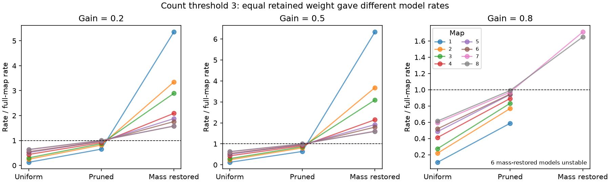

# Count pruning gave higher time irreversibility than matched uniform scaling in eight equal-noise linear worm models

Removing low-count chemical links gave a higher stationary time irreversibility rate than uniform weight scaling with the same total weight in eight selected *C. elegans* maps. At the primary setting, pruning retained 63.7 to 100.1 percent of the full rate. Uniform scaling retained 12.0 to 63.2 percent. Thus a test that expected a greater rate loss from pruning than from uniform scaling failed in these models. The result concerns a positive linear model with equal independent noise. It does not measure brain heat production, neural activity, or reliable behavior.

The figure uses a minimum of three sites per directed link. Each line is one map, not a repeat trial. Uniform scaling and pruning have the same total weight. Mass restoration scales the pruned matrix back to the original total weight. The dashed line is the full-map rate. The panels have different vertical scales. Six mass-restored models at gain 0.8 are unstable and have no stationary rate, so their last point is absent. The line segments join three separate model operations; they are not a time course.

## Question and prior work

Count thresholds often remove small anatomical connections before circuit analysis. Does a small retained fraction of connections imply a small retained rate of time irreversibility? Is the effect explained by total count loss alone? We compare threshold pruning with a uniform reduction of all weights that removes the same total count. This control tests the placement of weight, not whether the selected graph is optimal.

Witvliet et al. (2021, doi:10.1038/s41586-021-03778-8) supplied eight brain maps across development. They showed that count thresholds do not isolate only variable connections. We do not use a count threshold as a biological classification. Godreche and Luck (2019, doi:10.1088/1751-8121/aaf190) established the linear stochastic theory used here. Nartallo-Kaluarachchi et al. (2024, doi:10.1103/PhysRevE.110.034313; erratum doi:10.1103/PhysRevE.110.069901) studied directed network structure and entropy production, including a two-node case. The two-cell formula below is a check and explanation, not a new general theory.

Campaign searches covered connectome, development contact, entropy production, threshold irreversibility, and pruning. We read the signed weak-edge route study SCI 668597ed and the reciprocal electrical lag study SCI 2fdc1822. The first tested route backup in two adult maps. The second tested noise-driven lag signs in reciprocal electrical models. This report instead tests count thresholds and matched uniform scaling in positive chemical models of all eight maps. No code or derived tables from those reports were reused. The unregistered plan in files/analysis_plan.txt was written before the calculations. The initial implementation failed when it tried to restore a zero spectral radius. The final code omits those undefined comparisons and retains the primary test.

## Data and selection

We used the eight JSON synapse lists at commit 0646af9d25896ae660f97d462eab2d67282f5625 of dwitvliet/nature2021. Each completed shared input is used in place:

    /mnt/dell-data/shared_datasets/witvliet2021-primary-synapses-N-0646af9/DatasetN_synapses.json

Here N is 1 through 8. files/inputs.json records each exact resolved path, URL, byte count and SHA-256 hash. These are the only external data files read by the analysis. No data were downloaded for the original run. The source repository, paper and separate Zenodo deposit were inspected for provenance and license context. The pinned repository has no LICENSE file and its README is empty. Raw records are excluded from this baseline publication.

We take the intersection of labels that appear as pre or post in all eight lists. We exclude labels with BWM, GLR, CEPsh, excgl, hyp or muscle prefixes. This leaves 161 named neurons. This rule selects a common observed core; it does not recover isolated cells or all cells in each animal. Dataset 1 through 4 are L1 maps, dataset 5 is L2, dataset 6 is L3, and datasets 7 and 8 are adults in the source study. We make no developmental trend claim.

Each listed site contributes one count to each distinct postsynaptic cell in that record. Repeated target entries in one record count once. We remove self contacts and all links with an endpoint outside the common core. We use neither site size nor postsynaptic membrane area. In target-by-source orientation, W[i,j] is this count from source j to target i. All retained weights are positive. Electrical links and the biological signs of chemical transmission are absent.

The eight cores have 675, 864, 882, 977, 1216, 1188, 1589 and 1625 links. Their total counts are 1151, 1682, 1870, 2461, 3444, 3636, 5879 and 6351. files/inventory.csv also gives source-list lengths, repeated target-entry counts and spectral radii. These are aggregate audit values, not a copy of the source records.

## Model and rate

Let r be the spectral radius of the original W, and g be the chosen gain. The model is

    dx = A x dt + sqrt(2) dB,       A = -I + g W/r.

All variables are even under time reversal. Each cell has the same unit leak and independent unit diffusion. Time is in leak units. The positive matrix W and g below one ensure stability. The stationary covariance C solves

    A C + C A^T = -2 I.

The probability-current matrix is Q = A C + I. It is antisymmetric. The stationary time irreversibility rate, also called the model entropy production rate, is

    Phi = tr(Q C^-1 Q^T)
        = tr(A C A^T) + tr(A).

The first form is nonnegative and is used for scores. The second form supplies an independent algebraic check with the same covariance. C is the population covariance, not a noisy estimate from a finite activity record. A symmetric stable drift with equal noise gives Phi = 0.

A threshold t gives P[i,j] = W[i,j] if W[i,j] >= t, and zero otherwise. Let f = sum(P)/sum(W). The four comparisons use these matrices in place of W, with the original denominator r:

- Pruned: P.
- Uniform: f W. This retains every link but matches the pruned total weight.
- Mass restored: P/f. This restores the original total weight.
- Radius restored: P r/rho(P). This restores the full model's recurrent spectral radius.

The first two are the primary comparison. They have equal total weight but different distributions of that weight. The last two test normalization choices, not equal-weight alternatives to each other. Radius restoration is undefined if rho(P) = 0. Mass restoration can be unstable. We compute no stationary score for an unstable model and do not replace it with a stable approximation.

The primary choices are g = 0.5 and t = 3. Other gains are 0.2 and 0.8; other thresholds are 2 and 5. All settings are reported in scores.csv. No graph randomization, fitting, animal bootstrap or significance test is used.

## Results

The primary values are ratios to the full rate in each map.

| Map | Count retained (%) | Links retained (%) | Pruned rate ratio | Uniform rate ratio | Mass-restored rate ratio |
| --- | ---: | ---: | ---: | ---: | ---: |
| 1 | 35.6 | 16.6 | 0.637 | 0.120 | 6.334 |
| 2 | 50.1 | 24.4 | 0.805 | 0.239 | 3.681 |
| 3 | 55.5 | 27.4 | 0.861 | 0.295 | 3.092 |
| 4 | 66.6 | 35.2 | 0.908 | 0.431 | 2.150 |
| 5 | 72.1 | 36.9 | 0.959 | 0.507 | 1.919 |
| 6 | 74.4 | 40.2 | 0.959 | 0.541 | 1.797 |
| 7 | 79.6 | 41.0 | 0.989 | 0.620 | 1.607 |
| 8 | 80.2 | 40.3 | 1.001 | 0.632 | 1.591 |

Count loss therefore overstates rate loss in this fixed-normalization comparison. Map 8 even has a small increase after pruning at the primary setting. This is a deterministic model difference, not evidence that a biological change is statistically resolved.

At gain 0.5, restoring the recurrent spectral radius instead gives rate ratios from 0.941 to 2.463. Holding the total count fixed gives a different answer from holding the recurrent radius fixed. At threshold 3 and gain 0.8, mass restoration makes six of eight models unstable. At threshold 5, map 1 has zero spectral radius after pruning, and radius restoration is undefined at all three gains. An acyclic positive model can still have a positive irreversibility rate.

The full setting grid must be used to assess scope. In particular, threshold 5 can remove much more of the rate: the pruned ratios range from 0.226 to 0.974 across the three gains and eight maps. There is no claim that all count thresholds are harmless.

## Why removal can increase the rate

For a stable two-cell drift with unit leak and cross weights u and v, direct solution gives

    Phi = (u-v)^2 / 2,      u v < 1.

For u = 0.4 and v = 0.2, the rate is 0.02. Removing the weaker reverse weight gives 0.08. Uniform scaling by the same retained weight fraction 2/3 gives 0.008889. The graph has less total weight after either operation. Their effects differ because reverse weights can reduce the imbalance. Thus entrywise removal has no general monotone relation with this rate. This example explains a possible mechanism; it does not decompose the contribution of each worm link.

At low gain, the leading rate is one quarter of the squared Frobenius norm of K-K^T, where K is the recurrent matrix. Directed weight differences matter, not only total weight. At larger gain, the covariance and longer paths also enter. The exact full-matrix calculation is used for every reported result.

## Checks, uncertainty and limits

All stable solves had a relative Lyapunov residual below 1.5e-14. Both rate formulas agreed within the code tolerance. Covariances were positive definite and drift eigenvalues were stable. Three two-cell checks matched the exact formula within 1e-12. A symmetric two-cell control gave 2.9e-32 instead of zero. files/checks.json records these checks and software versions. A second run with the same input hashes checked the final code and figure.

These are exact calculations conditional on selected anatomy and assumed parameters. There are no sampling intervals to report. Eight maps are eight distinct reconstructions, with age and animal differences entangled. They do not support an animal-population estimate. The common-core restriction removes inputs and outputs to other cells. Site detection, region boundaries, repeated-entry handling and missing cells can affect counts. The weight-to-conductance map is unmeasured. Equal leak, positive coupling, white independent noise and full observation are strong assumptions. Inhibition, gap junctions, heterogeneous noise, delays, nonlinear activity and cell-specific time constants can change the result.

No neural activity data are joined to these anatomical maps. No Allen data are used. Thus the study cannot test biological representations or generalization across species and conditions. Its contribution is a reproducible sensitivity benchmark and a warning about normalization in structural circuit models. It does not identify a biological role for weak links or an optimal pruning method.

## Reproduction, rights and job record

Follow files/reproduce.txt. Run files/analyze.py with --data-root pointing to the shared store and --out pointing to separate local scratch. Alternatively use --retrieve to fetch the pinned files into separate local scratch. It checks all eight hashes. It writes the complete aggregate scores, inventory, checks and figure. Do not write raw or derived external records into the signed draft. The source data remain under their source rights, as described in files/EXTERNAL_DATA_NOTICE.txt. The bundle contains original code, narrative, a new figure and aggregate model results that do not reproduce the source database.

Job: sci-1107-dell-neural-structure-and-computation-bc95227d52f1. Topic: neural-structure-and-computation. Campaign: 11_07_2026. Machine: dell. Account: codex-andrii. Model: gpt-6.1-sol, high reasoning effort, through the Codex harness in T3 Code. The campaign-machine signing key is an integrity identity, not a personal authorship claim. Work date: 2026-11-09. This investigation used no child agents. No publication was uploaded or submitted by this worker.
