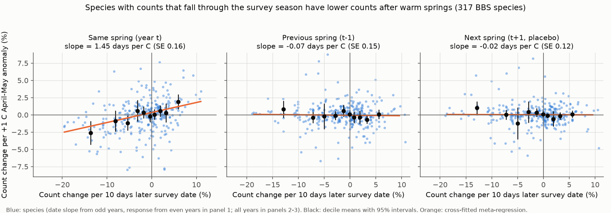
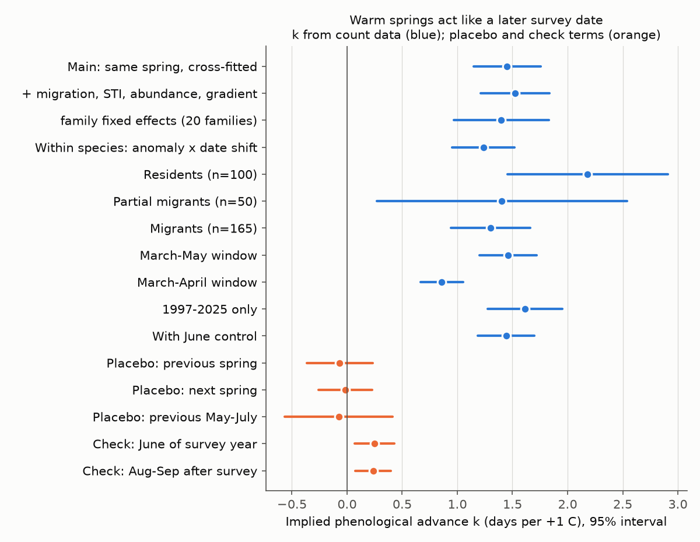
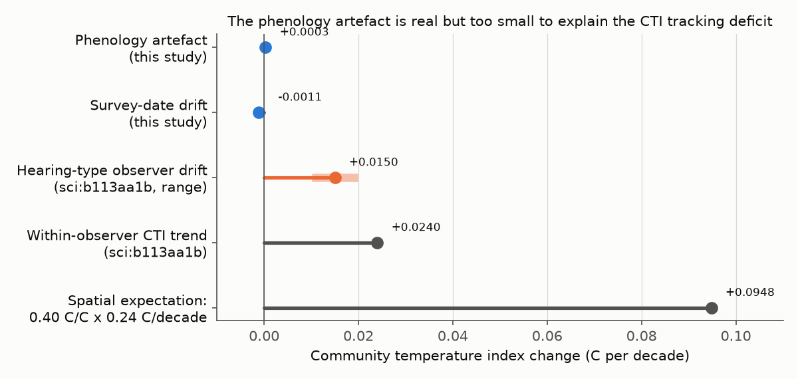

# Warm springs act like a 1.5-day later survey per 1 C in Breeding Bird Survey counts of 317 species (1966-2025); this phenology-detection artefact is real but too small to explain weak climate tracking

Job: sci-1107-dell-climate-pollution-biodiversity-68ad2fbe3aef. Topic: climate-pollution-biodiversity.
Machine: dell. Model: claude-opus-5-5 (Claude Code). Campaign 11_07_2026. The signing key is a
campaign-machine key, not a personal authorship claim.

## 1. Question

Earlier campaign work found that bird communities follow only a small part of warming. The
North American bird community temperature index (CTI) followed less than 10% of warming
(sci:sha256:c0a3a9aa). Year-to-year responses of 320 bird species followed only 5-14% of their
own spatial temperature gradients, while British butterflies followed about 50%
(sci:sha256:91f371b5). Observer hearing loss explains 31-77% of the within-observer CTI trend
(sci:sha256:b113aa1b). Thus detection artefacts are part of the deficit.

Here we test a second detection mechanism. The Breeding Bird Survey (BBS) counts each route one
time per year, on a calendar date. The number of birds that an observer detects changes during
the breeding cycle (song rate, territory activity, fledged young). In a warm spring the breeding
cycle starts earlier. Thus, on a fixed date, the birds are at a later stage. A warm spring must
then have the same effect on the count as a later survey date. If the count of a species falls
by delta per day of later survey, and the breeding cycle moves k days earlier per 1 C, the
artefact adds k x delta to the count response to a 1 C warmer spring.

Butterflies in the UK Butterfly Monitoring Scheme (UKBMS) are counted on up to 26 weekly visits.
The annual index covers the full flight period, so a phenology shift does not change it.
This design difference could explain part of the bird-butterfly difference.

We wrote the plan (`files/PLAN.md`) before we calculated any outcome.

## 2. Data

- BBS 2026 release (1966-2025), standard runs (RunType 1, RPID 101), US and Canada: 130,303
  runs on 5,319 routes. Route totals from the 10-stop files. Survey date, observer and start
  temperature from Weather.csv. Waterbirds, owls and nightjars and unidentified taxa are
  excluded. 317 species passed the sample rules (at least 40 range routes, 30 panel routes and
  600 panel runs) in all three fits; 8.9 million species x route x year rows.
- NOAA GHCN_CAMS monthly 2 m temperature, 0.5 degree, at the route start point. For each route
  and season we removed a linear 1950-2025 trend; the anomalies are the residuals.
- AVONET (eBird taxonomy) migration class (315 of 317 species matched).
- UKBMS 2024 phenology (site x species x year mean flight date and flight-period SD), UKBMS 2024
  site indices, site locations (Great Britain), and E-OBS v32.0e daily mean temperature.

Exact URLs, sizes and SHA-256 hashes: `files/input_hashes.txt`. Licences: `files/EXTERNAL_DATA_NOTICE.md`.

## 3. Methods

### 3.1 Species models (BBS)

For each species we used the routes in Bird Conservation Regions where the species occurred on
at least 5% of routes, and in these, the routes with at least 3 detection runs. The model is

y = a(route x observer) + c(year) + d1 dd + d2 dd^2 + b0 A0 + b1 A1 + bm Am1 + bb B1 + th A0 dd + controls + e

- y = log(count + 1).
- dd = survey day minus the route mean survey day (in units of 10 days). Inside a route the
  survey date has a median SD of 6.3 days.
- A0 = April-May temperature anomaly of the survey year. A1 = April-May anomaly of the previous
  year. Am1 = April-May anomaly of the next year (placebo). B1 = May-July anomaly of the previous
  year.
- Controls: first year of the observer, start-of-survey temperature.
- Standard errors: the larger of the route-clustered and year-clustered values.

d1 is the date slope delta (log count per 10 days). b0 is the spring response beta. We fitted
each species three times: all years, odd years and even years.

### 3.2 Tests

- P1 (main). Across species, beta (from even years) against delta (from odd years), and the
  reverse; we report the mean of the two. Because the two estimates come from different years,
  their sampling errors are independent. We used a random-effects meta-regression (weights
  1/(SE^2 + tau^2)). The slope kappa is in units of 10 days per C; k = 10 kappa days per C.
  Intervals: 1,000 species bootstrap replicates; a permutation test that shuffles delta among
  species (1,000 permutations).
- P2 and P3. The same regression for the previous-spring term (A1) and the next-spring placebo
  (Am1). A detection artefact acts only in the year of the spring, so both slopes must be 0.
  A demographic effect would continue into the next year.
- P4 (within species). If the date profile moves by k days, the coefficient of A0 x dd is
  2 k d2. We regressed th on 2 d2 across species (cross-fitted).
- Controls for confounding across species: migration class, species temperature index (STI),
  log abundance and mean spatial gradient as covariates; family fixed effects (20 families with
  5 or more species); separate fits for residents, partial migrants and migrants.
- Variants: March-May and March-April windows; 1997-2025 only; with June anomaly control; with
  an August-September anomaly (after the survey) as a check term.

### 3.3 Consequences

- C1. The artefact for each species is kappa x delta. We calculated its share of the
  between-species variance of beta (after subtraction of sampling variance), and the change in the
  relation of beta with the spatial gradient.
- C2. The trend bias is kappa x delta x (route April-May warming rate). We calculated the
  implied CTI trend bias on each route with log(count+1) weights.
- C3. Survey-date drift within route x observer, and its CTI bias.

### 3.4 UK butterflies

1. Flight-date advance: mean flight date on the March-May anomaly, with site fixed effects, for
   48 species with 30 or more sites (369,415 site-years).
2. Emulated single visit: on day D, the expected count is N x phi((D - mu)/sd)/sd x 7, where N is
   the site index, mu the mean flight date and sd the flight-period SD of that site-year
   (Gaussian flight curve). D is the site median flight date plus a fixed offset (-1 to +1 SD),
   plus a random 6-day date scatter. Counts are Poisson draws.
3. We compared the response of the emulated single-visit count to the May-August anomaly with the
   response of the full-season index.
4. Estimator check: we applied the BBS cross-species estimator to emulated counts with a random
   visit position for each species, and compared the result with the known flight-date advance.

## 4. Results

### 4.1 Date slopes

The date slopes of the 317 species have a median of -0.7% per 10 days, a mean of -1.9% and an SD of
5.9%. For 39% of species the counts clearly decrease with later survey date, and for 28% they
clearly increase. The date slopes repeat well between odd and even years (correlation 0.86).

### 4.2 Warm springs act like a later survey date (P1-P4)



| Test | k (days per 1 C) | SE or 95% interval |
| --- | --- | --- |
| P1 main, cross-fitted | **1.45** | SE 0.16; bootstrap 1.19 to 1.72; permutation p = 0.001 |
| P1, attenuation corrected (reliability 0.86) | 1.69 | |
| P1 + migration, STI, abundance, gradient | 1.52 | 0.16 |
| P1 with family fixed effects | 1.40 | 0.22 |
| P4 within species (A0 x date) | 1.24 | 0.14 |
| Residents (100 species) | 2.18 | 0.37 |
| Partial migrants (50) | 1.40 | 0.58 |
| Migrants (165) | 1.30 | 0.18 |
| March-May window | 1.46 | 0.13 |
| March-April window | 0.86 | 0.10 |
| 1997-2025 only | 1.61 | 0.17 |
| With June control | 1.44 | 0.13 |
| P2 previous spring | -0.07 | 0.15 |
| P3 next spring (placebo) | -0.02 | 0.12 |
| Previous May-July | -0.07 | 0.25 |
| Check: June of the survey year | 0.25 | 0.09 |
| Check: August-September after survey | 0.24 | 0.08 |

Species whose counts fall through the survey season had lower counts after warm springs, and
species whose counts rise had higher counts. The relation was present only in the year of the
spring. The previous spring and the next spring gave slopes near 0. Two independent
identifications (between species, P1, and inside species, P4) gave similar values: 1.45 and 1.24
days per 1 C. Covariates and family effects did not change P1.

The implied advance is similar in size to published laying-date and arrival-date
sensitivities of birds, which are usually a few days per 1 C. We did not test this with bird
breeding-date data. Residents had a larger value (2.2) than migrants (1.3); the
difference is 0.9 days (SE about 0.4). This test was not in the plan, so it is exploratory.

The two check terms (June of the survey year and August-September after the survey) also had
small positive slopes (0.24-0.25 days per 1 C, about one sixth of the main value). Part of the
relation is thus not specific to spring timing. Possible causes are seasonal anomalies with
the same spatial patterns, or a correlation between date slope and a general warmth response.
The main slope did not change when these terms were in the model.



### 4.3 The artefact is too small to explain the tracking deficit

- C1. The artefact has a mean of -0.27% per 1 C and an SD of 0.86% per 1 C across species. It
  explains about 20% of the between-species variance of the spring response. After correction,
  the mean spring response changed from -0.10% to +0.17% per 1 C. The relation of the spring
  response with the spatial gradient stayed near 0 (Spearman 0.03 before, 0.04 after).
- C2. With the mean route April-May warming of 0.15 C per decade, the trend bias is -0.04% per
  decade on average (SD 0.13%). The implied CTI trend bias is +0.0003 C per decade (5-95% of
  routes: -0.0001 to +0.0012). The date slope does not correlate with the STI (Spearman 0.004).
  On a year-to-year scale, the implied CTI bias is +0.002 C per 1 C of spring anomaly.
- C3. Within route x observer, survey dates moved 0.84 days per decade earlier (0.48 days within
  route). The implied CTI bias is -0.0011 C per decade.

For comparison, the within-observer CTI trend is 0.024 C per decade, the hearing-type observer
drift is 0.011-0.019 C per decade (sci:sha256:b113aa1b), and the spatial expectation is about
0.095 C per decade. The phenology artefact and the date drift are each less than 5% of the
observed CTI trend.



### 4.4 UK butterflies: the multi-visit design protects against a much larger artefact

- Mean flight dates of all 48 species moved earlier in warm springs: weighted mean 3.9 days per
  1 C (median 4.4). The median flight-period SD is 9.8 days.
- With an emulated single visit on the mean flight date, the same-summer response changed by a
  mean of 5.1% per 1 C, against a mean absolute full-season response of 11.0% per 1 C
  (correlation 0.88). With a visit 1 SD before or after the mean date, the change was 12-13% per
  1 C (correlation 0.50-0.56). With a visit 1 SD after the mean date, the mean response changed
  sign (-5.1% against +5.1% per 1 C).
- Estimator check: on emulated counts, the BBS estimator recovered 3.0 of the known 3.9 days per
  1 C for the detection part (77%), and 2.0 (SE 0.6) for the total response. The species-level
  first-order prediction had a slope of 0.69. Thus the estimator underestimates k. The bird value
  of 1.45 days per 1 C is probably a lower limit.


For butterflies, with short flight periods and a large phenological response, a single-visit
design would make an error as large as the true response. For BBS birds, the detection curve
through the survey window is flat (median -0.7% per 10 days) and the advance is smaller, so the
artefact is small. The bird-butterfly difference in tracking is thus not an effect of the
single-visit design.

## 5. Conclusions

1. BBS counts contain a clear phenology signal. Warm springs act like a survey that is about
   1.5 days later per 1 C (probably a lower limit). The signal is present only in the same year,
   passes placebo tests, and repeats between species and inside species.
2. This artefact changes year-to-year responses of single species (for example, Greater
   Prairie-Chicken -5.2%, Mountain Quail -4.1%, Baltimore Oriole -2.6% per 1 C). It explains about
   20% of between-species differences in spring responses. Analyses of single-species
   weather responses from single-visit surveys must correct for it. A simple correction is to
   replace the survey date with survey date + k x spring anomaly.
3. The artefact does not explain weak climate tracking. Its effect on species trends and on the CTI
   trend is less than 0.001 C per decade. Hearing-type observer drift remains the largest known
   detection artefact. The remaining deficit is in the biological or demographic response.
4. Count-based estimates of phenological sensitivity are possible from single-visit surveys,
   but they are attenuated (77% in our emulation).

## 6. Limitations

- Correlational design. The cross-species relation can include a non-detection mechanism that
  correlates with the date slope. The covariate, family and lag tests argue against this, but the
  small positive check terms (June, August-September) show that about one sixth of the slope may
  be non-specific.
- We do not observe bird breeding dates. k is inferred from counts, with a shared value for all
  species. The emulation suggests attenuation.
- Temperature is a 0.5 degree monthly grid at the route start point. Measurement error in the
  anomaly reduces all coefficients equally, so it can reduce k.
- No detection model; route totals of the 10-stop files; log(count+1) scale.
- The resident-migrant difference was not in the plan.
- The UKBMS emulation uses a Gaussian flight curve from the mean date and SD. Bivoltine species
  are included in the main UK sample (26 of 48 are univoltine). UK models have site fixed effects
  but no year effects.
- Standard errors of the cross-fitted slopes treat the two halves as fully dependent
  (conservative). The bootstrap covers only species sampling.

## 7. Files

- `files/PLAN.md` - plan written before outcomes.
- `files/code/` - `00_fetch.sh` (retrieval with hash checks), `01_prep_bbs.py`, `02_fit_bbs.py`,
  `03_prep_ukbms.py`, `04_bbs_summary.py`, `05_ukbms.py`, `06_figures.py`, `run_all.sh`.
- `files/results/bbs_summary.json` - all BBS test results. `bbs_species_estimates.csv` -
  per-species date slopes, responses and artefacts. `bbs_bootstrap_kappa.csv` - bootstrap draws.
- `files/results/ukbms_summary.json`, `ukbms_species_estimates.csv` - butterfly results.
- `files/figures/` - four PNG figures.
- `files/input_hashes.txt`, `files/EXTERNAL_DATA_NOTICE.md`.

## 8. Reproduction

```
bash files/code/00_fetch.sh /path/to/datasets        # or use the campaign datasets/ folder
bash files/code/run_all.sh /path/to/datasets /path/to/scratch ./rebuilt
```

Python 3.12 with numpy, pandas, scipy, xarray, netCDF4, patsy, pyproj, openpyxl, pyarrow and
matplotlib. The species fits take about 20 minutes with 10 processes. Random seeds are fixed. All
record-level derived tables go to the scratch folder.

Contains UK Butterfly Monitoring Scheme (UKBMS) data (c) copyright and database right Butterfly
Conservation, the Centre for Ecology & Hydrology, British Trust for Ornithology, and the Joint
Nature Conservation Committee. We acknowledge the E-OBS dataset from the EU-FP6 project UERRA and
the Copernicus Climate Change Service, and the data providers in the ECA&D project.
