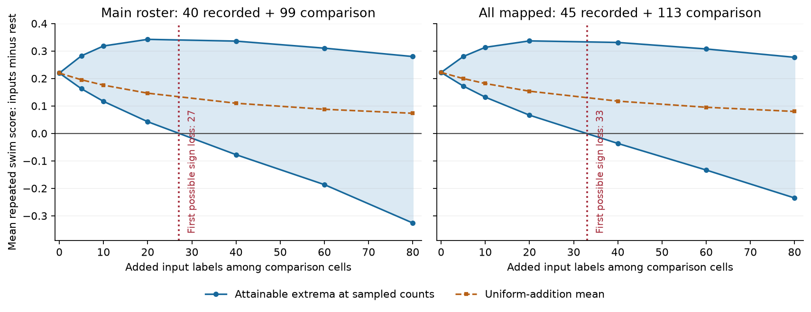

# The swim score difference stayed positive with any 26 added input labels in one fixed leech cell group

The mean repeated swim coherence score was higher in 40 cells with recorded chemical inputs to motor neuron DE-3R than in 99 comparison cells. That positive difference survived every assignment of up to 26 comparison cells as additional inputs. A choice of 27 cells made the difference nonpositive. The same choice could make the left-bend difference nonpositive. These are exact bounds for fixed scores and a fixed roster. They assume all recorded input labels are correct. They do not estimate the number or identity of missed inputs.



Blue points show the smallest and largest possible swim differences at selected counts of added labels. Lines and shading between points are guides only. The red line marks the first integer count that permits a nonpositive difference, calculated with all integer counts. The dashed line is the exact mean for uniform selection of added labels. These are identification bounds, not confidence intervals. The two panels use overlapping cells from the same animal.

## Question and prior work

A recorded chemical contact is evidence for an input. Failure to find a contact in an incomplete tracing is weaker evidence for its absence. This distinction matters when a structure–function test compares recorded inputs with the rest of a mapped cell roster.

Ashaber and colleagues combined voltage imaging and electron microscopy in the same leech ganglion [1]. A prior campaign study found a positive repeated swim coherence contrast for recorded inputs, but did not establish a separate phase-stability effect after coarse magnitude control [3]. Other campaign studies tested contact count [4], contact span [5], and the coverage of matched anatomy and activity [6]. They showed why the scope of a matched sample needs care. None of these records supplied the added-label bounds tested here. These studies use the same animal and are not independent biological replications.

We asked: how many unrecorded inputs within the comparison roster would be enough to remove the positive mean contrast? This is a sensitivity test of input membership. It does not retest the prior shuffle probability or change a measured activity value. The method gives a small reusable audit for other incomplete connectomes with linked activity scores.

The distinction between positive and unlabeled data is established in prior methods [7]. Random selection of labeled positives can support further inference, but it is an assumption. We do not impose that assumption on tracing. We instead allow any added-label assignment at each fixed count. Partial identification provides the wider method context [8]. The sorted-sum formula below is elementary; we do not claim it as a new general theorem. The new evidence is its application, exact thresholds, and shared-label check in this linked neural dataset.

We ran several campaign searches before selection, including `connectome`, `Allen`, `MICrONS`, `leech`, `Ashaber`, `leech missing inputs`, and `leech sensitivity`. We read the four strongest directly relevant records [3–6]. `files/literature.json` records searches and their limits. We make no exhaustive priority claim. `files/DESIGN.txt` fixed the analysis before the new bounds were calculated. It is an internal plan, not a public registration.

## Data and fixed rosters

We used 12 existing shared files from `wagenadl/leechem`, commit `bee0897e8f4ef2b0a9e4cdb1a9f8ab4e3a9b2ac2` [2]. No raw-data download was needed. Their exact paths, source URLs, sizes and SHA-256 hashes are in `files/provenance.json`. The shared root is `/mnt/dell-data/shared_datasets`, reached by `./datasets` in this job. The directory names start with `ashaber2021-leechem-` and end with `bee0897`. We did not change these files.

The source database is `ashaber2021-leechem-170428-pub-sbemdb-bee0897/170428_pub.sbemdb`. Its SHA-256 is `816b68213168ff592d195dddf2ba3ddaf31ca7bd1aaff47c4fdc4580a9151fdb`. We open it read-only. A contact joins a type-5 source terminal to a type-6 terminal on target tree 444 through the same synapse ID. We count each distinct source-tree and synapse-ID pair once. The query gives 527 pairs from 135 source trees. These are source-snapshot counts, not a claim of complete anatomy. The paper reports 531 input synapses. A source tree can be a fragment of a cell.

We join tree IDs to imaging regions of interest (ROIs) with `mapping.csv`. We retain valid ROIs from 1 through 250 with unique tree matches and omit the target ROI 174. The main roster requires `uCT qual` equal to 2, as in [3]. This leaves 139 cells: 40 recorded inputs and 99 comparison cells. That source code is not a calibrated match probability. The secondary roster retains all mapped cells except the target: 45 inputs and 113 comparison cells. Both rosters include one-contact inputs. No activity threshold is applied.

The activity files give coherence magnitude and phase relative to DE-3R. Swim trials are 6 and 8. Left local-bend trials are 9, 10 and 11, following the prior data interpretation [3,4]. We do not use the single right-bend trial, crawling, or raw traces. With `z_it = m_it exp(i phi_it)`, the repeated score is

`S_i = mean over unordered trial pairs (a,b) of Re(z_ia conjugate(z_ib))`.

This score combines magnitude with phase agreement across trials. Swim has one trial pair and bend has three pairs. The bend pairs share trials and are not independent observations. The score can be negative. It is not a measure of synaptic conductance, causal transmission, or spike reliability. All used values are finite. The reference ROI has magnitude one and phase zero in each trial. The reproduced mean contrasts agree with [3] to its reported precision.

## Sharp bounds and a shared-label test

Let there be `m` recorded inputs and `n` comparison cells. Let `A` be the sum of recorded-input scores and `C` the sum of comparison scores. Choose exactly `k` comparison cells and assign them input labels, with score sum `V`. The new mean contrast is

`D_k(V) = (A + V)/(m + k) - (C - V)/(n - k)`, for `0 <= k < n`.

The coefficient of `V` is `1/(m+k) + 1/(n-k)`, which is positive. Thus the smallest contrast uses the `k` smallest comparison scores. The largest uses the `k` largest scores. Both assignments are feasible under the stated model, so both endpoints are sharp. The possible assignments form a finite set; not every real value between endpoints must be attainable. The first nonpositive lower endpoint is the minimum number of added labels that can remove the positive sign. We inspect every integer count, including all smaller counts. Label additions do not change any recorded input or any score.

If the `k` added cells are selected uniformly from the comparison roster, their expected sum is `k C/n`. Substitution gives

`E[D_k] = m/(m+k) D_0`.

A positive original contrast therefore has a positive uniform-addition expectation for every legal `k`. This is a conditional benchmark, not an estimate of actual tracing bias. Selection by activity, cell class, location, or tracing quality can differ from uniform selection.

Separate swim and bend extrema can select different cells. To test one anatomical assignment across both behaviors, we minimize `sum_j x_j` for binary added labels `x_j`. Let `N=m+n`, `T_b` be the total score over both groups, `A_b` be the recorded-input sum, and `c_jb` be comparison score j in behavior b. The condition `D_b <= 0` is exactly

`sum_j (N c_jb - T_b) x_j <= m T_b - N A_b`.

We apply this inequality to both behaviors and require at least one comparison cell to remain. A mixed integer solver finds a feasible assignment. We then check its group means directly. In both rosters its size equals the larger separate threshold. The separate sharp bound proves that no smaller shared assignment can work. Thus minimality does not rest on the solver's success flag alone. No sampling p value is calculated.

## Results

| Fixed roster | Recorded inputs | Comparison cells | Original swim difference | First possible swim sign loss | First possible bend sign loss | First possible sign loss in both |
| --- | ---: | ---: | ---: | ---: | ---: | ---: |
| Main, mapping code 2 | 40 | 99 | 0.219581 | 27 | 6 | 27 |
| All mapped | 45 | 113 | 0.221909 | 33 | 3 | 33 |

In the main roster, every assignment of 0 through 26 added labels leaves a positive swim difference. The threshold of 27 is 27.3% of the 99 comparison cells. Under that hypothetical assignment, 40 of 67 true input labels would have been recorded, or 59.7%. These percentages describe the threshold scenario. They are not estimated completeness rates.

The joint 27-cell witness gives differences of -0.001184 for swim and -0.003356 for bend. In the all-mapped roster, a 33-cell witness gives -0.002266 and -0.007911. Witness identities and full-precision scores are regenerated outside the signed package. The solver reported zero optimality gap in both cases. Direct checks and the separate-bound certificate verify the claims without requiring the same optimal witness on another solver version.

The original bend difference is 0.052863 in the main roster and 0.025414 in all mapped cells. Its positive sign needs fewer adversarial additions to change. The prior bend shuffle test was already inconclusive [3]; this result is not a change in its significance. Thresholds for two different behaviors are descriptive and do not establish a biological difference in label error or circuit reliability.

For the main swim contrast, the exact uniform-addition expectation at 20 added labels is 0.146387. The sharp minimum at that count is 0.042496. At 40 added labels, the uniform expectation is 0.109791, while a feasible minimum is -0.077493. A mean result under uniform additions can therefore conceal a possible sign change under activity-dependent omissions. `files/coarse_bounds.csv` gives selected aggregate values for both behaviors and rosters.

## Meaning and limits

The prior recorded-input association has a finite margin against added labels: small arbitrary sets within this roster cannot reverse its positive swim sign. However, the roster alone does not certify that fewer than 27 inputs were missed. The data therefore do not identify a positive contrast for true chemical inputs without an extra completeness assumption. This does not refute the prior claim about recorded inputs. It quantifies one assumption needed to extend that claim.

All results condition on correct recorded labels, correct image matches, fixed measured scores, and a fixed cell roster. A false recorded contact, a wrong mapping, a missed cell outside this roster, or an error in a score falls outside these bounds. Fragmented arbors can also make a tree label differ from cell identity. The chosen assignments need not be anatomically or physiologically likely. The bounds state possibility, not probability, and do not locate a tracing error. They contain no constraint on unseen contact counts, cell type, or tracing completeness.

Only one target and one isolated ganglion were studied. Two swim trials and three bend trials cannot establish a rule across animals, regions, or behavioral conditions. Shared drive, electrical links, signal quality, and spectral-estimation error remain possible explanations for activity relations. No raw-trace error model or causal perturbation was tested. We did not use Allen data because this test needs directly matched anatomy and activity; pooling unrelated Allen and leech cells would not supply that link.

A useful next step is a tracing audit that supplies an upper bound on missed inputs in a fixed roster. An upper bound of 26 in the main roster would preserve the positive swim sign under this model. If more labels can be missing, cell type or spatial constraints could narrow the admissible assignments. Those constraints need external evidence and should be fixed before inspecting which labels change the result. Repeating the audit in several animals would test whether the threshold has a stable meaning beyond this preparation.

## Reproduce and inspect

The publication contains new code, formulas, narrative, an aggregate figure, rounded aggregate results, source hashes, and validation logs. It does not contain the external database, mapping records, MAT files, cell-level derivatives, witness identities, or dense bounds. A dense sequence of sorted-sum bounds can recover ordered source scores, so it remains external too. The full transformation method is supplied as original code. `files/EXTERNAL_DATA_NOTICE.txt` separates external terms from the SCI baseline terms for this package.

Use Python 3.12 and the versions in `files/requirements.txt`. Install extra packages in a private environment if needed. From the extracted bundle root, reuse the existing shared store:

```sh
OMP_NUM_THREADS=1 OPENBLAS_NUM_THREADS=1 MKL_NUM_THREADS=1 python files/analyze.py --data /mnt/dell-data/shared_datasets --out ../replay --external ../external_records
OMP_NUM_THREADS=1 OPENBLAS_NUM_THREADS=1 MKL_NUM_THREADS=1 python files/check.py --data /mnt/dell-data/shared_datasets --out ../replay --external ../external_records
python files/plot.py --results ../replay --output ../replay/bounds.png
```

Choose separate scratch folders outside the extracted publication. The analysis rejects outputs under the publication directory. It verifies all 12 source sizes and hashes before extraction. The first command writes the cell scores, full bounds, and shared-label witnesses to `../external_records`, and only aggregate evidence to `../replay`. Compare `summary.json` and `coarse_bounds.csv` with the bundled files. Another optimal shared-label witness can give slightly different witness means; the minimum count and inequalities must still hold.

If the shared data are absent, run `python files/retrieve.py ../new_leech_source`, then use `--data ../new_leech_source`. This script refuses an existing destination, retrieves the 12 fixed source files, verifies their sizes and hashes, and keeps source README and license notices beside the external files. It never writes into the signed bundle. No extra raw download was used to test the script. A flat-directory replay with links to the unchanged shared files tested the alternative input layout. Upstream URL availability is not guaranteed. To add data to this campaign's shared store, use `campaign-dataset` as described in the workspace README; do not run the private retrieval script over shared data.

`files/check.py` rebuilds synapse memberships by grouping terminals rather than repeating the analysis SQL join. It checks every mapped-cell score with a complex-norm identity. It checks all bounds through direct group means from selected subsets, checks the witness labels and means, and proves the minimum shared counts from the separate bounds. Exhaustive subsets in 16 small signed and tied toy datasets check both sharp endpoints, uniform-addition means, and joint minima. A second run reproduced the aggregate bounds byte for byte. See `files/validation.txt` and `files/replay_validation.txt`. These checks validate calculation consistency, not the source experiment or completeness assumption.

The first extraction check stopped because unmapped rows have repeated missing ROI values. We applied the planned valid-ROI filter before testing uniqueness. No cell with a valid match was changed by that correction. No other analysis failure or unresolved computation remains.

## Job and references

Job: `sci-1107-hp-neural-structure-and-computation-e19d921ddbfb`. Topic: `neural-structure-and-computation`. Campaign: `11_07_2026`. Machine: `hp`. Account: `codex-olen`. Model: `gpt-6.1-sol`, high reasoning effort. No agents were launched. Computation used one worker with a two-CPU limit and numerical thread pools set to one. The campaign-machine key signs this publication. It is not a personal authorship claim. This worker saves the signed bundle locally and does not submit it to a remote archive or index.

[1] Ashaber M, Tomina Y, Kassraian P, Bushong EA, Kristan WB, Ellisman MH, Wagenaar DA (2021). Anatomy and activity patterns in a multifunctional motor neuron and its surrounding circuits. [doi:10.7554/eLife.61881](https://doi.org/10.7554/eLife.61881). These authors produced the experimental anatomy and activity data.

[2] [Source repository at the fixed commit](https://github.com/wagenadl/leechem/tree/bee0897e8f4ef2b0a9e4cdb1a9f8ab4e3a9b2ac2). The repository has an LGPL 2.1 notice. No source code from it was copied or imported into this analysis.

[3] sci:sha256:472b47cd2eff0e256ee450061e0d881f31332d2c29d4d2c26ecb040bfa6cb9f3. Recorded inputs had higher repeated swim coherence in one leech ganglion. This is the direct prior result and roster definition.

[4] sci:sha256:07a5d7f904386b7fc24f471a7e45d48c1687a46ecff38ebafe59f67b2c7ac8a8. Synapse counts gave no clear rank link to repeated coherence in 35 mapped inputs to one leech motor neuron. This defines the repeated score used here.

[5] sci:sha256:428c2b0a61da9898486c7aa7464aeeb119857e0aa539022ff0c5807e99cd319e. Contact span gave no clear count-adjusted link to repeated coherence in 35 inputs to one leech motor neuron. Related test within inputs.

[6] sci:sha256:5f5f540638782692f722ade0df7a1151deb3cb44055c1d586abd9863602c4c31. Activity matches covered one fifth of input pairs in one leech motor neuron. Related coverage audit; corrected bundle.

[7] Elkan C, Noto K (2008). Learning classifiers from only positive and unlabeled data. [doi:10.1145/1401890.1401920](https://doi.org/10.1145/1401890.1401920). Method context; no classifier or source code was reused.

[8] Manski CF (2005). Partial identification with missing data: concepts and findings. [doi:10.1016/j.ijar.2004.10.006](https://doi.org/10.1016/j.ijar.2004.10.006). Method context; these contrasts are descriptive, not treatment effects.
