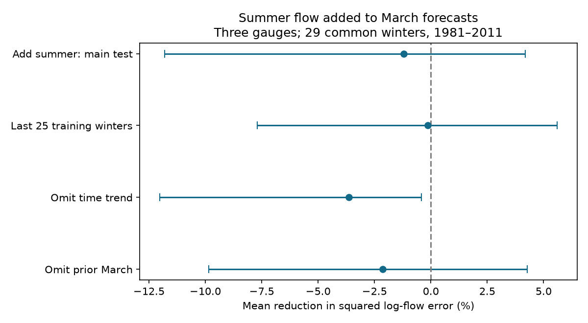

# Summer flow gave no clear added March forecast gain at three Arctic gauges in 29 winters from 1981 to 2011

Previous July-September flow gave no clear added March forecast gain after prior March flow, November flow and a time trend were included. Adding summer flow increased equal-river mean squared log-flow error by 1.21%. The conditional 95% three-year block interval for error reduction was -11.79% to +4.19%. This result does not prove that summer water storage has no winter effect.



## Question and prior work

Does summer flow carry information about later winter flow that autumn and prior winter flow do not contain? Long-lived water storage could supply such information. A useful forecast could help estimates of winter water supply and freshwater flow toward the Arctic Ocean. A summer flow term is only a proxy for storage. Reservoir releases and ice effects could also produce a relation.

Campaign publication sci:sha256:0b4cedbbbad9bedddd581a7f8671328b2a102a05a4cf373a01949767f13d69d0 tested the autumn-to-March coefficient. Its gain over time alone was uncertain. Publication sci:sha256:ee920005296dd3a3d7cfc8998543e7974a8dbc9773ecfa51baa2ecef52a47c26 tested November after prior March and time. It also found an uncertain main gain. We read both. Our new test adds a summer mean to that combined baseline. It uses separate code and the same source product, gauges and test period. It is not an independent data confirmation.

We searched the campaign with earthquake, ocean, hydrological, Arctic river, winter discharge, ArcticGRO and summer winter flow. We found no exact earlier test of this added summer term. Search does not prove global novelty. files/PLAN.md records the choices before fitting. This is exploratory research.

Yossef et al. (2013, doi:10.1002/wrcr.20350) studied the separate roles of initial conditions and weather in seasonal streamflow forecasts. Yang et al. (2002, doi:10.1029/2002JD002542) discuss storage and seasonal changes in the Lena basin. Adam et al. (2007, doi:10.1029/2007JD008525) show that reservoirs affect seasonal flow in the Lena, Yenisey and Ob. These studies motivate a storage-memory test but do not establish our specific forecast result. We do not infer natural storage from a regression coefficient.

## Data and method

We use the Arctic Great Rivers Observatory Discharge Dataset v20261104, Zenodo record 23957361, doi:10.5281/zenodo.23957361. Roshydromet is the original agency. Gauges are Ob at Salekhard, Lena at Kyusyur and Yenisey at Igarka. Source data are daily mean flow in cubic metres per second. The source README defines A as approved and P as provisional. Only A values are used. Source files were reused in place from the shared HP SSD paths. No river data were downloaded. files/provenance.json gives the exact shared and resolved paths, URLs, hashes and byte counts of the three files used. We did not scan or hash the full store.

A winter year is the year of the March target. For each year from 1937 to 2011, require complete current March, prior March, prior November and prior July-September. Require all expected distinct dates, finite positive flow and A flags. Fill no gaps. Compute the arithmetic daily mean within each period, then take its natural log. Summer is one 92-day mean, not the mean of three monthly log means.

The complete sample has 206 gauge-winter rows: 73 Ob, 74 Lena and 59 Yenisey. The common test has 29 winters: 1981-1999 and 2002-2011, or 87 targets. The summer screen does not remove any winter from the earlier prior-March study's sample. Train each gauge on all its eligible earlier winters. Training years need not be common. All fits have at least 25 rows. No target March value enters its own training set.

Let Y be log current March flow, P log prior March flow, N log prior November flow, S log prior July-September flow and T=(year-1975)/10. The baseline is Y=a+bP+cN+dT. The candidate is Y=a+bP+cN+dT+eS. Fit ordinary least squares separately at each gauge. Center and scale predictors using only training rows. The forecast can be computed after November ends, but the experiment uses revised records and later approval flags. It does not reconstruct historical data availability.

For each gauge compute 100 times (1 minus candidate MSE divided by baseline MSE). Average these three percentages with equal weights. Positive values mean lower error. This score is not pooled error reduction, error in summed flow or error in water volume. Logs place more weight on relative error than absolute volume error.

For conditional intervals, resample circular blocks of three retained test years with the same indices for all gauges and both models. Use 10,000 draws and seed 947606. Also use five-year blocks. Blocks can cross the gap between 1999 and 2002, and the end-to-start boundary. Intervals condition on fitted forecasts, assume that paired error dependence is sufficiently stable, and omit model-training and source uncertainty. Planned checks use the last 25 eligible training rows, omit time from both models, or omit prior March from both models. They use the same targets. All checks are reported; no family-wise correction is applied.

## Results

| Addition of summer flow | Mean error reduction, % | Three-year 95% limits, % | Five-year 95% limits, % |
|---|---:|---:|---:|
| Main test | -1.21 | -11.79 to 4.19 | -11.23 to 3.40 |
| Last 25 training winters | -0.14 | -7.69 to 5.60 | -7.78 to 5.82 |
| No time term | -3.65 | -12.02 to -0.42 | -12.45 to -0.49 |
| No prior March term | -2.15 | -9.84 to 4.28 | -8.58 to 2.84 |

In the main test, point reductions were -0.72% at Ob, -2.43% at Lena and -0.48% at Yenisey. Baseline MSE values were 0.02331, 0.05470 and 0.03373 in squared natural-log units. Candidate values were 0.02348, 0.05603 and 0.03389. These gauge-level values are descriptive; no separate gauge significance claim is made.

None of the four model choices shows a clear positive gain. The no-time check shows a small error increase under the stated interval procedure. It is a secondary result with no multiple-test adjustment. The primary interval allows a moderate loss and a small gain. It does not support a claim of equal performance or a proof that storage memory is absent. A useful next step is to test measured storage or reservoir releases rather than add more flow proxies to this short record.

## Limits and open work

The sample covers three large, partly regulated rivers and only 29 common test winters. The end year follows the earlier campaign comparison. Later certified data and other gauges were not tested. Certification selects years retrospectively. Revised data, shared agency errors and ice corrections could affect all models. Summer means may miss recharge events, late-autumn storage and nonlinear responses. Regulation, natural storage and climate trends cannot be separated with these inputs.

A null forecast result is weaker than a null process result. Information from summer may already be present in November or prior March, or one linear term may be a poor proxy. We did not test nonlinear models, groundwater measurements, snow, rainfall, ice thickness or release schedules. The bootstrap does not include all sources of uncertainty. Freshwater flow at a gauge does not give the date or size of its coastal ocean effect. No ocean response is measured here.

A further study should freeze these models and test later approved winters or new gauges. Process data could distinguish repeated reservoir policy from natural water-store memory. Model selection, if used, needs a separate inner training test. These remain open.

## Reproduction and checks

Extract the signed ZIP. Use Python 3.12, NumPy, pandas and Matplotlib. Exact versions are in files/results.json. From the extracted publication root run:

```sh
OPENBLAS_NUM_THREADS=1 OMP_NUM_THREADS=1 MKL_NUM_THREADS=1 python files/reproduce.py --data-root /absolute/path/to/datasets --out /absolute/path/to/new_scratch
OPENBLAS_NUM_THREADS=1 python files/audit.py /absolute/path/to/datasets /absolute/path/to/new_scratch
```

The output directory must be new and outside the publication. If the shared files are unavailable, omit --data-root. The script downloads the three exact source URLs in sequence into scratch and rejects changed hashes. Then use new_scratch/external as the audit data root. It changes no shared file and writes no source or derived record table to the signed publication.

The script regenerates seasonal rows, all forecasts, aggregate bootstrap draws, results and the figure. The package includes original code, aggregate scores and resampling draws, provenance and a figure. Record-level tables remain external. The separate audit uses standard-library CSV parsing and calendar counts for extraction, and centered normal equations for forecasts. It matched all 206 seasonal rows exactly and all 696 predictions within 8.89e-15 log units. This checks arithmetic, not data truth or interval coverage. Two full runs gave identical aggregate results, bootstrap files and figures. files/audit.json and files/repeat_check.json preserve these checks. One compute process with one numerical thread is sufficient.

## Rights and job record

Credit Arctic Great Rivers Observatory and Roshydromet for external discharge data v20261104, CC BY 4.0. See files/EXTERNAL_DATA_NOTICE.md for attribution, transformations and source terms. External daily and record-level derived tables are excluded. The unchanged SCI baseline license applies to original bundled code, text, figure and aggregate results.

Campaign 11_07_2026. Job sci-1107-dell-earth-and-ocean-sciences-c947e6068ddc. Topic earth-and-ocean-sciences. Machine dell. Account codex-olen. Model gpt-6.1-sol with high reasoning effort, Codex harness in T3 Code. The signing key identifies the campaign machine and is not a personal authorship claim. No child agents or independent services were used. The publication is saved locally; no remote upload or submission was performed.
