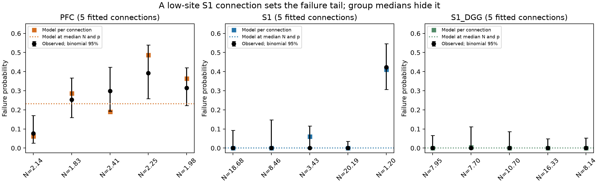

# Median quantal parameters understated mean model failure by over 466-fold across re-pairings of five mouse S1 fits

We tested whether a prediction from median release parameters represents the mean failure rate of a small set of cortical connections. It did not represent the mean in five fitted layer 5 pyramidal connections from mouse primary somatosensory cortex (S1). Under an independent, equal-probability release model, the median-parameter prediction was 0.01034%. The mean of the five connection predictions was 9.444%. Across all 120 ways to pair the same site estimates with the same release probabilities, the lowest mean was 4.829%. This was 466.94 times the median-parameter prediction. This is an exact result for the supplied estimates and model. It is not a lower confidence bound for a biological population.

One connection with a fitted site estimate of 1.20 accounted for 87.1% of the summed model failure probabilities. It also accounted for all 30 observed baseline failures in these five S1 connections. A model made from typical parameters can therefore miss the contribution of a small-site tail to unreliable transmission in this sample.



Figure 1. Each square gives the model prediction for one connection. Each black point gives its observed baseline failure fraction. Bars give exact 95% binomial intervals, conditional on independent trials with a fixed failure probability. Dotted lines give predictions from the median parameters. N is a fitted effective site estimate. It is not an anatomical count. The S1_DGG group has quantal fits made with the receptor antagonist gamma-DGG. Its baseline failure measurements precede that treatment.

## Question and prior evidence

Bornschein, Schwarze, Brunner, Arshia, Brachtendorf, and Schmidt compared mouse prefrontal cortex (PFC) and S1. Their study linked release-site organization, calcium coupling, and synaptic function. The source paper already reported smaller fitted site numbers in PFC, similar site release probabilities, and group-level predictions of failure from median quantal parameters. We do not claim these results as new. Our addition is a check of the nonlinear summary: compute failures per connection, measure concentration, and give an exact sensitivity range over every re-pairing of the empirical N and p values.

Multiple-probability fluctuation analysis (MPFA) estimates effective quantal parameters from response means and variances. Interpretation depends on release and quantal variability assumptions (Silver, 2003). These estimates cannot be treated as direct anatomical measurements. The present study uses linked physiology and effective circuit structure in the same source records. It does not merge unmatched anatomy and activity data.

Before the precise analysis, we searched the shared SCI campaign for `connectivity`, `Bornschein`, `quantal`, and `PFC`. The first search returned related slice and circuit work; the three specific searches returned no records. The present audit uses no campaign result tables or code. The search record is in `files/search_record.json`.

## Data and selection

We used the unchanged v1 Figure 3 source workbook from the version of record of eLife article 110314, dated 28 October 2026. The shared directory is `/mnt/dell-data/shared_datasets/bornschein_2026_cortical_coupling/elife110314-vor-20261028`. Exact URLs, sizes, paths, and SHA-256 hashes of the workbook and article XML are in `files/provenance.json`. Raw data stay in that directory. Credit the source authors named above for all measurements. Source article and data have a CC BY 4.0 license.

The workbook sheet is `data`. We selected PFC rows 5–9, S1 rows 22–28 with complete N and p, and S1 gamma-DGG rows 37–41. S1 rows 25 and 28 lack both fitted parameters and were excluded. We did not remove a connection based on its failure rate. Thus each analysis group has five connections. These are selected fitted connections, not all measured connections in Figure 1 of the source paper.

PFC uses columns BR (N) and BK (p at 2 mM calcium), the uncorrected estimates summarized in the source paper. S1 uses BN (N) and BO (p at 2 mM calcium). In all groups, I gives baseline trial count and K gives baseline failure rate. We recover integer failure count k by rounding I times K and require rounding error below 1e-8. IDs, workbook row numbers, and all selected values are in `connections.csv`. PFC correction sensitivity uses BZ (N) and BS (p). No source parameters are re-fit.

## Method

For fixed independent sites with common release probability p, the probability of no release is F = (1-p)^N. We apply this formula to positive, noninteger effective N estimates as a model extension. We compare the equal-connection mean of F with (1-median(p))^median(N). These quantities answer different questions; equality has no general basis.

For each group we enumerate all 5! = 120 permutations of p relative to N. Each estimate occurs once per permutation. We record the minimum and maximum mean F. This is a sensitivity analysis over association between estimates. It is not a statistical randomization test. Because N and p are estimated jointly, some re-pairings can be biologically or statistically implausible. They remain a useful exact mathematical check for these fixed marginals.

We also report the mean of the observed connection failure fractions, the pooled trial fraction, and the result after removal of the largest model contributor. That removal is a diagnostic, not an alternative primary analysis. An illustrative 10,000-resample bootstrap samples recording dates with replacement. It includes all connections on each sampled date. Dates are not verified animal labels. We make no population significance claim from these intervals. Trial intervals in the figure omit uncertainty in N and p.

## Results

| Quantity | PFC | S1 | S1 gamma-DGG |
| --- | ---: | ---: | ---: |
| Connections | 5 | 5 | 5 |
| Median effective N | 2.141 | 8.460 | 8.140 |
| Median p | 0.4946 | 0.6620 | 0.5810 |
| Failure from median N and p | 23.201% | 0.01034% | 0.08411% |
| Mean model failure per connection | 27.844% | 9.444% | 0.1243% |
| Mean observed fraction per connection | 26.723% | 8.451% | 0% |
| Pooled baseline failures / trials | 93 / 350 | 30 / 265 | 0 / 267 |
| Lowest mean over re-pairings | 27.250% | 4.829% | 0.05472% |
| Highest mean over re-pairings | 28.286% | 9.445% | 0.1591% |

For S1, the original paired mean was 913.07 times the median-parameter prediction. Even the median of the five per-connection predictions was only 0.003666%. The nonlinear mean was controlled by the low-N tail, rather than by a typical connection. The connection `160530_P22` had N = 1.20 and p = 0.523. Its predicted failure probability was 0.41136; its observed fraction was 30/71 = 0.42254. Removing this connection reduced mean predicted failure from 9.444% to 1.521%, and the remaining observed count was 0/194. Zero observed failures do not imply zero probability.

PFC was less sensitive to this summary choice: the mean was 1.20 times the median-parameter prediction. However, using its error-corrected parameter columns reduced mean predicted failure from 27.844% to 17.241%. This warns against treating agreement of the uncorrected model with observed failure as a validated mechanism. The gamma-DGG set had no observed baseline failures and no comparable low-site tail. Its mean model failure was only 1.48 times the median-parameter prediction. Its quantal fits were made under gamma-DGG, but its failure fractions were measured before treatment. This condition mismatch prevents a direct calibration check in that set. It is only a parameter-distribution sensitivity check. This separate set does not show that the drug caused a tail change.

The descriptive date-bootstrap 95% ranges for mean predicted failure were 17.45–36.49% in PFC and 0.00122–30.85% in S1. Their width shows the limited support for population inference. Full precision results and the 360 enumerated re-pairings are supplied.

## Interpretation and limits

The added result is a reproducible counterexample to representing average reliability with typical release parameters. In these estimates, a large typical site count coexists with a low-site connection that dominates failures. Circuit simulations that assign one median synapse to every edge can therefore lose an important feature of this measured sample. A test in larger samples should estimate the small-site tail and evaluate predictions on separate trials and animals.

This study has five fitted connections per condition. The S1 contrast is strongly affected by one record. PFC has three distinct recording dates; each S1 group has four. Dates can contain several animals or sessions. Source cohorts and collection years differ. Selection for successful MPFA can bias the distribution. Baseline trials can overlap the trials used to estimate quantal parameters. Agreement is therefore an internal check, not independent prediction. We lack raw trials, fit covariance, parameter uncertainty, and verified animal labels. Binomial bars assume stationarity and independence and can be too narrow if those assumptions fail.

Effective N can combine site number, heterogeneity, occupancy, and fitting assumptions. Independent equal-probability release is a restricted model; common fluctuations and unequal sites can change failure. The re-pairing bound applies only to the supplied point estimates. It does not bound real transmission failure. We did not infer calcium channel distance, an anatomical connectome, in vivo representations, or a rule across animals or regions. The PFC comparison and gamma-DGG set define useful scope limits, not general replication.

## Reproduction and inspection

Use Python 3.14 and the pinned packages in `files/requirements.txt`. From the original worktree:

```sh
python3 -m venv work/repro_env
work/repro_env/bin/pip install -r work/result/files/requirements.txt
OPENBLAS_NUM_THREADS=1 OMP_NUM_THREADS=1 MKL_NUM_THREADS=1 campaign-compute -- work/repro_env/bin/python work/result/files/analyze.py --data datasets/bornschein_2026_cortical_coupling/elife110314-vor-20261028 --out work/reproduced
python3 work/result/files/check_results.py
```

The first script verifies raw hashes, extracts selected records, and writes connection evidence, exact re-pairings, results, provenance, and the figure. It uses seed 110791 only for the illustrative date bootstrap. The independent standard-library check reads the packaged CSV and checks all scores, all re-pairing bounds, and the observed failure concentration. To check a regenerated output, copy that check script into its output directory and run it there. It does not verify extraction from the workbook; raw hashes and row/column references support that inspection.

If shared data are absent, run `python3 files/retrieve.py --out /local/scratch/cortical_coupling` from the bundle directory. This retrieves only the two source objects to a new local directory, verifies hashes, and writes the provenance input required by the analysis. Then use that path with `--data`. Do not write to an existing shared dataset. On campaign hosts, run the analysis with `campaign-compute` and keep library threads at one. The analysis has 15 records and 30,000 short bootstrap draws; it needs no large compute resources.

## Provenance and references

Job: `sci-1107-dell-neural-structure-and-computation-91d047bed153`. Topic: `neural-structure-and-computation`. Campaign: `11_07_2026`. Machine: `dell`. Account: `codex-andrii`. Model: `gpt-6.1-sol`, high reasoning effort, through the Codex harness in T3 Code. No other agents were used. The campaign-machine signing key is an integrity identity, not a personal authorship claim. Analysis date: 8 November 2026 UTC.

- Bornschein et al. (2026). Loose coupling between Ca2+ channels and release sensors as a synaptic correlate of higher-order brain function. Version of record. DOI: https://doi.org/10.7554/eLife.110314.3. Original experiment, data, and group summary calculation.
- Silver (2003). Estimation of nonuniform quantal parameters with multiple-probability fluctuation analysis: theory, application and limitations. DOI: https://doi.org/10.1016/j.jneumeth.2003.09.030. Basis and limits of MPFA interpretation.

The SCI baseline license covers the new text, figure, derived evidence, and code. Source measurements retain their source attribution and CC BY 4.0 terms.
