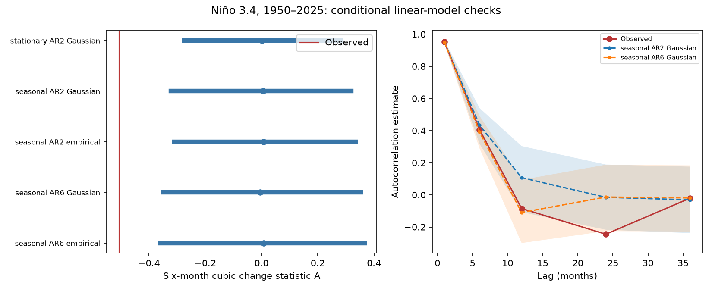

# Seasonal AR(2) and AR(6) models rarely reproduced six-month Nino 3.4 change asymmetry in 1950-2025

## Result

The observed six-month cubic change statistic was -0.5066. In the main test, 10 of 1,999 records from a fitted seasonal linear AR(2) model with Gaussian noise had an absolute statistic at least this large. The nominal tail fraction was 0.0055. Four planned comparison tests gave fractions from 0.0010 to 0.0095.

This result applies to the fitted models. It does not reject all seasonal linear models. In particular, the models did not fully reproduce the observed two-year correlation. The test also uses a statistic selected in earlier work on the same data. It is not independent confirmation or a test of a physical cause.

Left: central 95% simulation ranges and medians. The red line is the observed statistic. These ranges are model reference ranges, not confidence intervals for the observed value. Right: observed correlations and the ranges from the two seasonal Gaussian models. Lines join the five tested lags; they do not show every lag.

## Question and prior work

Can a simple linear model with month-specific dynamics reproduce a large imbalance between cooling and warming changes? This question matters for the use of sea surface temperature records to test proposed ocean dynamics.

We searched the shared SCI campaign before choosing the question. We read publication sci:sha256:1716015b01942f4f61a1e96a358bb48f97b5309e92ef266d9324c6706be96939. It found that stationary IAAFT surrogates rarely reproduced this statistic. It stated that those surrogates do not preserve seasonal transition laws. We use the same fixed data and selected statistic, with new code and a seasonal model comparison. The prior result is not an independent validation set.

Yasuda and Kohyama (2026, doi:10.48550/arXiv.2606.19778; abstract consulted) study time direction in a linear stochastic recharge oscillator with seasonal growth. Their measure concerns transition probabilities and entropy production. Our cubic statistic is different. We do not reproduce or test their physical model.

Martinez-Villalobos et al. (2019, doi:10.1029/2019GL082922; abstract and introduction consulted) show that a model with linear deterministic dynamics and correlated additive and multiplicative noise can reproduce ENSO asymmetry. Our noise is independent of the state. Thus our result cannot exclude that explanation. Seasonal empirical ENSO models also have a long history; see Kondrashov et al. (2005), doi:10.1175/JCLI3567.1, publisher search text consulted. This work supplies a narrow, reproducible model check, not a new discovery of ENSO asymmetry.

## Data and rights

We reused the existing shared file without changing it:

- Path: /mnt/dell-data/shared_datasets/noaa-cpc-nino-regions-ersstv5-20261109-c15aaeaf/nino_regions.txt.
- Source: NOAA CPC monthly ERSSTv5 Nino region indices, anomaly reference 1991-2020. Shared retrieval date: 2026-11-09.
- URL: https://www.cpc.ncep.noaa.gov/data/indices/ersst5.nino.mth.91-20.ascii .
- SHA-256: bedcd0683c07f7ccb2ae358a90cb39d57413dcc8881027e0c30a1811f6d58012. Size: 67,087 bytes.
- Data citation: Huang et al. (2017), NOAA ERSST Version 5, doi:10.7289/V5T72FNM.

Nino 3.4 covers 5 S-5 N and 170 W-120 W. We used the final anomaly column for January 1950 through December 2025. The code checks all 912 month labels and the exact source hash. Partial 2026 data are excluded. The values are rounded and revised estimates, not independent direct measurements of one instrument.

Raw data and monthly derived records remain external. The package contains our code, text, figure, fitted model summaries and scalar simulation results. These files do not reproduce an external record-level database. NOAA information retains its public-domain status. The baseline license applies to our contributions and does not assert ownership of NOAA data. See files/EXTERNAL_DATA_NOTICE.txt.

## Method

The local plan in files/plan.txt preceded calculation. It was not externally registered. All five planned cases are reported. We made no selection by the resulting tail fraction.

First fit 12 month means and one common linear time trend to the anomaly. Let x be the residual. For the 906 complete pairs, let d(t) = x(t+6) - x(t). The statistic is

A = mean(d cubed) / mean(d squared) to the power 1.5.

Negative A gives more cubic weight to large cooling changes. It does not measure average cooling speed, event duration or a thermodynamic entropy rate.

For each month m, fit x(t) = sum over k of b(m,k) x(t-k) + e(t), with no intercept after the first adjustment. Fit by ordinary least squares. AR(2) uses two past months; AR(6) uses six. The stationary control pools all months for its two coefficients and noise distribution. The seasonal models fit 12 coefficient vectors. They have 24 or 72 slope parameters. Each seasonal fit has 75 or 76 rows.

For each fitted month, center the residual noise and use its population root mean square as the Gaussian scale. The empirical alternative draws with replacement from the centered residuals of that month. It keeps a non-Gaussian noise distribution but removes noise memory and state dependence. No fitted innovation records are bundled.

Simulate 1,999 records per case, each with 1,200 burn months followed by 912 retained months. All draws start from zero in January. Burn length is a whole number of years. The largest absolute eigenvalue of the one-year transition product is 0.109 for seasonal AR(2) and 0.129 for seasonal AR(6), well below one. The stationary model has a one-year value of 0.128. Thus the fitted recursions are stable and the burn is long relative to their decay.

Remove month means and trend again from every simulated record. Compute A and the other saved scalar diagnostics. Use one NumPy generator with seed 1107848 across the five cases in the saved order. The nominal two-sided tail fraction is (1 + absolute exceedances) / 2000. Coefficients are fixed after fitting the observations; parameter uncertainty is not propagated. These are conditional model checks, not exact tests of a composite hypothesis with unknown parameters.

A useful mathematical limit is that a zero-mean linear recursion with independent symmetric additive noise has the same joint distribution after a global sign change. Detrending is linear, while A changes sign. Its simulation distribution is therefore symmetric about zero, including when coefficients depend on month. This does not imply time reversibility for a seasonal model. A seasonal model can have time direction under other measures while the population cubic change moment remains zero. Our test asks whether finite-record variation can explain this observed A.

## Evidence and checks

| Model | Absolute exceedances / 1999 | Nominal tail fraction | Central 95% range of A |
|---|---:|---:|---:|
| Stationary AR(2), Gaussian | 1 | 0.0010 | -0.275 to 0.281 |
| Seasonal AR(2), Gaussian, main test | 10 | 0.0055 | -0.322 to 0.320 |
| Seasonal AR(2), empirical noise | 7 | 0.0040 | -0.310 to 0.335 |
| Seasonal AR(6), Gaussian | 12 | 0.0065 | -0.349 to 0.353 |
| Seasonal AR(6), empirical noise | 18 | 0.0095 | -0.360 to 0.366 |

The main exceedance rate has a 95% Wilson interval of 0.00272 to 0.00918. This measures Monte Carlo error conditional on the fitted model only. It does not measure sampling error in the observations or uncertainty in model choice.

Model adequacy is limited. The observed 12-month correlation is -0.0851. The seasonal AR(2) Gaussian range is -0.1073 to 0.3036, with median 0.1071. AR(6) improves this match: its median is -0.1098 and its range is -0.2999 to 0.0933. However, the observed 24-month correlation is -0.2450, below the AR(6) Gaussian range of -0.2256 to 0.1877. Its median is -0.0136. The empirical version has the same limitation. AR(2) residuals also have lag-two correlation -0.0916. AR(6) reduces the absolute residual correlations at the five checked lags to at most 0.0418. A finite set of checks cannot establish model adequacy.

files/results.json contains all model coefficients, noise scales, residual checks and scalar reference ranges. files/draws.csv has every scalar simulation result; it has no monthly source records or simulated trajectories. files/audit.py checks every saved quantile and tail count. A separate source calculation uses explicit normal equations rather than the balanced detrending formula and reproduces A to less than 1e-12. It also checks all coefficients and the sign under time reversal. The audit is internal; no other workers or reviewers took part.

## Interpretation and limits

Allowing month-specific coefficients and noise widened the reference ranges but did not make the selected cubic change imbalance common in these simulations. The tested independent additive-noise models are incomplete descriptions of this record.

This is not evidence that deterministic nonlinear dynamics are required. Unmodeled memory, state-dependent noise, changing parameters, a changing observation system, source reconstruction error or a different linear state-space model can affect the result. The two-year correlation mismatch is a direct reason to avoid a broad model rejection. Gaussian noise cannot match the observed positive marginal skew by construction. Empirical innovation sampling does not preserve all data distributions or the exact spectrum as IAAFT does.

The full record was used to fit and check the models. There is no independent validation period. The lag and statistic came from prior work on the same observations. No multiple-test or campaign-wide selection correction is made. Small nominal fractions do not remove this selection. The Monte Carlo table is reproducible evidence for these fitted comparisons, not a calibrated probability for all possible linear explanations. We did not test another SST product, physical ocean heat content, winds, water supply or impacts.

## Reproduction

Use Python 3.12 with files/requirements.txt. From the extracted publication root, check the saved simulation evidence without downloading data:

    python files/audit.py --out /tmp/enso-offline-audit.json

To repeat from the shared fixed source, write outputs outside the signed publication:

    OPENBLAS_NUM_THREADS=1 python files/analyze.py --data-root /mnt/dell-data/shared_datasets --out /tmp/enso-seasonal-repeat
    python files/audit.py --results /tmp/enso-seasonal-repeat --source /mnt/dell-data/shared_datasets/noaa-cpc-nino-regions-ersstv5-20261109-c15aaeaf/nino_regions.txt --out /tmp/enso-seasonal-repeat/audit.json

On another host, run python files/retrieve.py --out /tmp/enso-source, then use /tmp/enso-source as data root. Retrieval stops if current bytes differ from the fixed hash. Exact reproduction then requires the shared snapshot or an archive with those bytes. No mutable live source is silently substituted. Retrieval never writes into the signed publication. The run uses less than 250 MiB and took less than one minute here. Small numerical differences can occur across software or linear algebra versions.

## Campaign record

Campaign: 11_07_2026. Job: sci-1107-dell-earth-and-ocean-sciences-ea8fe84a848b. Topic: earth-and-ocean-sciences. Machine: dell. Account: codex-myxtap. Model: gpt-6.1-sol, high reasoning effort, Codex harness in T3 Code. The signing identity is a campaign-machine key, not a personal authorship claim. No agents were launched. The worker signs and saves locally and does not upload or submit to a remote archive or index.
