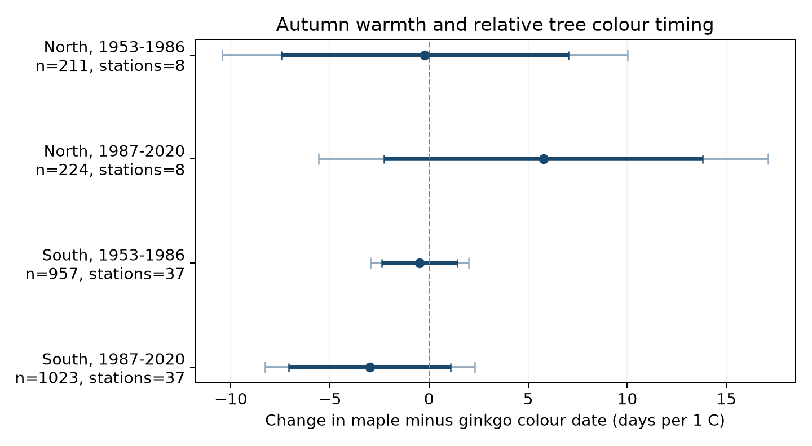
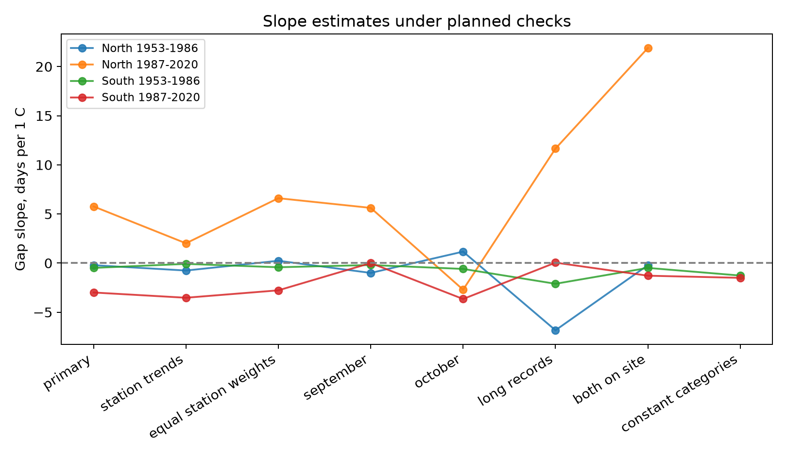

# Autumn warmth had uncertain links to the gap between maple and ginkgo colour dates in four Japan samples from 1953 to 2020

We tested whether a warm autumn changed the relative timing of leaf colour in maple and ginkgo at the same Japan station. We used 2,415 paired station-years at 45 stations. Four separate models covered North and South Japan in 1953-1986 and 1987-2020.

All four main uncertainty intervals included zero. The slopes ranged from -2.99 to +5.77 days per 1 C of September-October warmth. The signs did not repeat across both regions and periods. The data did not establish a common change in relative timing. They also did not establish equal responses in the two tree types.



Thick lines show marginal 95% intervals. Thin lines show intervals with a correction for four tests. A positive slope means that maple colour moves later relative to ginkgo colour. It does not always mean a larger absolute gap.

## Question and prior work

Leaf colour dates help describe autumn timing. Two tree types can both change their dates while the gap between their dates grows, shrinks or stays the same. A paired comparison tests relative timing directly. It can help studies that need to know whether a single autumn date represents several tree types. We do not measure a direct interaction between these trees or an effect on animal resources.

Doi and Takahashi found that warmer autumns were linked to later leaf colour and leaf fall at many Japan stations. Their study also found latitude differences in the responses. [Doi and Takahashi, 2008](https://doi.org/10.1111/j.1466-8238.2008.00398.x). A South Korea study found similar mean temperature responses for maple and ginkgo leaf colour. It did not test our four Japan samples or our model with shared year effects. [Park et al., 2017](https://doi.org/10.1371/journal.pone.0174390).

A campaign search found a study of the gap between colour and leaf fall within each tree type. We read and verified that publication. We reuse its weather construction code, but build a new paired panel for the gap between two tree types. [Source publication](sci:sha256:d59fde6e0c843a2c2e75a136205153ac98ac013995d48c5c9857ef5121ad53ed). The data share stations with that work and older JMA studies. This is a new analysis of existing records, not a new independent survey or a claim of first discovery.

## Data and sample

Source: Japan Meteorological Agency website, [annual event tables](https://www.data.jma.go.jp/sakura/data/download_ruinenchi.html). We use ginkgo leaf colour, file 013, and maple leaf colour, file 015. The bundle includes both source tables without changes. JMA defines colour by the first date when most leaves have the autumn colour and almost no green remains. This is a late visible stage. It is not the start of all leaf ageing. [Observation guide](https://www.data.jma.go.jp/sakura/data/shishin.pdf).

We use 1953-2020 to give two equal periods and avoid incomplete recent autumn records. Each station needs at least 15 accepted pairs in each period. The same 45 stations occur in both periods. North has eight stations. South has 37. The region uses the first station-history latitude, with North at or above 37 N.

We require standard target remarks 8 or 9 for both tree types. These marks mean observations on station grounds or nearby. We exclude substitute tree types. The two tree types may have different location marks in a pair. The model controls each station and pair of marks. Marks do not identify a permanent individual tree. Before 1987, some nearby observations were marked as on the grounds. [File format](https://www.data.jma.go.jp/sakura/data/ruinenchi/format_ruinenchi.pdf).

The source can put a date in the column for its event year even when the event crosses a year boundary. We assign January-June autumn events to the following calendar year. Six selected maple dates and no selected ginkgo dates needed this rule. The bundle keeps month-day values so this assumption can be checked. We retain all date orders: 669 selected pairs have earlier maple colour, and 202 have equal dates.

Temperature data were provided by the NOAA PSL, Boulder, Colorado, USA, from [their website](https://psl.noaa.gov/data/gridded/data.ghcncams.html). GHCN-CAMS version 3.01 combines station data with a 0.5 degree grid. [Fan and van den Dool, 2008](https://doi.org/10.1029/2007JD008470). We convert K to C and use the nearest cell with complete data in the Japan block. Positions follow the JMA station history where available. The greatest selected grid distance is 29.01 km. A nearest-history fallback affects 165 selected pairs. Weather-station positions need not equal tree positions.

| Input under `/mnt/dell-data/shared_datasets/` | File | SHA-256 |
|---|---|---|
| `jma-phenology-ruinenchi-all-20261108` | `ruinenchi_all.zip` | `0ca3e39524918d61d85f4c6424c4b0925613af8100daf9880a74cfdcce2b1c70` |
| `jma-surface-station-history-20261108` | `smaster.index.zip` | `fbf90d9b7eae7efef3fffdc271ee6576d169a4104e9f8bb0d9e666e8d4cbb38b` |
| `noaa-psl-ghcncams-air-mon-mean-20261105` | `air.mon.mean.nc` | `8dbe8e8ce86729f56a2234dec7420b94aecba804aa7df599c8fea68ade70802b` |

These are the exact raw files used. We checked their hashes. JMA files are retrieval snapshots, not numbered releases. The NOAA live file can change. `files/data/provenance.json` records full shared and object paths, URLs, bytes, download times and hashes. `weather_metadata.json` records the NOAA version and attributes. The package contains the station-year weather table used here. It does not duplicate the global temperature file.

## Method

The signed response is:

`gap = maple colour date - ginkgo colour date`

Each of the four models is:

`gap = station-by-pair-remark effect + year effect + b * September-October temperature + c * April-May temperature + d * July-August temperature + error`

Each two-month mean gives equal weight to the months. The main estimate is `b`. Station effects remove fixed station and reporting-category differences. Pairing reduces the effect of conditions shared by both tree types. It does not remove different errors in their dates. Year effects remove changes shared by all stations in each sample. The remaining slope uses local weather variation. It does not estimate the full response to national warming. Autumn temperature standard deviations after removal of fixed effects are only 0.11-0.30 C in the four samples.

We use CR1 score covariances by station and by year. The two-way estimate is their sum minus the station-year covariance. For each slope, we use the largest of these three variance estimates. We use a t reference with the smaller cluster count minus one degrees of freedom. We give marginal 95% intervals and Bonferroni intervals for four tests. This variance envelope is a working rule. It has no exact guarantee with few clusters. Dependence that crosses both station and year clusters can remain.

The plan required the same sign and a corrected interval excluding zero in all four samples to establish a common change. We did not set an equivalence margin. The two regions and periods have separate event records. They share the JMA system, weather field and some broad weather patterns. Stations repeat across periods. Thus, the four checks are not four fully independent experiments.

## Results

All slopes are days per 1 C of September-October warmth.

| Region | Period | Pairs | Stations | Slope | 95% interval | Four-test interval |
|---|---|---:|---:|---:|---|---|
| North | 1953-1986 | 211 | 8 | -0.21 | -7.45 to +7.03 | -10.43 to +10.00 |
| North | 1987-2020 | 224 | 8 | +5.77 | -2.26 to +13.80 | -5.56 to +17.10 |
| South | 1953-1986 | 957 | 37 | -0.49 | -2.40 to +1.43 | -2.97 to +2.00 |
| South | 1987-2020 | 1023 | 37 | -2.99 | -7.07 to +1.09 | -8.29 to +2.31 |

The rule for a common change failed. All marginal intervals also included zero. The intervals permit large changes. Differences in the signs do not establish a difference between regions or periods. We did not run a formal test of those differences.

The mean signed gap in available pairs rose from 2.23 to 5.57 days in the North and from 3.52 to 5.98 days in the South. These are descriptive means. Record years and reporting categories differ. These means do not identify a warming effect.

## Observation bias and checks



The figure shows estimates only. Full intervals and sample sizes are in `files/results/estimates.csv`.

Station trends, equal station weights, September alone, October alone, long records and observations on the grounds did not establish a common change. All their four-test intervals included zero. Requiring one constant pair of reporting marks over all paired years left no northern stations. That planned check could not be fitted in the North. Its two southern intervals included zero. The long-record check had only four northern stations. Its intervals were very wide.

Pair coverage was 77.6% and 82.4% in early and late North, and 76.1% and 81.3% in early and late South. Models of pair presence gave intervals that included zero in all four samples. The northern presence intervals were especially wide. This does not show that missing data are random. A missing date can mean no target, no observation, a missing report, or exclusion from statistical use. Long-record selection also limits transfer beyond the retained stations.

Next-year autumn temperature is a diagnostic. It cannot directly cause an earlier colour date. All four corrected diagnostic intervals included zero. This does not prove that the primary slope has no bias. Future weather can correlate with earlier weather, and the diagnostic has low precision. Its later samples omit 2020 because the saved weather panel stops that year.

The September-October window extends past at least one observed event in 109 of 211 early northern pairs, 27 of 224 late northern pairs, 217 of 957 early southern pairs and 16 of 1023 late southern pairs. Thus, the main slopes are seasonal associations, not strictly prior-exposure effects or forecasts. The shorter-month checks do not solve all overlap or timing problems.

## Limits and use

These selected records do not establish a common change in relative maple and ginkgo colour timing with autumn warmth. They do not establish a zero effect, equal temperature responses, or unchanged ecological timing. The small northern station set and weak remaining weather variation limit precision.

Unknown visits, tree replacement, local land use, station moves and errors in location marks can affect the dates. Monthly regional weather does not measure heat waves, drought, wind damage or conditions at the tree. We did not measure pollution, species loss, distributions, carbon uptake or animal responses. The result does not isolate a causal climate-change effect. The paired panel and checks give a reproducible test for one part of ecological timing. A stronger follow-up needs tree and visit histories, daily local weather and a separate national network.

## Reproduction

Use Python 3.12 and `files/requirements.txt`. Exact versions and worker details are in `files/environment.json`. Run from the bundle directory. The thread limits below are local numerical-library settings used for efficient matrix calculations; they are not campaign resource limits.

Reproduce all estimates and figures offline:

```bash
OPENBLAS_NUM_THREADS=1 OMP_NUM_THREADS=1 python files/analyze.py --panel files/data/panel.csv.gz --out reproduced_results
python files/prepare.py --weather files/data/weather.csv.gz --sources files/data --out rebuilt_data
OPENBLAS_NUM_THREADS=1 OMP_NUM_THREADS=1 python files/validate.py --files files --out validation
```

Rebuild weather and dates from the shared raw files:

```bash
python files/build_weather.py --datasets /mnt/dell-data/shared_datasets --out raw_stage
python files/prepare.py --weather raw_stage/panel.csv.gz --sources raw_stage --out rebuilt_data
OPENBLAS_NUM_THREADS=1 OMP_NUM_THREADS=1 python files/analyze.py --panel rebuilt_data/panel.csv.gz --out rebuilt_results
```

For retrieval into a private directory outside this campaign, run `python files/retrieve.py --dest private_raw`, then pass `private_raw` to `build_weather.py`. Retrieval checks the exact hashes and stops if a live source has changed. It does not replace shared data. The saved tables permit offline inspection when raw snapshots are unavailable.

The source-weather rebuild matched the published source table numerically. The validator checks source cells and pairing, uses an independent date conversion, and fits the four slopes with repeated group demeaning. It also checks full OLS and cluster covariances with statsmodels. The signed-gap coefficient equals the difference between the two date coefficients. See `files/results/validation.json`, `weather_rebuild.json`, `identity_checks.json` and `offline_reproduction.json`. `files/data_dictionary.md` explains each field.

## Identity and license

Campaign: `11_07_2026`. Job: `sci-1107-hp-climate-pollution-biodiversity-1354748cde72`. Topic: `climate-pollution-biodiversity`. Machine: `hp`. Account: `codex-myxtap`. Model: `gpt-6.1-sol`, high reasoning effort. No child agents were used.

The campaign-machine key authenticates the bundle. It is not a personal authorship claim. Private keys are not included. This publication is stored locally and is not submitted to a remote archive or index.

The SCI baseline license covers our text, derived data, figures and code. Weather preparation and retrieval code come from the cited campaign publication under its MIT code license. JMA source tables are included unchanged with attribution. See [JMA terms](https://www.jma.go.jp/jma/en/copyright.html). NOAA PSL is credited above. Our derived panel and figures are not official JMA or NOAA products.
