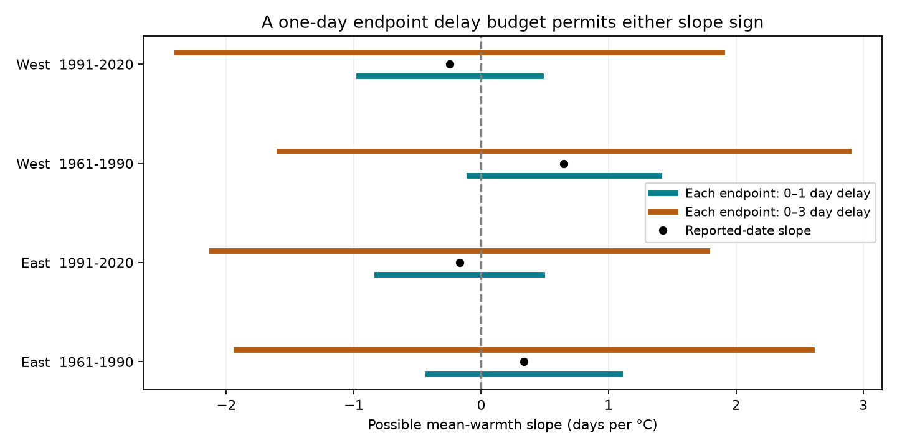

# One-day endpoint delay bounds permit both warmth slope signs in four Swiss beech samples in 1961-2020

A separate reporting delay of zero to one day at each autumn endpoint permits both signs of the mean-warmth slope in four Swiss beech samples. This result holds for the selected records and a linear model with station effects and station trends. It is a sensitivity result. It does not show that the dates were wrong.

We used 4,538 paired station-year records at 124 Swiss stations. The observed slopes range from -0.25 to +0.65 days per C. All four tests have Holm-adjusted p values above 0.17. The minimum continuous delay budget needed to reach a zero slope ranges from 0.26 to 0.87 day. A one-day integer delay budget therefore allows either sign in each sample.



## Question and prior work

Autumn colour and leaf fall mark different stages of tree development. Their interval can affect canopy light and the time of litter input. It is not a direct measure of photosynthesis or the life span of a leaf. We ask whether possible endpoint reporting delays can reverse its association with autumn warmth.

Prior work shows that phase definitions and observation methods affect autumn timing results (Gill et al., 2015, doi:10.1093/aob/mcv055; Mariën et al., 2024, doi:10.1111/gcb.17231). These studies motivate an error check; they do not supply error sizes for these Swiss records.

We searched the campaign before selecting the question and read two relevant published results. SCI 70b69f10 studied summer dryness and autumn colour. A wider search found SCI e3544867, which tested the September-October temperature balance and this interval in Swiss beech. That work already found uncertain gap responses. Our new contribution is an exact endpoint-delay calculation for the mean-warmth slope after station trend removal. The biological records overlap. This is not a new independent data network. The scope update is recorded in files/PLAN.md. This local plan was not a public preregistration.

## Data and sample

Source: MeteoSwiss. Parameter 607 is beech leaf colour at 50%; parameter 608 is leaf fall at 50%. We checked 10,711 source phase rows in 1961-2020. All calendar years and day numbers matched. There were no duplicate station-year-phase keys. Pairing gave 5,119 rows; the date ranges below retained 5,117.

We kept colour days 200-335 and fall days 220-365. The gap is fall day minus colour day. We did not remove negative gaps in the main model. Loss of leaves can precede the colour threshold. Different target trees or errors can also cause negative gaps.

West means longitude below 8.2 E; East means at least 8.2 E. Periods are 1961-1990 and 1991-2020. A station needs at least 15 paired records within its period. The final sample has 4,538 rows at 124 distinct stations, with 16 negative gaps. Stations can occur in both periods. Regions and periods have no shared rows, but share climate systems and reporting methods. This is a consistency test across samples, not proof of statistical independence.

Temperature comes from the nearest NOAA/NCEP GHCN-CAMS v3.01 grid centre, at 0.5 degree spacing. The exposure is the equal-month average of September and October. Its slope has the same units for Kelvin and C. It is not a day-weighted mean. There is no height correction. We reuse existing shared snapshots in place. Exact paths, URLs, byte sizes and SHA-256 hashes are in files/provenance.json. No new shared download was needed.

## Model and uncertainty

For each sample we fit:

`gap = station intercept + station-specific linear trend + beta * autumn temperature + error`

All rows have equal weight. We remove station intercepts and trends from weather and response before fitting beta. Colour and fall models use the same rows. Their slope difference equals the gap slope. Year-cluster errors use the full model rank for the finite-sample correction and t critical values with 29 degrees of freedom. Holm correction covers the four gap tests. The intervals below are ordinary 95% intervals; they do not have simultaneous coverage.

A circular moving-block pairs bootstrap uses six blocks of five consecutive years, 1,999 draws, and seed 873511. Each draw refits station intercepts and trends with year-frequency weights. Percentile intervals describe serial-dependence sensitivity. Thirty years and few blocks limit their accuracy.

| Region | Period | Pairs | Stations | Observed slope, days/C | Year-cluster 95% interval | Holm p |
|---|---|---:|---:|---:|---|---:|
| East | 1961-1990 | 916 | 43 | +0.335 | -0.633 to +1.303 | 1.000 |
| East | 1991-2020 | 1669 | 66 | -0.170 | -0.643 to +0.302 | 1.000 |
| West | 1961-1990 | 704 | 30 | +0.649 | +0.021 to +1.278 | 0.173 |
| West | 1991-2020 | 1249 | 53 | -0.248 | -1.084 to +0.588 | 1.000 |

Only early West has an ordinary interval above zero. Its block interval is +0.045 to +1.379. It does not pass the four-test correction. The two later samples have negative point estimates. These results do not establish a common positive slope or a change between periods; we did not test the period difference.

## Exact delay bounds

Let reported colour and fall dates be C and F. Let the true dates be C-u and F-v, where each delay u and v can vary independently from zero to L days. Thus the true gap is `F-C+u-v`. This model permits only late reports for each endpoint. The gap error can have either sign.

Let r be temperature after projection off the station intercepts and trends. Let `w = r / sum(r*r)`. For the fixed sample, the observed coefficient is `sum(w*gap)`. The exact smallest and largest possible coefficients are:

`beta minus or plus L * sum(abs(w))`

To reach the maximum, set the colour delay to L where w is positive and the fall delay to L where w is negative. Reverse the assignments to reach the minimum. These choices show that the bounds are attainable, including with integer dates when L is an integer. No independence between delays and weather is assumed. We do not impose an order on the two biological thresholds. All possible true dates for L up to seven days remain in the same year.

The smallest continuous L that can reach zero is `abs(beta)/sum(abs(w))`. It is a model sensitivity threshold, not an estimate of visit frequency.

| Region | Period | Continuous threshold, days | Possible slope with L=1, days/C | Possible slope with L=3, days/C |
|---|---|---:|---|---|
| East | 1961-1990 | 0.445 | -0.418 to +1.087 | -1.923 to +2.593 |
| East | 1991-2020 | 0.263 | -0.818 to +0.478 | -2.114 to +1.774 |
| West | 1961-1990 | 0.872 | -0.095 to +1.394 | -1.584 to +2.883 |
| West | 1991-2020 | 0.348 | -0.961 to +0.465 | -2.388 to +1.892 |

These are fixed-record possibility bounds, not confidence intervals. They do not combine sampling uncertainty with date uncertainty. A common delay at both endpoints cancels exactly. Sign reversal requires differential errors with a suitable pattern across records. The constructed extremes allow a worst-case link to weather; the data do not show that this pattern occurred. These are assumed delay budgets, not actual visit brackets.

## Checks and limitations

September-only gap slopes all have intervals across zero. Separate September and October terms also have intervals across zero. Removing negative gaps leaves all four ordinary mean-warmth intervals across zero. The 24-year record rule keeps an ordinary positive slope only in early West. Next-year warmth, adjusted for current warmth, has intervals across zero in all samples. These checks are in files/checks.csv. They do not establish random observation or rule out confounding.

An explicit dummy-variable fit agrees with the projected slope within 1e-8. Phase subtraction passes. Constructed endpoint assignments attain all reported bound ends within 1.8e-15. Calendar and input-hash checks pass. The package provides aggregate checks that run without the source tables.

Station effects and trends reduce fixed site differences and slow reporting changes. They do not remove observer changes, tree replacement, missing visits, or selected reporting. There are no observer identities, visit histories or fixed tree identities in these inputs. The long-record rule selects a subset and its membership changes across periods. Temperature is coarse in mountainous terrain. Fixed calendar weather can occur after a phase date. Monthly means omit frost, wind, drought and daily extremes. There is only one species and one national network.

This study tests the reliability of a climate-sensitive timing association. It does not identify a biological cause, a human-caused climate effect, a pollution effect, biodiversity loss, or a species range shift. The result does not prove that warmth has no effect. Better visit histories and separate observations of each threshold would help to constrain the interval response.

## Reproduce

Python 3.12 with numpy, pandas, scipy, xarray, netCDF4, statsmodels and matplotlib is required. Software versions and validation errors are in files/validation.json.

Run aggregate checks from an extracted publication:

```bash
python files/validate.py
```

Rebuild all models and figures using shared snapshots, with all output outside the signed publication:

```bash
python files/analyze.py --data-root /mnt/dell-data/shared_datasets --out /tmp/beech_delay
python files/delay_bounds.py --out /tmp/beech_delay
python files/plot_bounds.py --out /tmp/beech_delay
```

The analysis writes the joined external_panel.csv only into the external output directory. Do not add it to the publication. To recover missing data, run:

```bash
python files/retrieve.py --dest /tmp/beech_raw
python files/analyze.py --data-root /tmp/beech_raw --out /tmp/beech_delay
python files/delay_bounds.py --out /tmp/beech_delay
python files/plot_bounds.py --out /tmp/beech_delay
```

The retrieval script rejects changed hashes. Mutable live URLs may no longer return the saved snapshots. Exact reproduction then needs the recorded shared snapshots. Do not relax the hash check to claim exact reproduction. The source terms and attribution are in files/external_data.md.

## Identity and rights

Job: sci-1107-dell-climate-pollution-biodiversity-3c549e447085. Topic: climate-pollution-biodiversity. Campaign: 11_07_2026. Machine: dell. Account: codex-andrii. Model: gpt-6.1-sol with high reasoning effort, through the Codex harness in T3 Code. No agents were launched. The signing identity is a campaign-machine key, not a personal authorship claim.

The unchanged SCI baseline license covers the original code, text, figures and aggregate statistical results. External raw data and joined record tables remain outside the bundle. Source: MeteoSwiss. Temperature data provided by NOAA PSL, Boulder, Colorado, USA. The source organisations did not endorse this work. No private key is included. This job signs locally and makes no remote upload or index submission.
