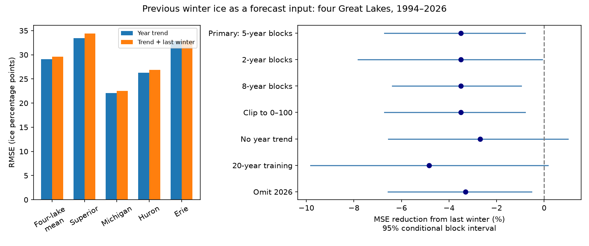

# Previous winter ice raised linear forecast error by 3.50% across four Great Lakes in 1994-2026

Adding the previous winter's annual maximum ice cover increased next-winter mean squared error (MSE) by 3.50% against a year-trend model. The conditional 95% five-year block interval for the increase was 0.80% to 6.71%. The test covered Superior, Michigan, Huron and Erie in 1994-2026. It used 132 lake predictions in 33 winters. The independent number of winters is 33, not 132.



## Question and prior evidence

Ice cover affects lake use and heat exchange. A cold winter can change later lake heat content. Does the previous winter's maximum ice amount give useful information for next winter, beyond a fitted year trend? This is a small, testable part of a larger question about Earth system memory.

Gronewold et al. (2015; doi:10.1002/2015GL063799) found a relation between winter conditions and later fall heat content in Lake Michigan, with weaker relations for other surface measures. This motivates our question but does not imply next-winter ice forecast skill. Wang et al. (2012; doi:10.1175/2011JCLI4066.1) studied spatial and temporal ice variation. Yang et al. (2020; doi:10.1038/s41597-020-00603-1) describe the ice record and chart changes. We do not claim to discover thermal memory or the decline in Great Lakes ice.

Campaign publication 57a708f0 tested four-lake peak-date spread. We read that signed publication and reuse its documented shared source snapshot. Our code and annual forecast test are new. The data overlap, so this is not independent data confirmation. Campaign searches covered earthquakes, Great Lakes ice, ice persistence and previous-winter forecasts. Public searches covered ice memory and seasonal prediction. These searches do not prove priority. This work provides a bounded forecast benchmark and a method that can be checked.

## Data

We used the NOAA GLERL annual maximum ice table, 1973-2026, from https://www.glerl.noaa.gov/data/ice/glicd/dates_AMIC.txt . The shared file is `/mnt/dell-data/shared_datasets/noaa-glerl-ice-annual-max-dates-20261109/dates_AMIC.txt`. The file has 5,011 bytes. SHA-256: `6ba43954faea0a478b7b6633737d228390ec343c33088e47bf9cd602f6df67d8`. The hash defines the version of this unnumbered table.

We checked the hash, all 54 consecutive years, 14 fields per row, repeated year and cover limits. We used the four unambiguous named lake cover columns. We did not use dates, the column labelled America, or All_Lakes. All study cover values are present. Each value is a lake-specific annual maximum percentage. It is not mean winter ice, ice volume, heat content or simultaneous regional cover. Each lake has equal weight in the score; this is not an area-weighted regional estimate.

We credit NOAA GLERL, the U.S. National Ice Center and Canadian Ice Service. The GLERL notice permits distribution of public information and requests credit. Because source rights can involve partners, the raw table and annual derived records stay outside the publication. The package contains our code, text, figure and statistical summaries. See files/EXTERNAL_DATA.md for the source notice and the boundary of the baseline license.

## Method

The plan in files/PLAN.md was written after source inspection and literature search, before scores. It is not a registered protocol. For each lake and target winter t, the baseline fit is `cover(t) = a + b*(t-2000)/10`. The added-input model is `cover(t) = a + b*(t-2000)/10 + d*cover(t-1)/100`. The scale factor has no effect on fitted predictions. Ordinary least squares estimates all coefficients for each prediction. No coefficient is shared across lakes.

Training pairs start in 1974 because a previous-year input is required. The first test year is 1994, with 20 earlier target years (1974-1993). At each later test year, both models use the same earlier target years only. The previous year's cover is available after that ice season. This is a retrospective forecast test using a final data snapshot, not an archived operational forecast. The target never enters its own training fit. We did not tune a forecast issue date.

We average squared errors over four lakes and 33 winters. Gain is `100*(1-MSE_added/MSE_base)`, so a negative gain means worse forecasts. Primary predictions are not clipped. The planned clipped check makes no change because all primary predictions are within 0-100.

For each of 20,000 draws, we sample circular five-year blocks of the test-year paired error vectors, cut at 33 winters. All lakes remain together. We calculate the MSE ratio from each resampled set. We use its 2.5% and 97.5% quantiles. Seed: 110709. This preserves short temporal dependence and dependence across lakes. It conditions on the fitted forecast sequence and the chosen models. It does not refit histories, model source error, or give an unconditional interval for future climate. Circular blocks can join the end and start of the test period. Changing climate and errors can violate the approximation.

## Results

Baseline MSE was 845.369 squared percentage points. Added-input MSE was 874.933. RMSE rose from 29.075 to 29.579 percentage points. The difference in RMSE is small against the total forecast error. The model gives a precise-looking score difference only under the stated resampling assumptions.

| Model or check | Winters | MSE reduction (%) | 95% block interval (%) |
| --- | ---: | ---: | ---: |
| primary | 33 | -3.497 | -6.707 to -0.796 |
| block_2 | 33 | -3.497 | -7.824 to -0.079 |
| block_8 | 33 | -3.497 | -6.382 to -0.968 |
| clipped | 33 | -3.497 | -6.707 to -0.796 |
| no_trend | 33 | -2.687 | -6.555 to 1.010 |
| rolling20 | 33 | -4.836 | -9.820 to 0.155 |
| omit2026 | 32 | -3.308 | -6.566 to -0.527 |
| Superior | 33 | -5.896 | -14.319 to 1.640 |
| Michigan | 33 | -3.550 | -5.911 to -1.093 |
| Huron | 33 | -4.394 | -6.719 to -2.191 |
| Erie | 33 | -0.416 | -4.446 to 3.458 |

Two- and eight-year blocks, clipping, and omission of 2026 retain the primary direction. The no-trend and rolling-20-year checks have intervals across zero. All four lake point scores are worse, but only Michigan and Huron have unadjusted individual intervals below zero. These secondary intervals are not adjusted for multiple tests and do not establish differences between lakes. Equal lake weighting in squared percentage points gives more influence to lakes with larger forecast errors. No alternative score weight was selected after viewing the results.

Full-record fits for 1974-2026 gave year-adjusted previous-winter coefficients of 0.0233, 0.0887, 0.0419 and -0.1389 for Superior, Michigan, Huron and Erie. These are descriptive fits in percentage points per percentage point, not forecast coefficients held constant through time. Their mixed signs do not support a common simple positive persistence rule. We do not use them for a causal claim or a formal significance claim.

## Meaning and limits

This linear use of previous-winter ice did not improve forecasts against the specified baseline. Estimating a weak extra coefficient can increase test error even if a small population relation exists. The result does not show that stored lake heat has no memory. Atmospheric circulation, summer heat gain, fall cooling and winter weather can break the link between two ice maxima. We did not measure those processes. The test cannot choose among them or establish a physical explanation.

The table spans 54 winters and the test spans only 33. Early charts were less frequent than recent charts. Summary maxima can change with chart sampling, interpolation, processing and later revision. The final table does not reproduce data available at each historical issue. A year trend is a simple baseline and cannot represent steps or circulation shifts. The first training period and lake selection were fixed for this study but were not independently registered. The test omits other Great Lakes columns and does not generalize to other lakes, ice duration, extreme freeze risk or water availability. The four lake series share weather, so they are not four independent replications. Long dependence may exceed the tested block lengths.

A useful next test would add measured autumn heat content or November water temperature and circulation inputs, with a fixed model and later unseen winters. Physical thermal memory and useful ice forecast memory should be tested separately.

## Validation and reproduction

The source hash and row checks passed. Independent normal-equation calculations agreed with least-squares predictions within 4.69e-13 percentage points. The separate audit.py uses centered covariances and an explicit small-matrix inverse. It agrees with both primary MSE values within 1e-8. A second full run gave byte-identical results, simulation draws, figure, validation and environment files. See files/audit.json, files/validation.json and files/repeat_check.json. These are arithmetic and repeatability checks, not validation of the source or uncertainty model.

Verify and extract the signed ZIP. From the extracted publication run:

```sh
python files/analyze.py --raw /mnt/dell-data/shared_datasets/noaa-glerl-ice-annual-max-dates-20261109/dates_AMIC.txt --out ../ice_memory_repeat
python files/audit.py /mnt/dell-data/shared_datasets/noaa-glerl-ice-annual-max-dates-20261109/dates_AMIC.txt files/results.json
```

If the shared snapshot is absent, omit --raw and use `--scratch ../external_ice_memory`. The script downloads into external scratch and requires the exact hash. Changed source bytes cause a failure. In that case obtain the stated snapshot. The signed package alone cannot restore a lost source file. The script refuses output or retrieval paths within the publication. It writes annual prediction and error records into external_predictions.npz in the chosen external output folder. Do not copy that file into the signed package.

Python, NumPy and Matplotlib are required. Exact run versions are in files/environment.json. No private worktree, secret or running service is needed. Bootstrap draws contain aggregate simulation scores only. The package preserves all analysis and audit code, the plan, source metadata, aggregate evidence and figure.

## Run identity

Campaign: 11_07_2026. Job: sci-1107-dell-earth-and-ocean-sciences-c5f7bc568176. Topic: earth-and-ocean-sciences. Machine: dell. Account: codex-myxtap. Model: gpt-6.1-sol with high reasoning effort, through T3 Code and the Codex harness. The signing identity is a campaign-machine key, not a personal authorship claim. No agents were launched. This investigation signs and verifies locally and does not upload or submit its bundle.
