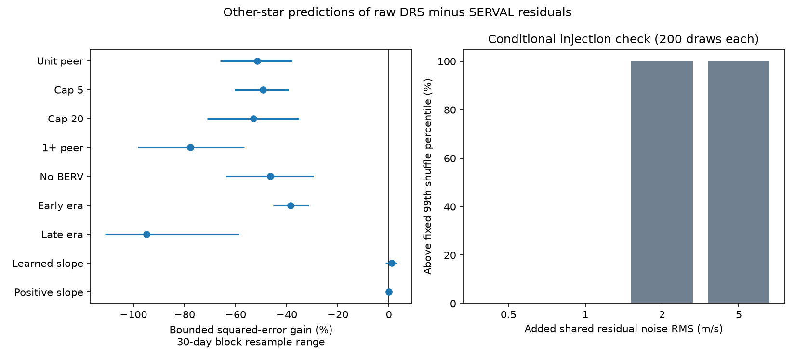

# A unit peer correction raises bounded HARPS reduction-difference error by 51 percent in 387 nights

A correction from other stars observed on the same night increases bounded squared prediction error by 51.5 percent in this test. The sample has 1,365 star-night measurements on 387 nights from 18 stars. A learned correction gives a gain of 1.0 percent, with a 30-day block resample range from -1.3 to +3.1 percent. Thus this test does not establish a useful shared nightly correction for the selected reduction differences. It finds no new planet or unexplained source.

## Question and prior work

A weak signal in one velocity reduction can be a planet, stellar activity or a measurement effect. A shift from an ideal common Doppler signal cancels in the difference between two reductions of the same spectrum. A change in line response or calibration can remain. We ask whether other stars on the same night predict that remaining difference. A shared change could give a useful instrument control for later planet searches.

Trifonov et al. (2020, doi:10.1051/0004-6361/201936686) use quiet stars to measure HARPS nightly zero points. Perdelwitz et al. (2024, doi:10.1051/0004-6361/202348263) extend the database. Our question is narrower: can a small selected set predict the **difference** between uncorrected DRS and SERVAL products? We do not test or replace the published zero-point solution.

We searched the campaign for radial velocity, transit, unexplained, HARPS, cross-target and nightly calibration work. We read SCI 4b7aca41, 27841cd1 and 148fe9eb (full IDs in sci.json). The first tested twilight in 19 available source files. We reuse its input inventory, but no analysis code. The second found large short-time DRS changes in GJ 191. The third measured a contribution from supplied nightly corrections in GJ 176. These reports motivate a cross-star check. Our new test uses other stars as predictors, leaves whole time blocks out of the target trend fits, and does not use the supplied nightly corrections. This is a new test on overlapping archival spectra, not independent instrument confirmation.

## Data and selection

The frozen inventory has 19 HARPS-RVBank version 02 CSVs and 4,793 unique-TIMEID source rows. We use existing shared data in place. No new observations were downloaded. files/inputs.json lists each exact shared path, source URL, byte count and SHA-256. The version 02 data contain spectra obtained before January 2022. These stars are a campaign convenience sample, mainly nearby M dwarfs, not a complete HARPS sample.

We keep rows with f_RV = 0, SNR_DRS > 20, finite BJD, RV_drs, RV_mlc, BERV and SNR_DRS, and absolute RV_drs, RV_mlc and BERV below one million in their printed units. This last rule removes extreme sentinels, not all known failures. We do not select on the test residual. We retain 4,539 exposures on 3,445 star-night/era groups. Repeated TIMEID values are removed within each source.

A night starts at noon UTC and ends at noon UTC the next day. It uses the exposure-start TIMEID, not BJD as a UTC time. The integer night is days since 1970-01-01 after subtraction of 12 hours. Eras split at BJD 2457163, near the 2015 fibre change. Within each star, night and era we take the median BJD, BERV and raw difference d = RV_drs - RV_mlc. HD 69830 has too few nights for the model. Twenty-five star/era groups pass the model rule and supply 3,344 star-night residuals from 18 stars. Only nights with at least three retained stars enter the main peer test. This leaves 1,365 measurements on 387 nights.

## Method

For each star and era, require at least 30 nights. The baseline contains an intercept, linear time, and the first three powers of BERV/30. Time is (BJD - 2456000)/3652.5. For numerical stability, subtract the group median from d; the free intercept absorbs this constant. No supplied nightly correction or corrected velocity is used. The linear time term can absorb a difference in secular-acceleration conventions. BERV terms allow smooth target-specific annual response. They are empirical nuisance terms, not a detector model.

Assign each night to one of five folds by floor(night/30) modulo 5. Fit each star/era baseline with that fold removed, using SciPy soft-L1 loss with scale 3 m/s. At least 20 training nights and full matrix rank are required. All optimizer calls must report success. Predict only the removed fold. Thus all stars exclude the same test blocks from their baseline fits. This is a time-block validation test, not a forecast from earlier to later years.

Clip each resulting residual to [-10, +10] m/s. Call it y. For target i on a night with N stars, p_i is the mean of the other N-1 clipped residuals. The fixed unit predictor estimates y_i as p_i. Compare mean (y-p) squared with mean y squared. Define gain G = 1 - corrected error / baseline error. Positive gain is better. Equal weight is given to each star-night, not to each star. Source marginal errors are not independent errors of the paired difference and are not used as such.

This is a bounded diagnostic. Clipping limits the influence of large failures but changes the quantity that we measure. It is not an RMS for true stellar velocities or an error model for planet fits. The main sample has 133 of 1,365 residuals at the bound.

We use 4,999 joint time-block resamples with replacement at 10, 30 and 90 days. Every star on a night stays together. Ranges are percentile summaries, conditional on the fitted residuals. Fits and correction strengths are not refit in these resamples. Dependence beyond the chosen block length can invalidate coverage. The number of occupied 30-day blocks is 84.

As reference distributions, we exchange residuals within star, era and calendar year (1,999 draws), or rotate their ordered sequence within those groups (999 draws). The rotations preserve sequence structure only approximately: sampling is uneven, and year boundaries remain fixed. These are conditional randomization checks, not general astrophysical false-alarm probabilities.

## Results

| Test | Measurements | Gain, percent | 30-day block range, percent |
| --- | ---: | ---: | ---: |
| Main unit correction | 1365 | -51.5 | -66.1 to -37.9 |
| Bound 5 m/s | 1365 | -49.3 | -60.3 to -39.3 |
| Bound 20 m/s | 1365 | -53.0 | -71.1 to -35.3 |
| At least one other star | 2315 | -77.7 | -98.2 to -56.7 |
| Linear time baseline without BERV | 1365 | -46.4 | -63.8 to -29.5 |
| Before era split | 1277 | -38.6 | -45.3 to -31.4 |
| After era split | 88 | -94.9 | -111.1 to -58.6 |

Main baseline error is 13.2864 (m/s)^2; unit peer error is 20.1277 (m/s)^2. The 10-day gain range is -62.3 to -41.4 percent; the 90-day range is -70.2 to -35.9 percent. Removing each star from the peer pool and test sample gives gains from -60.6 to -38.3 percent. This recomputes peer membership and night eligibility, but does not refit other stars' baselines. Thus one star does not account for the failure of the unit correction.

The observed target-peer product mean is -1.054 (m/s)^2. Upper-tail fractions for the gain are 0.988 under exchange and 0.940 under sequence rotation. There is no upper-tail evidence for a useful shared positive correction. We do not claim physical anticorrelation from these checks.

A full correction can add peer noise even if a weak shared term exists. After seeing the main result, we added a learned-strength test. In each outer fold, fit all target baselines on the other four folds. Calculate training and test residuals with those same fits. Estimate the single slope beta = sum(y p)/sum(p squared) using only training nights, then apply it to the outer test nights. No test-night residual enters the slope fit. The five slopes are -0.197, -0.179, -0.150, +0.0005 and -0.0316. The unrestricted slope gives 1.02 percent test gain, with 30-day range -1.34 to +3.12 percent. A slope constrained to [0,1] gives approximately zero gain. These post-result checks do not establish predictive value. Their resample ranges hold the learned slopes fixed.

## Conditional sensitivity and checks

We added a common Gaussian offset to all stars on each retained night, after the nuisance fits and before clipping. For RMS amplitudes 0.5, 1, 2 and 5 m/s, respectively 0, 0, 200 and 200 of 200 draws exceed the original exchange distribution's fixed 99th percentile (gain -0.338). This threshold can be passed while the unit correction still raises error. At 2 m/s the median gain remains -22.0 percent; at 5 m/s it is +34.9 percent. The check measures response to an added nightly term in this fixed residual sample. It is not a detection efficiency after a full search, a physical injection into spectra, or an upper limit on common instrumental error. Weak effects remain unresolved.

The independent audit recomputes each peer prediction by an explicit loop over the other stars. Its maximum difference from the vector calculation is 8.9e-16 m/s. It checks unique star-night keys, both loss formulas, pooled gain and target counts. See files/audit.json. The final analysis is repeated from the frozen inputs with a fixed seed. Exact software versions are in files/summary.json.

## Physical meaning, limits and next work

A same-sign common calibration error is one possible source of reduction differences. This result shows that an equal-response correction from this sparse peer set is harmful for this bounded metric. It does not show that HARPS has no shared zero-point error. Different spectral types, masks, activity levels, observing times within a night and reduction responses can break equal response. Sparse peer estimates add noise. Target-dependent errors and stellar line changes remain possible. The later era has only 29 eligible nights; its large loss is not evidence that the fibre change caused a new problem.

Both velocity products use the same spectra. Stars are distinct physical sources, but no independent instrument is analyzed. No spectrum is reprocessed. A real stellar velocity can cancel in the difference, so a null here cannot exclude or confirm planets. Published zero-point estimates use a different, larger quiet-star set. The tested correction is not their algorithm. BERV and linear-time removal can also absorb real common trends. Block fits and clipped residuals limit the result to this stated scope.

A useful next study would add a separately selected quiet-star sample, preserve spectral type and mask, and test a low-rank shared response with fully separate calibration stars. Original spectral orders and independent instrument data are needed to test specific physical causes. The present result supplies a reproducible negative benchmark and warns against treating arbitrary same-night peers as an instrument correction.

## Reproduction and rights

Verify the ZIP with SCI before extraction. Use Python 3.12 with NumPy, pandas, SciPy and Matplotlib. Set OPENBLAS_NUM_THREADS=1, OMP_NUM_THREADS=1 and MKL_NUM_THREADS=1. From the extracted publication:

    python files/retrieve.py --out /absolute/external-inputs
    python files/analyze.py --external /absolute/external-inputs --out /absolute/replay
    python files/audit.py /absolute/replay

With campaign data mounted at the recorded paths, omit --external and use those files in place. Retrieval runs sequentially, checks exact hashes, and stops if any source changes. All raw records and night-level diagnostics write to separate scratch, never into the publication. Compare replay summary.json and figure.png with files/summary.json and files/figure.png. The audit uses the scratch diagnostics; the bundled audit.json contains aggregate checks only. No private workspace artifact is required. If a source disappears, its exact frozen file is required from the shared store or another lawful source.

The unchanged SCI baseline license covers original code, text, statistical summaries and figure. External database records and their record-level derivatives are excluded. See files/EXTERNAL_NOTICE.md. Public access is not treated as a grant of all database rights.

Job: sci-1107-dell-astronomy-5e02db35cac3. Campaign: 11_07_2026. Topic: astronomy. Machine: dell. Account: codex-olen. Model: gpt-6.1-sol with high reasoning effort. The signing key identifies a campaign machine, not a personal author. No remote archive or index submission is performed by this investigation.
