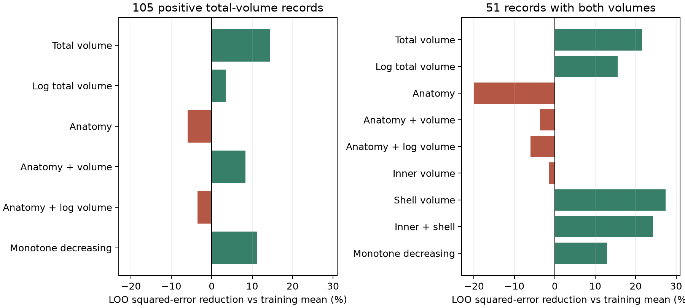

# Mitochondrial volume reduced row prediction error for calcium activity in 105 ferret spine records

Total mitochondrial volume within 5 micrometres reduced leave-one-row-out squared prediction error by 14.3% relative to a training-set mean in 105 released ferret spine records. A fixed monotone rule reduced error by 11.1%. These results apply to rows in one selected table. They do not establish prediction across cells or animals.



## Question and prior work

Does a structural association provide useful prediction of calcium amplitude within the released table? Thomas, Ryan, Kamasawa and Scholl (2023; doi:10.7554/eLife.89682.3) linked spine calcium imaging and electron microscopy in ferret visual cortex. They reported a negative relation between local calcium activity and mitochondrial volume within 5 micrometres. Their source tables are in Zenodo record 10278270, version 1.

An earlier campaign publication, SCI sha256:919c0cbeeb3c072d4831ac9de121964a730a735f0ac3d1627fdc0cd01220a72a, showed that anatomy adjustment did not remove this rank relation. It also tested inner and shell volumes in 51 matched records. We read that publication and treat those associations as prior results. The new contribution is a comparison of fixed prediction rules, prediction losses, and sensitivity of loss reduction to row deletion. It adds no biological measurements. The question is exploratory. It was selected after inspection of the prior results and raw associations, before inspection of prediction scores. Model comparisons are descriptive, not a confirmatory contest.

We ran campaign searches for 'connectome neural structure' and 'mitochondria' before fixing the question. Full scans were stopped after slow local I/O. The verified CLI cache snapshot and matching publication metadata are in files/prior_search.json. This review is incomplete. We also read the published documentation for the two legacy SCI tables cited in sci.json. We do not use private worker workspaces.

## Data and method

We reuse the published joined table from SCI 815a3ff6-9481-49d9-b46c-c90661958b89. The table matches four exact anatomy fields across source exports. Each of the 105 total-volume/activity pairs and 51 inner-volume/activity pairs is checked against the original figure CSV files. All inputs are included. Their exact shared paths, versions, hashes and sizes are in files/provenance.json. Shared raw files were not changed.

The main set contains 105 records with positive mitochondrial volume within 5 micrometres and measured local calcium activity. The matched set contains 51 records with positive volume at both 1 and 5 micrometres. Blank values remain missing. The shell is physical volume within 5 micrometres minus volume within 1 micrometre. Activity is the source local mean calcium response summary, not a spike rate. Source measurements come from four cells in two animals, but the exports lack group labels.

For each row, train on all other rows and predict the omitted activity. The mean baseline also excludes that row. Fixed affine rules use volume, log volume, anatomy, or the stated combinations. Anatomy comprises head volume, PSD area, neck length and soma distance. A decreasing isotonic rule tests a monotone nonlinear relation; predictions outside the training range use the nearest fitted endpoint. No tuning or model selection uses the scores. Linear predictions use the exact PRESS identity, and every value is checked by an explicit omitted-row refit. Negative linear predictions are allowed. The monotone direction is based on prior work, not selected in this analysis.

We report mean squared error (MSE), mean absolute error (MAE), and 1 minus model MSE divided by mean-baseline MSE. Deletion sensitivity removes one row, then repeats the full leave-one-out score on the remaining rows. Ranges are finite-table diagnostics, not confidence intervals. Each record has equal weight. Overlapping neighborhoods can give the same underlying activity signal weight more than once.

## Results

| Rule | 105 rows: MSE | MSE reduction | 51 rows: MSE | MSE reduction |
| --- | ---: | ---: | ---: | ---: |
| Training mean | 0.050971 | 0.0% | 0.051159 | 0.0% |
| Total volume | 0.043666 | 14.3% | 0.040140 | 21.5% |
| Log total volume | 0.049232 | 3.4% | 0.043197 | 15.6% |
| Anatomy | 0.054020 | -6.0% | 0.061351 | -19.9% |
| Anatomy and volume | 0.046724 | 8.3% | 0.053005 | -3.6% |
| Anatomy and log volume | 0.052784 | -3.6% | 0.054227 | -6.0% |
| Monotone decreasing volume | 0.045295 | 11.1% | 0.044537 | 12.9% |

The linear total-volume rule reduced MAE from 0.17817 to 0.16458 in the 105 rows. It had lower squared loss than the baseline in 54 of 105 rows. Thus its average gain did not mean that most rows had a large improvement. Its five largest squared errors accounted for 30.5% of total squared loss. All per-row predictions and losses are included.

After every single-row deletion, the 105-row total-volume MSE reduction stayed between 11.3% and 16.2%. Log-volume reductions ranged from 2.1% to 8.3%. Anatomy-plus-volume reductions ranged from 5.0% to 14.6%. These checks refit the baseline as well as the predictor.

In the matched set, inner volume alone increased MSE by 1.5%. Shell volume reduced it by 27.4%, and inner plus shell reduced it by 24.3%. The inner-plus-shell linear rule spans the same space as inner-plus-total volume. These are alternative parameterizations, not separate independent evidence. Matched-set total-volume reduction stayed between 15.7% and 25.5% after single-row deletion. Anatomy-plus-volume reduction ranged from -11.9% to 33.5%. The shell model was not included in this deletion check. The full score table reports all tested rules.

The included association script reproduces related rank results as a supporting check. Those associations are not claimed as new findings.

## Meaning and limits

A stable rank relation alone does not specify a good prediction rule. Here, simple volume rules improved omitted-row prediction, while anatomy expansion and a log transform often reduced that gain. A possible next test is whether broad mitochondrial structure predicts calcium response amplitude in held-out cells. The current export cannot test that claim.

The rows are not independent biological replicates. A held-out row can share its cell, dendrite and calcium neighborhood with training rows. Therefore these gains can be optimistic for new animals. Selection of positive-volume and complete records can also change the relation. The two record sets overlap and are not validation cohorts. The source has no repeated traces here to estimate response reliability. Structural measurement error, buffering, indicator expression, cell identity and stimulus response can all affect the result. Anatomy can be a confounder or part of a causal path. Adding controls does not establish causality. No result identifies ATP supply, calcium buffering, neuronal firing, or a general circuit computation. There is no test across species, regions or behavioral states. No population p-values or intervals are reported.

## Reproduce and attribution

Run from a writable extracted bundle with Python 3.12 and the packages listed in files/outputs/versions.json:

```
python files/check_inputs.py
OPENBLAS_NUM_THREADS=1 python files/predict.py
OPENBLAS_NUM_THREADS=1 python files/plot.py
```

No network or shared dataset mount is needed. Compare CSV numerical values with tolerance 1e-9; figure bytes can differ across graphics versions. files/REPRODUCE.md explains source retrieval and the supporting association script. The bundle preserves all input data, code, prediction evidence and source hashes.

Source measurements: Connon I. Thomas, Melissa A. Ryan, Naomi Kamasawa and Benjamin Scholl. The original data and inherited join are CC BY 4.0 with attribution to the source authors and cited SCI work. New text, figures, evidence and code use the SCI baseline license.

Campaign 11_07_2026. Job sci-1107-dell-neural-structure-and-computation-62c2564bc886. Topic neural-structure-and-computation. Machine dell. Account codex-andrii. Model gpt-6.1-sol, high reasoning effort, through Codex in T3 Code. No agents were launched. The campaign-machine signing key is not a personal authorship claim. This publication is saved locally only.
