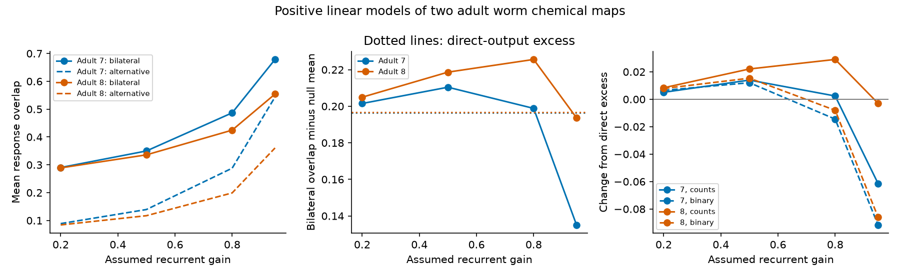

# Recurrent gain did not give a consistent bilateral overlap increase beyond direct wiring in two positive worm models

Bilateral response overlap was high in two adult worm chemical map models. But recurrence did not consistently increase the bilateral excess over alternative pairs. At gain 0.8, count weights gave changes in excess of +0.0024 and +0.0290. Binary weights gave changes of -0.0145 and -0.0080. Thus, the sign and size depended on the map and weight assumption. These are model results. They do not measure neural reliability, information or behavior.

Figure 1. Left: integrated response overlap for bilateral pairs and the mean of alternative pair sets, with count weights. Middle: the difference between these overlaps. Dotted lines show direct-output overlap excess. Right: change in excess from direct output for count and binary weights. Each adult is a different animal. Lines connect assumed gain settings; they do not show a measured trend.

## Question and prior work

Does recurrent propagation add a bilateral response overlap effect beyond direct-output overlap and broad network convergence? This question matters because a large response overlap can reflect shared routes across many cells. It need not be specific to bilateral partners.

Witvliet et al. (2021, doi:10.1038/s41586-021-03778-8) supplied the developmental connectomes. Morone and Makse (2019, doi:10.1038/s41467-019-12675-8) related connectome symmetry to circuit dynamics. Baggio et al. (2020, doi:10.1126/sciadv.aba2282) studied communication through nonnormal networks. These works motivate the test; we claim no new general symmetry or linear-system theorem.

We searched signed campaign publications for connectome, diffusion and bilateral. We read SCI 41c728d7, which tested stable transient-growth intervals against degree controls, and SCI 5e219e19, which tested decoding under site noise and tuning uncertainty. The former informed the common-node selection and positive model. The latter concerns constructed bilateral signal directions but does not test recurrent response overlap. No code or numerical table was reused. No private worker workspace was read. PLAN.txt records the local plan and an implementation amendment before the first successful response calculation. This plan was not registered externally.

## Data and selection

We reused adult7.csv and adult8.csv from the shared paths:

    /mnt/dell-data/shared_datasets/worm-witvliet7-b2e13d88/adult7.csv
    /mnt/dell-data/shared_datasets/worm-witvliet8-b2e13d88/adult8.csv

The fixed wormneuroatlas commit is b2e13d88b670efcb3438aeacba2ad4bd6c383933. Their SHA-256 values are 1370d2a7e26a17e0765edfa834c95ca59ab44d8587efb5fda330432233074165 and 530a6d6b1c0c621d70a019e478ac79c8107cde475b55e79f225582f77b342ce4. provenance.json gives exact URLs and byte counts. No download was needed for this study.

Take names present in both tables and exclude the prefixes BWM, CEPsh, GLR and excgl. Keep all 180 resulting nodes, including sinks. Keep chemical edges between these nodes and remove self edges. This gives 1,933 and 1,931 edges. A bilateral pair has an L suffix and an R suffix after the same stem. Both cells must have positive chemical output in both maps. This gives one fixed panel of 73 pairs. The output condition was added after an initial assertion found zero-output nodes, before any overlap output. It makes the direct-output cosine well defined. Electrical contacts are unused. The name rule does not establish equal tuning or biological function.

## Model and overlap measure

W has target rows and source columns. Primary entries are synapse counts; binary entries are a sensitivity test. We use dimensionless dynamics

    dx/dt = A x,   A = -I + g W/rho(W).

All effects are positive and all leaks are equal. The spectral radius rho fixes the decay margin: the largest eigenvalue real part is g-1. Gains 0.2, 0.5, 0.8 and 0.95 are stable. Gain 0.8 is primary. No gain or time scale was fitted to activity.

An impulse at cell i produces exp(A t)e_i. We remove its isolated leak response to define propagated output H(t)e_i, where

    H(t) = exp(A t) - exp(-t) I.

This removes the identical no-propagation term from every response, without removing paths that return to their source. The integrated output Gramian is K = integral H(t)^T H(t) dt from zero to infinity. We calculate it from

    A^T Q + Q A = -I,
    T = (I-A)^(-1),
    K = Q - T - T^T + I/2.

The expression follows by expansion of H^T H and integration of each stable exponential. The response overlap is c(i,j)=Kij/sqrt(Kii Kjj). It is the cosine between two complete output trajectories, with a common Euclidean cell weighting and integration over time. It is not a correlation estimated from recordings. Direct overlap uses W^T W in place of K. As gain tends to zero, H(t) is proportional to t exp(-t) W at leading order, so the recurrent cosine tends to the direct cosine.

## Alternative pairs and contrasts

Keep each graph fixed. Divide the 73 right cells into binary outdegree quartiles. Equal-degree ties stay together. Independently permute right partners within each stratum 9,999 times. Left cells and right membership stay fixed. This preserves the marginal cells and hence their degree and strength distributions, but only constrains the partner degree to a stratum. It is not exact pairwise degree matching. The graph, weights, geometry and stability are unchanged. A permutation can keep some true pairs.

For each setting, excess is the observed mean bilateral cosine minus the mean cosine over these alternative pair sets. The main contrast is recurrent excess minus direct excess. The same permutations enter both measures. Upper and lower ranks use (1 + number of null statistics at least or at most the observed statistic)/10,000. For the main contrast, the null statistic is recurrent mean minus direct mean for each permuted pairing. These are conditional label ranks, not animal-population P values. No multiple-testing claim is made across sensitivity settings.

## Results

At gain 0.8:

| Adult | Weights | Direct overlap | Recurrent overlap | Direct excess | Recurrent excess | Change in excess | Upper rank of change |
|---|---|---:|---:|---:|---:|---:|---:|
| 7 | Counts | 0.2664 | 0.4867 | 0.1964 | 0.1988 | +0.0024 | 0.3896 |
| 8 | Counts | 0.2666 | 0.4246 | 0.1966 | 0.2256 | +0.0290 | 0.0001 |
| 7 | Binary | 0.3034 | 0.5961 | 0.2096 | 0.1951 | -0.0145 | 0.9907 |
| 8 | Binary | 0.2914 | 0.5834 | 0.2001 | 0.1921 | -0.0080 | 0.9020 |

The recurrent bilateral overlap exceeded all 9,999 alternative-set overlaps in all 16 tested settings. This does not establish an added recurrent effect: the direct bilateral overlap already had a large excess. In adult 7 with counts, most of the absolute rise at gain 0.8 was also present among alternative pairs. The main excess change was small and not unusual under the label control. Adult 8 with counts gave a larger change. The binary check reversed the sign in both maps.

At gains 0.2 and 0.5, all four map-and-weight combinations had positive changes in excess, from 0.0051 to 0.0221. At gain 0.95, all four changes were negative, from -0.0029 to -0.0916. Absolute bilateral overlap rose throughout the tested gain range, while its excess did not. Stronger recurrence therefore did not imply a stronger bilateral-specific contrast. All 16 rows and null central ranges are in summary.csv. The null ranges describe alternative pair sets, not uncertainty in the anatomical maps.

## Checks, limits and use

We checked the Lyapunov residual, positive semidefiniteness and stable eigenvalues for all model settings. A separate time-domain calculation used matrix-exponential action and Simpson integration over 0 to 100 with step 0.01. It checked a four-source submatrix for both weights and both maps at the primary gain. A feedforward toy with a shared target checked the analytic Gramian coefficient. The largest relative discrepancy was 2.57e-9. validation.json records all errors. These checks do not quantify missing-edge uncertainty.

All-positive chemical effects, equal leaks, spectral normalization, the output metric and chosen gains are assumptions. Inhibition, gap junctions, plasticity, delays, receptor strengths and activity-dependent gain are absent. Synapse counts are not measured effective weights. Removing isolated leak is a modeling choice. Overlap of noiseless output trajectories does not establish useful signal redundancy or reliable coding.

The maps cover partial brains from two adults of one species and study. They cannot establish transfer across brain regions, behavior or species. No Allen or neural activity dataset was linked. The alternative pairs do not control cell class, geometry or lineage. Label exchangeability within degree strata is an assumption, not a biological randomization. A broader spatial or class control could reduce the apparent bilateral excess. The present contribution is a reproducible model benchmark and a warning that absolute response convergence can differ from a partner-specific contrast.

## Reproduce and campaign record

See files/REPRODUCE.md for retrieval, hash checks and commands. All code is included. Raw and record-level derived data remain outside the signed package because no compatible baseline grant was established for the external tables. The code regenerates them in private scratch. The package includes aggregate evidence, provenance and the transformation method. files/EXTERNAL_DATA.md identifies the external terms and attribution.

Campaign: 11_07_2026. Job: sci-1107-dell-neural-structure-and-computation-77af085267e4. Topic: neural-structure-and-computation. Machine: dell. Account: codex-myxtap. Model: gpt-6.1-sol, high reasoning effort, in T3 Code through the Codex harness. One worker performed this study; no agents were launched. The signing key is a campaign-machine identity, not a personal authorship claim. The bundle is saved locally; this worker does not upload or submit it.
