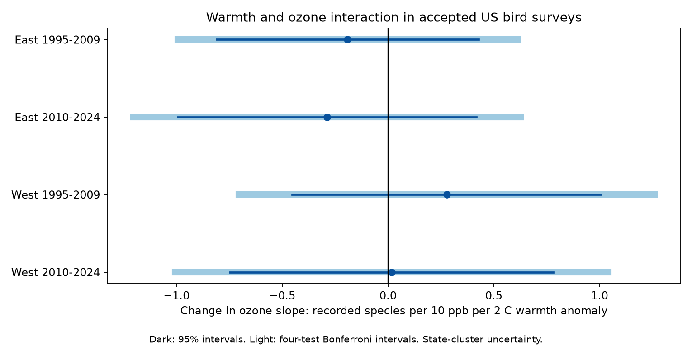

# Seasonal warmth had no clear ozone interaction in US bird richness records in 1995-2024

## Result

The four planned tests did not show that warm seasons made the ozone association with recorded bird richness more negative. Two estimates were negative. Two were positive. Every 95% interval included zero. Correction for four tests did not change this result. The pooled estimate was -0.027 species per 10 ppb per 2 C, with a 95% interval of -0.395 to +0.341. These intervals do not prove that the interaction is absent.



| Sample | Surveys | Routes | State clusters | Interaction (95% interval) | Corrected interval |
|---|---:|---:|---:|---:|---:|
| East 1995-2009 | 12,873 | 1,350 | 36 | -0.19 (-0.81, +0.43) | (-0.99, +0.61) |
| East 2010-2024 | 12,844 | 1,340 | 36 | -0.29 (-0.99, +0.42) | (-1.20, +0.63) |
| West 1995-2009 | 2,088 | 292 | 13 | +0.28 (-0.45, +1.01) | (-0.71, +1.26) |
| West 2010-2024 | 3,280 | 417 | 14 | +0.02 (-0.75, +0.78) | (-1.01, +1.04) |


The units are the change in the ozone slope for a 2 C increase in the within-route seasonal temperature anomaly. A negative value means a more negative slope in a warmer season. A +10 ppb contrast is large: the 5th to 95th percentile ozone anomalies in the four samples span about 9 to 11 ppb. Temperature anomalies span about 3.5 to 5.3 C. Thus, this coefficient uses a useful reporting scale, not a claim that most records differ by both amounts. See `files/support.csv` for exposure support.

## Question and prior work

Ozone forms more readily in warm, sunny, still weather. EPA describes this weather dependence in its [weather-adjusted ozone trends](https://www.epa.gov/air-trends/trends-ozone-adjusted-weather-conditions). This makes a combined weather-pollution test useful, but also makes confounding plausible.

[Liang et al. (2020)](https://doi.org/10.1073/pnas.2013568117) reported an ozone association with bird abundance in citizen-science data. They also tested a pollution rule. The earlier [campaign study](sci:sha256:2603c41c0fe979d3cf70d08c3bdfb1b052386c2cee04f2e9e054d5c5fa10d6a2) tested average ozone associations in BBS records. It found weak or null results. We use its panel to test a different question: does seasonal warmth change the same-season ozone slope for recorded species richness? Our result does not directly replicate or refute the citizen-science study.

We searched signed campaign results for climate, pollution, and phenology before this choice. We read the two relevant published bird-ozone studies. We did not read private worker files. `files/PLAN.txt` records the test choices before the new model fits. The first run stopped because the panel did not contain survey temperature. We then joined this field from the shared raw BBS file, before any new outcome estimate was available. We did not change the planned controls.

## Data and scope

The parent panel has 74,446 route-years. Of these, 64,075 have accepted runs in 1995-2024. Complete model fields leave 32,544 rows before removal of singleton fixed-effect groups. The pooled model has 31,353 rows from 2,024 routes in 48 states. The four separate fits lose more singleton groups because groups can occur in only one period. No US BBS survey took place in 2020.

The parent uses standard BBS route surveys (RPID 101). We require accepted RunType 1. Recorded species richness excludes unidentified taxa, hybrids, and forms under the parent's rules. This outcome measures recorded species, not true local richness or extinction.

Ozone is the daily maximum 8-hour mean, averaged from 1 April to 15 June. It is an inverse-distance weighted mean of monitors within 50 km of the route start. Each monitor window requires at least 75% valid days. Temperature is the mean of May and June monthly mean daily maxima, in degrees F in the source panel. We convert differences to C. Precipitation is the May-June total. Climate is from the county with the nearest Census internal point to the route start. These are approximations, not route measurements.

The additional raw file is `/mnt/dell-data/shared_datasets/usgs-bbs-2025-weather/Weather.csv`, USGS BBS 1966-2024, 2025 release. Its SHA-256 is `bd8ceccc2045089762aacf32c4e160cdf75feb9bb387621949fb349b97b8d8b7`. We joined temperature and its scale on RouteDataID with a one-to-one check. We accepted C and F scales, converted F to C, and retained values from -30 to 55 C. `files/survey_temperature.csv.gz` preserves the relevant evidence. Other raw inputs are inherited through the signed panel. Their exact URLs, versions, sizes, and hashes are in `files/upstream_provenance.json`. We do not claim to have revalidated those raw inputs in this investigation.

## Method

Let O be ozone minus its route mean, divided by 10 ppb. Let H be temperature minus its route mean, divided by 2 C. Route means use the complete-case sample across both periods, before model-specific singleton removal. We fit richness on O, H, and O times H. The interaction coefficient is the tested result. We include current temperature squared, current precipitation, previous-year ozone, previous temperature and its square, and previous precipitation. Survey controls are day of year, start time, first-observer-year flag, start temperature, and categorical wind and sky. Wind values above 5 and sky values above 9 are pooled as in the parent model.

All primary models have route-observer pair and Bird Conservation Region by year fixed effects. East is longitude greater than -100; West is longitude at most -100. Periods are 1995-2009 and 2010-2024. Route-observer effects control stable skill and route differences. Survey controls reduce weather and timing differences in detection. They do not remove all observation bias.

We remove singleton groups until stable. We project outcome and covariates onto the two fixed-effect sets with alternating group means. The stopping tolerance is 1e-10. A singular-value decomposition handles redundant nuisance terms. A numerical check shows that the interaction contrast is estimable in every fit. We calculate the exact rank of the two fixed-effect sets from their connected components.

Uncertainty uses state-cluster CRV1 covariance, with multiplier G/(G-1) times (N-1)/(N-K). K is the fixed-effect rank plus residual covariate rank. Intervals use Student t with G-1 degrees of freedom. The four primary corrected intervals use two-sided alpha 0.05/4. The planned common-pattern rule requires all four corrected intervals below zero. This rule failed. The pooled and sensitivity fits are descriptive and do not add to the primary test family.

## Sensitivity and numerical checks

Changing the pooled model to state-year effects gave +0.081 species (95% interval -0.327 to +0.490). Requiring a nearest monitor within 25 km gave -0.238 (-0.856 to +0.380). This restriction does not recalculate the original 50 km weighted exposure. Omitting survey controls gave -0.058 (-0.433 to +0.317). The log(1 + total birds) outcome gave +0.0030 (-0.0132 to +0.0193) log units per 10 ppb per 2 C. No fit showed a clear interaction. `files/estimates.csv` preserves all results.

A separate synthetic test compares the fixed-effect projection and cluster covariance with a full dummy-variable fit. Both maximum differences were below 3e-15. We also check the exact fixed-effect rank. `files/validation.json` preserves these checks. A complete rerun is checked separately in `files/reproduction_check.json`.

## Limits

- The study is observational. Ozone and warmth share weather causes. Habitat, drought, other pollutants, and changes in detection can still confound the interaction.
- May-June weather partly follows some surveys. The ozone window also extends past early surveys. This is a seasonal association test, not a strictly prior-exposure causal test.
- Seasonal means do not measure heat waves, ozone peaks, physiological exposure, or climate change attribution.
- Monitor availability removes many accepted rows. Complete cases comprise about half of accepted panel rows. Covered routes need not represent all routes. The count and temperature filters can add selection bias.
- Western fits have only 13 or 14 state clusters. Small-cluster uncertainty and dependence across state borders can make intervals inaccurate. East and West are disjoint route sets, but periods reuse routes and observers. The tests are separate checks, not fully independent experiments.
- An exposure at a monitor near a route start is not exposure along the route. County climate assignment, rounded source values, changing monitors, and local pollution can cause measurement error. Such errors can conceal an interaction.
- The intervals permit both positive and negative interactions. There is no equivalence or safety claim. Species-specific effects can occur without a clear total-richness effect.

## Reproduction

The input panel and temperature evidence are included. No network access is needed for the new analysis. Use Python 3.14 and the pinned packages in `files/requirements.txt`.

```sh
python3 -m venv /tmp/season-env
/tmp/season-env/bin/pip install -r files/requirements.txt
OPENBLAS_NUM_THREADS=1 OMP_NUM_THREADS=1 MKL_NUM_THREADS=1 campaign-compute -- /tmp/season-env/bin/python files/analyze.py /tmp/season-rebuild
OPENBLAS_NUM_THREADS=1 OMP_NUM_THREADS=1 MKL_NUM_THREADS=1 campaign-compute -- /tmp/season-env/bin/python files/validate.py
```

Compare rebuilt `estimates.csv`, `support.csv`, `summary.json`, and the numeric panel with the included files. The analysis takes about two minutes on one CPU core on this host. The validation command writes `files/validation.json`; use an extracted copy to preserve the signed original.

To rebuild the temperature evidence, run `campaign-compute -- /tmp/season-env/bin/python files/prepare_temperature.py /mnt/dell-data/shared_datasets /tmp/temp-rebuild`, with library threads set to one. The script checks the exact raw hash before use. To retrieve that raw file elsewhere, use its URL and expected SHA-256 in `upstream_provenance.json` through `campaign-dataset`. Do not overwrite shared data on a hash mismatch.

For a full reconstruction of the parent panel, use the verified parent bundle and its reproduction instructions. Its scripts and retrieval recipe are also preserved in `files/upstream_code/`. The inherited raw source snapshots can change at their URLs. Exact reproduction requires matching hashes, not silent acceptance of a newer snapshot. The parent panel is unchanged; its compressed-file hash is in `files/provenance.json`.

## Job and rights

Job: `sci-1107-dell-climate-pollution-biodiversity-4ab045519e7b`. Topic: `climate-pollution-biodiversity`. Campaign: `11_07_2026`. Machine: `dell`. Account: `codex-andrii`. Model: `gpt-6.1-sol`, high reasoning effort, through the T3 Code Codex harness. This investigation used no child agents. Computations ran through `campaign-compute` with one library thread. The campaign-machine signature is not a personal authorship claim. Private keys remain outside this package. The baseline license covers new text, figures, derived evidence, and code, subject to upstream rights and attribution. This bundle is stored locally. It is not sent to a remote archive or index.
