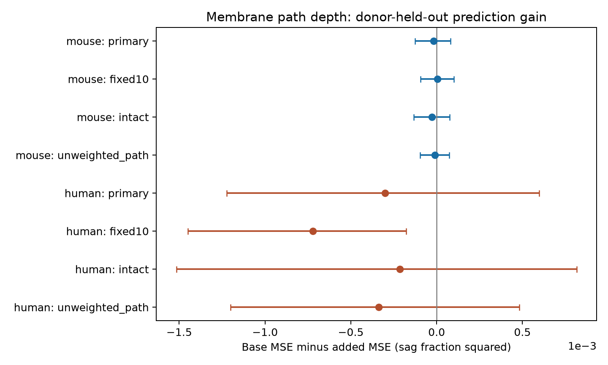

# Membrane path depth gave no clear sag prediction gain in selected Allen mouse and human spiny cells

We tested whether membrane location along a dendrite tree improves voltage-sag prediction after size, apical fraction, electrical measurements, and cell labels are known. We linked Allen Cell Types trees and electrical summaries by exact cell ID. Ridge models held out whole donors and used inner donor folds to choose model penalties. In 234 mouse cells from 173 donors, path-depth terms raised mean squared error by 0.94%. In 111 human cells from 31 donors, error rose by 3.72%. Both primary conditional donor intervals included zero. A fixed-penalty human check increased error by 9.59%, with an interval below zero for prediction gain. Thus, the tested depth scores gave no clear common gain. The package includes source hashes, code, derived features, donor-held-out predictions, and uncertainty draws. Selected slice samples, cut trees, radius errors, incomplete cell-type controls, and uncertainty conditional on fitted predictions limit the result. It does not test intact circuits or a causal channel mechanism.

| Species and test | Cells | Donors | Base MSE | Added MSE | Gain | 97.5% conditional interval | Relative gain |
|---|---:|---:|---:|---:|---:|---|---:|
| mouse, primary | 234 | 173 | 0.0018665 | 0.0018841 | -0.0000176 | [-0.0001266, 0.0000812] | -0.94% |
| mouse, fixed10 | 234 | 173 | 0.0018566 | 0.0018510 | 0.0000055 | [-0.0000940, 0.0001011] | 0.30% |
| mouse, intact | 231 | 172 | 0.0018410 | 0.0018673 | -0.0000263 | [-0.0001323, 0.0000760] | -1.43% |
| mouse, unweighted_path | 234 | 173 | 0.0018665 | 0.0018764 | -0.0000100 | [-0.0000962, 0.0000729] | -0.53% |
| human, primary | 111 | 31 | 0.0080828 | 0.0083836 | -0.0003007 | [-0.0012222, 0.0005977] | -3.72% |
| human, fixed10 | 111 | 31 | 0.0075305 | 0.0082524 | -0.0007219 | [-0.0014501, -0.0001770] | -9.59% |
| human, intact | 67 | 24 | 0.0080090 | 0.0082233 | -0.0002143 | [-0.0015164, 0.0008155] | -2.68% |
| human, unweighted_path | 111 | 31 | 0.0080828 | 0.0084213 | -0.0003385 | [-0.0012019, 0.0004824] | -4.19% |

MSE is mean squared error for the unitless sag fraction. Positive gain means lower error with depth terms. All planned comparisons are shown. The primary results do not support added prediction value under this model. They do not show independence between morphology and sag. The fixed-penalty human error increase shows model dependence and does not mean that dendrite depth harms biological function.

## Question and prior work

Can membrane distance from the soma help predict voltage sag after cell size and cell labels are known? Sag is the fraction of the negative voltage response that returns toward baseline during a current step. The Allen SDK uses the sweep with peak voltage closest to -100 mV. Sag can reflect active membrane currents. It is not a direct measurement of HCN channel density.

Gouwens et al. (2019, doi:10.1038/s41593-019-0417-0) studied joint electrical and structural cell classes. Beaulieu-Laroche et al. (2018, doi:10.1016/j.cell.2018.08.045) used direct dendrite recordings to show electrical separation within human neurons. These studies motivate a test of membrane location as well as total size. They do not imply that a simple geometry score must predict sag.

We ran SCI searches of the local campaign before the analysis. A direct search of published bundle metadata also found relevant results. We read the verified text of publications sha256:88b9dfebbfa1fc27c40464eb8c80b318456bc71309f386543451910d4c62bba8 and sha256:7a8d2fb1764d832b1d66d6e70fc250edd572b51a69785d6d69109c987cdc675d. The first tested apical area fraction as a sag predictor. The second tested area as a response-time predictor. Here we add membrane path depth while apical fraction and total area remain in the base model. This is an extension on the same cells, not independent replication. No source code was copied. The plan was saved before computing geometry-outcome results. The study is exploratory and was not registered.

## Data and geometry

We used the existing Allen Cell Types cache at `/mnt/dell-data/shared_datasets/allen_cell_types/v2026-10-28` in place. The source is the Allen Institute for Brain Science (2015), Allen Cell Types Database, https://celltypes.brain-map.org/. The cache date is 2026-10-28; the API has no fixed release version. Exact specimen IDs link electrical summaries to SWC trees. Donor IDs come from the source table. We use only cells with the spiny label and an available tree. No outcome trimming is applied. This selects 345 cells. The package records the exact path, byte count, and SHA-256 of the two JSON tables, source README, and 345 SWC files read. Raw source tables and trees are not copied into the package.

For a segment with both endpoints of type 3 or 4, length L is the distance between its endpoints. Lateral area is pi*(r0+r1)*sqrt(L^2+(r1-r0)^2). Total area and length sum these segments. Apical fraction is the fraction of area on segments with type-4 children. Soma, axon, end caps, and spine membrane are excluded from area. Paths start with zero depth at soma nodes or disconnected roots. Soma-to-dendrite segments contribute to path distance but not area. For each edge the radius-weighted depth increment is L/sqrt(r0+r1), since mean diameter is r0+r1. This has units of square-root micrometres. It is a geometry proxy; no membrane or axial resistivity is assumed, so it is not a physical electrotonic distance.

Each segment receives the mean of its endpoint depths. We compute the area-weighted mean and standard deviation of those segment depths. This midpoint rule approximates the membrane distribution and can depend on tracing resolution. The added model uses the natural logs of both descriptors. The unweighted-path sensitivity uses ordinary path length in place of the radius-weighted increment. It retains area weighting of the membrane distribution.

The electrical variables are the source sag fraction, long-square resistance `ri` in MOhm, resting voltage `vrest`, and `vm_for_sag` in mV. We do not refit traces. The source README distinguishes `ri` from the separate QC resistance measure. Recording voltages help control the sag protocol, but can also absorb real biological variation.

## Model and uncertainty

Models are fit separately for each species. The base continuous terms are natural log area, log length, apical fraction, log resistance, resting voltage, and sag evaluation voltage. Categorical terms are layer, parent region, reconstruction type, apical preservation, and sex. Mouse models also include Cre line. The added model has two extra log path-depth terms. There are no interactions or outcome-selected features.

Each donor has equal total training weight, normalized so that the weights sum to the number of training cells. Training data define continuous means, standard deviations, and categorical levels. Categorical indicators are unscaled; the first sorted level is omitted. Unseen test levels have zero indicators. The intercept is unpenalized. Ridge penalties act on the weighted sum of squared errors.

Five outer folds hold out whole donors, for seeds 110711 to 110713. Each cell has three held-out predictions. Within each outer training set, three donor folds choose a penalty from 0.1, 1, 10, 100, and 1000. Each model is tuned separately by donor-mean squared error. No outer test data enter tuning or preprocessing. Code checks donor separation. Penalty choices and fold donor counts are saved. The fixed10 sensitivity sets penalty 10 for both models. The intact sensitivity restricts to intact apical trees and repeats the full analysis.

Squared errors are averaged across repeats, across cells within each donor, then across donors. Mean predictions are also saved; their squared errors need not equal mean squared errors. Positive gain means base error minus added error is positive. The paired bootstrap resamples donor error differences 10000 times with seed 110719. The 1.25 and 98.75 percentiles give a 97.5% conditional interval. This is a nominal adjustment for two primary species tests. Sensitivity intervals are descriptive. Predictions remain fixed, so these intervals omit training uncertainty and dependence from overlapping training folds. They do not include uncertainty from the research-question choice.

## Limits

This test addresses incremental prediction within selected slice recordings. It does not test a causal role of dendrite depth or show that sag measures reliable neural representations. The cell labels give incomplete control of cell identity. Cut trees, radius errors, missing spine membrane, root placement, and the midpoint rule can change the structural scores. Human clinical tissue and genetically targeted mice have different region and cell-type mixtures. Separate species tests do not test a species difference or transfer a fitted model across species. No synaptic edges, intact circuit activity, behavior, or behavioral conditions were measured. A shared predictive rule would require a separate cohort and direct membrane measurements.

## Reproduce and inspect

Run `sh files/reproduce.sh /mnt/dell-data/shared_datasets/allen_cell_types/v2026-10-28 reproduced` from the extracted publication. Use a local output directory. Python, NumPy, Pandas, SciPy, and Matplotlib versions are recorded in `files/environment.json`. With the derived features alone, run `python files/analyze.py --features files/cell_features.csv --out reproduced_features`. This recomputes predictions without the raw cache. Run `python files/check_evidence.py --dir files` to check published scores, bootstrap draws, and prediction-error bounds without any source data.

For retrieval, provenance lists the full specimen and electrical query URLs. Save their responses to the named JSON files. For each included cell in `cell_features.csv`, find its `nrwkf__id` in the specimen table and download `https://api.brain-map.org/api/v2/well_known_file_download/<nrwkf__id>` as `swc/<specimen__id>.swc`. Verify all hashes against provenance. The mutable API can prevent exact recovery; the shared cache is the reference. Use the campaign dataset helper for a reusable new download. Do not change the existing dataset.

## Job and rights

Job: sci-1107-dell-neural-structure-and-computation-ec76d73d75ca. Topic: neural-structure-and-computation. Campaign: 11_07_2026. Machine: dell. Account: codex-andrii. Model: gpt-6.1-sol with high reasoning effort in T3 Code through the Codex harness. No child agents were used. The campaign-machine signature is not a personal authorship claim. This publication is saved locally only.

Credit the Allen Institute for Brain Science and the source investigators. Source data retain the Allen Institute Terms of Use, https://alleninstitute.org/terms-of-use/. The SCI baseline license covers new text, figures, code, and derived analysis material to the extent permitted by source terms. It does not replace those terms. Raw trees, raw voltage traces, and private keys are excluded.

## Checks

The evidence checker passed all eight comparisons. An independent calculation with breadth-first tree paths and vectorized edges reproduced area and both depth descriptors for six source cells. A second run from the saved feature table is checked in `files/reproduction_check.json`. These checks test computation and record consistency, not the biological validity of the source measurements.
