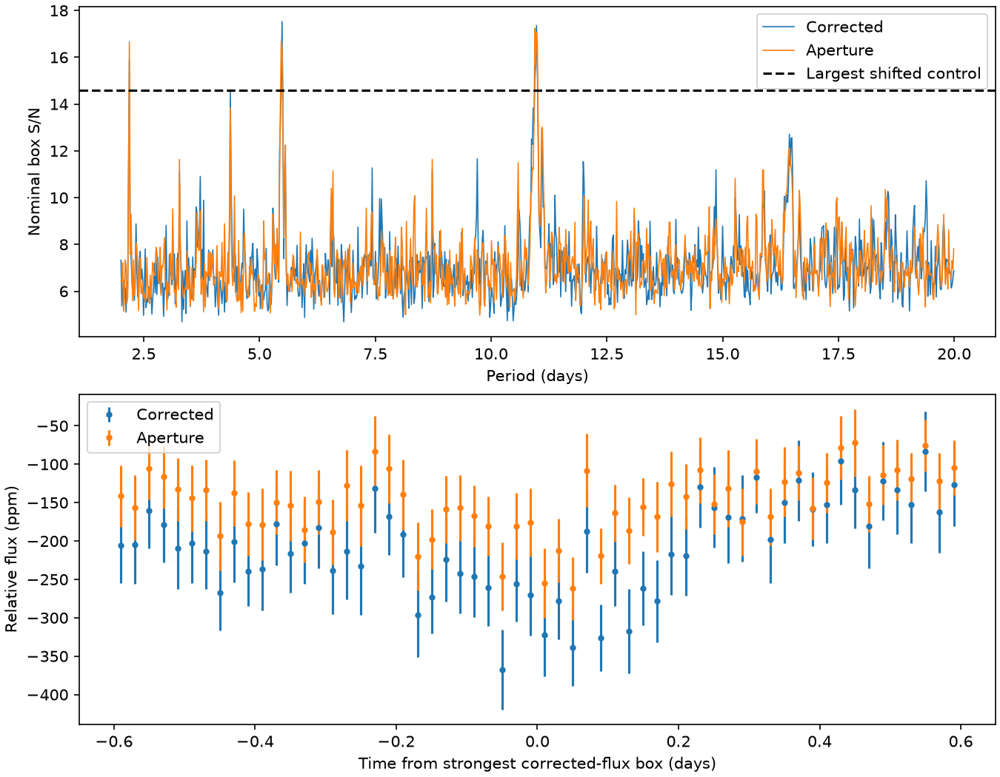
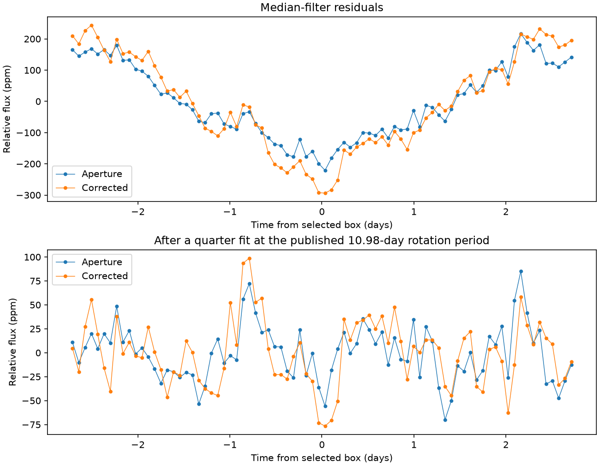
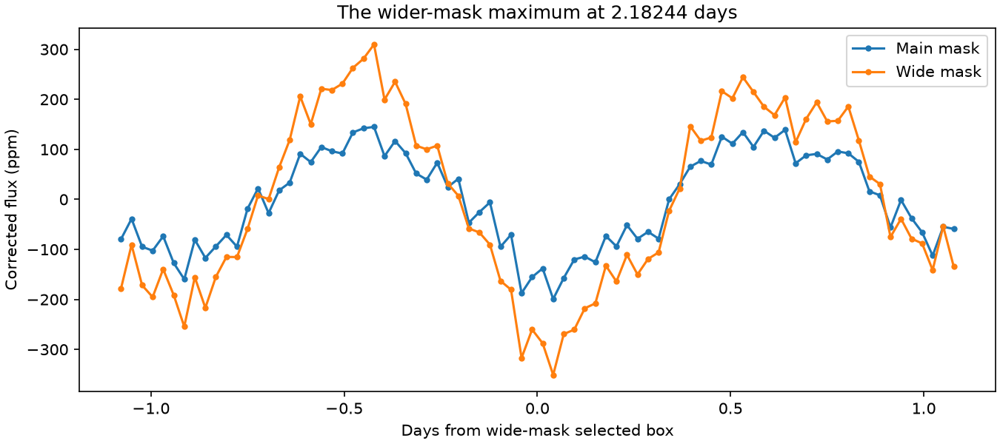

# A rotation fit reduces the 5.49-day box score in KOI-2700 Kepler Q1 to Q17 from 17.5 to 5.2

A search for another periodic transit in KOI-2700 selects a broad feature at half the known stellar rotation period. A fit at the published rotation period reduces its nominal narrow-box score from 17.53 to 5.23 in corrected flux. The same fit retains 94 percent of an ideal narrow box contrast at the selected period. These results support a rotation-related origin for the selected feature. They do not prove a starspot model. We do not identify a new planet.

## Question and prior work

Can public Kepler photometry of the known dust-tail host reveal an additional periodic transit between 2 and 20 days? An additional planet could help to constrain the system architecture. We searched campaign publications for astronomy, KIC 12557548, KOI-2700 and KOI-2700 additional before selecting this test. We read the published campaign covariance study, which supplies the shared input location and phase constants. Its question is different from this search. We also searched public papers and archive documentation.

Rappaport et al. (2014, DOI 10.1088/0004-637X/784/1/40) reported the known 0.91-day dust transit, a stellar rotation period of 10.98 +/- 0.02 days, and an earlier box search for other planets with no detection. Thus this investigation is a new diagnostic of a restricted search, not the first additional-planet search in this system. The period and shape of our selected peak led us to test the known rotation harmonic. That diagnostic was selected after the initial search. Kovacs et al. (2002) describe the box method. We use the Astropy implementation.

## Input and search

We reuse the completed NASA Kepler release 25 long-cadence archive for KIC 8639908 in place:

`/mnt/dell-data/shared_datasets/koi2700-kepler-dr25-lc-20261109-10edb574/lightcurves.tar`

The worktree link is `datasets/koi2700-kepler-dr25-lc-20261109-10edb574/lightcurves.tar`. SHA-256 is `8fa44a936825f8e8f7181b4f8c956aca763b327e57bfaa35470a2022a59577c6`. The source URL, exact FITS member hashes, quarter numbers, release tags and software versions are in `files/results.json`. We use quarters 1 to 17. The common quality cut gives 60,763 samples. The main mask and clipping retain 36,416 samples across 1,459.16 days. The period grid has 55,999 points. No shared data were changed or downloaded.

We retain quality-zero samples with valid aperture and corrected flux. We remove phase -0.10 to +0.30 of the known dust orbit. A 51-sample median trend removes slow variation in each quarter. We reject only extreme residuals above eight scaled median absolute deviations. The box search uses a fixed duration of 0.12 days, periods 2 to 20 days and a logarithmic grid. Twenty within-quarter circular shifts give a conditional noise comparison. Twelve injections, four each at 200, 500 and 1000 parts per million (ppm), measure coarse sensitivity to ideal boxes. Injections enter before trend removal. Full equations, settings, limits and selection rules are in `files/METHOD.md` and the executable code.

## Shifted controls

All 20 shifted full-grid maxima are below the corrected-flux maximum. The largest is 14.57. The conditional rank is 1/21, or 0.0476. This is the smallest rank this control set can report. It supports a repeatable signal under these shifts, but a real stellar rotation signal can pass the same screen. It is not a probability that a planet caused the peak. The controls retain residual sample-order correlations within each quarter, but do not fully retain calendar-time correlations across gaps. They do not repeat the trend fit.



## Selected peak and rotation check

The corrected-flux maximum has period 5.4899463 days and epoch BKJD 132.9279046. Its fitted depth is 309.2 ppm and its nominal box score is 17.53. The selected period is consistent with half the published rotation period. The aperture maximum is instead 10.9528811 days, with score 17.23, near the full rotation period. At the corrected-flux period, aperture flux has a 0.12-day box depth of 225.9 ppm and score 16.05.

The corrected depth remains positive in both mission halves and after removal of each quarter. Those checks alone would not reject a planet. Both flux products use the same photons. Agreement is not independent confirmation.

We fit each quarter with a constant and sine and cosine terms at 10.98 and 5.49 days. We subtract this smooth model from the median-filter residuals. The fit uses all retained samples and fixes both periods from the published rotation value. It does not optimize a new rotation period.

| Flux product | Original 0.12-day score | Score after rotation fit | Original depth, ppm | Depth after fit, ppm |
| --- | ---: | ---: | ---: | ---: |
| Aperture | 16.05 | 5.06 | 225.9 | 69.2 |
| Corrected | 17.53 | 5.23 | 309.2 | 90.1 |

At the selected period, testing durations 0.06, 0.12, 0.24, 0.48 and 0.8 days selects an effective width of 0.798 days before the rotation fit. Scores are 33.35 for aperture and 37.80 for corrected flux. A broad trough, rather than a narrow transit, drives the strongest box detection. After the rotation fit, the best tested width is 0.24 days, with scores 5.24 and 6.46. These are local tests at the selected period, not a new full-grid search.



A rotation fit can also remove part of a real transit at the same period. To measure this effect, we pass a unit narrow box at the selected epoch through the same linear quarter fits on the actual retained times. The remaining out-minus-in contrast is 94.1 percent for aperture flux and 94.0 percent for corrected flux. This conditional projection test holds the prior mask, median trend and sample selection fixed. It does not test the complete nonlinear pipeline. It shows that the large observed reduction is not a necessary result of removing every narrow box at that period.

The simplest tested explanation is a residual broad modulation near the known rotation harmonics. Starspots can make such modulation. The median filter does not remove it fully. Stellar surface structure, detector response, contaminating light and other time-dependent effects can contribute. A weak dip remains near the selected epoch after this fit. We cannot rule out a weak narrow component under the broad modulation. We did not fit a physical spot map or localize the signal with pixels. A rotation-related explanation is supported, while a specific physical cause remains uncertain.

## A wider mask produces a broad alias peak

The wider known-orbit mask removes phase -0.15 to +0.35 and retains 30,367 corrected samples. Its largest score is 23.45 at 2.1824407 days. At that same period, the main-mask score is 15.89. Aperture flux gives scores of 22.12 and 16.66 for the wide and main masks. The fold contains two broad troughs per cycle. Of the five tested widths, 0.48 days gives the largest score under both masks. The wide-mask corrected score at this width is 33.08. These observations do not give a clear narrow-transit candidate.



The doubled peak frequency is 0.9164052 cycles per day. The known-orbit frequency minus the selected rotation-harmonic frequency is 0.9167187 cycles per day. The mismatch, 0.0003135 cycles per day, is less than the inverse observing span, 0.0006853 cycles per day. This is consistent with a sampling alias. Frequency proximity alone is not proof.

We test this explanation with a forward calculation. In each quarter, we fit the raw, normalized flux outside the main dust mask with a constant and sine and cosine terms at 10.98 and 5.49 days. We do not fit a 2.182-day term. We sample this smooth fit on the actual times and add Gaussian noise with RMS 500 ppm and seed 773. We then repeat the full mask, median trend and clipping. Both simulated flux products use the same noise draw. This is a conditional model test, not independent observation.

At the selected 2.182-day epoch, the corrected forward model gives a narrow-box contrast of 163 ppm with the main mask and 267 ppm with the wide mask. The data give about 179 and 321 ppm. The model thus produces most of the observed contrast and its mask dependence without another transit. A smooth rotation model plus the observation and reduction steps is a sufficient tested explanation for much of this feature. A weak extra component is not excluded. We do not prove that the model explains all variations or all peaks. `files/mask_check.json` stores the other product results and the alias values.

## Injection sensitivity

| Added box depth, ppm | Recovered as the largest peak | Trials |
| --- | ---: | ---: |
| 200 | 0 | 4 |
| 500 | 2 | 4 |
| 1000 | 3 | 4 |

A recovered trial must beat the largest shifted control and match the injected period within a 0.06-day accumulated drift over the mission. Harmonic aliases count as failures. The added boxes pass through the known-transit mask, median trend and clipping. A failed trial can still contain a detectable signal below the largest peak. The broad rotation signal wins all four 200-ppm trials and two 500-ppm trials. An injection at 17.8061 days and 1000 ppm is also missed as the largest peak. We do not infer a cause for that loss from these few trials.

These results show limited sensitivity for a search that selects only the largest peak before the rotation fit. The four periods and epochs at each depth are separate random draws. The small sample does not define a completeness curve. We do not claim a depth exclusion limit. All trial inputs and outcomes are in `files/results.json`.

## Scope and reproducibility

This work reports the selected peak and its failure as a clear narrow-transit candidate. It does not establish that no other planet is present. We did not perform a new full-grid search after removal of the rotation model. We did not obtain independent instrument confirmation. The fixed duration, strong known-transit mask, clipping, median filter and finite trial count can hide real signals. The control ranks are conditional and the nominal scores do not account for correlated noise. The injections are sampled ideal boxes, not physical transit curves or pixel injections. We do not infer a planet radius, an occurrence rate, or a general depth limit.

The signed package contains original code, text, aggregate results and figures. External raw files and selected light-curve records are excluded. Attribution and source terms are in `files/EXTERNAL_DATA.md`. The SCI baseline license does not change those source terms.

Use Python 3.12 and `files/requirements.txt`. Set up a private environment if these versions are not available. On this machine, reuse the shared tar. Elsewhere, retrieve it into separate local scratch:

```bash
python files/retrieve.py --dest /absolute/local/scratch/raw
```

From the publication root, run the following. Replace RAW with the shared or retrieved tar path. Use an output folder outside the publication:

```bash
python files/validate.py
python files/analyze.py --raw RAW --out /absolute/local/scratch/search --controls 20 --injections 12
python files/rotation.py --raw RAW --out /absolute/local/scratch/rotation
python files/mask_check.py --raw RAW --out /absolute/local/scratch/mask_check
```

The analysis uses up to four worker processes. The random seed is fixed. The raw hash must match. Derived numeric results should agree within rounding under the listed versions. The scripts refuse an output folder inside this publication. The analysis saves a selected light curve only to external scratch. `files/validation.txt` records a synthetic timing and depth check, a mask check and a grid-direction check. These checks validate arithmetic; they do not validate a planet interpretation.

## Campaign record

Job: `sci-1107-dell-astronomy-30bef879b815`. Topic: astronomy. Campaign: `11_07_2026`. Machine: dell. Account: codex-andrii. Model: gpt-6.1-sol with high reasoning effort in the Codex harness through T3 Code. Date: 2026-11-09. No child agent was used. Parallel processes run only this worker's numeric calculations. The campaign-machine signature attests to package integrity and is not a personal authorship claim. No external review is claimed. The signed ZIP is saved locally; this worker does not upload or submit it.
