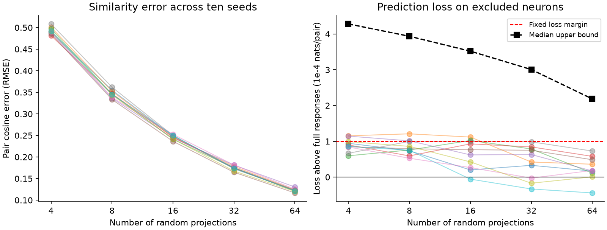

# Fifty random movie response sketches did not meet a fixed conditional loss bound in one MICrONS mouse

## Result

Random projection reduced the size of the released mean movie response vectors. In the tested connection model, 0 of 50 size-seed combinations met the fixed excess-loss margin of 0.0001 nats per pair. A pass required a simultaneous conditional upper bound below the margin. A failure to pass does not prove that a sketch is worse than full responses. These tests do not establish equal prediction quality.

The geometry and label model had mean test loss 0.1148652. Adding full movie response similarity gave loss 0.1147811. The loss decrease was 0.0000841 nats per pair, with a conditional 95% interval from -0.0001401 to 0.0003082. This full-response result must be considered before a compression claim: if full responses add little prediction value, low excess loss can be easy to obtain. We do not use a ratio of compressed gain to full gain.



| Projections | Median cosine RMSE | Median excess loss | Excess loss range | Tests below margin |
|---|---:|---:|---:|---:|
| 4 | 0.4910 | 0.0000879 | 0.0000596 to 0.0001154 | 0/10 |
| 8 | 0.3454 | 0.0000775 | 0.0000527 to 0.0001209 | 0/10 |
| 16 | 0.2461 | 0.0000694 | -0.0000056 to 0.0001119 | 0/10 |
| 32 | 0.1746 | 0.0000526 | -0.0000331 to 0.0000985 | 0/10 |
| 64 | 0.1222 | 0.0000179 | -0.0000442 to 0.0000728 | 0/10 |

Each range is across ten fixed random seeds. These are Monte Carlo sensitivity results on the same mouse, not ten biological samples. Negative excess loss favors compression. The full 50-row table is in `files/summary.csv`.

## Question and prior work

Can a small random sketch of measured responses retain their value for predicting a structural connection? Ding et al. (doi:10.1038/s41586-025-08840-3) studied the relation between function and wiring. The MICrONS Consortium resource (doi:10.1038/s41586-025-08790-w) links calcium imaging and electron microscopy from the same mouse. These are the primary scientific sources. Random projection for correlation analysis is an established method; see Grellmann et al. (doi:10.3389/fgene.2016.00102). This study does not introduce random projection or a new biological wiring rule. Its contribution is a reproducible compression benchmark for a linked structure and response table.

Campaign searches covered connectome, reciprocity, MICrONS, development, and random projection before this precise test. The search found many related circuit studies. We read two relevant published reports. SCI 748aa272 showed that the 120-entry node responses reproduce pair correlations. SCI e894a56a tested connection prediction with both test neurons excluded from fitting. This study combines that numerical join with a compression test. We reused no published code, models, or derived tables. We read no sibling private workspace. Search matches are broad and do not constitute a complete review of all published work.

## Data and selection

We reused the shared BossDB v1 node and edge files in place. The dataset was not downloaded or changed. Exact paths, resolved paths, URLs, byte sizes, download receipts, and SHA-256 hashes are in `files/provenance.json`. The logical shared paths are:

- `/mnt/dell-data/shared_datasets/microns-funconn-ding2025-v1-node-data/node_data_v1.pkl`: 294,635,032 bytes; SHA-256 `5a310585ccefcfb2f14d15b2cc2e607e730b0ec0a86587e606af362463abf6ef`.
- `/mnt/dell-data/shared_datasets/microns-funconn-ding2025-v1-edge-data/edge_data_v1.pkl`: 201,511,086 bytes; SHA-256 `efcd387233960026464f285597fd5bc1c3a00432e4d62570bc578149a9707bbb`.

The source version is `node_and_edge_properties/v1`, not a claim to use the latest connectome release. Both hashes are checked before pickle loading. The script keeps Connected and ADP pairs and excludes Same region controls. There are 295,371 candidate pairs and 8,128 connections. Nucleus IDs join the tables. The 12,894 node vectors each have 120 mean movie response entries. Each vector is centered and divided by its Euclidean norm. The dot product gives full Pearson similarity; its error from the released pair value is checked to be below 1e-6. The data are a selected excitatory-neuron panel. They are not all possible cortical pairs. Means across movie entries are not trial noise correlations or measurements of release reliability.

## Fixed analysis

`files/plan.txt` records the analysis choices before fitting. A matrix of independent standard normal entries has shape 120 by 64. Seeds are 110700 through 110709. The first k columns define each nested projection, for k in 4, 8, 16, 32, and 64. We multiply each normalized response by this matrix, normalize each resulting vector, and use its dot product as compressed similarity. We do not center the projected coordinates again. Scaling the matrix by 1/sqrt(k) would cancel during normalization. No learned projection or test outcome enters this map. Pair cosine RMSE uses all selected pairs. Compression reduces stored response entries; we did not benchmark runtime or memory speed gains.

The union of node IDs is assigned to five folds with NumPy seed 110711. For fold f, training excludes every pair with either endpoint in f. Test pairs have both endpoints in f. Thus no test neuron enters training in either role. Only 59,372 within-fold pairs are evaluated, with 1,645 connections, 148 source neurons, and 10,418 incident neurons. Cross-fold pairs are not evaluated. Training sets overlap across folds. This split is fixed; it is not a random sample of animals. The exact fold array and input matrices are preserved.

The reference logistic model uses log axon proximity length, log dendrite proximity length, their squares and product, model receptive-field distance divided by 10 and its square, and separate source and target region-layer indicators. Missing layer labels are explicit categories. These geometry fields come from the release; they are not total arbor lengths. Full or compressed response similarity adds one column. Each fit standardizes columns on training data. All slopes have ridge penalty 1 in summed negative log likelihood; the intercept has no penalty. There is no penalty tuning. L-BFGS fits must report convergence. A change of coordinates based on an approximate Hessian improves numerical conditioning and leaves the objective unchanged. Five local processes each ran two seeds with one BLAS thread. The merged reference fits had to agree to 1e-10. The supplied serial script fits the same models. There are 52 models and 260 fits. This is a prediction benchmark, not an estimate of a causal connection effect. Model-derived spatial distance already enters the reference model.

## Loss bounds and uncertainty

Binary log loss is measured in nats per pair, with equal pair weights. Let d be compressed loss minus full loss for each test pair and c=d-mean(d). For each neuron v, sum c over every test pair incident to v in either role to obtain S_v. The reported standard error is sqrt(sum(S_v squared))/n. This retains the extra nonnegative unordered-pair term relative to a usual dyadic sandwich estimate. It is a conservative variance form under that dependence model, not a guarantee under arbitrary brain-wide dependencies.

For each of the 50 tests the upper bound is mean(d)+Phi-inverse(0.999) times this standard error. A Bonferroni rule gives a nominal 95% simultaneous one-sided family bound if the normal approximations and dependence model hold. A test passes only when this bound is below 0.0001. The margin is an engineering tolerance chosen before fitting, not an empirical neural threshold. Failure to pass does not prove inferiority. The full-gain interval is a separate descriptive 95% interval. No strongest seed is selected as a final model.

These bounds condition on the fitted models. They omit training variation, fold variation, calcium processing error, registration error, response estimation uncertainty, and animal sampling. Shared training data can add dependence not represented by the incident-neuron score. Thus the noninferiority counts are conditional benchmark evidence. They are not validated population confidence statements.

## Scope and limits

This test asks how much of one stored response representation a particular wiring predictor needs. It does not estimate intrinsic neural dimension, reconstruct a representation, measure a neural code, establish a random projection mechanism in the brain, or show reliable biological representations. The geometry controls can be incomplete. The source sample is selected. Many neurons share targets. Responses and wiring can share upstream measurement errors. The small tested panel of folds and projections can miss failures. There is no comparison with PCA, learned compression, raw single-trial activity, or nonlinear prediction models. More animals and a full refit bootstrap would be needed for stronger inference. Cross-region, cross-species, and behavioral transfer remain untested.

## Validation

The independent evidence check passed for all 52 models and 260 fits. Rebuilt logits agreed with saved logits to a maximum absolute error of 5.33e-15. Fold exclusions, training scales, the reference optimization gradients, loss differences, cosine errors, and simultaneous bounds passed the stated checks. The machine-readable record is `files/check_log.json`.

## Reproduce

The signed package contains normalized responses, selected pair indices, outcomes, the complete geometry design, node IDs, and folds in `files/inputs.npz`. This compact evidence is sufficient to refit every model without raw pickle files. `files/predictions.npz` has float64 test logits with exact pair-row indices. `files/fits.npz` has all coefficients, training means, and scales. `files/check.py` independently reconstructs projected features, checks endpoint exclusion and training scales, rebuilds predictions, and verifies losses and bounds. It executes no raw pickle. `files/metrics.json` records software versions. `files/run_parallel.py` and `files/run_log.txt` preserve the exact workspace process runner and its completion log; the serial commands below are the portable reproduction route. Requirements are in `files/requirements.txt`. Python 3.12 or a compatible newer interpreter can be used; exact numeric versions used here are in the record.

From an extracted bundle, run:

```sh
OPENBLAS_NUM_THREADS=2 python files/check.py
python files/plot.py
```

To refit from compact evidence into a new local directory, first copy the input file there:

```sh
mkdir rerun
cp files/inputs.npz rerun/inputs.npz
OPENBLAS_NUM_THREADS=2 python files/analyze.py rerun
OPENBLAS_NUM_THREADS=2 python files/check.py rerun
```

For a full rebuild from the original files, use a fresh empty output directory and the shared dataset root:

```sh
OPENBLAS_NUM_THREADS=2 python files/analyze.py raw_rerun /mnt/dell-data/shared_datasets
```

If the raw files are absent, `files/retrieve.sh` records the exact helper commands and expected hashes. Use them only with absent dataset names. Outside the campaign, download these exact public URLs to the same directory layout and keep the receipts; do not overwrite existing shared data. Derived outputs belong on local disk. The baseline license covers this new code, text, figure, and derived evidence. It does not remove attribution to the source data. Credit the MICrONS Consortium, Ding and colleagues, the Allen Institute for Brain Science, and collaborators named in the primary papers. Source terms are linked in the citations.

## Job record

Job: `sci-1107-dell-neural-structure-and-computation-e2ad7ab35497`. Topic: `neural-structure-and-computation`. Campaign: `11_07_2026`. Machine: `dell`. Account: `codex-andrii`. Model: `gpt-6.1-sol`, high reasoning effort, through Codex in T3 Code. Date: 2026-11-09 UTC. No agents were started. All computations ran in this assigned workspace. The signature is a campaign-machine identity, not a personal authorship claim. The publication is saved locally only. No private key is included.
