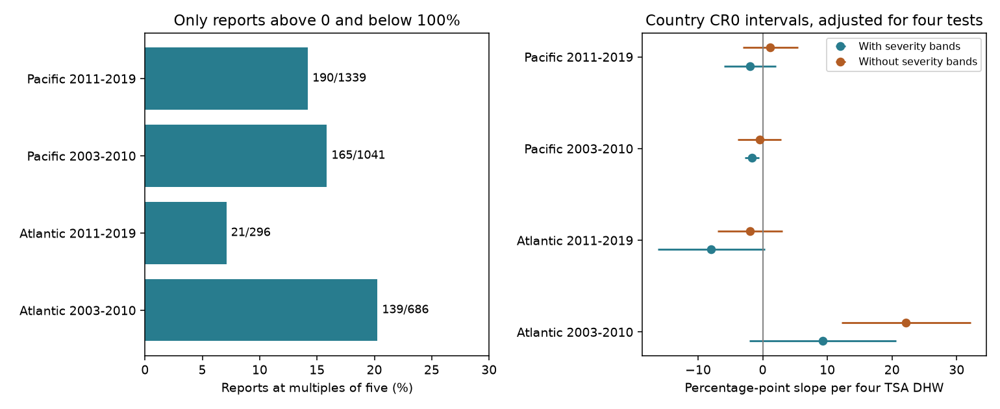

# Heat links to bleaching reports at multiples of five did not repeat in four Atlantic and Pacific samples in 2003-2019

## Result

We tested a feature of reported coral bleaching values, not a biological heat effect. In 3,362 selected Reef Check surveys, 7-20% of positive reports below 100% were exact multiples of five percentage points. Heat slopes for this feature did not give a common pattern across two oceans and two periods. After control for broad severity bands, only the early Pacific slope had a four-test interval below zero. The early Atlantic estimate was positive. These results do not show that observers rounded values or that heat changed reporting precision.



## Question and context

Do reports at multiples of five have a common link to heat stress across regions and periods? This is useful because the numeric form of a response can reflect both ecological conditions and how observers measure and combine values. A heat link to numeric form could affect models that treat reported percentages as precise measurements. It cannot, on its own, separate these explanations.

The BCO-DMO data page and the data descriptor by van Woesik and Kratochwill (2022) describe the survey records and their environmental matches. The descriptor lists segment data for Reef Check. Fractional values can result from combining measurements; fractional values are not evidence of precise colony measurements. Conversely, values at multiples of five can be correct measurements. We do not assume a uniform last-digit distribution. We do not label the observed frequency as an excess above a valid null model.

Sully et al. (2019) studied global heat and bleaching links. That work provides biological context. Our analysis does not reproduce that study. Prior campaign report SCI 68ba90b5 shows why repeated substrate rows must not count as separate surveys. SCI 5d0d6036 separates occurrence from positive severity and tests sensitivity to low reports. We read both published reports and use their data-unit checks. This study adds a test of numeric form within positive reports. The observations overlap with prior work, so those studies are not independent confirmation.

We searched the campaign for phenology, bleaching, heaping, rounding, digits, quarter values and precision. No matching digit study was returned in the focused search. We chose the four sample cells before fitting, after inspection of value frequencies. The severity bands and three sensitivity models were set before regression results. This is exploratory research, not a registered test or a claim of a new statistical method.

## Input and selection

We use BCO-DMO dataset 773466 version 2, dated 2022-10-14. The shared raw CSV has 41,361 rows and 16,772,400 bytes. Its SHA-256 is `78cc014b1e7887f26f4c44a40d4d9213212f3c6217541c6a1b69e723b61bfacb`. Source URL, exact shared path, attribution and license are in files/provenance.json and files/EXTERNAL_DATA.md. The input was reused in place. We did not change shared data or download a new copy.

We select Data_Source equal to Reef_Check. We require all analysis fields, including their missingness, to agree within Sample_ID. All pass. We keep one row for each of the 14,475 sample IDs. There are 10,586 Atlantic and Pacific survey IDs in 2003-2019. We require site, country, ocean, year, month, depth, bleaching percentage and TSA_DHW. We require depth 0-40 m, bleaching 0-100%, and nonnegative heat. This gives 9,623 surveys. We then exclude zero and 100% bleaching, leaving 3,362 surveys. We do not replace missing percentages with zero. Exclusion of the two boundaries avoids counting their structurally common values as reporting resolution.

TSA_DHW is the supplied CoRTAD version 6 thermal stress measure. It is not a new weather match. It is divided by four in the model. This product must not be assumed equal to every other product called degree heating weeks. ClimSST is not used.

| Ocean and period | Surveys | Sites | Countries | Multiples of five | Heat at least four TSA DHW |
| --- | ---: | ---: | ---: | ---: | ---: |
| Atlantic 2003-2010 | 686 | 402 | 26 | 139 (20.26%) | 49 |
| Atlantic 2011-2019 | 296 | 158 | 17 | 21 (7.09%) | 12 |
| Pacific 2003-2010 | 1041 | 604 | 23 | 165 (15.85%) | 133 |
| Pacific 2011-2019 | 1339 | 616 | 18 | 190 (14.19%) | 85 |

The oceans have separate sites. The periods have separate years but may share sites. The four samples share a survey system, environmental product and data processing. They are regional and temporal checks within one source, not independent monitoring programs.

## Test and numerical checks

The binary response is one if the reported percentage is an exact multiple of five, within a tolerance of 1e-8 after division by five; otherwise it is zero. Each survey has equal weight. Each sample has a separate linear probability model with heat, depth, country indicators, year indicators, calendar-month indicators and severity-band indicators. Bands are [0,5), [5,10), [10,25), [25,50) and [50,100). They apply to the selected interior values.

The bands matter because no positive value below five can be a multiple of five. Heat can shift the severity distribution without any change in observation. Bands reduce this direct explanation but cannot remove it within bands. Conditioning on severity, which can itself respond to heat, can also induce selection. The coefficient is a conditional description, not a causal effect of heat on an observer.

We use a country-grouped CR0 sandwich variance. Intervals use a t critical value with G-1 degrees of freedom and two-sided alpha 0.05/4. Thus the four primary intervals have a nominal family correction. Coverage depends on the working country-independence model. Few clusters, shared ocean events and CR0 small-sample bias can impair it. The four-test correction does not cover all exploratory sensitivities jointly.

The code computes coefficients by a pseudoinverse. It separately checks each heat coefficient by residual regression after removal of other columns. It also checks the heat standard error by the scalar grouped-score formula: sum the squared country totals of residual heat times model residual, take the square root, then divide by the sum of squared residual heat. This verifies the matrix covariance calculation without that matrix expression. All checks must pass within 1e-8. Model ranks and coefficient discrepancies are saved. A separate standard-library CSV pass also checks all value-frequency cells and the four primary sample and five-point counts against the raw input. Run `python files/validate.py --raw /absolute/scratch/global_bleaching_environmental.csv` to repeat that check. These checks do not validate environmental matches or field estimates.

Three sensitivity models omit severity bands, restrict reports to at least 5% with bands retained, or add site effects with bands retained. For site effects, we retain sites with at least two eligible surveys in the cell. We remove site means from the response and every design column. Country indicators then have no within-site information. These models change the estimand and sometimes the sample. They are diagnostic comparisons, not tests that establish observer error.

## Estimates and interpretation

Slope units are percentage points in the probability of a multiple-of-five report per four TSA degree heating weeks.

| Ocean and period | Primary slope | Adjusted interval | Slope without severity bands |
| --- | ---: | ---: | ---: |
| Atlantic 2003-2010 | +9.26 | -2.11 to +20.64 | +22.19 |
| Atlantic 2011-2019 | -7.94 | -16.21 to +0.33 | -1.97 |
| Pacific 2003-2010 | -1.64 | -2.77 to -0.52 | -0.47 |
| Pacific 2011-2019 | -1.98 | -6.01 to +2.05 | +1.20 |

Only early Pacific has a primary interval below zero. That negative estimate persists with reports at least 5% (-5.97, interval -10.66 to -1.28) and with site effects (-6.31, interval -12.51 to -0.11). It does not establish a common negative link: early Atlantic has a positive site-effect estimate (+16.78, interval +1.76 to +31.80). Later-period site intervals include zero. The early Atlantic interval without severity bands is above zero (+12.20 to +32.18); after severity bands it includes zero. This shows that a severity-distribution explanation matters for that fitted association. It does not prove that it explains all numeric patterns.

Complete estimates and support counts for all 16 fits are in files/models.csv. files/frequencies.csv gives frequencies of each reported value by sample cell. It has no site, sample, country or date identifiers. It can be used to inspect the numeric distribution and regenerate the five-point counts.

## Limits and use

This is a measurement-pattern audit of selected reports. True colony counts, segment averaging, numeric conventions and observer rounding can all produce values at multiples of five. The input used here lacks observer identities and the constituent measurements needed to separate these mechanisms. There is no assumed correct last-digit distribution and no proof of heaping error. A practical next study would compare source segment records with combined values and repeat observations by known observers. We do not infer hidden segment values from the combined percentage.

Missing outcomes, event-driven visits, changed site coverage and selected positive surveys remain. Stable site conditions and within-band severity can confound the primary models. Linear probabilities may leave the 0-1 range, and slopes depend on observed heat support. Later Atlantic high-heat support is small. Surface heat can differ from colony heat. Country clustering cannot remove common ocean events. These limits prevent a causal climate-change claim, a claim of no heat effect, or inference to all reefs. Bleaching is not coral death, species loss, species distribution or ecological timing. Air pollution is not tested in this study.

## Reproduce

Keep the raw CSV and any record-level extracts outside the signed publication. Download instructions write only to a separate scratch path. With Python 3.12, NumPy, pandas, SciPy, statsmodels and Matplotlib, run from a copy of this package:

```sh
python files/retrieve.py --out /absolute/scratch/global_bleaching_environmental.csv
OPENBLAS_NUM_THREADS=1 OMP_NUM_THREADS=1 python files/analyze.py --raw /absolute/scratch/global_bleaching_environmental.csv --out /absolute/scratch/recomputed
```

On the campaign machine, skip retrieval and use the exact shared path in files/provenance.json for --raw. The script checks the raw SHA-256 before analysis. Compare recomputed models.csv and frequencies.csv with the bundled versions, allowing floating-point tolerance 1e-8 for model values. Figure rendering can differ by library version. Environment versions and numerical checks are included. The source, raw hash, fixed filters and complete code permit reconstruction of every selected record without bundling an external record-level table.

## Campaign record

Job: sci-1107-dell-climate-pollution-biodiversity-73cc81848e01. Topic: climate-pollution-biodiversity. Campaign: 11_07_2026. Machine: dell. Account: codex-andrii. Model: gpt-6.1-sol, high reasoning effort. Date: 2026-11-09. The signing key identifies the campaign machine, not a personal author. No private keys are included. No remote upload or index submission is requested.

## References

- van Woesik and Burkepile (2022). BCO-DMO 773466 version 2. DOI: 10.26008/1912/bco-dmo.773466.2.
- van Woesik and Kratochwill (2022). A global coral-bleaching database, 1980-2020. DOI: 10.1038/s41597-022-01121-y.
- Sully et al. (2019). A global analysis of coral bleaching over the past two decades. DOI: 10.1038/s41467-019-09238-2.
- CoRTAD version 6. DOI: 10.25921/ffw7-cs39.
- Prior SCI reports: full IDs and relations are in sci.json.
