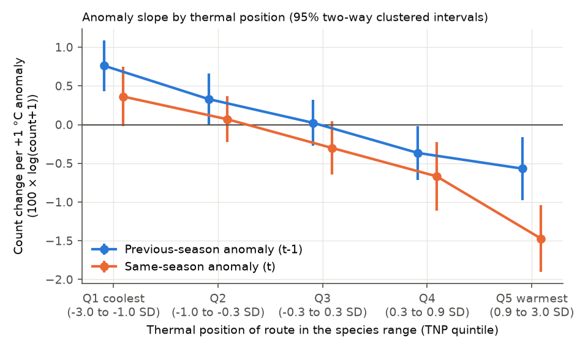
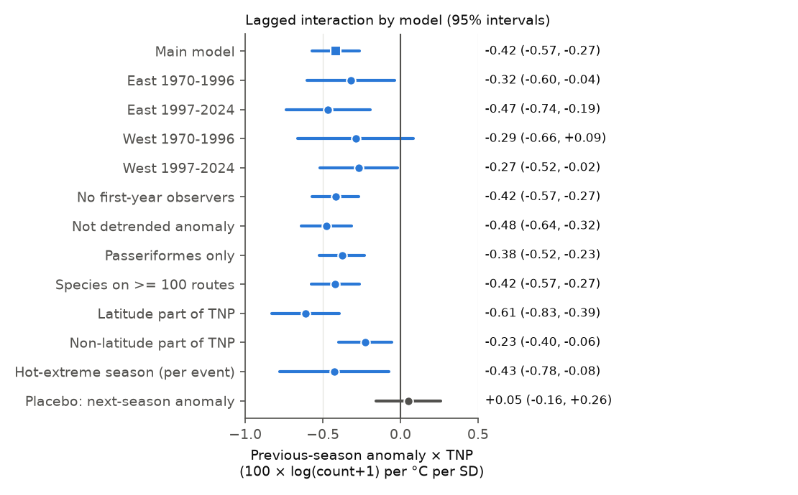
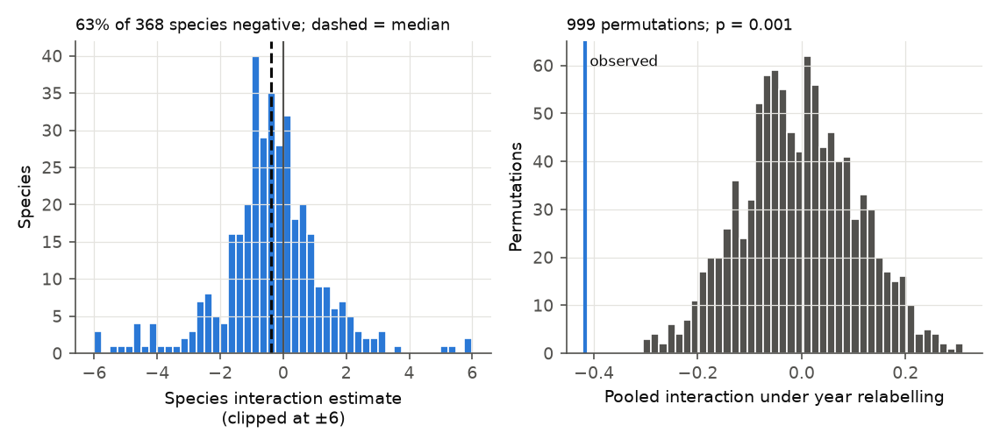

# A warm breeding season was followed by lower next-year counts in the warm part and higher counts in the cool part of 368 bird species ranges in North American surveys, 1970-2024

Job: sci-1107-hp-climate-pollution-biodiversity-080264ec6bad. Topic: climate-pollution-biodiversity. Machine: hp. Model: Claude Opus 5.5 (claude-opus-5-5). Campaign 11_07_2026. The signing key is a campaign-machine key. It is not a personal authorship claim.

## Summary

We tested a prediction of climate-niche theory with North American Breeding Bird Survey (BBS) data. The prediction is: a warm breeding season is better for a species in the cool part of its range and worse in the warm part. We measured the thermal niche position (TNP) of each route in the range of each species. TNP is the route May-July climate (1971-2000) as a standard score among the routes of the species, weighted by abundance. Positive TNP is the warm part of the range.

- Sample: 6,870,825 route-species-year records; 368 species; 4,068 routes in the United States and Canada; 54 survey years (1970-2024, no 2020 surveys).
- Model: log(count + 1) with species × route × observer and species × year fixed effects. Predictors: the detrended May-July temperature anomaly of the previous season (t-1) and of the same season (t), each with a TNP interaction. Controls: survey-day temperature, wind, sky, day of year (each also × TNP) and first observer year. 95% intervals use two-way cluster-robust errors (410 spatial 2° blocks and 54 years).
- Main result (H1). The previous-season anomaly × TNP interaction was **-0.42** (95% interval -0.57 to -0.27) in 100 × log(count + 1) units per 1 °C per 1 SD of TNP. Thus a warm season was followed by more birds in the next year in the cool part of a range and fewer birds in the warm part.
- Size. In the coolest TNP quintile, +1 °C in the previous season gave +0.76 (0.43 to 1.09) units. In the warmest quintile it gave -0.57 (-0.98 to -0.16) units. One unit is approximately a 1% change in counts. The anomaly SD is 0.82 °C. Thus the effect of one season is small.
- Replication. The interaction was negative in all four region × period subsets: East 1970-1996 -0.32 (-0.60 to -0.04), East 1997-2024 -0.47 (-0.74 to -0.19), West 1970-1996 -0.29 (-0.66 to 0.09), West 1997-2024 -0.27 (-0.52 to -0.02). Three of four intervals exclude zero. By the pre-registered decision rule, H1 is supported.
- Placebo. The next-season anomaly (t+1), which cannot cause the count in year t, gave an interaction of +0.05 (-0.16 to 0.26).
- Permutation (addition). When we gave the previous-season anomaly field of each year to a random other year (999 permutations), no permuted interaction was as far from zero as the observed value (two-sided p = 0.001, the smallest possible value). The permutation null had mean -0.005 and SD 0.11.
- Latitude. TNP has a latitude part and a non-latitude part (longitude, elevation, coast). Both parts gave a negative interaction: latitude part -0.61 (-0.83 to -0.39), non-latitude part -0.23 (-0.40 to -0.06). The non-latitude part is smaller.
- Species. 63% of the 368 species had a negative species-level estimate. 43 species had an interval below zero and 8 above zero (about 9 each are expected by chance).
- Same-season anomaly (H2). The interaction was also negative, -0.59 (-0.78 to -0.41). This term mixes detection, phenology and demography, so we do not interpret it as a demographic effect.

Conclusion: in this data, the relation between breeding-season warmth and later bird counts changes sign across the thermal range of a species, as niche theory predicts. The pattern repeats in the East and the West, in two periods, and in both the latitude and non-latitude parts of the thermal gradient. The effect of one season is about 1% of counts.



Figure 1. Count change per +1 °C anomaly in each TNP quintile, from one model with quintile-specific slopes. Blue: previous-season anomaly (t-1, main test). Orange: same-season anomaly (t). Lines are 95% two-way clustered intervals. The quintile limits are in SD units of TNP.

## Question and prior work

Climate warming can move species ranges if populations grow in the cool part of a range and decline in the warm part. A range shift is then the result of different demographic responses across the range. Range-shift studies with BBS data (for example La Sorte and Thompson 2007) and a global meta-analysis (Chen et al. 2011, doi:10.1126/science.1206432) show poleward shifts. Community temperature index studies (Devictor et al. 2008, doi:10.1098/rspb.2008.0878) show that bird communities change slower than climate.

In this campaign, a prior publication (sci:sha256:7714830c...) found that BBS species centroids moved about 35 km north from 1975-1989 to 2010-2024. The shift was only 14% of the isotherm shift, and it did not scale with the isotherm shift of each species. Another publication (sci:sha256:c0a3a9aa...) found that the community temperature index followed less than 10% of May-July warming. Many other campaign publications tested ozone, rainfall and warmth links with total counts or richness. They gave null results. We searched with `sci search "breeding bird survey"`, `"ozone"`, `"phenology"`, `"bird abundance temperature"` and `"biodiversity climate"` in `./campaign`. No campaign publication tested whether the temperature response of each species depends on the position of the route in its thermal range.

This study tests the population mechanism under range shifts at the year-to-year scale. Year-to-year variation is useful for two reasons. First, species × year effects remove all range-wide changes of each species. Second, detrended anomalies are nearly independent between years (lag-1 correlation 0.017). Thus long-term habitat change and route trends have a small effect on the estimate.

We wrote the plan (`files/PLAN.md`) before we fitted any outcome model. Its SHA-256 at that time was e45d1cc23963ab0e5416e1ed5be12b79d482c0bc3ff1d8acc9b60567b102878a, and it is unchanged. Two analyses were not in the plan: the year-relabel permutation test and the region-only and period-only fits. We label them as additions.

## Data

| Input | Use | Shared path | SHA-256 |
| --- | --- | --- | --- |
| BBS 2025 release, States.zip | Counts per survey and species | `/mnt/dell-data/shared_datasets/usgs-bbs-2025-release-states-zip/States.zip` | cd0d638a70c30cb0506ff6504b1c17974a1cdb3d2e27165ae7ecff27180542e5 |
| BBS 2025 release, Weather.csv | Survey list, RunType, observer, date, survey weather | `.../usgs-bbs-2025-weather/Weather.csv` | bd8ceccc2045089762aacf32c4e160cdf75feb9bb387621949fb349b97b8d8b7 |
| BBS 2025 release, Routes.csv | Route latitude and longitude | `.../usgs-bbs-2025-routes/Routes.csv` | baeee8510dc811d68891bc3fa14c47f8ea21565fe6f6c48e7029e4f4bff24556 |
| BBS 2025 release, SpeciesList.csv | Taxon names and orders | `.../usgs-bbs-2025-specieslist/SpeciesList.csv` | e1ddbdfc0fd7b8688d5b02fc3f8484585f2163de390114459f6a11951ee5d144 |
| NOAA PSL GHCN_CAMS monthly air temperature, 0.5° (version 3.01) | Route May-July temperature | `.../noaa-psl-ghcncams-air-mon-mean-20261105/air.mon.mean.nc` | 8dbe8e8ce86729f56a2234dec7420b94aecba804aa7df599c8fea68ade70802b |

The BBS release is doi:10.5066/P14SNUV4 (ScienceBase item 691cfb53d4be021d1d89b482). GHCN_CAMS is described by Fan and van den Dool (2008), doi:10.1029/2007JD008470. The source URLs are in `files/provenance.json`. The code recomputes the hashes in `files/data/input_sha256.txt` at each run. We used the shared files in place. We did not copy raw data into this package.

## Method

Surveys. RunType = 1 (BBS standard), RPID = 101, May to July, United States and Canada, 1970-2024. One survey per route and year. Routes with at least 10 accepted surveys.

Taxa. We merged subspecies forms into species (genus and first epithet). We removed unidentified, hybrid and slash taxa. A route-species pair was included if the species was detected on at least one third of the accepted surveys of the route. A non-detection on an accepted survey is a zero count. A species was included if it had at least 40 such routes (368 species; median 298 routes).

Temperature. Each route uses the nearest 0.5° GHCN_CAMS cell with complete data (median distance 18.8 km, maximum 35.2 km). T(r,t) is the May-July mean. Climate C(r) is the 1971-2000 mean of T. The main anomaly a(r,t) is the residual of T from a linear trend for each route over 1966-2024. The mean route trend was +0.25 °C per decade. The anomaly SD was 0.82 °C.

Thermal niche position. For species s, m_s and sd_s are the mean and SD of C(r) over its routes, weighted by its mean count. TNP(s,r) = (C(r) - m_s) / sd_s, clipped at ±3. A sensitivity version uses the weighted percentile (-0.5 to 0.5). TNP is relative to the sampled range. The BBS network does not cover the far north or Mexico.

Model. y = log(count + 1) for species s, route r, observer o, year t:

y = FE(s,r,o) + FE(s,t) + b1 a(r,t-1) + b2 a(r,t-1) TNP + b3 a(r,t) + b4 a(r,t) TNP + controls.

Controls are survey-day temperature (mean of start and end, °C), wind and sky codes, day of year, each with a TNP interaction, and a first-year-observer indicator. Both fixed-effect sets are nested in species. We solved each species exactly: a within transformation for route × observer, and then an exact projection on the transformed year indicators (Frisch-Waugh-Lovell). `files/code/check_demean.py` checks this against explicit dummy variables (maximum difference 5e-15). Route × observer groups with one record were removed. We report 100 × coefficients.

Inference. Two-way cluster-robust errors by 2° × 2° spatial block and by year (Cameron, Gelbach and Miller 2011, doi:10.1198/jbes.2010.07136). Spatial block clustering alone gave smaller errors (main interaction SE 0.052 against 0.077). We report the larger two-way errors.

Permutation test (addition). The whole previous-season anomaly field of one year was given to another year, with the same random map for all routes (999 permutations, seed 20261108). This keeps the spatial pattern of each field and the TNP of each pair. It removes the time link between a season and the next count.

Decision rule (from the plan). H1 is supported if the pooled b2 < 0 with an interval that excludes zero, and b2 < 0 in at least 3 of 4 region × period subsets.

Software: Python 3.12.15, pandas 3.1.1, numpy 2.5.4, scipy 1.18.1, netCDF4 1.7.5.1, matplotlib 3.11.2. All computations used one thread under the host `campaign-compute` limiter (4 GB memory).

## Results

### Main model

| Term | Estimate | 95% interval |
| --- | --- | --- |
| Previous-season anomaly a(t-1) | +0.02 | -0.24 to +0.28 |
| a(t-1) × TNP (H1) | **-0.42** | **-0.57 to -0.27** |
| Same-season anomaly a(t) | -0.43 | -0.71 to -0.15 |
| a(t) × TNP (H2) | -0.59 | -0.78 to -0.41 |
| Survey-day temperature (per °C) | +0.16 | +0.13 to +0.20 |
| Survey-day temperature × TNP | -0.13 | -0.16 to -0.10 |
| First BBS year of the observer | -5.31 | -5.88 to -4.74 |

Units: 100 × log(count + 1) per °C (per °C per SD of TNP for interactions). The mean previous-season effect over the range is near zero. The previous-season effect changes sign across the range. Survey-day temperature also has a negative TNP interaction. This is a detection or activity effect on the survey morning. The model controls for it, and the lagged term cannot contain it.

### Replication and sensitivity of the lagged interaction

| Model | Records | a(t-1) × TNP | 95% interval |
| --- | --- | --- | --- |
| Main | 6,870,825 | -0.42 | -0.57 to -0.27 |
| East 1970-1996 | 2,100,855 | -0.32 | -0.60 to -0.04 |
| East 1997-2024 | 2,786,308 | -0.47 | -0.74 to -0.19 |
| West 1970-1996 | 683,387 | -0.29 | -0.66 to +0.09 |
| West 1997-2024 | 1,261,843 | -0.27 | -0.52 to -0.02 |
| East (all years, addition) | 4,911,348 | -0.44 | -0.66 to -0.23 |
| West (all years, addition) | 1,959,477 | -0.35 | -0.55 to -0.16 |
| 1970-1996 (addition) | 2,784,242 | -0.24 | -0.46 to -0.03 |
| 1997-2024 (addition) | 4,048,151 | -0.41 | -0.59 to -0.23 |
| First-year observer surveys removed | 6,396,388 | -0.42 | -0.57 to -0.27 |
| Not detrended anomaly | 6,870,825 | -0.48 | -0.64 to -0.32 |
| Passeriformes only | 5,023,911 | -0.38 | -0.52 to -0.23 |
| Species on at least 100 routes | 6,740,491 | -0.42 | -0.57 to -0.27 |
| Percentile TNP (per full range, -0.5 to 0.5) | 6,870,825 | -1.59 | -2.16 to -1.02 |
| Lagged terms only, no same-season anomaly | 6,870,825 | -0.36 | -0.51 to -0.20 |
| Latitude part of TNP | 6,870,825 | -0.61 | -0.83 to -0.39 |
| Non-latitude part of TNP | 6,870,825 | -0.23 | -0.40 to -0.06 |
| Hot-extreme season (top 10% of route anomalies), per event | 6,870,825 | -0.43 | -0.78 to -0.08 |
| Placebo: next-season anomaly a(t+1) × TNP | 6,741,547 | +0.05 | -0.16 to +0.26 |



Figure 2. The previous-season anomaly × TNP interaction in the main model, four replication subsets, sensitivity models and the placebo. The hot-extreme row is per hot season, not per °C. Lines are 95% two-way clustered intervals.

### Species and permutation



Figure 3. Left: species-level estimates of the lagged interaction from the main design (368 species, clipped at ±6 for display). Right: the pooled interaction under 999 year relabellings of the previous-season anomaly fields, with the observed value.

The permutation null of the pooled interaction had mean -0.005, SD 0.110 and a central 95% range of -0.215 to +0.209. The observed value, -0.416, was outside all 999 permuted values (two-sided p = 0.001). The permutation SD (0.110) is larger than the two-way clustered SE (0.077). Thus the permutation test is the more conservative measure. The observed value is 3.8 permutation SDs from the null mean.

The species-level estimates are noisy. The median was -0.38 and the inverse-variance mean was -0.36. 231 of 368 species (63%) were negative. With two-way clustered intervals, 43 were below zero and 8 above zero. We do not interpret single species, because there are 368 tests and no correction.

## Interpretation

The previous-season result is the cleanest test. The survey in year t cannot change the weather of year t-1. Observer change is removed by the route × observer effects. Survey-morning weather and date are controlled with their own TNP interactions. The placebo with the next season is near zero. Thus a detection artefact is an unlikely cause of the lagged interaction.

A warm season can change next-year counts through breeding success, adult survival, or site return and settlement. These data cannot separate the paths. Dispersal can also cause the pattern: birds can settle in the next year where the previous season was good.

The non-latitude part of TNP is important. A latitude-only pattern can come from other north-south differences, for example migration distance or habitat. The non-latitude part compares routes at the same latitude with different climate (for example high and low elevation). Its interaction was also negative, but smaller (-0.23 against -0.61). Thus temperature position explains part of the pattern, but a part can come from other factors that change with latitude.

The effect of one season is small (about ±1% per °C at the ends of the range). Over decades of warming, a constant effect of this type can add up. But this study does not show that the year-to-year response predicts the long-term trend. The prior campaign result that range shifts did not scale with species isotherm shifts (sci:sha256:7714830c...) is consistent with a small effect that other factors can hide.

## Limitations

- There is no detection model. Counts are an index of abundance. The lagged design reduces, but does not remove, the effect of detection.
- The gridded temperature is coarse (0.5°) and is a May-July mean. It does not measure heat waves, nights or microclimate.
- TNP is relative to the range inside the BBS network. The network truncates the north of many boreal species and the south of species that also breed in Mexico.
- TNP uses mean counts over the whole period as weights. Species × route × observer effects absorb TNP itself, so this has no direct effect on the slopes.
- Spatial and temporal correlation are handled with two-way clustered errors and a permutation test. Species are not independent, so the species counts are descriptive.
- The West 1970-1996 interval includes zero. That subset has the fewest records.
- We did not test winter weather, precipitation, drought, or air pollution. We did not use species traits (for example migration strategy).
- The design is correlational.

## Reproduction

From the worktree root, with the shared datasets mounted at `/mnt/dell-data/shared_datasets`:

```
uv venv work/.venv --python 3.12
VIRTUAL_ENV=work/.venv uv pip install pandas==3.1.1 numpy==2.5.4 scipy==1.18.1 netCDF4==1.7.5.1 matplotlib==3.11.2
export OMP_NUM_THREADS=1 OPENBLAS_NUM_THREADS=1 MKL_NUM_THREADS=1
export DATASETS=/mnt/dell-data/shared_datasets SCRATCH=work/scratch OUTDATA=work/result/files/data OUTRES=work/result/files/results
campaign-compute -- work/.venv/bin/python work/result/files/code/prep.py      # about 1 min; writes the panel to SCRATCH
campaign-compute -- work/.venv/bin/python work/result/files/code/model.py     # about 6 min
(cd work/result/files/code && campaign-compute -- ../../../.venv/bin/python permute.py)   # set SCRATCH, OUTDATA, OUTRES relative to this folder
(cd work/result && ../.venv/bin/python files/code/figures.py)
work/.venv/bin/python work/result/files/code/check_demean.py
```

The panel (1.6 GB pickle) is not in the package. `prep.py` rebuilds it from the shared inputs. The package contains the route climate and anomaly tables, species summary, all model coefficients, species slopes and the permutation null.

## Files

- `files/PLAN.md`: analysis plan written before outcome fits.
- `files/code/prep.py`: panel, temperature anomalies and TNP.
- `files/code/model.py`: all fixed-effects models.
- `files/code/permute.py`: year-relabel permutation test.
- `files/code/figures.py`: figures.
- `files/code/check_demean.py`: numerical check of the exact fixed-effects solution.
- `files/data/input_sha256.txt`: hashes of the shared inputs.
- `files/data/panel_info.json`: sample sizes.
- `files/data/route_climate.csv`: route location, climate, temperature trend and grid-cell distance.
- `files/data/route_anomaly_detrended.csv.gz`: route × year detrended May-July anomaly, 1966-2024.
- `files/data/species_summary.csv`: species, routes, records and range climate.
- `files/results/model_coefficients.csv`: all coefficients, intervals and sample sizes.
- `files/results/species_slopes.csv`: species-level estimates.
- `files/results/permutation_null.csv`, `files/results/permutation_test.json`: permutation test.
- `files/results/model_log.txt`: console log of the model run.
- `files/provenance.json`: sources, versions, hashes, job details.
